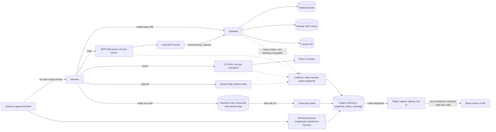
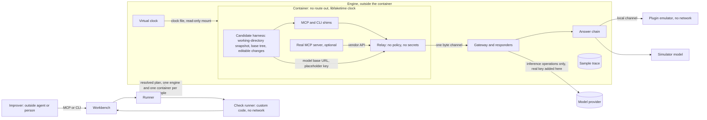

# Phoenix: Architecture

Status: November 15, 2026. Built from SPEC.md.

## 0. The shape

Phoenix is a TypeScript monorepo run with `npx`. For each surface, the person picks the capture routes. **After-the-fact routes** read the harness's own transcripts or session logs once the run is over, and put nothing in the live path. **In-path routes** use a **tap** for MCP over stdio, MCP over Streamable HTTP, CLI commands, direct HTTP calls or the model API. A tap relays traffic unchanged. Through its **tee** it forwards each frame first and only then offers a copy to a per-capture **collector**, using a bounded, non-blocking send. It never waits on the collector, the disk or redaction. When a copy can't be taken, the frame still goes through and the record shows a marked gap. The collector strips secrets and writes one append-only segment per stream. Everything else is kept exactly as it was recorded. By default one launch is one Run. A long-lived server harness marks its tasks by session or thread id, or with a marker call. The working directory is snapshotted at the start of each run, beside the harness and never ahead of it. A **Moment** is a directory of plain files (manifest, success check, lock, data) that can sit in git. The setup step fills in whatever the chosen routes missed, and tags each filled answer derived or synthesized. A person approves the check, and the approval is recorded in a ledger outside every workspace that the Workbench can't write. A Replay can start at the beginning, at the mark, or at any point between. Everything before the start point is imposed from the recording and checked against it, and the run stops loudly on the first difference. From the start point on, the backend is a responder driven by the **answer chain**, which works in the spec's order: recording, overlay, emulator, capture-time reads, simulator, divergence. A recorded answer is used only while the Replay's writes on that connector match the writes the original run had made at that point. A Replay runs a frozen candidate (the captured working directory plus the base harness tree plus only the edits made to editable paths) in a container. The container has no route out, one byte channel to the Phoenix **engine**, and a clock faked by libfaketime. The engine holds the recording, the trace, the check and the real model credential, and none of them is inside the container. Samples per moment start at 2, with a 3rd when the first two disagree. A pass that rests on synthesized answers is discounted and counts for nothing until it is confirmed. The Workbench is a thin API over the runner, exposed as an MCP server and a matching CLI, and it has no code that can write a success check or the ledger. Every language-neutral format is a versioned JSON Schema. Plugins and recipes are separate processes or data files, so the core works with none installed.

## 1. Runtime picture

**Capture (live, beside the harness, no container):**



Dotted arrows are copies. Nothing on the forwarding side waits for them, and a copy that can't be sent is dropped and counted. The launcher, the collector, the gateway, each proxy and each shim is its own process. The collector is restarted by the launcher if it dies. Every recorded stream has one writer. After-the-fact routes and the plugin sidecar touch only files and their own connections.

**Replay (inside the Workbench):**



In a Replay the engine is the only controlled path out of the container. The candidate can reach the engine's listeners and nothing else. Phoenix has no long-running hosted service. All state is files, and any `phoenix` process can pick up work another one left unfinished.

## 2. Units

| Unit | Language | Owns | May depend on | Must never depend on |
|---|---|---|---|---|
| `spec` | JSON Schema, Markdown | Versioned definitions of the trace, working-directory snapshot, moment manifest, fills, success check, lock, approvals ledger, harness contract, bindings, plugin descriptor, recipe descriptor, replay plan and replay result | nothing | any code |
| `formats` | TypeScript | Types generated from `spec`, validators, version checks | `spec` | every other unit |
| `store` | TypeScript | Capture directories: segment writer, blob store and spool, merged reader with run and task attribution, crash recovery. Moment bundle reader and writer. Reading the approvals ledger | `formats` | taps, answer, engine, workbench |
| `redact` | TypeScript | Pure secret stripping for capture and pure personal-data scrubbing for packing | `formats` | I/O of any kind |
| `wire` | TypeScript | Pure codecs: MCP framing for both protocol eras; CLI invocation records; HTTP exchanges; model-API dialects (inference-operation lists, splitting a request into history and configuration, tool-use ids); call keys; write histories; format inference; the mechanical fill derivations | `formats` | I/O of any kind |
| `taps` | TypeScript | One listener per surface, each given a `Backend` | `wire`, `formats` | `capture`, `answer`, any knowledge of live versus replay |
| `capture` | TypeScript | Launcher, collector, upstream backends, the tee, working-directory snapshotter, task markers, recipe application, flag and correction commands, plugin capture host | `taps`, `store`, `redact`, `plugin-host`, `formats` | `answer`, `engine`, `runner`, `workbench`, `checks`, `approvals` |
| `transcripts` | TypeScript | Runs recipe transcript readers and `phoenix record`, validates their events, strips secrets, writes import segments | `store`, `redact`, `formats` | `taps`, `capture`, `answer`, `engine` |
| `model` | TypeScript | `ModelProvider` port and its adapters, used by the simulator, gap filling and check drafting | `formats` | everything else |
| `answer` | TypeScript | Answer chain, matcher, write histories, entity overlay, prefetch and simulator resolvers, divergence | `wire`, `store`, `plugin-host`, `model`, `formats` | `taps`, `sandbox`, `workbench`, any live vendor client |
| `engine` | TypeScript | Replay-side server: taps wired to responders over the answer chain, frozen-prefix model responder, model route, virtual clock, sample trace | `taps`, `answer`, `store`, `redact`, `formats` | `workbench`, `setup` |
| `sandbox` | TypeScript, shell | `Sandbox` port, container driver, the relay, the clock file and probe | `formats` | everything else |
| `checks` | TypeScript | Deterministic expectation evaluators, custom-check host, taint, sample and moment verdicts, discount confirmation | `store`, `wire`, `sandbox`, `formats` | `engine`, `workbench`, `setup` |
| `fidelity` | TypeScript | Tier and grade rules and the fidelity report, all computed from a trace | `store`, `wire`, `formats` | `engine`, `workbench` |
| `runner` | TypeScript | Resolves a replay plan, runs and resumes samples, applies the sample rule, reuses baselines, records results | `engine`, `sandbox`, `checks`, `fidelity`, `store`, `formats` | `workbench`, `setup`, `approvals` |
| `approvals` | TypeScript | The only functions that append to the approvals ledger: check approval and auto-lock, moment acceptance, pass acceptance | `store`, `formats` | `workbench`, `runner`, `engine`, any network |
| `setup` | TypeScript | Turns a mark or a Scenario into a moment bundle: finds connectors, fills gaps, classifies operations, picks tiers, drafts the check, locks it through `approvals`. Also builds packed revisions for sharing | `store`, `wire`, `redact`, `plugin-host`, `model`, `approvals`, `formats` | `workbench`, `runner` |
| `workbench` | TypeScript | `WorkbenchApi`, its MCP server and CLI, workspaces, candidate freezing, patch and pull-request output | `runner`, `store`, `checks`, `fidelity`, `formats` | `setup`, `approvals`, any code that writes a check or the ledger |
| `plugin-host` | TypeScript | Finds plugin descriptors, starts plugin processes, speaks the plugin protocol | `sandbox`, `formats` | any specific plugin |
| `plugin-kit` | TypeScript | The connector test kit: runs recorded exchanges through a plugin and reports differences | `plugin-host`, `store`, `wire`, `formats` | `workbench` |
| `cli` | TypeScript | The `phoenix` binary, and the only place units are wired together | all units | nothing barred |
| `recipes/*` | YAML, optional scripts in any language | Capture recipes for Claude Code, Codex, pi, fx, Ozi and a generic one, including their transcript readers | `spec` | core internals |
| `plugins/*` | any | Connector plugins, each separately installed | `spec` | core internals |
| `reference-harness` | TypeScript | The small from-scratch harness | the harness contract in `spec`, the official MCP client SDK | every Phoenix package |

`redact`, `wire`, the matcher in `answer`, and the evaluators in `checks` and `fidelity` are pure functions over files. Each can be checked by feeding it a recorded trace, with no vendor and no container running.

## 3. Core pieces

### 3.1 Taps, links and backends

A tap owns one surface's transport and nothing else. It knows where a message starts and ends, not what it means.

```ts
interface Frame {
  dir: "out" | "back";     // out: harness toward tool; back: tool toward harness
  stream: number;          // one message or body within the connection
  bytes: Uint8Array;
  last: boolean;           // this frame completes a message
  at: bigint;              // host monotonic clock when seen
}
interface Link {
  write(f: Frame): Promise<void>;
  frames(): AsyncIterable<Frame>;
  abort(why: string): void;
}
interface Backend {
  open(conn: { surface: Surface; connector: string; meta: unknown }): Link;
}
```

A link is two-way and long-lived, so every protocol pattern fits without a special case. On stdio that means JSON-RPC lines in both directions. On Streamable HTTP it means a POST and its request-scoped SSE stream. For MCP revisions up to 2025-11-25 it also covers the session header, the standalone GET stream, server-initiated requests, cancellation and `Last-Event-ID` resumption ([2025-11-25 transports](https://modelcontextprotocol.io/specification/2025-11-25/basic/transports)). The 2026-07-28 revision removes the handshake, sessions and resumability. It carries the protocol version in each request's `_meta`, adds `server/discover`, delivers change notifications on a `subscriptions/listen` stream, and replaces server-initiated requests with `input_required` results that the client retries ([2026-07-28 changelog](https://modelcontextprotocol.io/specification/2026-07-28/changelog), [transports](https://modelcontextprotocol.io/specification/2026-07-28/basic/transports)). Both eras are just frames on streams.

There are four taps:

- **MCP stdio.** A process that sits where the server command used to be and relays newline-delimited JSON-RPC both ways. Some clients probe a stdio server by launching a disposable second copy ([SDK guide](https://ts.sdk.modelcontextprotocol.io/v2/migration/support-2026-07-28.html)). When that happens, a second proxy relays to a second server process.
- **MCP Streamable HTTP.** A reverse route in the gateway (`/mcp/<name>`).
- **CLI.** A shim placed first on `PATH` for each command the recipe names. It carries these things:
  - argv as an array, never a joined shell string;
  - the working directory and an allow-listed slice of the environment;
  - stdin, stdout and stderr;
  - the exit code or signal.

  Each descriptor gets a pseudoterminal only if the shim's own descriptor is a terminal, along with the terminal size, resize events and forwarded signals. Otherwise it gets a pipe.
- **HTTP gateway.** One listener with three entry modes. In reverse mode the harness's base URL points at it. In forward-proxy mode it is set through `HTTPS_PROXY` with a local CA. Transparent mode exists only inside the container. The gateway serves the model API, direct API calls, and vendor traffic from a real MCP server.

Every tap keeps these rules:

1. A tap never rewrites a message, never answers one itself, never decodes a body, and never adds a request of its own (no discovery probe, no protocol upgrade, no change to the tool list). Meaning is decoded later from the recorded copy by `wire`.
2. A tap does not know whether it is live or in a replay. That depends only on the backend it was given.
3. In Capture, the only recording work on a tap's path is the tee's non-blocking copy (section 3.2). A tap never awaits anything to do with recording.
4. Agent-level traffic and the traffic underneath it are kept apart. An HTTP request made by a local MCP server is recorded with `layer: "under"`. If exactly one `tools/call` is in flight on that server, the request is linked to it with `parent_basis: "sole-in-flight"`, which marks the link as an inference, not proof. If no single call can be named, the parent is left empty. No check depends on these links.

### 3.2 Capture

Capture routes are the person's choice, set for each surface through the recipe's options. They come in two kinds, and a person can combine them:

- **In-path routes**: the MCP proxy, the CLI proxy, and the gateway for model-API recording and direct API calls. Each one is a tap.
- **After-the-fact routes**: the harness's own transcripts or session logs, and any script that writes trace events (section 3.3). Nothing is in the live path.

Every event records the route it came from. Whatever the chosen routes didn't capture is filled in later by the setup step, and each filled answer is tagged derived or synthesized (section 3.6).

`phoenix capture [--routes <list>] -- <harness command>` is the launcher. It does these things in order:

1. It creates the capture directory and starts the collector as a supervised child.
2. It applies the capture recipe as an overlay for the in-path routes that were chosen. The overlay uses environment variables, command-line config overrides, or a generated copy of a config file, so the person's own files are never edited.
3. If a chosen route needs the gateway, it starts the gateway on a loopback port as a supervised child.
4. It runs the harness with its stdio inherited, forwards signals to it, and starts the working-directory snapshotter beside it.
5. When the harness exits, it closes the capture, exits with the harness's exit code, and runs the transcript reader if that route was chosen.

`PHOENIX_CAPTURE`, `PHOENIX_COLLECTOR` and `PHOENIX_HOME` reach every proxy and shim through the inherited environment. If the launcher itself dies, the harness and its routes keep running, and the capture ends with no `close`. The harness never depends on the launcher staying up. With only after-the-fact routes chosen, the launcher puts nothing between the harness and anything it talks to. Its only jobs are the working-directory snapshot and reading the transcript at the end.

- **MCP proxy.** The recipe rewrites each stdio server entry to `phoenix mcp-proxy -- <original command>` and each remote entry to the gateway's `/mcp/<name>` route. The server itself is untouched. The trace holds every message in both directions, every tool list seen (including later changes), and the protocol version actually used. On older servers that version comes from the `initialize` result. On current servers it comes from per-request `_meta` and `server/discover`. A `server/discover` sent only as a compatibility probe is recorded as a probe.
- **Remote MCP and OAuth.** Authorization is bound to the server's own resource URL ([authorization](https://modelcontextprotocol.io/specification/2026-07-28/basic/authorization)). A reverse route is used only where its authorization behavior stays valid. Otherwise the recipe uses forward-proxy mode, which keeps the original URL. Phoenix never weakens token validation to make interception work.
- **CLI proxy.** The shim starts the real binary from the rest of `PATH` first, then relays and copies. When the binary exits, the shim exits at once with the same code, or re-raises the same signal. It never waits for its copies to finish sending. A command invoked by absolute path or as a shell built-in doesn't pass through a shim, and the coverage record says so. A recorded command response doesn't record the local files that command wrote.
- **Model-API recording.** In reverse mode the gateway forwards to the real provider and records the full request and the full streamed response in the provider's own format. They are not converted into a common chat format. Every tool result the model was shown crosses this boundary in some request. That makes this record the evidence of what the model saw from tools nobody proxied, and a second witness for tools that were proxied. It is not evidence of side effects the harness never reported. Some dialects let the provider hold the conversation, so later requests carry only new items ([OpenAI conversation state](https://developers.openai.com/api/docs/guides/conversation-state)). In that case the trace still holds every item that was sent, and the coverage record notes that the provider held the history.
- **Direct API calls.** Forward-proxy mode records these. The calling process must trust the local CA, so recipes turn this mode on only where that is known to work. The same mode, set in a local MCP server's environment, records the vendor traffic underneath the server.
- **A login mode whose model endpoint can't be changed.** The recipe covers it with another route. It can use the forward proxy where the binary accepts the CA, or the transcript route, which reads what the harness logged of its model exchanges. The coverage record names the route that was used.
- **Plugin capture.** This is opt-in per connector and off by default. A connector plugin may declare a `capture` command, which the capture host runs as a sidecar.
  - The sidecar reads that connector's recorded events from the capture's segment files and never sits on a tap.
  - It asks for read-only calls over objects the agent saw. The host runs them on a **separate connection** to the same server or API: its own server process started from the same command for stdio, or its own requests for a remote server, with authorization the person grants when turning it on. The calls never share the agent's connection, its request ids or its session.
  - The host refuses any tool the plugin didn't declare read-only. Server tool annotations are never enough, because MCP says clients must treat them as untrusted ([tools](https://modelcontextprotocol.io/specification/2026-07-28/server/tools)).
  - Results are written as `prefetch` events with their own timestamps and are never sent to the harness.
  - The sidecar ends by writing a coverage statement: which collections it read completely, and over what span of time.
- **Flagging.** `phoenix flag "<reason>"` writes a mark to the current run. An opt-in one-tool MCP server does the same for harnesses that prefer a tool. Neither is added unless the person adds it, so default Capture never changes what the agent sees.
- **Corrections.** `phoenix correct <run> --at <event> "<text>" [--one-off]` appends a Correction to the capture's notes, either during the run or afterward. Corrections are entered only through this command.
- **Coverage record.** When a stream connects, the collector appends a line to `coverage.jsonl` giving the route, surface, server or command, and entry mode. Coverage therefore survives a capture that never closes cleanly. At close, the launcher adds the surfaces that were configured but saw no traffic, and what the taps can't see.

#### Runs and task boundaries

By default, one launch through `phoenix capture` is one Run. For a long-lived server harness that handles many tasks in one process, the recipe declares how tasks are told apart, using either or both of these:

- **A task key on the wire.** This is a session or thread id at a location the recipe names: an HTTP header, a field in a request's `_meta`, or a JSON path in model requests. MCP's own session header exists only before the 2026-07-28 revision, so a recipe doesn't rely on it alone.
- **A marker call.** The harness runs `phoenix task start <key> [--cwd <dir>]` and `phoenix task end <key>`, or writes the same events through `phoenix record`. A marker command hands its event to the collector and exits at once with status 0. If the collector can't be reached, the command appends the event directly to the capture's notes. It never fails the harness.

Runs are a view that the trace reader computes. Nothing is split at capture time. Each event is attributed to a task in this order:

1. its own task key;
2. for a tool call, the task of the model exchange whose tool-use block it pairs with;
3. the only task open at that moment.

An event that none of these places stays **unattributed**. The run's coverage lists it, and it is never guessed into a run.

#### Working directory

At the start of each run, the snapshotter records the harness's working directory: the launch directory, or the directory a `task start` marker names. It runs beside the harness at lowered CPU and I/O priority and never ahead of it, so the harness doesn't wait for it.

- In a git repository, it first records HEAD's commit. It then reads that commit's tree from git's object store into the blob store. The objects don't change, so this copy is exact whenever it finishes. It also copies the files that differ from HEAD and the untracked files git doesn't ignore ([git-status](https://git-scm.com/docs/git-status), [git-ls-files](https://git-scm.com/docs/git-ls-files)).
- Outside git, it copies every file.
- Files git ignores are listed by path, size and modification time, without content, by default. Copying them is an opt-in, set per capture (`phoenix capture --copy-ignored` or the recipe's option of the same name) or per moment (`include_ignored` in `moment.yaml`). A capture that copied them stores them like any other copied file, secrets stripped. A moment includes them only when its own opt-in is set, or when the capture's was and the moment doesn't turn it off. A moment can only include ignored files its capture copied.
- A copied file whose change time is later than the run's start, or that changes while it is being read, is stored as `uncertain`. Its content is what the snapshotter read, not provably what was there at the start.

Secrets are stripped from copied files by the same rules as traffic. The result is a content-addressed tree plus a `workdir/<run>.json` manifest. A snapshot that can't finish is marked incomplete, with the paths it didn't read.

#### The tee

In Capture, a backend is the real upstream wrapped in a tee. For each frame, the tee does two things in this order:

1. It forwards the frame to the other side at once.
2. It then offers a copy to the collector, but only if the tap's send buffer to the collector is under its configured bound. Otherwise the copy is dropped and counted.

The tee never awaits the collector, a disk write or redaction. The copy code runs after the forward, inside a guard. If it throws for any reason, the guard turns recording off for that tap and leaves the relay running.

Each tap numbers every message it sees, before offering the copy. After a drop, the next copy that gets through carries the dropped sequence range and byte count, so the gap describes itself once sending resumes. If sending never resumes, the hole in the sequence and the missing `close` still show the gap. A message that lost any frame is recorded as a gap for that message, with the frames that did arrive marked partial. It is never recorded as a complete message.

Pressure on the recording side stops at the tee. A slow disk or a busy redactor makes the collector stop reading its sockets. The kernel buffers then fill, and the tap's own buffer reaches its bound. From there on, copies are dropped and the forwarded traffic is untouched.

#### Collector and recording path

The collector is one process per capture, supervised by the launcher. Taps connect to it over a Unix socket. For each tap stream, a worker thread reassembles messages from frames, strips secrets from each whole message, and appends it to that stream's own segment file (`seg/<stream>.<generation>.jsonl`). No buffering sits in between. The worker keeps calling `write` until every byte is accepted, because one call may take fewer bytes than asked ([write(2)](https://man7.org/linux/man-pages/man2/write.2.html)). After each batch, the worker syncs the file continuously, so a power loss can take at most the batch in flight. Node's `fs.fsync` is enough on every platform, because libuv issues `F_FULLFSYNC` on macOS itself ([libuv `fs.c`](https://github.com/libuv/libuv/blob/v1.x/src/unix/fs.c)).

Streamed bodies are spooled as they pass. Bytes go into a temporary blob, with each chunk's arrival time, once they are behind the secret scanner's look-behind window. When the body ends, three steps happen before any event refers to the blob: it is synced, renamed to its content hash, and its directory is synced. The directory needs its own sync, as [fsync(2)](https://man7.org/linux/man-pages/man2/fsync.2.html) explains.

The collector recovers by itself in three cases:

- **A write fails** (disk full, permission, I/O). The collector drops and counts what it can't write. It retries on a new segment generation on a timer, and writes a `gap` event when writing works again.
- **The collector dies.** The launcher restarts it on the same socket path. Taps drop copies while they are disconnected and reconnect on a timer that runs off the forwarding path. Each stream starts a new segment generation, and the reconnect carries the tap's drop counts.
- **A tap starts before the collector is ready.** The tap buffers up to its bound and then drops, exactly as above.

#### Redaction at capture

Private local captures keep the raw data exactly as recorded, with one exception: secrets are always stripped. The collector, the transcript importer and the working-directory snapshotter all apply the same pure policy before anything reaches disk:

```ts
stripSecrets(msg: WireMessage, policy: SecretPolicy):
  { msg: WireMessage; changes: { at: string; rule: string }[]; unscanned: string[] }
```

The policy strips four things:

- auth headers (`Authorization`, `Proxy-Authorization`, `Cookie`, `Set-Cookie`, `x-api-key` and similar);
- credentials in URLs;
- values under keys whose names mark them as secret;
- values that match secret patterns.

Nothing else is changed. Personal data and media are kept as they are.

A replaced value becomes a typed placeholder derived from an HMAC of the original, under a key that stays in `PHOENIX_HOME`. The same secret always maps to the same placeholder, so replay matching still works. The scan runs over the whole assembled message. On a streamed body it uses a look-behind window, so a secret split across network chunks is still caught. Bodies with a standard content encoding (gzip, deflate, br, zstd) are decoded for scanning. When no secret is found, the bytes are stored as received. When a secret has to be replaced inside an encoded body, the body is stored decoded with the replacement, the original encoding is noted, and a Replay re-encodes it. A body the scanner can't read is stored as received and marked `secrets: unscanned`. Packing never includes it. Each change is recorded with its location and rule. Phoenix writes no raw payload to its own logs or crash output.

#### What Capture guarantees

1. Capture never slows, blocks or stops the agent. No call waits on recording. The only recording work on the path is one bounded, non-blocking copy per frame, made after the frame has been forwarded.
2. When recording falls behind or fails, copies are dropped, the agent carries on, and the record shows a clearly marked gap: the dropped sequence range when sending resumes, and a sequence hole or missing `close` when it doesn't.
3. Recording recovers on its own. A failed write retries on a new segment, and a dead collector is restarted, with its taps reconnecting.
4. If the machine loses power or the kernel crashes, the collector can lose the batch it had written but not yet synced. Everything synced before that is intact.
5. Each segment file has exactly one writer. Streams share no locks.
6. A dropped upstream connection gives an `aborted` result with the bytes received. Phoenix never retries a live call.
7. An in-path route is itself a relay. If a proxy, shim or gateway process dies, that connection fails the way it would if the server had crashed. After-the-fact routes have no such exposure.

### 3.3 After-the-fact routes

A capture recipe can name a **transcript reader**. This is a command in any language that reads the harness's own thread transcripts or session logs and writes trace events on stdout. For example, Claude Code keeps one JSONL transcript per session ([sessions](https://code.claude.com/docs/en/sessions#where-transcripts-are-stored)), and pi documents its JSONL session format ([session format](https://pi.dev/docs/latest/session-format)). It runs only after the fact. Either the launcher runs it when the harness exits, or the person runs `phoenix import --recipe <name> <path>` at any later time, including for runs that never went through `phoenix capture`. `phoenix record` accepts the same events from any script on stdin.

`transcripts` keeps these rules:

- Every event is validated against the trace schema, has its secrets stripped, carries `route: transcript` or `route: import`, and goes into its own import segment, keyed by the reader and the digest of the source file. Re-importing the same file replaces nothing and adds nothing new.
- A reader maps only what the log contains. For each event it marks which fields came verbatim from the log, and it never fills anything in. Filling is the setup step's job, and it is tagged there.
- The reader writes a coverage statement saying what its log format carries and what it lacks, such as raw wire bytes, tool lists, protocol version, timings or the system prompt.
- Transcript formats are a harness's own and can change between versions. A reader states which harness versions it was written for. A record type it doesn't recognize is listed as unread and never dropped silently.
- Transcript times are wall-clock times, not the host monotonic clock. When a run combines transcript events with tap events, the reader orders events across the two clock domains by wall time and marks that order approximate. Where the same exchange arrived by both routes, matched by tool-use id or call content, the wire record is used and any disagreement goes into the fidelity report.

### 3.4 Trace store

A capture is a directory, whether it came from a live launch, an import or a Replay sample:

```
captures/<capture-id>/
  capture.json          written once: harness name and tree digest, recipe and version, routes, task-key rule, start time, host boot id
  coverage.jsonl        one line per stream or reader as it starts, plus the launcher's summary at close
  seg/<stream>.<gen>.jsonl   one append-only file per stream and generation, ending with a close event
  import/<reader>.<digest>.jsonl   events from after-the-fact routes
  notes.jsonl           marks, task markers and Corrections, append-only
  workdir/<run>.json    working-directory snapshot manifests
  blobs/sha256/..       bodies above a size threshold and snapshot files, named by the hash of the stored bytes
  blobs/tmp/..          spools of bodies still streaming
```

A Run is a capture id plus a task key. The task key is empty when the capture is one Run.

```ts
interface TraceWriter { append(e: TraceEvent): "queued" | "dropped"; close(): Promise<void>; }
interface TraceReader {
  runs(capture: CaptureId): RunSummary[];          // computed from task keys and markers
  events(run: RunRef, from?: EventId): AsyncIterable<TraceEvent>;
}
```

The reader merges segments by monotonic timestamp, then stream id, then sequence number. All the taps of a capture are processes on one host reading one monotonic clock, so the merged order is the order in which the taps saw the traffic. Import events are placed as described in section 3.3. The reader handles damage this way:

- A final line that doesn't parse is dropped and reported as torn.
- A line that fails validation anywhere else is reported as corruption, never skipped silently.
- Sequence holes, drop ranges, segments with no `close` and incomplete snapshots are reported as gaps.
- An orphaned spool is attached to its call as a partial body.
- Unattributed events are reported for the capture.

Reading needs no index and no database, and a capture can be read while it is still being written. Capture directories are private and are never published. Only packed moment bundles are shared.

### 3.5 Harness contract, recipes, bindings and the reference harness

The **harness contract** (`phoenix.harness.yaml` in the harness repository) declares the three things the spec names: how to run the harness, where its MCP servers and model API are configured, and which files are editable.

```yaml
phoenix_harness: 1
name: my-harness
run:      { command: [node, dist/main.js, --task-file, "{task_file}"], output: stdout,
            build: [npm, run, build], image: { dockerfile: Dockerfile } }
# a long-lived server harness gives serve and submit in place of command:
# run:    { serve: [node, dist/server.js], ready: { http: "GET /health" },
#           submit: { http: { method: POST, path: /tasks, body: "{task_json}" } },
#           build: [npm, run, build], image: { dockerfile: Dockerfile } }
endpoints:
  model:  { env: ANTHROPIC_BASE_URL, dialect: anthropic-messages }
  mcp:    { file: .mcp.json, format: mcpServers }
editable: ["prompts/**", "tools/*.json", "config/model.yaml"]
```

`run.image` and `run.build` are part of "how to run it" when the harness runs in a Replay. The image is built from the base tree, and `build` runs inside the container on the candidate. A server harness's task ends at its `task end` marker or the session end its recipe declares. A harness contract whose editable globs match any path inside a moment bundle is refused.

A **capture recipe** (`recipe.yaml`, optionally with scripts) says how to point one harness at Phoenix without editing the person's config. It declares:

- the harness versions and login modes it covers;
- for each version and login mode, the routes it offers for each surface;
- the model base-URL setting and dialect;
- where MCP servers are configured and in which format;
- which CLI commands to shim;
- an optional transcript reader;
- the task-key locations for a server harness;
- a sandbox image;
- the clock probe command for the harness's runtime (section 3.10).

Recipes aim to cover every login mode of their harness. Where a login mode pins the model endpoint, the recipe offers the forward proxy where the binary accepts the CA, and the transcript route otherwise. A recipe never switches the harness to a different provider or billing route than the person chose.

The first recipes rely on these documented settings:

- Claude Code reads `ANTHROPIC_BASE_URL` and MCP entries from `.mcp.json` ([gateway](https://code.claude.com/docs/en/llm-gateway-connect), [MCP](https://code.claude.com/docs/en/mcp)).
- Codex takes a custom `model_providers` entry and `mcp_servers` in `config.toml` ([config](https://learn.chatgpt.com/docs/config-file/config-advanced)).
- pi takes a provider `baseUrl` in `models.json` ([docs](https://pi.dev/docs/latest/models-configuration)) and writes JSONL sessions ([sessions](https://pi.dev/docs/latest/sessions)).
- fx takes named custom connections ([docs](https://fx.sh/docs/configure-fx/custom-model-connections)).
- The Ozi recipe is written against Ozi's own configuration files.

**Bindings** (`bindings.yaml` beside a moment set, optional) join a moment's logical connector names to this harness's own config entries, and say how each one is served. For example, `calendar: { mcp_server: google-calendar, serve: recorded }`, or `serve: real` to run the real server over replayed vendor traffic. With no bindings file, a connector binds to the MCP server or command of the same name. Bindings let a shared moment run under someone else's harness without touching the locked bundle.

The **reference harness** is a small TypeScript harness with one model, a few MCP tools and a few CLI tools, its own `phoenix.harness.yaml`, and no import of any Phoenix package. It has no session or resume feature, and it replays from any start point like any other harness.

### 3.6 Moments and the setup step

A Moment is a bundle directory with these parts:

- `moment.yaml`, `check.yaml` and `moment.lock.json`;
- `data/`, which includes `data/workdir/` and `data/fills/`;
- `checks/`, when the check has custom code.

It never holds harness, tool or plugin code. The one executable thing it may hold is the custom check, which the manifest names as executable and which runs only in the check sandbox (section 3.12).

A **mark** is a cut in a run's merged order, named by an event id. A **start point** is any cut from the beginning of the run up to the mark. The **frozen prefix** of a Replay is every exchange whose result was complete before its start point. A call that was open at the cut (request before, result after) is not frozen. Its recorded result belongs to the continuation, because the harness hadn't yet received it. The bundle keeps the run's evidence whole and in run order, so the split is made per Replay from the start point the Replay asks for. A run can be a live capture, an imported transcript, a Replay sample's trace, or a staged run written by hand, and any of them can be marked.

`setup` builds a bundle in fixed steps. Each step is a function from files to files:

1. **Locate.** Take a mark (flagged or picked) in a run, or a Scenario description.
2. **Find connectors.** Group the run's agent-level events by connector, surface and route.
3. **Collect the Snapshot.** Copy the run's evidence for each connector and for the model, in run order. Each recorded exchange keeps its position, its observed-at time, the call it came from, its route, and its **write history**: the ordered keys of the non-read-only calls that had completed on that connector before it. Capture-time observations (plugin state and prefetch results) are kept as a separate part. The run's working-directory snapshot is materialized into `data/workdir/` as a manifest of path hashes. The blobs are shared with the capture store on this machine and copied in only at packing. Setup also records:
   - the prompt;
   - the model identifier as the provider reported it, with an alias recorded as an alias;
   - the clock time and timezone;
   - the working directory's path, commit, and its uncertain, ignored and unread paths, and whether copied ignored files are included;
   - the harness tree digest, and the git commit when there is one;
   - the recipe version and the tool lists;
   - the MCP protocol version and era.

   Setup uses only what was captured. It never queries a vendor's present state.
4. **Fill gaps.** Setup lists what a Replay of this run needs and the chosen routes didn't capture. Examples are an MCP result envelope for a tool whose result only a transcript holds, a provider-format model response for the frozen prefix, a tool list, or a protocol version. Each item is filled in this order:
   1. A mechanical derivation in `wire` where a rule exists. For example, a `tools/call` result built from the result text in a transcript or a model request, or a tool list built from the tool definitions in a recorded model request. These are tagged `derived`, with the rule's name and the evidence location.
   2. Otherwise, the setup agent, a model behind the `ModelProvider` port that reads the trace, the transcripts, the harness files and any docs the person names, writes the item. Its fill is tagged `derived` only when every value in it appears verbatim in evidence it cites, and setup checks that mechanically. Otherwise it is tagged `synthesized`.
   3. An item nobody can fill stays missing. A Replay that needs it reports a divergence.

   Fills are stored in `data/fills/`, apart from captured evidence, each with its tag, basis and producer. They are listed when the person approves the moment.
5. **Classify operations.** For each connector, write down which operations are read-only and where that came from. The plugin's declaration comes first. Without one, the server's own annotations and HTTP safe methods ([RFC 9110 §9.2.1](https://www.rfc-editor.org/rfc/rfc9110#section-9.2.1)) are used and marked `unverified`. Without either, the list is empty and every operation counts as a write. This classification is part of what the person approves.
6. **Pick tiers.** A connector's tier can be no higher than its plugin declares and no higher than its coverage statement supports. It is `stateful` only when the collections its tools read were captured completely, and `recorded` otherwise. A connector with no plugin is `recorded`. A connector whose answers include synthesized fills is `synthesized` wherever those fills answer.
7. **Infer formats.** Build a JSON Schema for each tool from its recorded responses, and note where a declared `outputSchema` disagrees with what was recorded. `outputSchema` is optional in MCP, and plain text is never treated as JSON.
8. **Draft the check.** The draft is a file, `check.draft.yaml`. `phoenix check draft` writes it through the `ModelProvider` port by reading the trace, the harness files and any docs the person names. It starts from the Correction, if there is one that isn't marked one-off, and proposes `samples: { base: 2, tiebreak: 1 }`. The person, or an agent of theirs working outside the Workbench, may write or edit the same file.
9. **Lock.** `phoenix check approve <moment>` shows the draft, the operation classification and the fills. On approval, `approvals` writes `check.yaml` and `moment.lock.json`. The lock holds the hashes of the manifest, the check, every custom-check file, every data file and every fill, plus who approved and when. `approvals` also appends the lock's hash to the **approvals ledger**, an append-only file in `PHOENIX_HOME` outside any workspace. For a seeded Scenario, the manifest may set `lock: auto`. That is set per moment, locks without approval, and is recorded in the ledger as such. Changing anything locked makes a new moment revision with a new lock. Results stay attached to the hash they were run against.

The lock file in the bundle is the portable record of an approval. The ledger is the authority on this machine, and the runner runs only bundles whose lock hash is in it. A moment received from someone else carries their lock, which proves the files are intact but not that this person agrees with the check. `phoenix moment accept <moment>` shows the check and records the acceptance in the ledger.

For a Scenario, steps 2 to 4 are replaced by the author's seed files. These can be emulator state in the plugin's state format, hand-written exchanges, an optional seeded working directory, and optionally a **staged run** (hand-written model and tool exchanges as trace events) with a mark in it. The manifest says `source: scenario`, and its data is marked `origin: seeded`, never `captured`. From step 5 on, both kinds are the same bundle and replay the same way.

**Packing for sharing.** `phoenix moment pack <moment>` builds a packed revision:

1. It verifies the bundle against its lock.
2. It scrubs personal data from the manifest, the data, the fills, the working directory and the check's literal values. One placeholder mapping is used per pack, so the same value becomes the same placeholder everywhere, and it recomputes the call keys that depend on scrubbed arguments.
3. It withholds media it can't scan and every body marked `secrets: unscanned`, keeping their size and the reason.
4. It shows the person everything that changed, including any change to the check. The person approves the packed revision through `approvals`, which gives it its own lock and ledger entry.
5. It writes an archive of the packed revision, with no absolute paths and with the blobs copied in, and lists any custom-check file as executable content.

The private revision stays local, and its results stay attached to its own hash. Capture directories are never part of a pack.

### 3.7 Answer chain

The replay layer is an ordered list of resolvers over calls. Each one returns an answer or a reasoned miss, and the chain returns the first answer.

```ts
interface Call {
  surface: "mcp" | "cli" | "http";
  layer: "agent" | "under";
  connector: string;          // logical name, e.g. "calendar"
  op: string;                 // "tools/call:move_event", "gh", "GET api.notion.com/v1/pages/{id}"
  args: unknown;              // normalized arguments
  readOnly: boolean;          // from the locked classification
  raw: WireMessage;
}
interface Answer {
  raw: WireMessage;           // exact bytes to send back, streamable
  provenance: "real" | "recorded" | "derived" | "synthesized";
  resolver: string;
  note?: string;              // e.g. "repeat of last observation", "filled: transcript envelope"
}
type Miss = { miss: true; why: string };
interface Resolver { name: string; resolve(call: Call, ctx: ReplayCtx): Promise<Answer | Miss>; }
```

**Keys.** A call key is the SHA-256 of the canonical JSON ([RFC 8785](https://www.rfc-editor.org/rfc/rfc8785)) of surface, connector, op and normalized arguments. Canonical JSON fixes representation, not meaning, so only object key order is normalized. Array order, null versus absent, and argv boundaries are kept. An argument path is removed from the key only by a versioned rule in the connector's plugin. The core removes nothing.

**Write history.** For each connector, the engine keeps the ordered keys of the non-read-only calls served so far in this sample. A recorded exchange is **current** when its stored write history equals the sample's. With a plugin entity map, the comparison is narrower. A differing write makes stale only the recorded answers that contain an entity it touched and, for a create, lists of that entity type. This rule keeps the recording from answering for a world the candidate has changed, or for one where the candidate skipped a write the original made. An error response to a write is not treated as proof that the write had no effect.

The resolvers run in the order the spec fixes:

1. **Recorded.** A current exchange from the continuation with the same key answers, byte for byte. Its provenance is the exchange's own: `recorded` for captured evidence, and `derived` or `synthesized` for a fill. When several exchanges share a key, the k-th call gets the k-th recorded answer. A call beyond the recorded count misses here, with one exception. If the locked classification lists the operation as read-only, the call is answered with the last current observation, labeled `derived` with the note "repeat of last observation". No write has been made to the frozen world since that observation, so the frozen world's answer hasn't changed. The exception doesn't apply to an operation a plugin marks `volatile`, meaning cursors, polls, or anything whose answer moves without a write, including answers relative to "now". A manifest can also turn it off for a connector.
2. **Overlay.** This is driven by a declarative **entity map** in the connector's plugin descriptor. For each tool, the map gives:
   - its kind (list, get, create, update or delete) and the entity type;
   - the paths to ids and items;
   - how a list result shows it is complete;
   - optionally, which arguments filter a list by equality or range on a named field.

   The core builds the entities observed at or before the start point, plus capture-time observations. It applies the frozen prefix's writes, using the entity each write's recorded response returned, and then applies the Replay's own writes on top. It answers in these cases only:
   - It answers a get by id for a known entity.
   - It answers a list only when the list is complete and either unfiltered or filtered by declared arguments.
   - An entity whose state after a write isn't known is **unknown**, and reading it is a miss.
   - An entity never seen is a miss, not "not found", unless a complete list covers it.

   A connector with no entity map has no overlay. The map covers lookups only. Recurrence, permissions, ranking and side effects are connector semantics, so they belong to an emulator.
3. **Emulator.** Used for connectors whose plugin has a `serve` command. The emulator starts from the Snapshot, with a seed and the virtual clock supplied by the engine, and answers at the vendor-API level or the tool level. The frozen prefix's writes are run against it so its state at the start point matches the captured world. Where its answer to a prefix call differs from the recording, the recorded answer is served and the difference goes into the fidelity report.
4. **Prefetch.** Results of read-only tools that the capture sidecar ran at capture time. They are matched by key and must be current under the same write-history rule.
5. **Simulator.** Used only for connectors whose manifest entry allows `synthesized`. The simulator model writes a response in the tool's format, and these rules apply:
   - The response is validated against the tool's real protocol envelope, the inferred schema and any declared schema. An invalid response is retried within the resolver and never served.
   - It is stored before it is served, keyed by moment, connector, call key, write history, clock context and simulator configuration. The store is write-once and shared by every sample and by the baseline, so the same question in the same world gets the same invented answer on both sides of a comparison.
   - Non-read-only calls get a synthesized acknowledgement and change nothing. That acknowledgement never counts as evidence that a state change happened.
6. **Divergence.** The chain stops the sample and records the call and every resolver's reason for missing. It never falls back to a live connector.

Each connector has exactly one state holder in a Replay, either the overlay or the emulator, never both. Each sample has its own state holder.

When the bindings mark a connector `serve: real`, the real MCP server runs in the container and tool calls go to it. The chain answers only the server's vendor traffic, and the two layers are never both answered. The tool result's provenance is the weakest provenance among the vendor answers served to that server since its previous tool result, with `resolver: real-server`. Real code running over invented inputs is not `real`. Vendor-hosted MCP servers can't be redirected, so they stay at recorded fidelity at the tool level.

Every answer carries a provenance:

- `real` means the live system during Capture, the real model provider during a Replay, or real server code that consumed no replayed data.
- `recorded` means bytes from captured evidence or from prefetch.
- `derived` means computed from recorded data by a fill, the overlay, an emulator or a repeat.
- `synthesized` means the simulator or the setup agent wrote it.

No resolver may return data without one of the four. The order is fixed in code, and a manifest can only remove steps for a connector.

### 3.8 Engine

There is one engine process per sample, outside the container. It hosts the taps with responders as their backends, the virtual clock, the model route and a trace writer, so a Replay produces a full trace in the same format as a live capture. The matcher's index is built in memory from the bundle when the engine starts. The engine appends each answer to the sample's trace before it sends that answer. Nothing in a Replay is live, so this write is simply waited for. Every answer the harness received is therefore in the trace, which is what makes a sample resumable (section 3.11).

**Divergence detector.** The last resolver is one trigger. Seven more are recorded the same way:

- an outbound connection the engine can't map to a connector;
- a TLS handshake the client refused;
- a call in the frozen prefix that doesn't match the recording;
- a model-route request that isn't an inference operation;
- a model request that would make the provider act on the live world;
- a model request that refers to conversation state the provider holds from outside this sample;
- lifecycle behavior the MCP recording doesn't contain.

**MCP responder.** This is the server side of the link, driven by the recording, and it answers in the recorded era.

- A connector recorded on an older revision gets the recorded `initialize` result, and its `server/discover` is handled the way the recording shows.
- A connector recorded on 2026-07-28 answers `server/discover` and stamps each result.
- Tool lists are served as recorded.
- Within a `tools/call`, the messages the server sent during that call are replayed in order before the result. These include progress notifications and, on older revisions, server-initiated requests. For each server-initiated request, the responder waits for the harness's response and compares it with the recorded one.
- Change notifications are sent at the same position in the call order as recorded, on the GET stream or the `subscriptions/listen` stream according to era.
- An `input_required` result and the retry that follows it are two ordinary calls.
- Lifecycle behavior the recording doesn't have is a divergence, not an invented success.

When a connector's envelope came from a fill, the responder serves the fill and carries its tag.

**Model responder: two phases.**

- **Frozen prefix.** When a Replay starts at the mark or at any point before it other than the beginning, the candidate is still launched from the start. Until the start point, the engine answers every model request with the recorded model response and every tool call with its recorded result. This imposes the history exactly as it was, for any harness, with nothing asked of the harness beyond its three-item contract. `wire` splits each prefix model request into its **history** (the user, assistant and tool-result turns) and its **configuration** (system prompt, tool definitions, model identifier and parameters). Three conditions must hold:
  - The history must equal the recorded history.
  - The configuration may differ, because that is what an Improver edits. Each difference is listed in the result as `prefix_edits`.
  - Every tool call in the recorded history must still name a tool the candidate defines, with arguments its input schema accepts.

  Where the prefix evidence came from a transcript or a fill, the comparison covers the fields that evidence holds, and the result lists the fields it couldn't compare. A history difference, a broken condition, or a tool call the recording doesn't have at that point stops the sample with a **prefix-drift** divergence that names the first differing field. Such a change needs an earlier start point or a Replay from the beginning. Concurrent requests are matched by content first and order second.
- **Live.** From the start point onward, model requests go to the real provider and tool calls go through the answer chain. A call that was open at the cut is the first live step.

Every result says what "frozen" covered. The history shown to the model and every answer the harness received before the start point are the recorded ones. The code that carried them is the candidate's. State that a harness keeps outside its model and tool calls is whatever the candidate rebuilt from that history. Local files written by a shimmed command answered from the recording are not recreated, and the fidelity report names those commands.

The same mechanism does two more jobs.

- **Echo Replay.** The start point is put at the end of the run, so nothing runs live. Every difference between what the harness does and the recording is then a fidelity finding about Phoenix, the recipe, or the harness's own nondeterminism. This is the spec's "replay an original run, diff every response against the recording, and explain each difference". A harness that drifts on an echo Replay with no edits is limited to replays from the beginning. The runner records that drift against the base tree digest and refuses later start points for it, naming the echo result.
- **Resuming an interrupted sample.** This uses that sample's own partial trace as the prefix (section 3.11).

### 3.9 Sandbox and the model route

Replays run in containers only. Phoenix starts no hypervisor of its own. Container runtimes that run their own Linux VM, such as Docker Desktop and Podman on macOS, are supported, because Phoenix drives only the container CLI and never the VM.

```ts
interface Sandbox {
  start(spec: { image: ImageRef; argv: string[]; env: Record<string, string>;
                mounts: Mount[]; clockFile: HostPath }):
    Promise<{ process: SandboxProcess; channel: EngineChannel }>;
}
```

The container driver guarantees two things: the workload has no route off its own network namespace, and exactly one byte channel leaves it, ending at the engine.

- **No route out.** The workload runs with [`--network none`](https://docs.docker.com/engine/network/drivers/none/), which leaves only a loopback device. An internal bridge network is not used, because Docker documents that containers on one can still reach the gateway address and host services listening there ([`--internal`](https://docs.docker.com/reference/cli/docker/network/create/#internal)).
- **The relay.** The workload shares the network namespace of a small Phoenix container that runs the relay. The relay listens on loopback, answers every name lookup with loopback, accepts the connections that follow, and pipes each one to the engine along with its original destination. It has no policy and no secrets, and the engine decides everything. Where the runtime allows a redirect rule inside the namespace, every other outbound TCP connection (raw addresses, unusual ports) is also sent to the relay and reported. Where it doesn't, those connections fail locally, and the fidelity report says raw-address reporting is off. Either way they reach nothing. Safety rests on the absence of a route, not on name resolution or firewall rules.
- **The channel.** It is a Unix socket shared only between the relay and the engine, and the workload can't see it. Emulators and custom checks run in their own containers, with no network and with their own socket to the engine.

For each sample, the file tree is materialized fresh. The working-directory snapshot comes first, then the harness tree at its path. Where the two overlap, editable paths come from the candidate (the base tree plus only the Improver's changes) and every other path comes from the snapshot. Ignored files are present only when the moment includes copied ignored files, and absent otherwise. Uncertain files are present as read. Several things are never mounted:

- the moment bundle, the recordings, the trace and the check;
- the host's home directory, credentials and agent sockets;
- the container socket.

Stdio MCP entries point at a shim that relays to the engine, and CLI shims do the same. Model and remote-MCP base URLs point at the relay over plain HTTP, so the main paths need no CA. Node's permission model is not relied on as a boundary anywhere, because Node states that it "does not protect against malicious code" ([Node permissions](https://nodejs.org/docs/latest-v24.x/api/permissions.html)).

**Model route.** The route is an allow-list of operations, not hosts. Each dialect in `wire` lists its inference operations (method and path). The engine forwards only those, to the configured provider, adds the real credential there, and doesn't follow redirects on the harness's behalf. Two kinds of request are refused as a divergence with tier `blocked`:

- A request that declares provider-run tools reaching outside systems, or names content for the provider to fetch by URL. Anthropic's web search and MCP connector are examples ([MCP connector](https://platform.claude.com/docs/en/agents-and-tools/mcp-connector)). The provider would act on the live world.
- A request that points at a stored response or conversation the provider holds from the live run. That is vendor state outside the frozen copy.

The container reaches only the engine, the engine forwards only inference operations, and no real credential enters the container. No flag turns any of these off.

### 3.10 Virtual clock

The clock is a small state owned by the engine: a virtual anchor and a real anchor. It is set to the run's captured start time when a Replay starts. When the frozen prefix ends, it is re-anchored to the captured time at the start point. Plugin emulators read it from a `now` endpoint, and the engine uses it for the `Date` headers it writes.

Inside the container, the clock is faked with [libfaketime](https://github.com/wolfcw/libfaketime/blob/master/README). It is preloaded into every process through `LD_PRELOAD` and reads its time specification from a clock file that the engine writes and mounts read-only (`FAKETIME_TIMESTAMP_FILE`). Re-anchoring is a rewrite of that file. Runtimes that need a real monotonic clock, such as the JVM, get `FAKETIME_DONT_FAKE_MONOTONIC` from their recipe, as the README advises. libfaketime can't reach a process that doesn't take time from the dynamic libc. That includes statically linked binaries, setuid binaries, runtimes that read the vDSO directly (Go is one), and runtimes that load their time library themselves after startup ([README](https://github.com/wolfcw/libfaketime/blob/master/README)).

A process that libfaketime can't reach still runs, on the host's real clock. That includes a statically linked harness, a Go program and Codex's default Linux build. The Replay is never refused for it, and the clock never lowers a fidelity grade. Before the harness starts, the runner runs a probe in the same container, only to record what happened:

1. It runs the recipe's clock probe command, which asks the harness's own runtime for the time, and records whether it saw the virtual time.
2. It checks the ELF header of the harness's entry binary and of every binary the recipe names. A binary with no program interpreter is statically linked, and is recorded as `clock: real`.
3. A real MCP server run with `serve: real` is probed the same way. Processes the probe didn't cover are recorded as `clock: unknown`.

The fidelity report lists these as information. The engine's own clock, the emulators and the `Date` headers it writes always use virtual time. Supervision and provider transport use the host's real monotonic time, outside the simulated world.

### 3.11 Runner

```ts
interface Runner {
  replay(req: { moment: MomentRef; candidate: TreeDigest;
                start: "beginning" | "mark" | { at: EventId } | "echo";
                samples?: { base: number; tiebreak: number } }): Promise<ReplayId>;
  status(id: ReplayId): ReplayStatus;       // durable; safe to read after a crash
}
```

A start point must be a cut between the beginning and the mark. Any other cut is refused, and so is any start point other than the beginning for a harness limited to it (section 3.8). A Scenario with no staged run starts only from the beginning.

The runner first writes a **resolved plan**, `plan.json`. It holds:

- the bundle digest and check hash;
- the base and candidate tree digests and the harness image digest;
- the model identifier and parameters, with an alias labeled as an alias;
- the start point and the sample rule;
- the resolved plugin versions;
- the simulator model and configuration;
- the container runtime and the clock probe command;
- the version of the engine's matching rules.

Everything after that is a function of the plan. The plan's hash is the Replay's identity, so asking for the same Replay twice returns the same one. It is also the key under which baseline results (base tree, same moment, same model, same start point) are stored and reused.

The runner then works in this order:

1. It checks the bundle against its lock and the lock against the approvals ledger.
2. It writes the harness's endpoint overlay from the harness contract and the bindings.
3. It starts one engine and one container per sample, and runs samples in parallel up to a configured limit.
4. It runs the `base` samples first. When all of them are assessed and they disagree (some pass and some fail), it schedules the `tiebreak` samples.

For a server harness, the runner starts `serve` in the container, waits for `ready`, and hands the moment's one task to it through `submit`. The sample ends at that task's end marker or session end. Earlier tasks the live process had handled are not replayed, and the fidelity report says so.

Samples share only immutable inputs and the write-once simulator store. Each attempt at a sample writes into its own directory, no attempt is ever deleted, and a journal records each sample's state.

**Recovery.** Only infrastructure counts as an interruption: the engine, the container, an emulator or the host dying, or a provider outage that stops the sample. When the candidate itself crashes, that is the sample's outcome. An interrupted sample resumes with a new attempt that uses the interrupted attempt's own trace as a frozen prefix. The model responses and answers it had already received are imposed again. Its writes are run against a fresh state holder started with the same seed and clock, and each re-executed write's response is compared with the trace. The resumed sample therefore continues the same history instead of drawing a new one. If the prefix drifts, the runner does the following:

- An attempt that had already broken an expectation that no later event can repair keeps that failure.
- Otherwise a fresh attempt starts from the sample's start point, and the result says so.
- If the fresh attempt is interrupted by the same cause, the sample is left unassessed and the cause is reported.

A sample's outcome is the outcome of the first attempt to reach one. A finished sample is never re-run. Nothing real is ever retried to repair a Replay.

### 3.12 Success checks

`check.yaml` holds deterministic expectations, an optional custom check, an optional intent statement, the evidence scope and the sample rule:

```yaml
phoenix_check: 1
samples: { base: 2, tiebreak: 1 }   # setup's proposal; changeable per moment
scope: continuation                 # or: run
expect:
  - called:     { tool: calendar.move_event, args: { event_id: evt_3pm }, times: 1 }
  - not_called: { tool: calendar.move_event, args: { event_id: { not: evt_3pm } } }
  - order:      [calendar.list_events, calendar.move_event, slack.post_message]
  - max_calls:  { tool: "*", count: 12 }
  - end_state:  { connector: calendar, equals: data/expected-calendar.json }
  - final_text: { contains: "moved" }      # or matches: <regex>
  - custom:     checks/only-3pm.ts
intent: "Move only the 3pm, notify attendees, leave recurring events alone."
```

Evaluators are pure functions over a sample's trace, and they see only agent-level actions. For a tool that has a tap, the action is the tap's call. For a tool nobody tapped, the action is the tool-use block in the model exchange. Each action therefore comes from exactly one source, and nothing is counted twice. With `scope: continuation`, evaluators see only what happened after the Replay's start point, so frozen history is never mistaken for the candidate's behavior. `order` compares actions by the model turn that issued them and their position within that turn. A tap call is placed in a turn by pairing it with that turn's tool-use block. When pairing is ambiguous, tap observation order is used, and the result notes it. `end_state` compares the connector's state holder at the end of the sample.

A **custom check** is a TypeScript module that exports one function. It runs with Node's built-in type stripping ([Node TypeScript](https://nodejs.org/api/typescript.html)), so it uses erasable syntax only. It may import Node built-ins and other files under the bundle's `checks/` folder, and every one of those files is hashed in the lock. It runs in its own container with no network, the sample's evidence mounted read-only, and nothing from the candidate tree, because a shared moment's check is someone else's code.

**Verdict rules:**

- **Clean and tainted.** Every expectation is evaluated, and none is ever dropped. An expectation is **clean** when all the evidence it reads comes before the first synthesized answer in the sample, whether that answer came from the simulator or from a synthesized fill. Otherwise it is **tainted**. Taint runs forward in time, because anything the model does after a synthesized answer may have been shaped by it. No finer dependency can be established through a model.
- **Sample pass and fail.** A sample **fails** if any clean expectation fails. That result is binding, and no intent judgment overrides it. A sample **passes** if every expectation passes and the intent, if present, was judged met. When a tainted expectation is among the deciding results, the sample's pass is **discounted**.
- **Diverged samples.** A sample that diverged **fails** if its trace up to the divergence already breaks an expectation that later events can't repair (`not_called`, `max_calls`, a broken `order`). Otherwise it is **unassessed**. A sample whose check errored, or whose intent has no judgment yet, is also unassessed.
- **Intent.** The Improver judges plain-language intent and records a judgment and a reason for each sample through the Workbench.
- **Sample count.** The runner runs `base` samples, and adds `tiebreak` samples when the assessed base samples disagree. A moment's result is **incomplete** while any scheduled sample is unassessed. Unassessed samples are never dropped to shrink the count.
- **Moment verdict.** A complete moment **fails** when half or more of its samples fail. Otherwise it **meets the check**. A verdict that rests on any discounted sample is itself discounted and is never shown as a plain pass.
- **Target pass.** A target moment **passes** when it meets the check and has a higher share of passing samples than the baseline: the base harness, on the same model, the same moment and the same start point. If the baseline already meets the check, the result says that the failure didn't reproduce at baseline.
- **Set pass.** A change **passes** a moment set when its target moments pass and every other moment that met its check at baseline still meets it. An incomplete moment establishes neither. A discounted verdict counts toward neither the set rule nor a patch until it is confirmed.

**Confirming a discounted pass.** There are three ways:

- **A stateful fake.** Replay the same candidate with the connectors whose synthesized answers the pass rested on served by an emulator. A pass with no discount confirms it.
- **A fresh real recording.** The person captures a new live run that makes the calls the pass rested on. `phoenix moment confirm <moment> --from <run>` adds those exchanges as confirmation evidence, tagged with their later observed-at times, in a new moment revision that the person locks. The recorded resolver serves them under the same key and write-history rules, with the note "observed after the moment". A pass on that revision with no discount confirms it.
- **The person accepts the pass.** `phoenix pass accept <replay> --moment <id>` shows the synthesized answers the pass rests on and appends a `pass-accepted` entry, keyed by the result's hash, to the ledger through `approvals`.

**The lock is enforced in five places:**

1. The Workbench has no operation that writes a check, a ledger entry or a pass acceptance, and it may not import `setup` or `approvals`.
2. The bundle isn't mounted in the container.
3. The runner refuses a bundle whose hashes differ from `moment.lock.json`, and a lock whose hash isn't in the ledger.
4. Editable globs that match a bundle path are refused.
5. Every result embeds the check's hash and its ledger entry, so whoever reviews the patch can see that it is the check they approved.

### 3.13 Fidelity

A connector's tier in a run is the lowest of three things: what its plugin declared, what its captured coverage supports, and the weakest source that actually answered. An emulator gives **stateful**. A recording, overlay, repeat, prefetch or derived fill gives **recorded**. The simulator or a synthesized fill gives **synthesized**. A divergence or a refused call gives **blocked**. The run's grade is the weakest tier among connectors that were called, and connectors that went unused are listed separately.

`fidelity` produces the fidelity report from the trace alone, as a file in the sample directory. The report lists:

- the moment's source (snapshot or scenario) and each connector's data origin (captured or seeded) and capture routes;
- for each connector, its tier and the counts of real, recorded, derived and synthesized responses;
- every synthesized, derived, filled and repeated answer, with its call;
- fields of the frozen prefix that couldn't be compared because their evidence came from a transcript or a fill;
- read-only classifications that are unverified;
- recorded answers refused as stale;
- every divergence;
- emulator answers that differed from the recording;
- format mismatches between declared or inferred schemas and what came over the wire;
- the start point and `prefix_edits`;
- shimmed commands whose local file effects weren't recreated;
- working-directory paths that were uncertain, ignored or unread;
- for a server harness, that earlier tasks in the live process were not replayed;
- the container runtime, the clock probe result, and which processes ran on the real clock (`clock: real`) or weren't probed (`clock: unknown`);
- gaps, drop ranges, unknown tails and unattributed events in the source run;
- where secrets were stripped, and bodies marked unscanned;
- discounted verdicts and whether each was confirmed, and how.

### 3.14 Workbench and export

```ts
interface WorkbenchApi {
  listMoments(): MomentSummary[];
  readTrace(ref: RunOrReplayRef, range?: Range): TraceEvent[];
  listEditable(): string[];
  readFile(path: string): string;
  editFile(path: string, content: string): void;   // editable paths only
  startReplay(req: ReplayRequest): ReplayId;        // target moments or the whole set, with a start point
  getReplay(id: ReplayId): ReplayStatus;
  runChecks(id: ReplayId): CheckResults;
  judgeIntent(id: ReplayId, sample: number, met: boolean, reason: string): void;
  fidelityReport(id: ReplayId): FidelityReport;
  makePatch(opts?: { pullRequest?: boolean }): PatchRef;
}
```

The MCP server (built on the official TypeScript SDK) and the CLI are both generated from this one interface, so they can't drift apart. Replays are started and then polled rather than awaited, so they survive tool-call timeouts and reconnects. `editFile` returns after the file is on disk.

A **workspace** is a working copy of the harness at a base tree. When the harness is a git repository, the workspace is a git worktree at a base commit. When it isn't, Phoenix copies the directory into a private git repository under `PHOENIX_HOME` and uses that instead. The harness needs no git of its own, and such a harness gets a patch file. The Improver may edit through `editFile` or directly in the tree. At `startReplay`, the Workbench collects the changes against the base: modified, deleted and new files. These are refused:

- Any changed or new path outside the editable globs refuses the Replay, and the paths are named.
- A symlink or path that escapes the tree is refused the same way.

Files the repository ignores (dependencies, build output) are never part of a candidate. The candidate is the base tree plus exactly those editable changes, and its digest goes in the plan. Later edits become the next candidate and can't change one that is already running.

`makePatch` writes the diff of editable paths as a patch file, plus a result file. The result file holds per-moment verdicts against baseline, sample counts, check hashes and ledger entries, the fidelity grade, and every discounted verdict marked confirmed or unconfirmed. Only confirmed verdicts count toward what the patch claims. With `pullRequest`, it pushes a branch with that patch and opens a pull request against the harness's own repository, with the results and grade in the description, using the person's own git credentials on the host. Before pushing again after an interruption, it checks whether the branch and the pull request already exist. Captured data never goes into the patch. Phoenix has no deploy command.

An Improver that also has an unrestricted shell under the person's account could reach `PHOENIX_HOME`. Nothing local can stop a process that has the person's full rights. The Workbench gives no path to the ledger or the check. The check hash and ledger entry in every result, and a patch that can only contain editable paths, are what the reviewer relies on.

### 3.15 Connector plugins

A connector plugin is a separately installed package with a `phoenix-plugin.json`. The descriptor declares:

- the plugin-interface major version and the connector name;
- how to recognize the connector (MCP server names, hosts, CLI commands);
- its declared tier and the operations it covers;
- its read-only tools and volatile operations;
- key rules for arguments;
- an optional entity map;
- up to two commands.

`capture` is the sidecar described in section 3.2. It is opt-in per connector, reads recorded segments, and makes its read-only calls on its own connection. `serve` starts an emulator from a Snapshot directory, at `http` or `tool` level, with a seed and a `now` endpoint from the engine. It also exposes its state for `end_state`. Replies distinguish four cases: an answer, an unsupported operation (a miss, never an empty success), invalid input, and execution failure. Both commands speak newline-delimited JSON on stdio or plain HTTP, so a plugin can be written in any language. In a Replay, plugin processes get no production credentials and no network.

Existing emulators are wrapped this way rather than linked into the core. A declared tier is a ceiling, never proof. `plugin-kit` seeds a plugin from a Snapshot, runs the recorded exchanges through it, and reports every difference in content, protocol behavior and end state. This is how people add connectors and check their fidelity themselves.

## 4. Data flows

**1. Fix a live failure.**
1. The person runs the harness through `phoenix capture`, choosing the MCP proxy for the calendar server and model-API recording. The proxy and the gateway relay traffic and offer copies to the collector, which strips secrets and writes segments. The snapshotter records the working directory beside the harness. If calendar plugin capture is on, its sidecar reads the recorded segments and fetches calendar state over its own connection.
2. The harness calls `phoenix flag` (or its opt-in tool), or the person picks an event from the trace later. Either way, a mark exists.
3. The person runs `phoenix correct` with "it should only have moved the 3pm".
4. `phoenix moment create` runs the setup step. It writes the bundle with the run's evidence in order and the working directory. It fills anything the routes missed and tags each fill. It drafts the check from the Correction, with the 2 + 1 sample rule. The person runs `phoenix check approve`, and the lock is written and its hash goes in the ledger.
5. The person connects their coding agent to `phoenix workbench --mcp`. The agent calls `listMoments`, `readTrace` and `listEditable`.
6. The agent calls `startReplay` with a start point: the mark, the beginning, or any event between. The runner writes the plan, computes or reuses the baseline, and then, for each sample, starts an engine and a container with the frozen candidate and the clock file. The prefix is imposed up to the start point, and the clock is re-anchored there. From that point the model is live and calendar calls go through the answer chain. A read the original also made, before any differing write, is answered from the recording. After the candidate moves a different event, reads come from the overlay or the emulator.
7. Two samples run. If they disagree, a third runs. Checks run on each sample's trace. The agent reads the results and the fidelity report, records intent judgments, edits the prompt and tool description, and replays.
8. When the target moment passes, the agent calls `startReplay` on the whole set, which confirms that every moment that met its check at baseline still does. A discounted verdict holds up the set until it is confirmed by an emulator replay, a fresh recording, or the person running `phoenix pass accept`.
9. `makePatch` writes the patch and results, or opens the pull request. The person reviews it and deploys it outside Phoenix.

**2. Staging that was never live.**
1. The person writes a Scenario: `moment.yaml` with `source: scenario`, a prompt, a clock time, seed files for each connector, an optional seeded working directory, and optionally a staged run with a mark.
2. Setup runs from step 5 of section 3.6. The check is approved, or locked automatically if this moment's manifest opts in.
3. A Scenario with only world state starts from the beginning. One with a staged run can start anywhere from its beginning to its mark.
4. The loop is the same as in flow 1. Any sample's trace is also a run, so the person can mark a point in it and make a moment from it.

**3. Regression sets.**
1. The moment set is a directory of bundles kept with the harness.
2. `startReplay` with the set runs every moment against the candidate and against the cached baseline, in independent per-sample worlds, each at its moment's default start point.
3. The result gives per-moment verdicts and the set rule from section 3.12. A regression, an incomplete moment or an unconfirmed discounted verdict prevents a set pass.

**4. Model or tool migration.**
1. The person changes the model or a tool description in the workspace. Both are harness edits to editable paths.
2. They replay the set, from the beginning when the change affects initialization.
3. Where a tool's real MCP server is available, `serve: real` runs the changed tool code over replayed vendor traffic, so formatting and defaults are exercised.
4. Each moment reports whether it still meets its check. Where an improvement is claimed, the baseline is the base tree run on the proposed model, so the comparison uses the same model.

**5. Sharing.**
1. `phoenix moment pack` verifies the bundle, scrubs personal data with consistent placeholders, and withholds media and bodies that can't be scanned. It shows the person every change, including any change to the check's values.
2. The person approves the packed revision, which gets its own lock and ledger entry. The archive is written with no absolute paths, the working-directory blobs included, and any custom-check file listed as executable content.
3. The recipient unpacks it next to their own harness, reads the check, and runs `phoenix moment accept`. They then write bindings, install any plugin the manifest names, and replay.
4. Phoenix validates the bundle's versions, paths and hashes before running anything. It never downloads or runs code a manifest points to, and it runs the bundle's custom check only in the check container. Raw capture directories and the private revision are never part of a pack.

**6. A brand-new harness.**
1. The person writes `phoenix.harness.yaml` and runs `phoenix capture` with the generic recipe, choosing routes: the CLI and MCP proxies and model-API recording, or a transcript reader if the harness logs its sessions.
2. They run an echo Replay on one captured run to see what replays exactly.
3. They continue as in flow 1, including replays from any start point. The reference harness is this flow, kept in the repository.

## 5. Failure

| What fails | What happens |
|---|---|
| The collector is slower than the traffic | It stops reading its sockets, the tap's send buffer reaches its bound, and copies are dropped and counted. Forwarding is untouched. The dropped range is recorded when sending resumes, and recording continues as soon as the collector catches up. |
| The collector can't write (disk full, permission, I/O error) | It drops and counts what it can't write and retries on a new segment generation. A `gap` event is written when writing works again. Tool results in the gap remain readable from the model-API record if that stream was written. |
| The collector crashes | The launcher restarts it on the same socket path. Taps drop copies while disconnected and reconnect on their own. Each stream starts a new generation, and the gap is marked. |
| A tap's recording code throws | The guard turns recording off for that tap. The relay keeps running, and the coverage record shows where recording stopped. |
| The MCP stdio proxy or a CLI shim crashes | That one server connection or invocation fails, as it would if the server crashed. Copies already sent are in its segment, and the message in flight is partial. Other streams are unaffected. |
| The gateway crashes during Capture | The launcher restarts it on the same port. An in-flight request fails and the harness's own retry applies. Completed exchanges are in the trace. |
| The launcher dies | The harness, the gateway and the collector keep running. The capture has no `close` and shows an unknown tail. |
| The host loses power during Capture | The collector can lose the batch it had written but not synced. Every earlier line is intact. A torn last line is dropped on read and reported. A call dispatched in that window may be missing, its outcome at the vendor is unknown, and Phoenix doesn't guess it. |
| The upstream connection drops mid-response | The partial response is recorded with an `aborted` result, and the harness sees the same drop it would have seen without Phoenix. Phoenix never retries a live call. |
| The working-directory snapshot fails or can't finish | The run is unaffected. The snapshot is marked incomplete with the paths it didn't read, and setup and the fidelity report list them. |
| A marker or flag command can't reach the collector | It appends to the capture's notes directly and exits 0. The harness is never failed. |
| Events in a server harness can't be placed in a task | They stay unattributed and are listed. They never enter a run by guesswork. |
| The plugin capture sidecar crashes or misbehaves | The live path is untouched, because the sidecar has its own connection. A request for a tool not declared read-only is refused. With no coverage statement, the connector is `recorded`. |
| Malformed or undecodable wire data during Capture | It is forwarded unchanged and stored as received. If it can't be scanned for secrets, it is marked `secrets: unscanned` and never packed. |
| A transcript reader crashes, or meets an unknown record or harness version | Nothing live is affected. Events read before the failure are kept, and unknown records are listed as unread. Re-running the import is safe. |
| A fill fails validation, or the setup agent fails | That fill isn't used and the item stays missing. A Replay that needs it reports a divergence. |
| A bundle doesn't match its lock, its lock isn't in the ledger, its format version is unsupported, or it has paths outside itself | The runner refuses to start and names the mismatch. |
| A start point is after the mark, isn't a cut, or isn't allowed for this harness | The Replay is refused with the reason. |
| A changed or new path is outside the editable set | The Replay is refused with the list of paths. Nothing is reset silently. |
| A recorded answer is stale | The recorded resolver misses with that reason, and the chain continues. |
| No resolver can answer a call | Divergence. The sample stops, and the call and every miss reason are recorded. |
| The candidate departs from the recording before the start point | A prefix-drift divergence names the first differing field. The change needs an earlier start point or a Replay from the beginning. |
| Outbound traffic to an unknown destination in a Replay | It lands on the engine through the relay and is reported as a divergence, or it fails locally where redirect is unavailable. Either way it reaches nothing. |
| Simulator output fails validation | It is retried within the resolver. If it is still invalid, divergence. An invalid answer is never served. |
| A plugin emulator crashes mid-sample | The sample is interrupted and resumed. A fresh emulator starts from the Snapshot with the same seed, and the sample's recorded writes are run against it and compared. An empty world is never substituted. |
| The engine or a container dies | The sample is interrupted and resumed from its own trace. No real system was reachable, so nothing needs undoing. |
| The runner or Workbench process dies | Workspaces, plans, journals and attempts are on disk. On restart, `getReplay` returns the recorded state, and the Replay resumes its unfinished samples, including any tiebreak sample already scheduled. |
| The Improver disconnects | Nothing is lost. All state is on disk and addressed by ids, and the Improver reconnects to the same workspace. Repeating `startReplay` returns the same Replay. |
| The model provider errors or rate-limits during a Replay | The error is passed to the harness as the provider sent it, and recorded. If the sample can't finish, it is interrupted, not failed. |
| A harness process can't be reached by the faked clock (statically linked, Go, setuid) | It runs on the host's real clock. The Replay goes ahead, its fidelity grade is unchanged, and the fidelity report lists the process. |
| A custom check throws or exceeds its limit | That expectation is recorded as an error and the sample is unassessed. The error is shown to the person, because fixing it means a new check revision. |
| A discounted verdict is never confirmed | It counts toward neither the set rule nor the patch, and the result file lists it as unconfirmed. |
| The pull-request step fails or is interrupted | The patch and result files are already written. Before pushing again, Phoenix checks whether the branch and the pull request already exist. |

## 6. Data and versions

- **Trace.** JSON Lines, one event per line. Each event has these fields:
  - `v`, `capture`, `stream` and `seq` (assigned by the tap);
  - `ts` (wall time, and monotonic time where the route has one);
  - `kind`: `call`, `result`, `meta`, `prefetch`, `mark`, `task`, `correction`, `gap`, `divergence` or `close`;
  - `route` (`tap`, `transcript`, `import`), `task`, `surface`, `layer`, `parent`, `parent_basis`, `connector`, `id` and `op`;
  - `body`, inline or as a blob reference above the size threshold;
  - `chunks` (offset and arrival time, for streamed bodies), `partial`, and `dropped` (sequence range and bytes, carried after a drop);
  - `verbatim` (for imported events, the fields that came from the log as written);
  - `provenance` and `resolver` on replay results;
  - `secrets` (location and rule for each stripped value, or `unscanned`).

  Bodies are stored as received, apart from stripped secrets, so a new provider API or MCP revision never breaks recording. Decoding into tool calls and model turns happens at read time in `wire`. Large integers and durations that don't fit a JSON number are strings.
- **Working-directory snapshot.** JSON: the path, git commit if any, and for each entry its path, mode, blob hash, and one of `committed`, `copied`, `uncertain`, `ignored` (listed with size and modification time only) or `ignored-copied`, plus whether ignored files were copied and the list of paths not read.
- **Moment bundle.** `moment.yaml`, in the JSON-compatible subset of YAML, holds:
  - `phoenix_moment`, `id` and `source` (`snapshot` or `scenario`);
  - the run (capture and task key), the mark, and the default start point;
  - the clock time and timezone, the prompt, and the working-directory snapshot reference;
  - the model identifier and parameters, with an alias recorded as an alias;
  - the harness name, tree digest and commit, and the recipe version;
  - for each connector: surface and routes, tier, origin, coverage, read-only operations and their source, plugin name and version range, recorded tool list, MCP protocol version and era, and paths to its data files, each marked run evidence, capture-time or confirmation;
  - the fills, each with its tag (`derived` or `synthesized`), basis and producer;
  - `lock: auto` where the moment opts in;
  - `include_ignored` where the moment includes copied ignored files.

  `check.yaml`, any `checks/*.ts` and `moment.lock.json` sit beside it. A packed revision also records the hash of the revision it was packed from and what was scrubbed or withheld, by location.
- **Approvals ledger.** Append-only JSON Lines in `PHOENIX_HOME`. Each entry holds the moment id and revision, the lock hash or result hash, how it was recorded (`approved`, `auto`, `accepted` or `pass-accepted`), who, and when.
- **Replay plan and result.** JSON. The plan is described in section 3.11. The result holds:
  - the plan hash;
  - per-sample attempts and status, with per-expectation results and taint;
  - whether tiebreak samples ran;
  - intent judgments with reasons;
  - baseline counts;
  - whether the moment meets the check and whether it improved;
  - the verdict, any discount, and its confirmation;
  - the start point and `prefix_edits`;
  - the fidelity grade.
- **Harness contract, bindings, plugin descriptor, recipe descriptor.** YAML or JSON, as shown in sections 3.5 and 3.15.

Versioning rules are the same for every format:

1. Each file carries an integer major version in a named field (`phoenix_moment: 1`).
2. Within a major version, changes only add optional fields that are safe to ignore. Readers ignore fields they don't know and preserve them when rewriting. A field that isn't safe to ignore needs a new major version.
3. A breaking change is a new major version with a new schema file. `phoenix migrate` writes new files beside the old ones and never edits recorded evidence in place. A reader refuses a major version it doesn't support, with a message naming both versions.
4. The JSON Schemas in `spec/` are the source of truth and are published with stable `$id`s. TypeScript types are generated from them, never the reverse.
5. A plugin states which plugin-interface major version it implements, and the host refuses others at load time. A transcript reader states the harness versions it reads.

## 7. Repo layout

```
spec/                 JSON Schemas and prose for every format
packages/
  formats/  store/  redact/  wire/  taps/
  capture/  transcripts/  model/  answer/  engine/  sandbox/
  checks/   fidelity/  runner/  approvals/  setup/  workbench/
  plugin-host/  plugin-kit/  cli/
recipes/              generic/ claude-code/ codex/ pi/ fx/ ozi/   (each with its transcript reader, if any)
plugins/              first-party connector plugins, each its own package
reference-harness/
```

There is one package per unit in section 2, with the same names. Package manifests and a lint on import paths enforce the import rules:

- Dependencies point only in the directions given in the unit table. `formats` is the root, and `cli` is the only leaf that sees everything.
- `redact` and `wire` do no I/O.
- `capture` and `transcripts` and their dependencies never import `answer`, `engine`, `runner`, `checks`, `approvals` or `workbench`, so what runs beside a live agent stays small.
- `workbench` never imports `setup` or `approvals`. Functions that write a check or append to the approvals ledger exist only in `approvals`, called from `setup` and the `cli`.
- Nothing under `packages/` imports from `recipes/`, `plugins/` or `reference-harness/`, and nothing in `reference-harness/` imports from `packages/`.
- No package names a specific harness, vendor or connector in code. Those names appear only in recipes and plugins.

## 8. Build order

1. `spec` schemas for the trace, working-directory snapshot, moment manifest, fills, check, lock, ledger, plan, result, harness contract, bindings, recipe and plugin descriptor, with `formats`. These are published early and versioned so others can build against them.
2. `store` and `redact`.
3. `wire` and `taps`, then `capture`: the launcher, the collector, the tee, the MCP proxy, the CLI shim, model-API recording, the working-directory snapshotter and task markers. The `reference-harness` and the generic recipe come alongside, because Capture needs a harness to record.
4. `transcripts`, with `phoenix import` and `phoenix record`, and the mechanical fill derivations in `wire`, which give imported runs servable answers.
5. `answer` with the recorded resolver, write histories and divergence only.
6. `sandbox` with the container driver, the relay and the libfaketime clock and probe; the virtual clock; `engine` with the responders, the frozen prefix and the model route; `runner` with plans, start points, the sample rule and resume; and `fidelity`. At this point a recorded run can be replayed safely on the captured time from any start point, with a report of what answered. The echo Replay arrives with this step and is the first thing run on any new recipe.
7. Moment bundles and `approvals` (lock, ledger, moment acceptance, pass acceptance), the manual parts of `setup`, then `checks`.
8. `workbench` with workspaces, frozen candidates, the MCP server, the CLI, and patch and pull-request output. The full loop of scenario 1 now works on a recorded-tier moment.
9. `plugin-host`, then the entity overlay and plugin capture with its own connection, prefetch and coverage.
10. Emulator serving, which needs the clock and the plugin host, then `plugin-kit`.
11. `model` and the simulator resolver, which need write histories and format inference.
12. The automated parts of `setup`: connector discovery, gap filling by the setup agent, operation classification, tier choice, format inference and check drafting. Packing with personal-data scrubbing comes alongside.
13. Recipes for Claude Code, Codex, pi, fx and Ozi, covering their login modes, and first-party plugins. Each is independent and needs only steps 3, 4, 6 and 9.

## 9. Libraries

| Choice | Why | Source |
|---|---|---|
| Node.js 24 LTS | Stable built-in type stripping for custom checks; worker threads for the collector; `http`, `http2`, `tls` and `net` for the gateway; `net.Socket.writableLength` for the tee's bounded send buffer; `fs.fsync` already does the full flush on macOS through libuv | [Node TypeScript](https://nodejs.org/api/typescript.html), [net](https://nodejs.org/api/net.html), [libuv `fs.c`](https://github.com/libuv/libuv/blob/v1.x/src/unix/fs.c) |
| Node core HTTP modules for the gateway, not a mocking proxy | The tee needs frame-level control of a passing stream, forwarding first and copying after. mockttp's callbacks wait for whole bodies, and a non-blocking stream hook is still an open request | [mockttp #192](https://github.com/httptoolkit/mockttp/issues/192), [http](https://nodejs.org/api/http.html), [http2](https://nodejs.org/api/http2.html) |
| `@peculiar/x509` | Mints the local CA and per-host certificates for forward and transparent modes | [PeculiarVentures/x509](https://github.com/PeculiarVentures/x509) |
| `@modelcontextprotocol/server` and `/client` v2 | The Workbench MCP server, the reference harness's client, and per-era wire codecs for classifying recorded messages. Never used inside the MCP proxy, which relays untouched. 2026-07-28 support is an explicit opt-in | [SDK v2](https://ts.sdk.modelcontextprotocol.io/v2/), [2026-07-28 support](https://ts.sdk.modelcontextprotocol.io/v2/migration/support-2026-07-28.html) |
| Docker-compatible CLI (Docker, Podman) | The container driver shells out to it; `--network none` leaves only loopback | [none driver](https://docs.docker.com/engine/network/drivers/none/) |
| libfaketime | Fakes the clock inside the container for every process that takes time from the dynamic libc, reading its time from a file the engine rewrites | [README](https://github.com/wolfcw/libfaketime/blob/master/README) |
| node-pty | Gives a shimmed command a pseudoterminal on the descriptors that were terminals | [microsoft/node-pty](https://github.com/microsoft/node-pty) |
| Ajv (2020-12 build) | Validates every format, every imported event, every fill, and every simulator and emulator answer. MCP schemas are JSON Schema 2020-12. External references are not fetched | [Ajv](https://ajv.js.org/json-schema.html), [MCP tools](https://modelcontextprotocol.io/specification/2026-07-28/server/tools) |
| json-schema-to-typescript | Generates `formats` types from `spec` | [bcherny/json-schema-to-typescript](https://github.com/bcherny/json-schema-to-typescript) |
| `json-canonicalize` (RFC 8785) | Stable call keys that any language can reproduce | [RFC 8785](https://www.rfc-editor.org/rfc/rfc8785), [npm](https://www.npmjs.com/package/json-canonicalize) |
| `yaml` | Reads and writes manifests, checks and contracts | [eemeli.org/yaml](https://eemeli.org/yaml/) |
| eventsource-parser | Decodes SSE in model-API streams and Streamable HTTP when reading traces | [rexxars/eventsource-parser](https://github.com/rexxars/eventsource-parser) |
| picomatch | Matches editable-path globs | [micromatch/picomatch](https://github.com/micromatch/picomatch) |
| secretlint rules | Secret patterns for capture-time stripping | [secretlint/secretlint](https://github.com/secretlint/secretlint) |
| openredaction (MIT) | Local, pattern-based personal-data detection for packing, in TypeScript | [sam247/openredaction](https://github.com/sam247/openredaction) |
| Presidio (MIT), optional | Name and entity detection that patterns miss. It runs as a separate process the person installs, behind the same detector port, and the core packs without it | [presidio](https://github.com/microsoft/presidio) |
| git CLI | Reading HEAD's tree for working-directory snapshots, worktrees for workspaces, the private repository for a harness outside git, diffs for patches, branches for pull requests | [git-ls-files](https://git-scm.com/docs/git-ls-files), [git-worktree](https://git-scm.com/docs/git-worktree), [git-diff](https://git-scm.com/docs/git-diff) |
| emulate (Apache-2.0) | Stateful local emulators for Google, Slack and other APIs. Wrapped by plugins, never a core dependency | [vercel-labs/emulate](https://github.com/vercel-labs/emulate) |
| Backlot (Apache-2.0) | Python emulator for enterprise SaaS APIs over a supplied corpus. Wrapped by plugins | [PyPI](https://pypi.org/project/backlot/), [brekkylab/backlot](https://github.com/brekkylab/backlot) |

Phoenix uses no database and no native add-on of its own. The trace files are the store, and the matcher's index is built in memory. Format inference, the fill derivations and the expectation matchers are small enough to write in `wire` and `checks` without a dependency. Speed comes from these choices:

- nothing on the live path waits for recording;
- after-the-fact routes that put nothing in the path at all;
- a working-directory snapshot that copies only what differs from git;
- independent per-stream segments with no locks;
- an in-memory matcher index;
- content-addressed blobs shared between captures and bundles;
- baseline reuse keyed by plan hash;
- a write-once simulator store;
- parallel independent samples, with a third sample only when two disagree.

## 10. Risks and open questions

- **Gaps under load.** When the collector or the disk falls behind, copies are dropped. A dropped copy can be a write the vendor did apply. Gaps are always marked, and the model-API record is a second witness, but a gap at the model API itself is a real hole in that run. The drop ranges in real captures show how often this happens.
- **In-path routes are still in the path.** A proxy, shim or gateway is a relay hop. If one dies, its connection fails. A CLI shim starts a Node process for every shimmed command. Recording can't slow a call, but the route itself is a process the traffic passes through. After-the-fact routes avoid all of this at the cost of what the harness chose to log.
- **Transcript formats are the harness's own.** They change between versions and may leave out raw envelopes, system prompts or tool lists. Readers pin the versions they read and list what they can't. Fills cover the rest, and every fill is tagged.
- **Fills that look better than they are.** A derived fill from the setup agent is checked for verbatim support in the evidence. A synthesized fill taints every expectation after it, so a moment that rests on fills can stay discounted until it is confirmed.
- **Server harnesses.** When tasks run concurrently and share a stdio MCP server with no task key, tool calls are placed only by pairing with model exchanges, and the rest stay unattributed. In a Replay, in-process state left by earlier tasks isn't rebuilt. An echo Replay of one task per server harness shows how much that matters.
- **Working directory at the start.** Files that changed during the snapshot are `uncertain`. Ignored files are listed without content unless the capture copied them. Moments whose failure depends on files that weren't copied are weaker, and the fidelity report names the paths.
- **Frozen-prefix matching.** Harnesses that issue concurrent or background model calls may not repeat them in the same order. Content-first matching should hold, and a mismatch stops with prefix drift rather than guessing. Prefixes built from transcripts compare fewer fields. An echo Replay on each recipe shows whether later start points work for that harness.
- **Local file state.** A shimmed command answered from the recording doesn't recreate the files it wrote. An unshimmed command runs for real against the sample's copy of the captured working directory.
- **Provider-held conversations.** A harness that relies on the provider storing the conversation is refused once its requests point at state from the live run. Recipes set such harnesses to send full history where a setting exists. Where it doesn't, replays from later start points are `blocked` for them.
- **Clock coverage.** libfaketime can't reach static, setuid or vDSO-reading binaries. Codex's default Linux release target is one of these, a static musl build ([targets.py](https://github.com/openai/codex/blob/main/scripts/codex_package/targets.py)). Such processes replay on the real clock, so anything they compute from "now" (relative dates, expiry checks, "today") can differ from the original run, while the connectors answer as of the captured time. The fidelity report lists those processes, so a surprising result can be traced to the clock.
- **Container runtimes differ.** Sharing a Unix socket only between the relay and the engine, and adding a redirect rule inside the namespace, behave differently on Docker on Linux, Docker Desktop and rootless Podman. Without the redirect, raw-address attempts fail locally and go unreported. On macOS, Docker Desktop runs its daemon and containers inside a Linux VM it manages ([Docker Desktop](https://docs.docker.com/desktop/setup/install/mac-permission-requirements/)). macOS-only tools can't run inside the container, so those connectors are answered from recordings. The way to find out is to try each runtime.
- **Write histories on connectors with no plugin.** With no read-only list, every operation counts as a write, and a recorded answer is current only while the candidate repeats the original's calls in order. With an unverified list taken from annotations, a tool wrongly marked read-only would leave a stale or repeated answer labeled recorded or derived. The classification is shown at lock time and in every fidelity report.
- **Repeated reads that move with time.** A read-only call whose answer depends on "now" is safe to repeat only if its plugin marks it volatile. Without a plugin, the manifest switch is the only guard.
- **Two MCP eras on the wire.** The proxy relays both, but the Replay responder must answer each era from what was recorded, including the probe behavior of current clients against older servers. An echo Replay of one recorded run per era settles it.
- **Remote MCP with OAuth and TLS interception.** Swapping the URL can break authorization discovery, so the fallback is forward-proxy mode with a trusted CA. A native binary with its own trust roots refuses the gateway's certificate. Live, that surface goes uncaptured unless the transcript route covers it, and the coverage record names it. In a Replay, it is a reported divergence.
- **Login modes.** pi is covered by `models.json`, and fx through a custom connection. fx's own login, Codex with ChatGPT sign-in, and Claude Code installs whose managed settings pin the endpoint need the forward proxy or the transcript route, and a recipe must not swap the route silently. This is the spec's fourth open question, and only trying each route answers it.
- **Snapshots aren't one instant.** Objects were observed at different times. Observed-at times and coverage are kept, and the world at the start point is built only from observations valid there, but a Snapshot is still a set of observations, not a vendor-wide image.
- **Provider-run tools.** Harnesses that rely on a provider's own web search or MCP connector are `blocked`. That is safe, and it limits what can be replayed for them.
- **Placeholders change the bytes.** In a Replay, the model reads secret placeholders where the live model read real values. A packed revision also carries personal-data placeholders, and patterns can't reliably find names in free text. A mistake caused by a stripped or scrubbed value may not reproduce, and the fidelity report shows where.
- **Unscanned bodies.** A body the scanner can't read is kept locally as received, so a secret inside it isn't stripped. It is never packed.
- **Emulators holding real data.** emulate and Backlot are built for seeded data and cover part of each API, which is the spec's second open question. `plugin-kit` answers it per connector: seed from a Snapshot, run the recorded exchanges, diff. Recurrence rules and their exceptions, attendee data, ids and timestamps are the first things to diff. Both currently publish Apache-2.0 licenses, which answers the spec's third question for today's releases. The exact version a plugin pins, and that version's dependencies, still need checking.
- **Entity maps are small on purpose.** They answer lookups by id and complete lists with simple filters. Recurrence expansion, search and permissions are misses by construction and need an emulator or stay recorded.
- **How far recorded replay gets.** This is the spec's first open question. The stale-answer and divergence counts of the first real moments answer it and show which of overlay, emulator and simulator is worth building next.
- **Simulator answers cleaner than real ones.** Taint keeps them out of the decision where possible, and a pass that rests on them counts only once it is confirmed.
- **The Improver judges its own intent result.** The lock stops it from changing the target, not from misjudging it. Judgments carry a reason, clean deterministic failures stay binding, and the result file shows which verdicts rest on intent.
- **Overfitting to one moment.** Only the set rule addresses this, and a set of one gives no protection.
