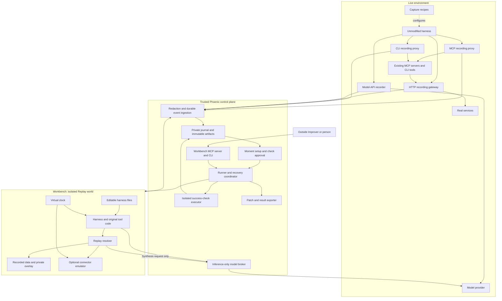

# Phoenix: Architecture

Status: November 15, 2026. Built from SPEC.md.

## 0. The shape

Phoenix is a TypeScript control plane, launched with `npx`, around a durable recorder and an isolated Workbench. Capture recipes route MCP, CLI, direct HTTP, and model traffic through recording adapters without changing the harness’s source. The recorder saves redacted evidence before letting the harness depend on it. A moment manifest binds a marked point to immutable recordings or a Scenario, the harness and tool versions, a virtual clock, and a locked success check. Each Replay gets a fresh world: recorded answers first, then overlay and derived answers, a stateful emulator, capture-time read expansion, and finally explicitly synthesized answers; an unresolved call stops as a divergence. An outside Improver edits only declared harness files. Phoenix runs deterministic checks, records the Improver’s intent judgments, compares samples with the baseline, protects previously passing moments, and exports a patch with evidence. Production access belongs only to live Capture; Replay has no route to production connectors.

## 1. Runtime picture



The Workbench has no general outbound network path. Its only external service access is through a host-side broker that accepts configured model inference operations. That broker cannot forward arbitrary URLs or invoke provider-hosted tools. Neither the harness nor a connector plugin receives production credentials.

The TypeScript control plane runs on the person’s machine or a machine they operate. Replay workloads run in an isolated Linux worker. The worker uses OCI containers inside a dedicated virtual machine when native executable isolation or guest-wide clock control is required. `npx` starts Phoenix; it does not remove the need for a supported sandbox runtime.

The Improver’s own model connection is outside Phoenix. Connecting an existing coding agent does not make that agent a Phoenix-owned component.

## 2. Units

| Unit | Language | Owns | May depend on | Must never depend on |
|---|---|---|---|---|
| Contracts | JSON Schema, JSON, TypeScript bindings | Trace, manifest, harness, plugin, result, and provenance formats | Published standards | Runtime implementations or a particular harness |
| Domain | TypeScript | Matching, replay decisions, state transitions, fidelity reduction, sample aggregation | Contracts | Network, filesystem, SDKs, model providers |
| Durable store | TypeScript, SQLite | Event journal, artifact references, operation state, comparison records | Contracts, filesystem adapter | Harness or connector semantics |
| Privacy boundary | TypeScript | Recording-time redaction and safe artifact admission | Contracts, configured policies | Improver decisions or publication destinations |
| Capture adapters | TypeScript; optional recipe helpers in other languages | MCP, CLI, HTTP, and model-wire interception | Contracts, privacy boundary, durable store, protocol libraries | Replay policy or success checks |
| Capture recipes | Declarative files; optional executable helpers | Harness-specific launch and endpoint configuration | Public capture and harness contracts | Internal control-plane imports |
| Replay resolver | TypeScript | Ordered response resolution and divergence | Domain, store ports, plugin ports, simulator port | Production credentials or unrestricted HTTP clients |
| Connector plugins | Any language | Connector-specific Capture, state interpretation, serving, declared fidelity | Public plugin files and messages | Phoenix internals or live access during Replay |
| Sandbox and gateway | TypeScript orchestration; standard runtime components | Filesystem, process, clock, and network isolation | Contracts, container and VM interfaces | Success-check content or Improver judgments |
| Runner | TypeScript | Rebuilding moments, scheduling samples, recovery, comparison | Domain, store, resolver, sandbox, checker ports | Harness-specific branches or direct vendor access |
| Success-check executor | TypeScript | Deterministic expectations and custom TypeScript checks | Contracts, sealed execution evidence | Editable harness files, network, simulator, approval authority |
| Moment setup | TypeScript orchestration; caller-selected research assistance | Correction handling, evidence assembly, check drafting and locking | Contracts, captured evidence, harness source, approved documentation access | Replay-time changes to locked checks |
| Workbench interface | TypeScript | Matching MCP and CLI operations, editing authorization | Runner, setup, store read ports | Direct connector execution or independent grading logic |
| Exporter | TypeScript | Allowlisted patch, results, fidelity report | Immutable candidate and result artifacts | Deployment systems or production credentials |
| Reference harness | TypeScript | Example task loop with one model and MCP and CLI tools | Public harness contract and public SDKs | Phoenix implementation packages |

These are dependency boundaries, not a requirement to run a separate service for every row. The local controller can host several units in one process. Recording, untrusted execution, and authoritative checking remain separate failure and privilege boundaries.

## 3. Core pieces

### 3.1 Capture: protocol-preserving adapters

Every adapter emits the same event envelope while retaining its surface-specific payload. A normalized view supports searching and checking; it never replaces the recorded wire representation.

```ts
interface CaptureSink {
  append(event: CaptureEvent): Promise<DurableReceipt>;
  putArtifact(input: RedactedArtifact): Promise<ArtifactRef>;
}

interface CaptureEvent {
  formatVersion: string;
  runId: string;
  sourceId: string;
  sourceSequence: string;
  callId?: string;
  parentCallId?: string;
  kind: string;
  observedAt: string;
  monotonicOffsetNs: string;
  payload: unknown;
}
```

An adapter durably records a request intent before forwarding it. It records each response or stream segment before delivering that evidence to the harness. The journal distinguishes request admission, upstream dispatch, response reception, delivery attempt, completion, cancellation, and unknown outcome. A delivery attempt is not proof that a remote process consumed the bytes.

Recording adds overhead and can apply backpressure. Phoenix does not claim otherwise. The durable path cannot silently become a best-effort background queue when storage is unavailable.

**MCP.** The proxy preserves the protocol revision, capabilities, tool descriptions, schemas, content blocks, errors, notifications, cancellation, and ordering exposed by the connection. It records tool-list changes rather than assuming the initial list lasts forever. Where a supported revision has server-initiated requests, sessions, resumable streams, or asynchronous work, those exchanges are recorded too. Authentication and session secrets are not trace identifiers.

The proxy uses revision-specific transport adapters. Current official SDK v2 targets MCP `2026-07-28`; the maintained v1 line supports older deployments. Newer MCP semantics must not be imposed on an older server. The original revision is preserved through Replay, including legacy initialization negotiation where it applies. See the [official SDK](https://github.com/modelcontextprotocol/typescript-sdk), [current transport specification](https://modelcontextprotocol.io/specification/2026-07-28/basic/transports), and [older Streamable HTTP specification](https://modelcontextprotocol.io/specification/2025-11-25/basic/transports).

**CLI.** The proxy records executable identity, argument boundaries, working directory, relevant redacted environment, stdin, stdout, stderr, exit status, signals, and timing. It preserves pipe versus terminal behavior. A recipe requiring an interactive terminal uses a pseudoterminal; a pipe-based invocation does not acquire one accidentally. Shell execution is explicit, not created by concatenating arguments into a command string.

A CLI recording proves what that invocation returned. It does not automatically prove the state of every file or service the process touched. Recipes capture the local artifacts needed to reconstruct those effects, or route the process’s service calls through the HTTP gateway. Without that evidence, returning recorded stdout cannot be treated as restoring the process’s effects.

**HTTP.** The gateway supports configured reverse-proxy endpoints and standard forward-proxy use. It records the request method, destination identity, path, ordered query representation, relevant headers, body, response status, body, streaming events, and timing. Capture passes the original traffic onward; authentication stripping applies to the recording, not to the live request.

For TLS traffic, endpoint configuration is preferred. Explicit proxying with a trusted local certificate is a recipe option where supported. Certificate pinning, application-layer encryption, unsupported transports, and bypassed proxy settings are coverage gaps, not permission to claim complete Capture.

**Model API.** The recorder preserves the provider’s request and response protocol instead of translating every provider into an OpenAI-shaped abstraction. It captures tool definitions, tool results included in prompts, attachments available at the boundary, model parameters, streaming deltas, and the final response.

This is the evidence of what the model received, including results from tools without a dedicated proxy. It does not reveal tool actions the harness never sent to the model, hidden provider-side state, or external content referenced only by an unresolved URL. Those distinctions remain visible in the run’s coverage record.

Nested observations are linked where correlation exists. One MCP call and the HTTP requests it caused are not counted as several agent tool calls. When correlation is unavailable, Phoenix preserves that uncertainty rather than inventing a parent relationship.

### 3.2 Privacy and durable storage

The storage boundary accepts only redacted material. Capture adapters may hold raw bytes transiently while forwarding them, but neither the journal nor debug logs become a raw archive.

Redaction has three layers:

1. Transport rules remove authentication headers, cookies, signed credentials, and other known secret-bearing fields from recorded copies.
2. Recipe and connector rules identify personal and sensitive fields in structured requests, responses, prompts, and local artifacts.
3. Content rules handle unstructured text and binary content. Material whose safe representation cannot be established is withheld and recorded as unavailable, rather than persisted raw.

Streaming redaction carries parsing state across chunks. Splitting a credential across network packets must not bypass redaction. Typed placeholders preserve useful relationships where possible: the same captured person or object remains the same placeholder throughout a moment. Redaction metadata records what changed without embedding the removed values.

Exact original bytes and removal of personal information cannot both be promised for the same field. Replay uses the recorded, redacted representation and reports that transformation. A decision that depends on removed information may become impossible to assess faithfully.

The local authoritative journal is SQLite in WAL mode with durable commits. A dedicated writer keeps synchronous storage work off transport event loops. Independent events can share a commit; no caller receives a durability acknowledgment before that commit. SQLite’s [WAL documentation](https://sqlite.org/wal.html) explicitly distinguishes durable `FULL` synchronization from settings that can lose recent transactions after power loss.

Large immutable artifacts live outside the database under content-derived identifiers calculated from their redacted bytes. Publication order is:

1. Write and sync the artifact.
2. Atomically publish its final name and sync the containing directory.
3. Commit the journal reference.

An interrupted write can leave an unreferenced artifact, but cannot create an acknowledged reference to an incomplete one. The store never accepts a content identifier as proof without checking the bytes.

The portable representation is documented JSON Lines plus ordinary referenced files. SQLite is a local implementation choice, not a requirement for reading a shared moment. Exports are regenerated from committed events, so a failed export does not damage Capture.

The durability promise covers committed evidence and completed Workbench operations on functioning persistent storage. It cannot reconstruct an unobserved vendor response, repair a destroyed disk, or make a live side effect atomic with local recording.

### 3.3 Harness contract and capture recipes

The required harness declaration contains only the three things in the spec:

```json
{
  "formatVersion": "1.0",
  "run": {
    "command": ["node", "dist/harness.js"],
    "cwd": "."
  },
  "configuration": {
    "mcp": { "file": "harness.config.json", "pointer": "/mcpServers" },
    "model": { "environmentVariable": "MODEL_BASE_URL" }
  },
  "editable": ["prompts/**", "src/tools/**", "harness.config.json"]
}
```

A command is an argument array. Configuration locations are explicit file fields or environment variables, not assumptions about one harness’s directory structure. Replay writes endpoint substitutions into its isolated copy; it does not rewrite production configuration.

Capture recipes add version-specific knowledge: launch flags, model wire format, CLI interception, terminal mode, local artifacts, available continuation import, and clock compatibility. These are recipe capabilities, not additional mandatory interfaces every harness must implement.

The default recipe collection includes Claude Code, Codex, pi, fx, Ozi, the reference harness, and a generic configured-command recipe. Each recipe states which surfaces it actually captures for the selected harness version and authentication mode.

Current public configuration surfaces provide concrete starting points:

- [Claude Code](https://code.claude.com/docs/en/llm-gateway-connect) supports gateway configuration through `ANTHROPIC_BASE_URL` and related provider settings.
- [Codex](https://learn.chatgpt.com/docs/config-file/config-advanced) documents configurable model-provider endpoints and wire APIs.
- [pi](https://github.com/badlogic/pi-mono/blob/main/packages/coding-agent/docs/custom-provider.md) supports endpoint configuration and provider extensions.
- [fx](https://fx.sh/docs/configure-fx/custom-model-connections) documents custom connections for Chat Completions, Responses, and Anthropic Messages.

Those facts do not prove that every subscription-login path uses the same configuration. A recipe must preserve the selected provider and authentication mode; silently switching a subscription run to a different API route would change the captured world.

The reference harness uses only the public declaration. It calls one configured model, exposes a few MCP and CLI tools, and routes its observable boundaries through the standard recipes. It receives no privileged continuation or replay API unavailable to other harnesses.

### 3.4 Moments, Snapshots, Scenarios, and setup

A Moment is a reference to an immutable run and an event boundary. Its mark identifies the exact event and causal frontier, not only a wall-clock timestamp. Concurrent calls can overlap a mark; the manifest identifies which inputs, outputs, and side effects belong before it.

A Snapshot contains captured observations and state evidence. It does not claim to be a globally atomic copy of several independent vendors. Objects carry observation times, source calls, version information where available, and completeness boundaries. An incomplete list is not evidence that unlisted objects do not exist.

A Scenario uses the same artifact and connector-state interfaces, but its origin is explicitly seeded. It can produce a marked run without first passing through production Capture. Scenario data is never relabeled as captured real data.

Setup performs the following work:

1. Read the trace, the harness version, the Correction, and relevant documentation.
2. Identify observed tools, connector identities, clock requirements, missing state, and available replay mechanisms.
3. Assemble the Snapshot from already captured evidence, or assemble the Scenario from declared seed data.
4. Draft the success check and identify which evidence will decide it.
5. Ask the person to approve the check, then lock its content and dependencies.

Setup may use the person’s existing agent for research and drafting. Phoenix supplies the workflow and artifacts, not an autonomous Improver or a separate judge.

A Correction is the default source of expected behavior. A Correction marked one-off is retained as context but is not converted into a success check.

Capture-time read expansion is configured before or during the live run. It calls only explicitly declared read-only operations over objects the harness encountered, using restricted credentials where the vendor supports them. HTTP method names and MCP read-only annotations alone are not sufficient authority. These observations have their own timestamps and provenance.

Setup never queries today’s vendor state and labels it yesterday’s Snapshot. A later observation is not moved backward across the moment’s mark without evidence that it describes the earlier state.

Check locking produces a content digest covering the check text or code, referenced expectations, and its approval record. Unattended Scenario locking requires the explicit opt-in specified in the manifest. Any subsequent check change creates a different moment revision with a new lock; it cannot retroactively change the meaning of existing results.

### 3.5 Rebuilding the start of a Replay

The runner separates reconstructing the frozen prefix from executing the candidate.

**Replay from the beginning.** Start from the recorded initial prompt, local artifacts, tool configuration, clock origin, and connector world. Run the candidate harness from its entry point. Original later responses remain evidence, not an unconditional sequence of answers to consume.

**Replay from the mark.** Restore the exact externally observable prefix, then start candidate execution at the chosen boundary. A recipe can do this in either of two ways:

- Import recorded continuation state using a supported harness interface.
- Execute the original harness through the prefix, supplying recorded model and tool responses, reconstructing captured local effects, and validating the resulting boundary state before starting the candidate continuation.

The original harness reconstructs the prefix; the candidate does not rewrite it. Prompts, tool definitions, conversation history, and other observations already consumed before the mark remain frozen. A change to an initialization step or earlier prompt requires a Replay from the beginning if that harness cannot apply it after the mark.

A prefix reconstruction does not rerun live writes. Recorded command output is paired with captured local effects where needed. Pending calls at a mark retain their pending status and recorded completion relationships; the runner does not pretend that every mark occurs between two fully completed calls.

If a harness exposes neither usable continuation state nor a reconstructible prefix, Phoenix reports the requested mark as blocked. A fresh run with a copied chat transcript is not silently presented as the same moment. The manifest retains the evidence needed to explain what is missing.

This is an important limit of the three-field harness contract: launch configuration alone cannot make arbitrary hidden memory or unrecorded nondeterminism recoverable.

### 3.6 Replay resolver, overlays, and divergence

The resolver accepts a transport-neutral call plus its original wire representation:

```ts
interface ResolveRequest {
  replayId: string;
  callId: string;
  connectorId: string;
  surface: "mcp" | "cli" | "http";
  operation: string;
  arguments: unknown;
  wireArtifact: string;
  worldRevision: string;
}

type Resolution =
  | { kind: "answer"; response: ArtifactRef; provenance: Provenance }
  | { kind: "divergence"; reason: string; evidence: ArtifactRef[] };
```

It evaluates the spec’s resolution order:

1. **Recorded response.** Match connector identity, operation, arguments, relevant protocol metadata, causal position, and applicable world state. Repeated identical requests are distinct occurrences unless their semantics establish that reuse is valid.
2. **Overlay or derived response.** Apply replay-local writes and derive answers only through declared connector semantics backed by captured evidence.
3. **Stateful emulator.** Ask the isolated plugin serving the seeded connector world.
4. **Capture-time read expansion.** Use compatible, previously captured read-only observations not already represented in the main recording.
5. **Simulator model.** Generate a schema-checked response, persist it before delivery, and mark it synthesized. A simulated write has no state effect.
6. **Divergence.** Stop the affected run with the unmatched call, attempted resolution paths, and missing evidence.

Matching is deliberately conservative. JSON object ordering can be canonicalized, but array order, omitted versus null values, CLI argument boundaries, query ordering where meaningful, and textual output are not casually normalized. A connector can supply additional normalization rules; the rule version and original representation remain recorded. [RFC 8785](https://www.rfc-editor.org/rfc/rfc8785.html) is useful for canonical JSON within its representational limits, not for redefining tool semantics.

A response from before a replay-local write is not a match after that write if the answer could have changed. Unknown write semantics invalidate potentially affected recorded reads. The resolver either obtains a state-aware answer later in the chain or reports a divergence; it never returns a stale recording simply because the arguments match.

The overlay is an append-only sequence of connector mutations over an immutable base. One authority owns each connector’s writable state: either Phoenix’s connector-specific overlay implementation or the stateful emulator. The resolver does not maintain a second competing copy.

Mutation, world revision, consumed recording occurrence, and returned response are committed together. A replay retry with the same call identity receives the committed result without applying the mutation twice. A recorded successful write updates local state only when its effects can be established. Otherwise the response is recorded evidence of success, but subsequent state-dependent behavior is unresolved.

Derivation includes an explanation and source references. Looking up one event from a complete captured list is a derivation. Inventing search ranking, treating a partial page as a complete calendar, or inferring an uncaptured object from a similar object is not.

Each sample owns its overlay and recording cursors. No sample, baseline, or candidate can contaminate another’s world.

### 3.7 Connector plugins, emulators, and synthesis

A plugin is a separately installed package. Its descriptor is a plain file:

```json
{
  "pluginApiVersion": "1.0",
  "id": "example.calendar",
  "capture": ["calendar-plugin", "capture"],
  "serve": ["calendar-plugin", "serve"],
  "declaredTier": "stateful",
  "readOnlyTools": ["list_events", "get_event"],
  "snapshotSchema": "schemas/snapshot.json"
}
```

`capture` consumes a documented request file and emits artifact references and a capture report. `serve` consumes a world descriptor and exchanges versioned JSON messages over stdio. The message schemas and example request and response files define the interface; no TypeScript class is required. Filesystem paths are confined to the invocation’s supplied directories.

The serving interface returns one of: an answer with provenance and state revision, unsupported operation, invalid input, or failure. Unsupported is not an empty successful result. The optional semantic operations needed for derivation, state export, and recovery are declared capabilities of `serve`, not assumptions made about every plugin.

A plugin declares both its overall tier and the operations and state boundaries behind that claim. A calendar emulator that cannot preserve recurring-event exceptions cannot claim full stateful fidelity for a moment that depends on those exceptions.

The strongest arrangement runs the original MCP server or CLI binary and redirects its vendor HTTP traffic underneath it. Production tool defaults, formatting, pagination behavior, and error text then come from the actual tool code. Vendor-hosted MCP servers that cannot be redirected use recorded tool-level answers instead.

Existing emulators remain optional adapters:

- [emulate](https://github.com/vercel-labs/emulate) supplies mutable local service implementations and configurable seed data. Its [Google documentation](https://emulate.dev/docs/google) and [seed configuration](https://emulate.dev/docs/configuration) describe available Calendar surfaces, but do not establish complete recurrence and attendee fidelity.
- [Backlot](https://pypi.org/project/backlot/) supports enterprise APIs over imported corpora, with some write support. Its corpus-oriented model is useful, but lossless import of a live Snapshot is a separate capability that must be established per connector.

The core runs without either package or any plugin. Generic recorded replay remains available.

The connector test kit is a standalone consumer of the public plugin contract. Given supplied recordings and state artifacts, it invokes capture and serve, compares wire responses, inspects exported state where supported, and reports unsupported operations and unexplained differences. It produces evidence for a fidelity claim, not an automatic promotion to stateful fidelity.

The simulator is a replaceable model-provider adapter. It receives the tool’s real schema where available, captured examples, relevant redacted world evidence, and the unmatched call. It does not receive permission to alter the success check.

When `outputSchema` is absent, Phoenix validates the actual MCP result envelope and an explicitly inferred format contract. A text-shaped result remains text-shaped. Inference is labeled, and structural validity does not prove that an invented answer is true. MCP’s [tool specification](https://modelcontextprotocol.io/specification/2026-07-28/server/tools) defines the real protocol constraints.

Synthesis is cached by moment revision, connector, normalized call, applicable world revision, and simulator configuration. The accepted answer is stored before delivery. Repeat calls in the same applicable world receive that answer; an unrelated write cannot accidentally make an old simulated answer valid for new state.

### 3.8 Workbench isolation and virtual time

The sandbox is an enforcement boundary, not an agreement to set `HTTP_PROXY`.

The harness and tool processes receive:

- An immutable base filesystem with the pinned harness and tool dependencies.
- A writable copy containing only declared editable source paths, plus separate disposable runtime output directories.
- Read-only moment data, never writable success checks or control-plane storage.
- Local connector endpoints and fake credentials appropriate to the frozen world.
- No host home directory, cloud credential directory, SSH agent, Docker socket, device access, or inherited production environment.

Network isolation exists outside the workload. The worker cannot route to the host’s services, metadata endpoints, private network, public internet, or another Replay. Its controlled gateway can reach only local replay services and the narrow model broker. Unknown destinations, arbitrary CONNECT tunnels, redirects to unapproved destinations, and non-HTTP escape attempts fail closed.

The model broker keeps provider credentials outside the guest. It accepts only the configured provider and inference API shape. Provider-hosted web search, remote MCP, computer use, or other tools that would access an unfrozen world are not permitted merely because they travel through a model endpoint. If a moment requires such a capability and it cannot be replayed locally or from recordings, that dependency is blocked.

All real tool code, connector plugins, and custom success-check code are untrusted execution. Plugins have no production access during Replay. The checker runs separately from the editable harness and reads controller-owned evidence rather than an in-process result object supplied by the candidate.

A clock interface has two distinct responsibilities:

```ts
interface ReplayClock {
  wallTime(): string;
  virtualElapsedNs(): string;
}
```

The manifest stores the captured epoch, timezone, and clock policy. Reconstruction supplies recorded prefix times. Candidate execution starts at the mark’s captured time, with subsequent time advancing according to the replay clock rather than the host’s calendar date. Connector implementations use that same clock for timestamps, expiry, and recurrence calculations. The controller uses its own monotonic clock for process supervision and connection handling.

A JavaScript `Date` shim is sufficient only for a recipe whose entire time-sensitive workload is covered by that shim. Native executables, subprocesses, and direct clock syscalls need guest-wide clock control. A dedicated VM provides that boundary without changing the host’s clock. Its guest disables external time synchronization, initializes the captured epoch before workload execution, and uses a virtual clock source. QEMU documents a virtual-clock-driven RTC and instruction-count-based virtual time in its [invocation reference](https://www.qemu.org/docs/master/system/qemu-manpage.html).

Linux time namespaces are not a complete substitute: they do not virtualize `CLOCK_REALTIME`, as documented in [time_namespaces(7)](https://man7.org/linux/man-pages/man7/time_namespaces.7.html). Likewise, [libfaketime](https://github.com/wolfcw/libfaketime) documents limitations around static binaries and interception bypasses. A recipe cannot claim virtual-clock coverage from preload injection alone.

A faster container backend can be used when the recipe’s clock and process requirements are covered. It must enforce the same network and filesystem contract. Sandbox selection is recorded; changing it cannot silently preserve a claim of identical execution conditions.

### 3.9 Success checks, samples, and fidelity

A success check can combine deterministic expectations, custom TypeScript, and plain-language intent. The locked check identifies which components apply.

The deterministic executor operates on controller-recorded evidence:

```ts
interface CheckInput {
  momentDigest: string;
  replayTrace: ArtifactRef;
  finalConnectorState: ArtifactRef[];
  finalText: ArtifactRef;
  provenance: ArtifactRef;
}

interface CheckResult {
  outcome: "pass" | "fail" | "inconclusive";
  evidence: ArtifactRef[];
  explanation: string;
}
```

Built-in expectations cover required and forbidden calls, argument matching, call order, call caps, connector end state, and final text. Order checks use causal relationships and recorded sequence rather than inventing a total order between unrelated concurrent calls.

Custom TypeScript executes as pinned code in an isolated checker with explicit input, no network, and no ambient source of time or randomness. The candidate cannot replace its dependencies or output file. A checker crash is an execution failure, not a negative judgment of the harness’s behavior.

The Improver supplies an intent judgment, explanation, and evidence references for each applicable sample. It cannot override a deterministic failure. Missing intent judgment leaves the result incomplete. Phoenix does not introduce a separate judge agent.

Every moment fixes its sample count for a comparison before candidate results are observed. No numerical default beyond the spec’s requirement for several samples is invented here. If there are `n` completed, assessable samples and `f` failures, the moment fails when `2 × f >= n`; otherwise it satisfies the sample threshold.

A crash is retried as the same scheduled sample. Phoenix does not keep only favorable completed attempts or drop inconclusive samples to improve the denominator. If the configured samples cannot be assessed, the comparison is incomplete rather than a pass.

A candidate earns the spec’s improvement pass only when it satisfies the moment’s sample threshold and has a strictly better sample success rate than the baseline on the same moment and model. Satisfying the check and improving on the baseline are separate reported facts. An unchanged perfect baseline can remain successful without being described as improved.

The comparison identity includes the moment and check digests, baseline and candidate harness contents, model and available model revision, generation settings, sample count, replay start mode, world artifacts, plugin versions, and clock policy. Cached baseline results are reusable only for the same relevant comparison conditions.

For model migration, run the original harness and candidate under the proposed model to obtain the same-model improvement comparison. Separately report whether the proposed model continues to satisfy the saved moments relative to their existing results. A comparison between two different models is labeled a migration comparison, not silently presented as the same-model pass required by the spec.

For a collection of moments, previously passing moments must remain passing under the proposed change. The runner uses an immutable set membership and previous-result reference for that comparison. Missing, blocked, or incomplete results cannot certify absence of regressions.

Fidelity has two levels:

- Every response records whether it is live-observed, recorded, derived, emulated, seeded, or synthesized, plus redaction and approximation metadata.
- Every connector has an effective tier: stateful, recorded, synthesized, or blocked. The run’s grade is the weakest required or encountered connector, including a required connector that could not be served.

A plugin’s declared tier is an upper bound, not an unconditional grade. Derived answers remain attributed to their source evidence; they do not turn a partial recording into a complete stateful world.

Synthesis provenance propagates into subsequent model turns and derived answers. A deterministic failure established independently of synthesis remains binding. A pass that relies on invented state or on behavior influenced by invented evidence is inconclusive unless that dependence can be ruled out. For example, an unsupported synthesized write response cannot establish the expected final calendar state. Reports retain both the check result and the fidelity explanation instead of hiding one inside the other.

### 3.10 Workbench interface and safe export

The CLI and MCP server are adapters over the same application commands:

```text
list_moments
read_moment
read_trace
read_fidelity
list_editable_files
read_file
apply_edit
replay
read_replay
run_checks
submit_intent_judgment
export_patch
```

Moment creation, Corrections, check drafting, approval, and Scenario opt-in locking are separate setup operations. The Improver’s editing capability does not grant check-approval or check-replacement authority.

Editing is enforced at the filesystem boundary and again at export. Paths are resolved beneath the declared workspace; symlink traversal, hard-link tricks, generated files outside the allowlist, and attempts to replace the harness declaration cannot expand authority. Runtime scratch directories are writable for normal harness execution but are not exportable source changes.

Each Replay uses a frozen candidate content digest. Editing the workspace while a Replay runs creates the next candidate; it cannot change the code associated with an existing result.

Export contains only allowed source changes. Replay results and the fidelity report accompany the patch as a separate report or PR description, so captured data does not accidentally enter the harness repository. A PR, when requested, targets that repository and uses publication credentials held outside the Workbench. Phoenix has no deployment command.

## 4. Data flows

### Fix a live failure

1. A recipe launches the original harness with MCP, CLI, HTTP, and model recording configured. Production credentials stay in the live environment.
2. Capture persists calls, responses, timings, tool definitions, local artifacts, and any configured read expansion. An agent can mark a Moment immediately; a person can mark the same event later.
3. The person supplies a Correction. Setup assembles the Snapshot, drafts the success check, and locks it after approval.
4. The runner establishes the baseline using the original harness, the frozen world, the recorded model configuration, and the moment’s configured samples.
5. The Improver reads the trace and fidelity report, edits allowed files, and requests Replay. The runner reconstructs the chosen start, then executes the frozen candidate.
6. The resolver serves each tool call without contacting production. The checker evaluates deterministic expectations; the Improver judges any intent component.
7. Phoenix compares the candidate with the baseline and verifies that previously passing moments still pass.
8. The exporter emits the allowlisted patch and evidence. The person reviews and deploys it outside Phoenix.

### Staging that was never live

1. The person supplies Scenario seed files and a harness declaration.
2. Setup records the seed origin and connector capabilities, then drafts and locks the success check. Unattended locking requires the explicit Scenario opt-in.
3. The runner materializes the seeded world and produces a run and Moment.
4. Baseline, candidate samples, checking, fidelity reporting, and export follow the same path as a live-derived Moment.

### Regression sets

1. The person selects saved moment revisions and the existing passing results that must be preserved.
2. The runner freezes the candidate and resolves the comparison settings for every Moment.
3. Independent samples run in separate worlds, sharing only immutable artifacts.
4. Phoenix reports the result for every Moment. A newly failing previously passing Moment prevents the change from counting as a pass; an incomplete comparison cannot claim no regression.

### Model or tool migration

1. The candidate changes an allowed model setting, tool description, or tool implementation.
2. Existing observations remain attached to their original tool and protocol identities. Matching does not pretend that a different interface is the old one.
3. Where possible, the changed tool code runs over the original frozen vendor data. Calls outside that evidence follow the resolver’s normal fallback order.
4. Phoenix reports behavior under the proposed configuration, same-model baseline comparison where applicable, and any loss of fidelity caused by newly requested information.

### Sharing

1. The exporter gathers a manifest and its selected redacted artifacts, with content identifiers and schema versions.
2. It excludes credentials, raw captures, local absolute paths, and tool implementations. Missing separately installed code is named by version and provenance.
3. The recipient imports the files, resolves a compatible harness declaration and independently installed tools or plugins, and supplies their own model credentials.
4. Phoenix validates the bundle before execution. Unavailable dependencies or incompatible contracts are reported as blocked, not downloaded and executed implicitly from untrusted instructions in the manifest.
5. Replay uses the same resolver and checks. A different harness is an explicit comparison input, not a claim that the original harness was reproduced.

### A brand-new harness

1. The builder declares the launch command, configuration locations, and editable paths.
2. The generic recipe routes its configured endpoints and command surfaces through Capture.
3. Captured runs produce Moments through the same setup path.
4. The builder connects an existing Improver or works by hand. No Phoenix-specific agent loop is required.

## 5. Failure

| Failure | Behavior and recovery |
|---|---|
| Capture process crashes | Recover the durable journal and source sequence positions. Restart the adapter. Mark interrupted calls explicitly; do not manufacture a completion. |
| Storage fills or cannot commit | Stop admitting affected calls and stop delivering uncommitted observations. Preserve the last durable state and report Capture failure. Never silently bypass recording. |
| Connection fails after a live write was sent | Keep the durable intent and mark the outcome unknown. Do not automatically retry a non-idempotent vendor operation. A vendor-supported idempotency or status interface may resolve it; otherwise uncertainty remains. |
| Response delivery is interrupted | Retain committed response segments and the uncertain delivery frontier. Do not claim the harness consumed the complete response. |
| Controller crashes | Recover operation records, reconcile surviving workers, and resume orchestration. A persisted operation identifier prevents a client retry from creating duplicate work. |
| Improver disconnects | Completed edits, queued Replay requests, running work, and committed results remain. Reconnecting reads existing operation state rather than starting over. |
| Replay worker crashes | Retain the partial trace. Reconstruct the same scheduled sample from immutable inputs and committed nondeterministic responses. Do not count the crash as a behavioral failure or discard it as an unfavorable sample. |
| Plugin or emulator crashes | Restore from its declared state artifact and mutation log. If it cannot restore safely, restart the whole sample. Never substitute an empty world. |
| Model connection breaks mid-response | Preserve the partial stream. An incomplete model turn is not used as a complete answer. Resume only where the provider protocol supports it; otherwise repeat the incomplete operation as part of recovery and retain the attempt history. |
| Simulator produces malformed output | Reject it before delivery and before mutation. Report the failure or divergence; do not silently repair semantic content. |
| A captured server returns malformed protocol data | Preserve the observed failure as evidence. The proxy does not quietly turn it into a successful tool result. |
| A call misses every replay source | Stop with a divergence containing the call and missing evidence. Never fall through to a live vendor. |
| Clock coverage is unavailable | Block the affected Replay mode and state the uncovered process or clock source. Do not call host time virtual time. |
| Custom check crashes or returns invalid output | Record an incomplete check. The candidate cannot pass until authoritative checking completes. |
| Manifest, plugin descriptor, or schema is hostile | Validate versions, paths, references, sizes, and schema structure before execution. Resolve external schema references only from supplied or explicitly trusted resources. Execute code only in the sandbox. |
| Export fails or the caller disconnects | Recreate the patch from the frozen candidate and result digests. Before repeating a PR publication, reconcile whether the first publication succeeded. |

Recovery never erases an earlier attempt or turns an unknown result into a success. Completed samples and edits survive independently of running processes. Live external side effects are the important exception to automatic retry: safety requires preserving uncertainty rather than duplicating an action.

## 6. Data and versions

### Portable files

| Format | Contents |
|---|---|
| `trace.jsonl` | Versioned event envelopes, causal links, surface payload references, timing, completion state, and provenance |
| `moment.json` | Moment origin and mark, Snapshot or Scenario references, clock, prompt, model, harness identity, tool lists, MCP revisions, success-check lock, sample configuration |
| `harness.json` | Launch command, MCP and model configuration locations, editable paths |
| `plugin.json` | Capture and serve commands, interface version, fidelity declaration, read-only operations, schemas, and capabilities |
| `check.json` | Deterministic expectations, optional TypeScript artifact, intent statement, approval or Scenario opt-in record |
| `result.json` | Candidate and comparison identities, sample outcomes, deterministic evidence, intent judgments, divergences, fidelity, and regression-set result |
| Artifact files | Redacted bodies, prompts, local state, connector state, seed data, custom check code, and model stream segments |

A moment manifest references artifacts rather than embedding executable connector code or large traces. Referenced code is separately installed or supplied as an explicit harness or checker dependency. Data remains shareable without sharing the tool implementation.

The manifest records enough identity to distinguish reproduction from substitution: harness commit plus any captured patch, tool package or executable digest, dependency lock or image identity, recipe version, plugin version, protocol revisions, provider model identifier, and the exact model revision when the provider exposes one. A floating model alias is recorded as floating; Phoenix cannot pin a revision the provider does not offer.

### Event semantics

Event IDs and per-source sequence numbers are stable. The journal provides a total ingestion order, while parent links and source order describe causality. Ingestion order alone is not asserted to be the order in which concurrent services changed.

Wall times use explicit offsets or UTC. High-resolution elapsed values and integers outside interoperable JSON number range use strings. Binary data is referenced by artifact rather than forced into text. Argument representations preserve distinctions needed for matching.

Every derived artifact identifies its source artifacts and transformation version. Captured, seeded, emulated, and synthesized data remain distinguishable after export and import.

### Schema evolution

Each public format has its own version. Additive fields are compatible only when readers can ignore them without changing safety or meaning. Required semantic changes use a new major version.

Readers reject unsupported major versions and unknown required capabilities. They can retain unknown optional fields for lossless forwarding. Migration creates new artifacts and a new manifest revision; it never edits historical evidence in place.

Success-check digests cover canonical content and referenced code. Changing a check, seed, redaction policy that affects evidence, or matching rule produces a new comparison identity. Old results remain attached to the old identity.

## 7. Repo layout

```text
packages/
  contracts/
  domain/
  store/
  privacy/
  capture-mcp/
  capture-cli/
  capture-http/
  capture-model/
  replay/
  plugin-host/
  sandbox/
  runner/
  checks/
  setup/
  workbench/
  export/
  cli/
  connector-kit/
recipes/
  generic/
  claude-code/
  codex/
  pi/
  fx/
  ozi/
reference-harness/
formats/
  trace/
  moment/
  harness/
  plugin/
  check/
  result/
docs/
```

`contracts` and `domain` form the bottom of the dependency graph. Domain functions receive explicit values and ports; they do not read the filesystem or contact a model. Adapters implement those ports.

`runner` composes ports but contains no provider- or harness-name branches. `workbench` and `cli` invoke application commands and do not duplicate matching, checks, or grading. `capture-*` packages never import `replay`, and `replay` never imports a live vendor client.

Recipes and the reference harness consume public contracts only. Separately installed connector implementations stay outside the core repository dependency graph. The connector kit invokes them through their documented process interface.

Captured data belongs in the person’s private data directory, not in these source folders. A harness repository can hold a moment manifest and deliberately selected redacted artifacts; Phoenix does not automatically commit its private store.

## 8. Build order

1. **Define the public contracts and domain invariants.** Trace envelopes, moment manifests, harness declarations, plugin descriptors, provenance, check locks, and result identities must exist before implementation-specific data spreads across components.
2. **Build privacy-aware durable recording.** The journal and artifact store precede MCP, CLI, HTTP, and model recording adapters. Capture recipes then connect real harnesses to those adapters. The reference harness provides a direct consumer of the public harness contract.
3. **Build sandbox enforcement and strict recorded Replay.** Isolation, the model broker, divergence reporting, and recorded-response matching precede running any editable candidate. Initial Replay starts from the beginning; mark restoration is added through recipe-supported continuation and prefix reconstruction.
4. **Complete moment setup and the locked improvement loop.** Snapshot and Scenario assembly, Corrections, approval, deterministic checking, intent judgments, baseline sampling, regression sets, and the Workbench interface make a recorded Moment usable end to end. Export depends on the edit allowlist and immutable result identity.
5. **Add state-aware resolution.** Connector state extraction, overlays, derivation, capture-time read expansion, and plugin-backed emulators extend the existing ordered resolver. Guest-wide clock support is required wherever the workload cannot use a fully covered clock adapter.
6. **Add explicit synthesis and complete connector tooling.** Simulator validation, stable answer storage, dependency-aware fidelity reporting, and the connector kit build on the established trace and plugin contracts. They do not weaken strict Replay or its network boundary.

A feature that needs stateful writes or native clock coverage depends on those capabilities even if other recorded Moments already work. Build order is not permission to label an unsupported Moment faithful.

## 9. Libraries

| Choice | Why and boundary | Source |
|---|---|---|
| Node.js and TypeScript | Core runtime, CLI entry point, process management, streams, workers, and public TypeScript bindings. Keep Node APIs behind runtime adapters. | [Node.js documentation](https://nodejs.org/api/), [TypeScript](https://www.typescriptlang.org/docs/) |
| Official MCP TypeScript SDK | Implement Workbench MCP and revision-specific proxy transport handling. Use the stable v2 packages for the current revision and isolate maintained v1 support for older servers. | [SDK repository and release-line guidance](https://github.com/modelcontextprotocol/typescript-sdk) |
| Node HTTP and stream primitives | Model recording preserves provider-native bodies and stream events without an unnecessary model-protocol translation layer. | [HTTP](https://nodejs.org/api/http.html), [streams](https://nodejs.org/api/stream.html) |
| Mockttp | TypeScript-compatible forward and reverse HTTP interception, TLS interception where configured, and programmable local response serving. Phoenix owns durability, redaction, and replay semantics. | [Mockttp](https://github.com/httptoolkit/mockttp) |
| mitmproxy, optional recipe helper | Capture supported applications that cannot use a configured base URL. Its local and other proxy modes broaden routing options; they do not defeat certificate pinning or prove semantic coverage. | [Proxy modes](https://docs.mitmproxy.org/stable/concepts/modes/) |
| `node:child_process` and optional `node-pty` | Preserve command arguments and pipes; use a real pseudoterminal only for CLI surfaces that need terminal behavior. | [Child processes](https://nodejs.org/api/child_process.html), [node-pty](https://github.com/microsoft/node-pty) |
| SQLite with `better-sqlite3` in a dedicated worker | Durable transactions, indexed matching, and recoverable operation state without a separate database service. The public data format remains JSON Lines and artifact files. | [SQLite WAL](https://sqlite.org/wal.html), [better-sqlite3](https://github.com/WiseLibs/better-sqlite3) |
| Ajv | Validate Phoenix formats and provider or plugin JSON Schemas. Use separate validator instances for incompatible schema dialects and disable uncontrolled external reference loading. | [Supported schema dialects](https://ajv.js.org/json-schema.html), [strict mode](https://ajv.js.org/strict-mode.html) |
| OCI containers with gVisor where supported | Isolate untrusted Linux processes behind a narrower kernel interface. Network restrictions and mounts remain explicitly configured; gVisor is not an automatic no-egress policy. | [gVisor security model](https://gvisor.dev/docs/architecture_guide/security/), [Docker network isolation](https://docs.docker.com/engine/network/drivers/none/) |
| QEMU for VM-backed workers | Guest-wide clocks and isolation for native workloads that cannot be covered by process-level adapters. Use least-privilege host execution and no ambient guest networking. | [Clock options](https://www.qemu.org/docs/master/system/qemu-manpage.html), [security model](https://www.qemu.org/docs/master/system/security.html) |
| emulate, optional connector dependency | Reuse existing stateful API behavior where Snapshot import and required operations are supported. Do not infer complete vendor fidelity from the emulator’s presence. | [Repository](https://github.com/vercel-labs/emulate), [Apache-2.0 license](https://github.com/vercel-labs/emulate/blob/main/LICENSE) |
| Backlot, optional connector dependency | Reuse imported-corpus APIs and available write overlays where they match a Moment’s requirements. | [Package](https://pypi.org/project/backlot/), [current Apache-2.0 license](https://github.com/brekkylab/backlot/blob/main/LICENSE) |

No model-provider SDK is mandatory for the recorder. Provider-specific adapters can use an SDK when useful, but Capture preserves the provider’s actual protocol. No cloud orchestration system, remote database, or hosted Phoenix service is required.

Speed comes from indexed exact matching, compiled schema validators, immutable artifact reuse, copy-on-write worlds, and parallel independent samples. Semantic operations stay serialized within the connector state they modify. Durable commits, provenance, and isolation are not disabled to make the fast path look better.

## 10. Risks and open questions

**Universal Capture is not equivalent to configurable endpoints.** Model recording recovers the model-visible view, but cannot reveal unreported CLI effects, hidden tool execution, encrypted content, or provider-side state. A recipe’s coverage record must distinguish observed calls, inferred relationships, and missing effects. Actual request paths and recorded boundary evidence decide whether a particular harness configuration is covered.

**Arbitrary mark restoration needs more than a transcript.** Hidden in-memory state, local databases, concurrent processes, and nondeterministic prefix behavior can prevent an exact continuation. Inspect the selected harness’s continuation format and compare the reconstructed boundary with captured artifacts. If that evidence is insufficient, the architecture must report the limitation rather than silently substitute a fresh run.

**Redaction can remove the cause of the mistake.** Names, text, identifiers, or attachment content may affect model behavior. Field-level redaction provenance reveals this loss; only an approved privacy policy can decide what information is safe to retain in a useful form. Pattern matching alone cannot guarantee that all personal data has been recognized.

**Distributed observations are not a vendor-wide point-in-time image.** A list response, an expanded object, and a later write can describe different instants. Object versions, completeness markers, timestamps, and causal ordering determine what can truthfully seed a moment. New information gathered after the failure cannot repair missing historical state without being labeled differently.

**Calendar and email fidelity can fail on details.** Recurring-event exceptions, attendee notifications, timezone transitions, search ordering, and access controls are not captured by a claim that an emulator supports CRUD. Compare the required wire shapes and state transitions with the actual vendor contracts. Google’s [recurring-event documentation](https://developers.google.com/workspace/calendar/api/guides/recurringevents) shows why recurrence requires explicit handling.

**A declaration of stateful fidelity can overstate completeness.** Serving a partial Snapshot from a mutable emulator does not make unknown objects absent. Plugins must carry coverage boundaries through every response and decline operations outside them.

**Real tool code can hide network escapes.** A server can start subprocesses, ignore proxy settings, use a different transport, or call a hard-coded address. The worker’s externally enforced network boundary prevents these from reaching production; the trace explains the blocked attempt. Proxy configuration alone is insufficient.

**Model aliases and provider internals move.** Even identical model names and parameters may not identify identical weights or behavior. Record exposed revisions and provider metadata. If a revision is unavailable, report that qualification rather than claiming exact reproducibility.

**Synthesis can contaminate later reasoning.** Valid JSON and stable repeated answers are not truth. Provenance must follow the answer into later model turns and check dependencies, with inconclusive results when an independent decision cannot be established.

**The Improver judges its own intent result.** A locked statement prevents changing the target but does not make the judgment independent. Preserve its explanation and evidence, keep deterministic failures binding, and identify intent-based judgments in the final report. This limitation follows the spec’s deliberate choice not to ship a separate judge.

**A general sandbox adds installation and compatibility cost.** Native macOS-only tools cannot simply execute in Linux. Recorded CLI responses may cover their observable behavior, but not uncaptured local effects. The selected recipe must identify whether recorded replay, a compatible binary, or a different supported worker is required.

**Emulator licensing must follow the selected release.** The currently inspected emulate and Backlot repositories publish Apache-2.0 licenses. That does not establish the license of every historical package, dependency, or bundled dataset. Keep package identity and license evidence attached to the dependency choice.

## 11. Questions for the user

1. **When durable Capture becomes unavailable, should production pause or continue with an explicitly incomplete recording?** This design pauses affected traffic to preserve the recording guarantee. Uninterrupted production and guaranteed lossless Capture cannot both be maintained through every recorder or storage failure.
2. **What should “the same prompt” mean after mandatory personal-data redaction?** The proposed behavior preserves the redacted representation and reports changed fields. Some mistakes will no longer be reproducible if the distinguishing information must be removed.
3. **How should unsupported mark restoration be presented?** The proposal blocks that start point while allowing Replay from the beginning when possible. The three required harness declarations cannot alone guarantee restoration of arbitrary hidden process state.
4. **For model migration, is the proposed split correct: check that saved moments still hold under the new model, and measure strict improvement against the original harness running that same new model?** This preserves the spec’s same-model comparison without making cross-model improvement look like an equivalent measurement.
5. **Which exact distributions and authentication modes identify the intended fx and Ozi setups?** fx now documents custom endpoints, but that does not settle its subscription-login recording path. Ozi needs an identifiable public contract or supplied recipe inputs rather than assumptions about private internals.
6. **What redaction policy should the default recipes apply to unstructured text and attachments?** Structural secrets can be stripped predictably; reliably distinguishing all personal information from task-relevant content needs an explicit policy.
7. **What sample count should be the default, with per-moment overrides?** The design implements the specified majority rule and leaves the default count unset rather than inventing one.
