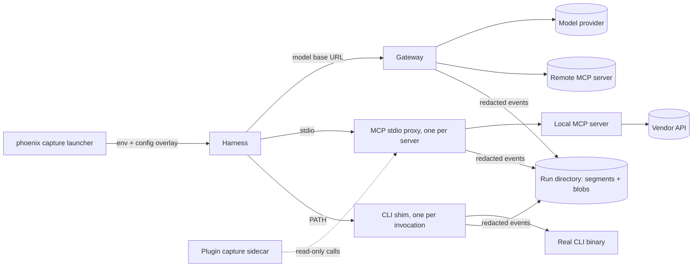
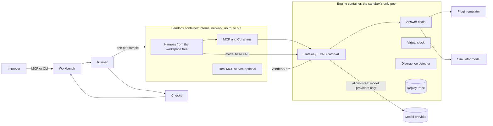

# Phoenix: Architecture

Status: November 15, 2026. Built from SPEC.md.

## 0. The shape

Phoenix is a TypeScript monorepo, run with npx, built around one idea: every tool surface (MCP over stdio, MCP over Streamable HTTP, CLI commands, direct HTTP calls, and the model API) is handled by a **tap** that turns wire traffic into a normalized `Call` and hands it to a **backend**. During Capture the backend is the real upstream plus a recorder that writes redacted events to an append-only trace. During a Replay the backend is the **answer chain**, which answers from the recording, the overlay, an emulator, pre-run read-only results, or the simulator model, and otherwise stops with a divergence. The harness is pointed at the same kinds of endpoints in both modes, so nothing about the harness changes between live and replay except where its config points. A Moment is a directory of plain files (manifest, success check, lock, data) that sits in git. A Replay runs the harness from a private git worktree inside a container whose only network peer is the Phoenix engine, so every outbound byte takes one path and nothing can reach a real system. The Workbench is a thin API over the runner, exposed as an MCP server and a matching CLI, and it contains no code that can write a success check. Everything language-neutral (trace, manifest, check, harness contract, plugin and recipe descriptors) is defined by JSON Schemas in `spec/`, and plugins and recipes are separate processes or data files, so the core works with none installed.

## 1. Runtime picture

**Capture (live, alongside the harness, no container):**



**Replay (inside the Workbench):**



In Capture every recorder is its own process writing its own file, so there is no shared daemon to lose. In a Replay the engine is the single controlled path the spec asks for.

## 2. Units

| Unit | Language | Owns | May depend on | Must never depend on |
|---|---|---|---|---|
| `spec` | JSON Schema, Markdown | The versioned definitions of trace, moment manifest, success check, lock, harness contract, plugin descriptor, recipe descriptor, replay result | nothing | any code |
| `formats` | TypeScript | Types generated from `spec`, validators, version checks | `spec` | every other unit |
| `store` | TypeScript | Run directories: segment writer, blob store, merged reader, crash recovery; moment bundle reader and writer | `formats` | taps, replay, Workbench |
| `redact` | TypeScript | Pure redaction of events before they are written | `formats` | I/O of any kind |
| `wire` | TypeScript | Pure codecs: MCP framing and era detection, CLI invocation records, HTTP exchange normalization, model-API dialects, call keys | `formats` | I/O of any kind |
| `taps` | TypeScript | The listeners for each surface, each taking a `Backend` | `wire`, `formats` | `capture`, `answer`, knowledge of live vs replay |
| `capture` | TypeScript | Launcher, passthrough backends with recorder tee, recipe application, flag and correction commands, plugin capture host | `taps`, `store`, `redact`, `plugin-host`, `formats` | `answer`, `engine`, `runner`, `workbench` |
| `model` | TypeScript | `ModelProvider` port and its adapters | `formats` | everything else |
| `answer` | TypeScript | Answer chain, matcher, entity overlay, prefetch and simulator resolvers, divergence | `wire`, `store`, `plugin-host`, `model`, `formats` | `taps`, `sandbox`, `workbench` |
| `engine` | TypeScript | Replay-side server: taps wired to the answer chain, virtual clock, replay trace | `taps`, `answer`, `store`, `redact`, `formats` | `workbench`, `setup` |
| `sandbox` | TypeScript | `Sandbox` port and the container driver | `formats` | everything else |
| `checks` | TypeScript | Deterministic expectation evaluators, custom-check host, sample and moment verdicts | `store`, `wire`, `formats` | `engine`, `workbench`, `setup` |
| `runner` | TypeScript | Builds a Replay from a manifest, runs samples, records results | `engine`, `sandbox`, `checks`, `store`, `formats` | `workbench`, `setup` |
| `setup` | TypeScript | Turns a marked point or a Scenario into a moment bundle, drafts and locks the success check | `store`, `wire`, `plugin-host`, `model`, `formats` | `workbench`, `runner` |
| `workbench` | TypeScript | `WorkbenchApi`, its MCP server, workspaces, patch output | `runner`, `store`, `checks`, `formats` | `setup`, any check-writing code |
| `plugin-host` | TypeScript | Finds plugin descriptors, spawns plugin processes, speaks the plugin protocol | `formats` | any specific plugin |
| `plugin-kit` | TypeScript | The test kit: runs recorded exchanges through a plugin and diffs | `plugin-host`, `store`, `wire`, `formats` | `workbench` |
| `cli` | TypeScript | The `phoenix` binary; the only place units are wired together | all units | — |
| `recipes/*` | YAML, shell | Capture recipes for Claude Code, Codex, pi, fx and a generic one | `spec` | core internals |
| `plugins/*` | any | Connector plugins, separately installed | `spec` | core internals |
| `reference-harness` | TypeScript | The small from-scratch harness | the harness contract in `spec`, the MCP client SDK | every Phoenix package |

## 3. Core pieces

### 3.1 Taps and backends

A tap owns one surface's wire format and nothing else. It decodes a request into a `Call`, asks its backend for an answer, and streams the answer back in the surface's own wire format.

```ts
interface Call {
  surface: "mcp" | "cli" | "http" | "model";
  connector: string;          // logical name, e.g. "calendar"
  op: string;                 // "tools/call:move_event", "gh", "GET api.notion.com/v1/pages/{id}"
  args: unknown;              // normalized arguments
  raw: WireRequest;           // exact bytes and headers as received
}
interface Answer {
  raw: WireResponse;          // exact bytes to send back, streamable
  provenance: "real" | "recorded" | "derived" | "synthesized";
  resolver: string;           // which step produced it
}
interface Backend { handle(call: Call, signal: AbortSignal): Promise<Answer>; }
```

There are four taps:

- **MCP stdio.** A process that sits where the server command used to be. It relays newline-delimited JSON-RPC lines in both directions.
- **MCP Streamable HTTP.** A reverse route in the gateway (`/mcp/<name>`), relaying POST bodies and the request-scoped SSE stream.
- **CLI.** A shim placed first on `PATH` for each declared command. It carries argv, working directory, an allow-listed slice of the environment, stdin, stdout, stderr and the exit code.
- **HTTP gateway.** One listener with three entry modes: reverse (the harness's base URL points at it), forward proxy (`HTTPS_PROXY` with a local CA), and transparent (used only inside the sandbox). It serves the model API, direct API calls, and vendor API traffic from a real MCP server.

Rules every tap keeps:

1. A tap forwards before it interprets. In Capture, bytes go to the upstream as they arrive and a copy goes to the recorder; decoding happens on the copy, off the forwarding path. A decode error never stops forwarding.
2. A tap never rewrites a message. The MCP taps do not re-negotiate anything, so they carry both protocol eras unchanged: the handshake-based revisions up to 2025-11-25 and the stateless 2026-07-28 revision, where each request carries its version in `_meta` and the `MCP-Protocol-Version` header and `server/discover` replaces `initialize` ([changelog](https://modelcontextprotocol.io/specification/2026-07-28/changelog), [versioning](https://modelcontextprotocol.io/specification/2026-07-28/basic/versioning)).
3. A tap knows nothing about live versus replay. That choice is the backend it was given.

### 3.2 Capture

`phoenix capture -- <harness command>` is the launcher. It creates the run directory, applies a capture recipe as an overlay (environment variables, command-line config overrides, or a generated copy of a config file; the person's own files are not edited), starts the gateway on a loopback port as a supervised child, runs the harness, and closes the run when it exits. `PHOENIX_RUN_ID` and `PHOENIX_HOME` reach every proxy and shim through the inherited environment.

- **MCP proxy.** The recipe rewrites each stdio server entry to `node <phoenix>/mcp-proxy.js -- <original command>` and each remote entry to the gateway's `/mcp/<name>` route. The server itself is untouched. The proxy records every message, the tool lists, and the protocol version actually used: from the `initialize` result on legacy servers, and from per-request `_meta` and `server/discover` on modern ones.
- **CLI proxy.** The recipe puts a shim directory first on `PATH`. A shim records the invocation and its streams, then runs the real binary found on the rest of `PATH`.
- **Model-API recording.** The gateway in reverse mode forwards to the real provider and records the full request and the full streamed response. Because the request contains every tool result the model was shown, this is the record of what the model saw from tools nobody proxied.
- **Direct API calls.** The forward-proxy mode records them. It needs the local CA trusted by the calling process, so recipes turn it on only where that is known to work.
- **Plugin capture.** A connector plugin may declare a `capture` command. The capture host runs it as a sidecar, streams it that connector's recorded events, and executes the read-only calls it asks for on the same upstream connection. The host refuses any tool the plugin did not declare read-only. Results are written as `prefetch` events and are never sent to the harness. This is how a stateful connector's full state, and the pre-run read-only answers of step 4, exist before anything goes wrong.
- **Flagging.** `phoenix flag "<reason>"` writes a mark to the current run. An opt-in one-tool MCP server does the same for harnesses that prefer a tool. Neither is added unless the person adds it, so default Capture never changes what the agent sees.
- **Corrections.** `phoenix correct <run> --at <event> "<text>" [--one-off]` appends a Correction to the run's notes, during the run or afterward.

**Redaction** runs inside each recorder before the write call, so unredacted bytes never reach disk:

```ts
redact(event: TraceEvent, policy: RedactPolicy): { event: TraceEvent; count: number }
```

The default policy strips auth headers (`Authorization`, `Proxy-Authorization`, `Cookie`, `Set-Cookie`, `x-api-key` and similar), replaces values under secret-named keys and values matching secret patterns, and replaces detected personal data. A replaced value becomes a placeholder derived from an HMAC of the original under a key that stays in `PHOENIX_HOME`, so the same value always maps to the same placeholder and replay matching still works. The count of redactions is kept on each event.

Rules Capture keeps:

1. Recording never blocks or fails a call. If the write queue is full or the disk fails, the recorder drops the event, writes a `gap` marker when it can, and keeps forwarding.
2. A recorder writes only its own segment file. There are no locks between recorders.
3. A `call` event is written when the request is seen and a `result` event when the response ends, so a call that never returned is visible as such.

### 3.3 Trace store

A run is a directory:

```
runs/<run-id>/
  run.json            written once: harness name and version, recipe, start time
  seg/<recorder>.jsonl  one append-only file per recorder process
  blobs/sha256/..     bodies above a size threshold, named by content hash
  notes.jsonl         marks and corrections, append-only
```

```ts
interface TraceWriter { append(e: TraceEvent): void; close(): Promise<void>; }
interface TraceReader { events(run: RunId, from?: EventId): AsyncIterable<TraceEvent>; }
```

Each event is one line and one `write()`. The reader merges segments by timestamp, then recorder id, then sequence number, and drops a torn final line. Reading needs no index and no database; a run can be read while it is still being written.

### 3.4 Moments and the setup step

A Moment is a bundle directory: `moment.yaml`, `check.yaml`, `moment.lock.json`, and `data/`. It holds data only, never harness code, which is what lets it be shared on its own.

`setup` builds a bundle in fixed steps, each a function from files to files:

1. **Locate.** Take a mark (flagged or picked) in a run, or a Scenario description.
2. **Find connectors.** Group the run's events by connector and surface.
3. **Collect the Snapshot.** Copy the connector's exchanges, plugin state and prefetch results up to the mark into `data/`; copy the model exchanges before the mark as the frozen prefix; record prompt, model, clock time, harness version, tool lists and MCP protocol version.
4. **Pick tiers.** A connector with a plugin gets the plugin's declared tier; one without gets `recorded`.
5. **Infer formats.** Build a JSON Schema per tool from its recorded responses and note where a declared `outputSchema` disagrees with what was recorded.
6. **Draft the check.** Read the trace, the harness files and any docs the person names, start from the Correction if there is one that is not marked one-off, and write `check.draft.yaml` through the `ModelProvider` port.
7. **Lock.** `phoenix check approve <moment>` shows the draft to the person and, on approval, writes `check.yaml` and `moment.lock.json` (hashes of the check and every data file, who approved, when). For a seeded Scenario the manifest may set `lock: auto`, which locks without approval.

For a Scenario, steps 2 and 3 are replaced by the author's seed files: emulator state in the plugin's state format, or hand-written exchanges. From step 4 on, both kinds are the same bundle and replay the same way.

### 3.5 Answer chain

The replay layer is an ordered list of resolvers. Each returns an answer or a reasoned miss; the chain returns the first answer.

```ts
interface Resolver { name: string; resolve(call: Call, ctx: ReplayCtx): Promise<Answer | Miss>; }
type Miss = { miss: true; why: string };
```

In the order the spec fixes:

1. **Recorded.** The call key is the SHA-256 of the canonical JSON ([RFC 8785](https://www.rfc-editor.org/rfc/rfc8785)) of surface, connector, op and normalized args, with volatile argument paths (declared by a plugin) removed. When several recorded exchanges share a key, the k-th call gets the k-th response, then the last one repeats. A hit is served byte for byte, unless the overlay holds a write touching an entity in it, in which case step 2 answers.
2. **Overlay.** Driven by a declarative **entity map** in the connector's plugin descriptor: for each tool, its kind (list, get, create, update, delete), the entity type, and the paths to ids and items in arguments and results. From this the core materializes the entities seen in recordings, applies writes made during the Replay on top, and derives answers, such as a single-event lookup from an earlier list. A connector with no entity map has no overlay.
3. **Emulator.** For connectors whose plugin has a `serve` command, the plugin host starts it seeded from the Snapshot. It answers at the vendor-API level (the gateway routes the vendor's hosts to it) or at the tool level.
4. **Prefetch.** Results of read-only tools that the plugin capture sidecar ran at capture time, matched by the same call key.
5. **Simulator.** Only for connectors whose manifest entry allows `synthesized`. The simulator model writes a response in the tool's format; it is validated against the inferred schema (and the declared one, if any), stored under the call key in the moment's workspace so every repeat and every sample gets the same answer, and tagged `synthesized`. Calls to tools not declared read-only return a synthesized acknowledgement and change nothing.
6. **Divergence.** The chain stops the sample and records the call and every resolver's reason for missing.

The divergence detector is this last step plus four other triggers, all recorded the same way: an outbound connection the gateway cannot map to a connector, a TLS handshake the client refused, a call in the frozen prefix that does not match the recording, and a model request that declares provider-run tools (below).

Rules: the chain order is fixed in code and not configurable per moment; a manifest can only remove steps for a connector, never reorder them. Every answer carries its provenance and resolver. No resolver may return data without one of the four provenance tags.

### 3.6 Engine, sandbox and virtual clock

**Engine.** One process per sample. It hosts the taps with the answer chain as their backend, the clock, and a trace writer, so a Replay produces a full trace in the same format as a live run. For the model API its backend has two phases:

- **Frozen prefix.** When a Replay starts from the mark, the harness is still launched from the start, and until the mark the engine answers model requests with the recorded model responses and tool calls with their recorded results. Matching is by a key that ignores the system prompt and tool descriptions, then by order. This freezes everything before the mark exactly as it was, for any harness, with no harness-specific state restore.
- **Live.** From the mark onward (or from the first request, when starting from the beginning) model requests go to the real provider through the allow-list and tool calls go through the answer chain.

The engine's allow-list holds the model provider hosts for the harness's model and for the simulator model, and nothing else. A model request that declares provider-run tools which reach outside systems, such as Anthropic's web search tool or MCP connector ([docs](https://platform.claude.com/docs/en/agents-and-tools/mcp-connector)), is refused and reported as a divergence with tier `blocked`, because the provider would execute them against the live world.

**Sandbox.**

```ts
interface Sandbox {
  start(spec: { image: ImageRef; argv: string[]; env: Record<string,string>;
                mounts: Mount[]; peer: EngineAddr }): Promise<SandboxProcess>;
}
```

The container driver creates an internal network ([`docker network create --internal`](https://docs.docker.com/reference/cli/docker/network/create/)) with two members: the sandbox container and the engine container. Only the engine is also attached to a network with egress. The sandbox's DNS server is the engine, which resolves every name to itself and accepts those connections in transparent mode, so traffic from clients that ignore proxy settings still lands on the gateway and is either answered or reported; a connection to a raw address has no route. The workspace tree is mounted in; the moment bundle and the check are not mounted at all. In the sandbox, stdio MCP entries point at a shim that relays to the engine, CLI shims do the same, and the model and remote-MCP base URLs point at the engine over plain HTTP, so the main paths need no CA. If the harness contract marks a connector `serve: real`, the real MCP server runs in the sandbox and only its vendor API traffic is redirected, which is the spec's most faithful setup.

Rules: the sandbox has no route except to the engine; the engine forwards only to allow-listed model hosts; there is no flag that turns either rule off.

**Virtual clock.** A small state (virtual anchor, real anchor) owned by the engine and re-anchored to the captured time at Replay start and again at the mark. It reaches consumers three ways: a timestamp file read by [libfaketime](https://github.com/wolfcw/libfaketime) preloaded into sandbox processes, a `now` endpoint and environment variable given to plugin emulators, and the `Date` headers the engine writes. libfaketime cannot affect statically linked binaries and some runtimes bypass it, so the engine probes the harness's clock at start and records `clock: virtual` or `clock: host` in the fidelity report.

### 3.7 Runner

```ts
interface Runner {
  replay(req: { moment: MomentRef; tree: TreeRef; start: "beginning" | "mark";
                samples: number }): Promise<ReplayId>;
  status(id: ReplayId): ReplayStatus;       // durable; safe to poll after a crash
}
```

The runner validates the bundle against its lock, writes the harness's endpoint overlay from the harness contract, starts one engine and one sandbox per sample, and runs samples in parallel up to a configured limit. Each sample writes into its own directory, and the Replay keeps a journal of sample states, so an interrupted Replay resumes by running only the samples with no recorded verdict. Baseline results (the unedited tree on the same moment and model) are stored under the hash of bundle, base tree and model, and reused.

### 3.8 Success checks

`check.yaml` holds deterministic expectations, an optional custom check, an optional intent statement, and the sample count:

```yaml
phoenix_check: 1
samples: 5
expect:
  - called:     { tool: calendar.move_event, args: { event_id: evt_3pm }, times: 1 }
  - not_called: { tool: calendar.move_event, args: { event_id: { not: evt_3pm } } }
  - order:      [calendar.list_events, calendar.move_event, slack.post_message]
  - max_calls:  { tool: "*", count: 12 }
  - end_state:  { connector: calendar, equals: data/expected-calendar.json }
  - final_text: { contains: "moved" }      # or matches: <regex>
  - custom:     checks/only-3pm.ts
intent: "Move only the 3pm, notify attendees, leave recurring events alone."
```

Evaluators are pure functions over a sample's trace. Tool calls come from the tap events and, for tools nobody proxied, from the tool-use blocks in the model exchanges. `end_state` compares the plugin emulator's state at the end of the sample. A custom check is a TypeScript module exporting one function; it runs in a child Node process using Node's built-in type stripping and permission model with no network and no write access ([Node CLI docs](https://nodejs.org/docs/latest-v24.x/api/cli.html)).

Verdict rules:

- A sample **fails** if any deterministic expectation fails, **passes** if all pass and the intent, if present, was judged met, and is **diverged** if the chain stopped it.
- Plain-language intent is judged by the Improver, who records a judgment per sample through the Workbench. A deterministic failure is binding and cannot be overridden by a judgment.
- An expectation whose evidence lies after the first synthesized answer in a sample is marked `tainted`. When a check has untainted expectations, only those decide; when all are tainted, the verdict is computed and marked `discounted`.
- A moment **fails** when half or more of its samples fail. It **passes** when it does not fail and its count of passing samples is higher than the baseline's, or the baseline already passed.
- A change **passes** a moment set when its target moments pass and no moment that passed at baseline now fails.

The lock is enforced in four places: the Workbench has no operation that writes a check and may not import the unit that does; the bundle is not mounted in the sandbox; the runner refuses a bundle whose hashes differ from `moment.lock.json`; and every result embeds the check's hash so the person reviewing the patch can see it is the one they approved.

### 3.9 Fidelity

Every answer carries a provenance. A connector's tier in a run is set by the weakest source that actually answered for it: emulator gives **stateful**, recording, overlay or prefetch gives **recorded**, simulator gives **synthesized**, a divergence or a refused call gives **blocked**. The run's grade is the weakest tier among connectors that were called. The fidelity report lists, per connector, the tier and the count of real, recorded, derived and synthesized responses, every synthesized and derived answer with its call, every divergence, format mismatches between declared or inferred schemas and what came over the wire, the clock mode, and redaction counts. It is a file in the sample directory, produced from the trace alone.

### 3.10 Workbench

```ts
interface WorkbenchApi {
  listMoments(): MomentSummary[];
  readTrace(ref: RunOrReplayRef, range?: Range): TraceEvent[];
  listEditable(): string[];
  readFile(path: string): string;
  editFile(path: string, content: string): void;   // editable paths only
  startReplay(req: ReplayRequest): ReplayId;        // one moment or the whole set
  getReplay(id: ReplayId): ReplayStatus;
  runChecks(id: ReplayId): CheckResults;
  judgeIntent(id: ReplayId, sample: number, met: boolean, reason: string): void;
  fidelityReport(id: ReplayId): FidelityReport;
  makePatch(): PatchRef;
}
```

The MCP server and the CLI are generated from this one interface, so they cannot drift. Replays are started and polled rather than awaited, so they survive tool-call timeouts and reconnects. A **workspace** is a git worktree of the harness repository at a base commit. The Improver may edit through `editFile` or directly in the tree; either way, before each Replay the runner diffs the tree against the base and refuses to run if any changed path falls outside the contract's editable globs, naming the paths. `makePatch` writes the diff of editable paths as a patch file, plus a result file (per-moment verdicts against baseline, sample counts, check hashes, fidelity grade) and, on request, a local branch ready to push. Phoenix pushes nothing and deploys nothing.

### 3.11 Harness contract, plugins, recipes, reference harness

**Harness contract** (`phoenix.harness.yaml` in the harness repository):

```yaml
phoenix_harness: 1
name: my-harness
run:      { command: [node, dist/main.js, --task-file, "{task_file}"], output: stdout,
            image: { dockerfile: Dockerfile } }
endpoints:
  model:  { env: ANTHROPIC_BASE_URL, dialect: anthropic-messages }
  mcp:    { file: .mcp.json, format: mcpServers }
  cli:    [gh, gcalcli]
connectors: { calendar: { mcp_server: google-calendar, serve: recorded } }
editable: ["prompts/**", "tools/*.json", "config/model.yaml"]
```

It declares the three things the spec names: how to run, where endpoints are configured, and what may be edited. The `connectors` map binds a moment's logical connector names to this harness's own config entries, which is what lets a shared moment run under someone else's harness.

**Connector plugin** (a separately installed package with a `phoenix-plugin.json`): connector name, how to recognize it (MCP server names, hosts, CLI commands), declared tier, read-only tools, volatile argument paths, the optional entity map, and up to two commands. `capture` is the sidecar of 3.2. `serve` starts an emulator from a Snapshot directory, at `http` or `tool` level, and exposes its state for `end_state`. Both commands speak newline-delimited JSON on stdio or plain HTTP, so a plugin can be written in any language. Existing emulators are wrapped this way rather than linked into the core.

**Capture recipe** (a `recipe.yaml`, optionally with a script): how to point one harness at Phoenix. It names the model base-URL setting and dialect, where MCP servers are configured and in which format, which CLI commands to shim, and a sandbox image. Recipes are data read by the launcher and the runner.

**ModelProvider port:** `complete(req): Promise<ModelResult>`, with adapters for an Anthropic-style and an OpenAI-compatible endpoint chosen in config. It serves the simulator and the check draft. The Improver never goes through it.

**Reference harness:** a small TypeScript harness with one model, a few MCP tools and a few CLI tools, its own `phoenix.harness.yaml`, and no import of any Phoenix package.

## 4. Data flows

**1. Fix a live failure.**
1. The person runs the harness through `phoenix capture`. The calendar MCP proxy, the gateway and any CLI shims write redacted events to the run directory. The calendar plugin's capture sidecar reads the calendar state through the same connection.
2. The harness calls `phoenix flag`, or the person later picks an event from the trace. Either way a mark exists.
3. The person runs `phoenix correct` with "it should only have moved the 3pm".
4. `phoenix moment create` runs the setup step: bundle written, check drafted from the Correction. The person runs `phoenix check approve`; the lock is written.
5. The person connects their coding agent to `phoenix workbench --mcp`. It calls `listMoments`, `readTrace`, `listEditable`.
6. It calls `startReplay`. The runner computes or reuses the baseline, then for each sample starts an engine and a sandbox. The prefix is frozen up to the mark; from there the model is live and calendar calls go through the answer chain (recorded, overlay, emulator).
7. Checks run on each sample trace. The Improver reads the results and the fidelity report, records intent judgments, edits the prompt and tool description, and replays.
8. When the moment passes, it calls `startReplay` on the whole set, which confirms no moment that passed at baseline now fails.
9. `makePatch` writes the patch and results. The person reviews and deploys.

**2. Staging that was never live.** The person writes a Scenario: `moment.yaml` with `source: scenario`, a prompt, a clock time, and seed files per connector. Setup runs from step 4. The check is approved, or locked automatically if the manifest opts in. From there the flow is steps 5 to 9 above, always starting from the beginning.

**3. Regression sets.** The moment set is the directory of bundles in the harness repository. `startReplay` with the set runs every moment against the proposed tree and against the cached baseline, and returns per-moment verdicts plus the set rule of 3.8.

**4. Model or tool migration.** The person changes the model or a tool description in the workspace (both are harness edits) and replays the set from the beginning. The result file shows which moments held, with their fidelity grades. No patch is needed unless they want one.

**5. Sharing.** `phoenix moment pack` re-runs the redactor over the bundle as a gate and writes an archive of the bundle directory. The recipient unpacks it next to their own harness, maps connector names in their harness contract, and replays. Raw run directories are never part of a pack.

**6. A brand-new harness.** The person writes `phoenix.harness.yaml`, runs `phoenix capture` with the generic recipe, and continues as in flow 1. The reference harness is this flow, kept in the repository.

## 5. Failure

| What fails | What happens |
|---|---|
| A recorder cannot write (disk full, permission) | The call is still forwarded. Events are dropped, a `gap` marker is written when possible, and the trace reader reports the gap. |
| MCP stdio proxy or CLI shim crashes | That one server or invocation fails, as it would if the server crashed. Its segment is intact up to the last full line; other recorders are unaffected. |
| Gateway crashes during Capture | The launcher restarts it on the same port. An in-flight model request fails and the harness's own retry applies. Events already written are kept. |
| Host loses power during Capture | Events not yet flushed by the OS are lost, bounded by the flush interval. Every earlier line is intact; a torn last line is dropped on read. |
| Upstream connection drops mid-response | The partial response is recorded with an `aborted` result, and the harness sees the same drop it would have seen without Phoenix. |
| Plugin capture sidecar crashes or misbehaves | The live path is untouched. A request for a non-read-only tool is refused. The Snapshot is marked incomplete, which lowers the connector to `recorded`. |
| Malformed or unknown wire data | Forwarded unchanged and stored raw with a `decode_error` note. |
| Bundle does not match its lock, or is a newer format version | The runner refuses to start and names the mismatch. |
| A changed path outside the editable set | The Replay is refused with the list of paths. Nothing is reset silently. |
| No resolver can answer a call | Divergence: the sample stops, the call and all miss reasons are recorded, the sample counts as diverged. |
| Outbound traffic to an unknown host in a Replay | It lands on the engine through the DNS catch-all and is reported as a divergence. A raw-address connection has no route and fails in the sandbox. |
| Simulator output fails schema validation | It is retried within the resolver; if still invalid, divergence. An invalid answer is never served. |
| Plugin emulator crashes mid-sample | The sample is marked diverged with the emulator's exit reason. Other samples continue. |
| Engine or sandbox container dies | That sample is marked interrupted and re-run on resume. No real system was reachable, so nothing needs undoing. |
| Runner or Workbench process dies | Workspaces, journals and finished samples are on disk. `getReplay` on restart returns the recorded state and the Replay resumes the unfinished samples. |
| Improver disconnects | Nothing is lost; all state is addressed by ids on disk, and it reconnects to the same workspace. |
| Model provider errors or rate limits during a Replay | The error is passed to the harness as the provider sent it and recorded. If the sample cannot finish, it is marked interrupted, not failed. |
| Custom check throws or exceeds its limit | That expectation is recorded as an error and the sample has no verdict; the error is shown to the person, since the check is theirs to fix. |

## 6. Data and versions

- **Trace.** JSON Lines, one event per line: `v`, `run`, `rec` (recorder id), `seq`, `ts`, `kind` (`call`, `result`, `meta`, `prefetch`, `mark`, `gap`, `divergence`), `surface`, `connector`, `id`, `op`, `body` or a blob reference, `provenance` on replay results, `redactions`. Bodies are stored as received (after redaction), so a new provider API or MCP revision never breaks recording; decoding into tool calls and model turns happens at read time in `wire`.
- **Moment bundle.** `moment.yaml` (YAML restricted to the JSON-compatible subset) with `phoenix_moment`, `id`, `source` (`snapshot` or `scenario`), run and mark, default start point, clock time, prompt, model and parameters, harness name and version, and per connector: surface, tier, plugin name and version range, recorded tool list, MCP protocol version and era, and paths to its data files (JSON and JSON Lines). `check.yaml` and `moment.lock.json` sit beside it.
- **Replay result.** JSON: moment and check hashes, base and candidate tree hashes, model, per-sample status with per-expectation results and taint, baseline counts, verdict, fidelity grade.
- **Harness contract, plugin descriptor, recipe descriptor.** YAML or JSON as shown in 3.11.

Versioning rules, the same for every format:

1. Each file carries an integer major version in a named field (`phoenix_moment: 1`).
2. Within a major version, changes only add optional fields. Readers ignore fields they do not know and preserve them when rewriting.
3. A breaking change is a new major version with a new schema file. `phoenix migrate` rewrites old bundles forward. Phoenix reads every older major version and refuses newer ones with a message naming both versions.
4. The JSON Schemas in `spec/` are the source of truth and are published with stable `$id`s. TypeScript types are generated from them, never the reverse.
5. A plugin states which plugin-interface major version it implements; the host refuses others at load time.

## 7. Repo layout

```
spec/                 JSON Schemas and prose for every format
packages/
  formats/  store/  redact/  wire/  taps/
  capture/  model/  answer/  engine/  sandbox/
  checks/   runner/ setup/   workbench/
  plugin-host/  plugin-kit/  cli/
recipes/              claude-code/ codex/ pi/ fx/ generic/
plugins/              first-party connector plugins, each its own package
reference-harness/
```

Import rules, enforced by the package manifests and a lint on import paths:

- Dependencies point only in the direction given in the unit table. `formats` is the root; `cli` is the only leaf that sees everything.
- `redact` and `wire` do no I/O.
- `capture` and its dependencies never import `answer`, `engine`, `runner` or `workbench`, so what runs in production stays small.
- `workbench` never imports `setup`. Check-writing functions exist only in `setup`.
- Nothing under `packages/` imports from `recipes/`, `plugins/` or `reference-harness/`, and nothing in `reference-harness/` imports from `packages/`.
- No package names a specific harness, vendor or connector in code. Those names appear only in recipes and plugins.

## 8. Build order

1. `spec` schemas for the trace, moment manifest, check, lock, harness contract and plugin descriptor, with `formats`.
2. `store` and `redact`.
3. `wire` and `taps`, then `capture` with the launcher, MCP proxy, CLI shim and model-API recording. `reference-harness` alongside, since Capture needs a harness to record.
4. `answer` with the recorded resolver and divergence only.
5. `sandbox`, `engine` and `runner`. From here a recorded run can be replayed safely, including the frozen prefix.
6. Moment bundles and the lock (the manual parts of `setup`), then `checks`.
7. `workbench` with workspaces, the MCP server, the CLI, and patch output. The full loop of scenario 1 now works on a recorded-tier moment.
8. Fidelity report, and the replay-and-diff of an original run in `plugin-kit`.
9. `plugin-host`, the entity overlay, and plugin capture with prefetch.
10. Emulator serving, the virtual clock, `model`, and the simulator resolver. These four are independent of each other.
11. The automated parts of `setup`: connector discovery, tier choice, format inference, check drafting.
12. Recipes for Claude Code, Codex, pi and fx, and first-party plugins. Each is independent and needs only steps 3 and 9.

## 9. Libraries

| Choice | Why | Source |
|---|---|---|
| Node.js 24 LTS | Runs TypeScript directly for custom checks; has a permission model for running them without network or write access | [nodejs.org/docs/latest-v24.x/api/cli.html](https://nodejs.org/docs/latest-v24.x/api/cli.html), [nodejs.org/learn/typescript/run-natively](https://nodejs.org/learn/typescript/run-natively) |
| `@modelcontextprotocol/server`, `/client`, `/core` v2 | The Workbench MCP server (serving both protocol eras), the reference harness's client, and the wire schemas for classifying recorded messages. Not used inside the MCP proxy, which relays messages untouched | [ts.sdk.modelcontextprotocol.io/v2](https://ts.sdk.modelcontextprotocol.io/v2/), [packages](https://ts.sdk.modelcontextprotocol.io/v2/get-started/packages), [2026-07-28 support](https://ts.sdk.modelcontextprotocol.io/v2/migration/support-2026-07-28.html) |
| mockttp | The gateway's data plane: HTTPS interception with generated CA, forward and transparent proxying, streaming passthrough with request and response events. Powers HTTP Toolkit | [github.com/httptoolkit/mockttp](https://github.com/httptoolkit/mockttp), [events](https://httptoolkit.github.io/mockttp/interfaces/Mockttp.html) |
| Docker-compatible CLI (Docker, Podman) | The container driver shells out to it; internal networks give the no-route-out property without privileges inside the container | [docker network create](https://docs.docker.com/reference/cli/docker/network/create/) |
| libfaketime | Shifts the clock for dynamically linked processes on Linux and macOS, with a timestamp file the engine can update | [github.com/wolfcw/libfaketime](https://github.com/wolfcw/libfaketime) |
| Ajv (2020-12 build) | Validates every format in `spec` and every simulator and emulator answer; MCP schemas default to JSON Schema 2020-12 | [ajv.js.org/json-schema.html](https://ajv.js.org/json-schema.html), [MCP tools](https://modelcontextprotocol.io/specification/2026-07-28/server/tools) |
| json-schema-to-typescript | Generates `formats` types from `spec` so the schemas stay the source of truth | [github.com/bcherny/json-schema-to-typescript](https://github.com/bcherny/json-schema-to-typescript) |
| RFC 8785 canonical JSON (`json-canonicalize`) | Stable call keys that any language can reproduce | [rfc-editor.org/rfc/rfc8785](https://www.rfc-editor.org/rfc/rfc8785), [npm](https://www.npmjs.com/package/json-canonicalize) |
| `yaml` | Reads and writes manifests, checks and contracts | [eemeli.org/yaml](https://eemeli.org/yaml/) |
| eventsource-parser | Decodes SSE in model-API streams and Streamable HTTP when reading traces | [github.com/rexxars/eventsource-parser](https://github.com/rexxars/eventsource-parser) |
| picomatch | Matches editable-path globs | [github.com/micromatch/picomatch](https://github.com/micromatch/picomatch) |
| secretlint rules | Secret patterns for the redactor | [github.com/secretlint/secretlint](https://github.com/secretlint/secretlint) |
| git CLI | Worktrees for workspaces, diffs for patches | [git-scm.com/docs/git-worktree](https://git-scm.com/docs/git-worktree) |
| emulate (Apache-2.0) | Stateful Google, Slack and other API emulators with seeding and state inspection; wrapped by plugins, never a core dependency | [github.com/vercel-labs/emulate](https://github.com/vercel-labs/emulate) |
| Backlot (Apache-2.0 from 0.1.0; MIT through 0.0.6) | Python emulator for Slack, Gmail, Notion and others over a supplied corpus; wrapped by plugins | [github.com/brekkylab/backlot](https://github.com/brekkylab/backlot), [pypi.org/project/backlot](https://pypi.org/project/backlot/) |

No database is used. Format inference and the expectation matchers are small enough to write in `wire` and `checks` without a dependency.

Harness settings the first recipes rely on: Claude Code reads `ANTHROPIC_BASE_URL` and MCP entries from `.mcp.json` ([gateway docs](https://code.claude.com/docs/en/llm-gateway), [MCP docs](https://code.claude.com/docs/en/mcp)); Codex takes `openai_base_url` or a custom `model_providers` entry and `mcp_servers` in `config.toml` ([config docs](https://learn.chatgpt.com/docs/config-file/config-advanced)); pi takes a provider `baseUrl` in `models.json` ([docs](https://pi.dev/docs/latest/models-configuration)); fx accepts an OpenAI-compatible endpoint as a custom model connection ([repo](https://github.com/vercel-labs/fx)).

## 10. Risks and open questions

- **Two MCP eras on the wire.** The 2026-07-28 revision removed the handshake and sessions, and many servers still speak 2025-11-25 or earlier. The proxy avoids the problem by relaying, but the replay responder must answer each era from what was recorded. Find out by replaying one recorded run of each era and diffing every response.
- **Remote MCP servers with OAuth.** Swapping the URL for the gateway's route can break authorization discovery, which is bound to the server's own URL. The fallback is the gateway's forward-proxy mode, which keeps the URL and needs the CA trusted. Find out with one OAuth-protected server per harness recipe.
- **TLS interception limits.** A native binary with its own trust roots will refuse the gateway's certificate. The base-URL paths avoid this for the model API and MCP; direct API calls from such a binary become a reported divergence in a Replay and an uncaptured surface live, visible only through model-API recording.
- **Model-API recording for fx and subscription logins.** pi is covered by `models.json`. fx is covered when it uses an OpenAI-compatible endpoint; with its own ChatGPT or Grok login the base URL is not ours to set, so it depends on forward-proxy interception working against a Zig binary. Codex with ChatGPT sign-in has the same question. This is the spec's fourth open question and is answered only by trying each.
- **Clock bypass.** fx (Zig) and Go binaries will not see libfaketime. The report says `clock: host` when that happens, but a prompt containing today's date then differs from the captured one.
- **Provider-run tools.** Harnesses that rely on a provider's own web search or MCP connector are `blocked` under this design. That is safe, and it limits what can be replayed for them.
- **Frozen-prefix matching.** Harnesses that issue concurrent or background model calls may not repeat them in the same order. Matching by key first and order second should hold; a mismatch stops with a prefix-drift divergence rather than guessing.
- **Streaming through mockttp.** Its transform callbacks buffer whole bodies ([issue 192](https://github.com/httptoolkit/mockttp/issues/192)), so Capture must use plain passthrough and record from events. If the events prove insufficient for streamed model responses, the reverse-proxy path for the model API is small enough to write on Node's own HTTP modules behind the same tap.
- **Redaction changes the bytes.** Placeholders keep matching consistent, but the model in a Replay reads placeholders where the live model read real values, and names in free text cannot be found reliably by patterns. The fidelity report counts redactions so a pass can be discounted.
- **Emulators holding real data.** emulate and Backlot are built for seeded synthetic data and cover part of each API (the spec's second open question). `plugin-kit` answers it per connector: seed from a Snapshot, run the recorded exchanges through the emulator, diff. Recurrence rules, attendee data, ids and timestamps are the first things to diff.
- **Emulator licences.** Both are Apache-2.0 today (Backlot was MIT through 0.0.6), which is compatible with an open-source release, and they are wrapped by separately installed plugins rather than shipped in the core.
- **Entity maps are simple.** They fit list/get/create/update/delete connectors such as calendar. Notion's block trees likely need an emulator or stay recorded.
- **How far recorded replay gets.** The spec's first open question. The divergence log of the first real moments answers it and shows which of overlay, emulator and simulator is worth building next.
- **Simulator answers cleaner than real ones.** Taint marking keeps them out of the verdict where possible, but a moment whose fix depends on synthesized data stays discounted.
- **Overfitting to one moment.** Addressed only by the set rule; a set of one gives no protection.
- **CLI shim start-up.** Each shimmed invocation starts a Node process. If that proves noticeable, the shim can become a shell launcher that hands off to the run's gateway process, at the cost of one more thing that can be down.
- **Container requirement.** A Replay needs a Docker-compatible runtime and an image for the harness. Anthropic's sandbox-runtime ([repo](https://github.com/anthropics/sandbox-runtime)) could back a second driver behind the same `Sandbox` port without containers, but it is a research preview, and on a host it would have to also close local channels such as Apple Events, which a container closes by construction.

## 11. Questions for the user

1. **Container for replays.** Is requiring a Docker-compatible runtime acceptable for every Replay? The design chose it because it blocks local side channels (iMessage is in the spec's connector list) as well as the network.
2. **What is one Run for a long-lived harness?** The design treats one launch through `phoenix capture` as one Run. A server-style harness that handles many tasks in one process would need a way to mark task boundaries. Do you have such harnesses in scope?
3. **"Better than the baseline."** The design reads this as a higher count of passing samples, or the baseline already passing. Is that the rule, and how should diverged samples count: as failures, or as neither?
4. **Default sample count.** The spec says "several" and settable per moment. The design makes `samples` a required field in the check so there is no hidden default. What number should the setup step propose?
5. **Personal data.** Should detected personal data be replaced with consistent placeholders (the design) or removed outright? Placeholders keep replays matching; removal is safer for sharing.
6. **Pre-run read-only calls.** Plugin capture sends extra read-only requests to real services during live runs. That costs rate limit and money on the person's accounts. Is opt-in per connector plugin the right default?
7. **Live corrections.** The design takes a Correction from a CLI command during or after the run. Is there a live surface (a harness's own approve/reject prompt) you expect Phoenix to read corrections from?
8. **Pull requests.** The design writes a patch and, on request, a local branch, and leaves pushing and opening the pull request to the person. Should Phoenix open the pull request itself when asked?
9. **Auto-lock scope.** Is the opt-in to lock a Scenario's check without approval set per moment (the design) or per repository?
10. **Capture overhead.** The spec has no performance goal, so the design carries none. Capture is the one part of Phoenix that sits in a production call path, and "without changing what the agent does" may deserve a stated limit on added latency per call. If you want one, it belongs in the spec.
