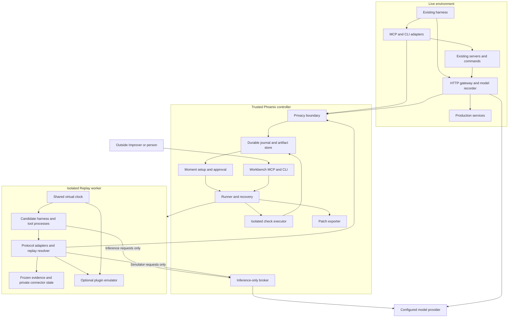

# Phoenix: Architecture

Status: November 15, 2026. Built from SPEC.md.

## 0. The shape

Phoenix is a TypeScript application launched with `npx`, with recording adapters in the live environment and a supervised controller operating an isolated Workbench. Adapters preserve MCP, CLI, HTTP, and model-provider protocols while recording redacted evidence durably. A plain moment manifest identifies a Snapshot or Scenario, its mark and frozen prefix, the original execution inputs, and an approved, locked success check. Each Replay gets immutable candidate code and an independent world. Tool calls follow the specified recorded, overlay, emulator, capture-time expansion, simulator, and divergence order. The outside Improver edits only declared files; Phoenix evaluates deterministic checks, records the Improver’s intent judgments, compares samples with a same-model baseline, protects previously passing moments, and exports an allowlisted patch with results and fidelity. Replay has no route or credentials for production connectors, and Phoenix never deploys.

## 1. Runtime picture



The controller runs on a machine the person operates. A worker runs on a supported isolated Linux runtime. The controller, evidence store, check authority, and model credentials are outside the candidate’s privilege boundary. Plugins and real tool processes are untrusted worker workloads.

A container backend is sufficient only for recipes whose clocks and local execution are completely covered. A VM-backed worker supplies guest-wide time for native workloads that cannot use those adapters. Neither backend inherits host credentials, devices, local IPC services, or unrestricted networking.

The Improver’s own model connection remains outside Phoenix. The Workbench exposes capabilities to an existing agent; it does not become an agent itself.

## 2. Units

| Unit | Language | Owns | May depend on | Must never depend on |
|---|---|---|---|---|
| Formats | JSON Schema, Markdown, generated TypeScript | Versioned public files and messages | Standards | Runtime implementations |
| Domain | TypeScript | Matching, resolution order, state transitions, grading | Formats | Filesystem, network, SDKs |
| Store and privacy | TypeScript, SQLite | Redacted journal, artifacts, durable operation state | Formats, storage adapters | Harness-specific behavior |
| Wire adapters | TypeScript | MCP lifecycle, CLI streams, HTTP and model protocols | Formats, transport libraries, explicit backend ports | Checks or connector semantics |
| Capture | TypeScript | Live forwarding, durable recording, recipe application | Wire adapters, store, privacy, plugin capture port | Replay execution or grading |
| Replay | TypeScript | Answer chain, occurrence cursors, world revisions, divergence | Domain, store ports, plugin and simulator ports | Live vendor clients or production credentials |
| Plugins | Any language | Connector Capture, semantics, serving, fidelity declaration | Public plugin files and messages | Core implementation packages |
| Sandbox and broker | TypeScript orchestration, standard runtimes | Process, filesystem, network, clock boundaries; inference access | Formats, runtime and provider adapters | Success-check decisions |
| Runner | TypeScript | Immutable candidates, reconstruction, samples, recovery, comparisons | Domain, store, replay, sandbox, checker ports | Named-harness branches |
| Checks | TypeScript | Deterministic expectations and isolated custom checks | Formats, sealed evidence | Candidate filesystem, simulator, approval authority |
| Setup | TypeScript | Corrections, evidence assembly, drafting, approval, locking | Formats, evidence, selected research model port | Rewriting checks during improvement |
| Workbench and export | TypeScript | Matching MCP/CLI operations, authorized edits, patches and reports | Runner and store APIs | Deployment or direct check writes |
| Recipes | Plain files, optional helpers in any language | Harness-specific configuration and capture capabilities | Public contracts | Internal imports |
| Reference harness | TypeScript | Small independent model/tool loop | Public harness contract and SDKs | Phoenix internals |

These are code boundaries, not a separate service for every row. Pure domain functions take explicit inputs. Transport, storage, model, clock, and plugin dependencies are replaceable ports, so behavior can be inspected without running an entire live stack.

## 3. Core pieces

### 3.1 Protocol-preserving Capture

Wire adapters separate transport lifecycle from semantic calls. A normalized call is an indexable view, not a replacement for recorded protocol evidence.

```ts
interface CaptureEvent {
  version: string;
  runId: string;
  sourceId: string;
  sequence: string;
  eventId: string;
  callId?: string;
  parentEventIds: string[];
  kind: string;
  wallTime: string;
  elapsedNs: string;
  payload: ArtifactRef;
}

interface CaptureSink {
  append(event: CaptureEvent): Promise<DurableReceipt>;
}
```

Before dispatching a request, Capture commits its redacted intent. Before delivering a response segment, it commits that segment’s redacted representation or explicit withholding record. Dispatch, partial response, delivery attempt, completion, cancellation, and unknown outcome are distinct events. Transport consumption by a remote process cannot be proven merely by writing to a socket.

The forwarding path preserves application content and protocol behavior. Semantic interpretation can happen afterward, but privacy processing and durable admission cannot be an asynchronous best-effort tee. Bounded buffering applies backpressure when storage is slow; inability to commit stops affected traffic rather than silently dropping events. This costs latency and can change timeout behavior. The availability conflict is explicit in Questions for the user.

**MCP.** Local stdio and remote Streamable HTTP carry ordinary MCP without changing the upstream server. Record protocol revisions, initialization or discovery, capabilities, tool-list revisions, schemas, result envelopes, content blocks, errors, notifications, and cancellation. Older transports retain their GET streams, session and resume relationships, and server-initiated exchanges; newer transports retain per-request version and capability information. Session secrets and bearer tokens are not persisted as public identifiers.

Use the official v2 SDK for Phoenix’s MCP endpoints and revision-aware codecs. It supports both protocol eras; modern serving is an explicit choice, not an automatic property of using v2. Capture does not probe, renegotiate, or upgrade the person’s existing connection. See the [SDK migration guide](https://ts.sdk.modelcontextprotocol.io/v2/migration/support-2026-07-28.html) and [older transport requirements](https://modelcontextprotocol.io/specification/2025-11-25/basic/transports).

Remote OAuth routing preserves resource identity and discovery semantics. A reverse endpoint is used only when the recipe supports that authorization arrangement. Otherwise an explicitly configured forward proxy can preserve the original URL. Phoenix does not weaken token audience validation to make interception work; [MCP authorization](https://modelcontextprotocol.io/specification/2026-07-28/basic/authorization) remains the governing contract.

**CLI.** Record executable identity, argument boundaries, working directory, relevant redacted environment, stdin, stdout, stderr, exit status, signals, and timing. Preserve pipe versus terminal behavior; use a pseudoterminal only when the original invocation requires one. Never construct shell commands by joining untrusted arguments.

PATH shims cover command lookup through PATH, not absolute paths, shell built-ins, or every descendant automatically. Recipes declare the actual interception mechanism and local artifacts needed to reconstruct effects. A recorded command response alone does not restore files or databases that command changed.

**HTTP and model APIs.** Prefer configured reverse endpoints, then explicit forward proxying with a locally trusted CA where supported. Preserve method, destination identity, meaningful query and header distinctions, payloads, response status, stream events, and timing. Live authentication is forwarded normally and stripped only from the recorded copy.

The model recorder preserves provider-native requests and streams rather than translating everything into one provider’s format. It records prompts, tool definitions, model parameters, tool-result messages, and available attachments. This is evidence of what reached the model, including results of unproxied tools. It is not evidence of hidden actions, unresolved remote attachments, or local effects the harness never reported.

Certificate pinning, application-layer encryption, unsupported transports, and bypassed routing remain explicit coverage gaps. Replay isolation still prevents those paths from reaching production.

Where known, parent links connect an agent tool call to its internal HTTP exchanges. Checks count the agent action once. Unknown correlation stays unknown rather than being guessed from adjacent timestamps.

### 3.2 Privacy and durable evidence

Only redacted material enters persistent storage. Authentication headers, cookies, credential fields, and signed secrets are stripped by default. Recipe and connector policies redact personal data in structured fields; content policies cover text, streams, and attachments.

Streaming privacy processing maintains state across chunks. Data cannot evade redaction merely because a credential spans packets. Material that cannot safely be represented is withheld, with a durable coverage record. A parsing failure never authorizes raw persistence. Debug logging and crash artifacts must not become an alternate raw capture store.

Consistent, scoped placeholders preserve relationships where useful. Their mapping secrets stay private and are never exported. Provenance identifies fields changed or withheld, not just a redaction count. The stored prompt is the redacted prompt: Phoenix cannot simultaneously remove a distinguishing fact and promise byte-identical reproduction of that fact.

The authoritative local store uses SQLite WAL with `synchronous=FULL`, through a dedicated writer. It holds event metadata, operation records, recording cursors, mutation references, and comparison identities. Independent events may share a transaction, but no durability receipt precedes its commit. The database resides on supported local persistent storage, not a network filesystem. See [SQLite WAL](https://sqlite.org/wal.html) and [synchronization guarantees](https://sqlite.org/pragma.html#pragma_synchronous).

Large redacted artifacts use content-derived identifiers. Write and synchronize an artifact, publish its final name atomically, synchronize the directory, and only then commit references. Recovery may find an unreferenced artifact; it must not find an acknowledged reference to an incomplete one. Content hashes are checked against bytes on import.

JSON Lines and ordinary artifact files are the portable representation. SQLite is an implementation detail, not a requirement for opening a shared Moment. Export is regenerated from committed records and does not modify live Capture.

This durability guarantee covers acknowledged local work on functioning persistent storage. No local recorder can atomically commit a vendor’s side effect with its own disk, recover an unobserved response, or survive destruction of the only storage device.

### 3.3 Harness declarations, recipes, and the reference harness

A harness declares the three required things: its launch command, where MCP and model endpoints are configured, and editable files.

```json
{
  "version": "1.0",
  "run": {
    "command": ["node", "dist/main.js"],
    "cwd": "."
  },
  "configuration": {
    "mcp": { "file": "harness.json", "pointer": "/mcpServers" },
    "model": { "environmentVariable": "MODEL_BASE_URL" }
  },
  "editable": ["prompts/**", "src/tools/**", "config/model.json"]
}
```

Configuration substitutions happen in launch overlays and isolated copies, not in production files. A git commit is useful identity, but is not mandatory: a content manifest can identify a self-built harness without a repository. A repository becomes necessary only when producing a repository patch or PR.

Recipes add version-specific configuration knowledge, CLI interception, provider dialect, local artifacts, continuation support, and clock requirements. These are optional capabilities of a recipe, not extra mandatory methods on every harness. Logical connector bindings are recipe or moment configuration, so shared data can be used by a different harness without renaming its tools.

The shipped collection covers the reference harness, a generic configured command, Claude Code, Codex, pi, fx, and Ozi. Coverage is recorded per harness version and authentication mode. Public configuration starting points include [Claude Code gateways](https://code.claude.com/docs/en/llm-gateway-connect), [Codex provider configuration](https://learn.chatgpt.com/docs/config-file/config-advanced), [pi endpoints](https://pi.dev/docs/latest/models), and [fx custom connections](https://fx.sh/docs/configure-fx/custom-model-connections). These settings do not prove coverage of subscription-login paths. A recipe never silently switches a person’s provider or authentication mode.

The reference harness is written from scratch in TypeScript, uses one model and a few MCP and CLI tools, and consumes only the public contracts. It has no privileged restoration mechanism unavailable to other harnesses.

### 3.4 Moments and setup

A Moment identifies an event boundary and causal frontier in a Run. A timestamp alone cannot distinguish overlapping calls. Pending operations at the mark retain their request, completion, and uncertainty relationships.

A Snapshot contains captured observations, state artifacts, and their coverage limits. It is not a claim of a globally atomic image across independent vendors. A Scenario contains explicitly seeded state or exchanges and can itself produce marked Runs. Both use the same manifest and Replay interface.

Setup:

1. Reads the Run, harness identity, Correction, and relevant documentation.
2. Resolves connectors, tools, clock requirements, available state, and missing coverage.
3. Assembles the Snapshot or Scenario, distinguishing initial state, frozen prefix, and later recordings.
4. Drafts the success check, including its evidence scope and configured sample count.
5. Presents it for approval and locks its content, referenced code, expectations, and data identity.

The person’s Correction is the default source. A one-off Correction stays contextual and does not become a check. Research and drafting can use a selected external model or the person’s existing agent; Phoenix does not ship an Improver or a separate judge.

A manifest may reference recordings after the mark as historical response evidence. They are not automatically initial state, and observations made after an original write cannot seed a world before that write without a justified reconstruction.

Read expansion happens at capture time, only over objects encountered and through explicitly authorized read-only operations. Its results have independent timestamps, object versions where available, and completeness markers. Read-only tool declarations inform policy but do not replace trust or restricted credentials. Expansion can consume rate limits and observe a different instant; it does not manufacture a simultaneous vendor snapshot.

Locking records a digest and approval authority outside the Improver’s workspace. Unattended Scenario locking requires explicit opt-in. Modifying a check or relevant data creates a new Moment revision requiring a new lock; historical results retain their old meaning. Adjacent hash files establish integrity only when the controller already trusts the approved digest—they do not establish approval by themselves.

### 3.5 Reconstructing a Replay

The runner separates the original prefix from the candidate continuation.

**From the beginning:** materialize the captured initial prompt, local artifacts, configuration, clock origin, and connector world; then run the candidate from its entry point. Later recorded exchanges are eligible only in their applicable context.

**From the mark:** use a recipe-supported continuation import, or execute the original harness through the prefix with recorded model and tool responses and captured local effects. Validate the reconstructed boundary, then hand off to the candidate through an actual continuation mechanism. Running edited code through a prefix while ignoring prompt differences is not restoration.

Previously consumed prompts, tool lists, messages, and side effects remain frozen. An initialization change that cannot take effect after the mark must be exercised from the beginning. A command’s recorded stdout is accompanied by its required local effects, or the reconstruction is incomplete.

The reconstruction interface is explicit:

```ts
interface StartState {
  mode: "beginning" | "mark";
  momentDigest: string;
  originalHarness: ArtifactRef;
  candidateHarness: ArtifactRef;
  prefix: ArtifactRef;
  localState: ArtifactRef[];
  connectorState: ArtifactRef[];
  clock: ClockDescriptor;
}
```

If hidden memory, unrecorded nondeterminism, local state, or lack of a continuation interface prevents restoration, the requested mode is blocked with the missing evidence named. A copied chat history is not silently advertised as the same execution state. Both Snapshots and Scenarios can use mark replay when that boundary is reconstructible.

### 3.6 Ordered resolution and connector state

```ts
interface ResolveRequest {
  replayId: string;
  callId: string;
  connectorId: string;
  surface: "mcp" | "cli" | "http";
  operation: string;
  arguments: unknown;
  wire: ArtifactRef;
  stateDigest: string;
}

type Resolution =
  | { kind: "answer"; response: ArtifactRef; provenance: Provenance }
  | { kind: "divergence"; reasons: string[]; evidence: ArtifactRef[] };
```

The fixed order is:

1. **Recorded response:** match connector, operation, arguments, relevant protocol information, occurrence, causal context, and applicable state.
2. **Overlay or derivation:** answer through explicit connector semantics using captured evidence and replay-local writes.
3. **Stateful emulator:** serve the seeded world through a plugin.
4. **Capture-time read expansion:** use compatible historical read-only observations.
5. **Simulator:** produce, validate, persist, and label a synthesized response; simulated writes are no-ops.
6. **Divergence:** stop and explain the unmatched call and each resolver’s reason for declining.

Canonicalization preserves meaning. JSON object key order can be normalized; arrays, omitted versus null fields, CLI argument boundaries, and meaningful query distinctions cannot be discarded casually. Semantic normalization requires a versioned connector rule. [RFC 8785](https://www.rfc-editor.org/rfc/rfc8785.html) supplies canonical JSON within its stated numeric and representational limits.

Recorded occurrences are consumed explicitly. Exhaustion is a miss unless connector semantics prove safe reuse. No “repeat the last answer forever” default exists. After a write, a recording that may be stale no longer matches merely because its request arguments do.

Each connector has one writable state authority. A plugin may implement an overlay, an emulator, or both behind that authority. A recorded successful write must update that authority when its effects are known. If its effects are unknown, mark affected state uncertain and invalidate potentially stale reads. Unknown state is not absence.

The commit boundary includes the call identity, selected recording occurrence, response, mutation, and next state reference. Repeating a committed call identity returns its result without applying a second mutation. An external emulator must support compatible transactional state publication or be reconstructed from the committed operation history before reuse; an uncertain in-memory emulator is never the authoritative world.

Derivation carries source references and a named transformation. A lookup from an adequate captured list is legitimate; inventing search ranking or treating one page as an exhaustive collection is not. Every sample has private state and cursors.

A connector chooses its interception boundary. With a real MCP server, the server executes and the resolver answers its underlying vendor HTTP calls; the MCP observation layer does not also substitute a second response. Hosted servers that cannot be redirected remain at tool-level recorded fidelity.

### 3.7 Plugins, emulators, and synthesis

A plugin is a separately installed package with a plain descriptor:

```json
{
  "pluginApiVersion": "1.0",
  "id": "example.calendar",
  "capture": ["calendar-plugin", "capture"],
  "serve": ["calendar-plugin", "serve"],
  "declaredTier": "stateful",
  "readOnlyTools": ["list_events", "get_event"],
  "snapshotSchema": "snapshot.schema.json"
}
```

`capture` receives a documented request file and recorded observations, then emits artifact references and a coverage report. `serve` receives a world descriptor and speaks versioned JSON messages over stdio or a declared local HTTP interface. Responses distinguish answered, unsupported, invalid input, and execution failure. Optional capabilities cover semantic derivation, state export, and recovery. No TypeScript inheritance is required.

Plugin processes receive only their supplied directories and capabilities. Replay serving has no production credentials or network route. A plugin’s declared tier is a ceiling; actual operations and Snapshot coverage determine effective fidelity.

Real server code over frozen vendor APIs is preferred when available, because production defaults, formatting, errors, and tool descriptions then come from that code. Plugins must not hide unsupported recurrence, permissions, pagination, or search semantics behind generic CRUD success.

[emulate](https://github.com/vercel-labs/emulate) and [Backlot](https://pypi.org/project/backlot/) are optional plugin dependencies, not core requirements. Importing real data losslessly and reproducing required operations remain connector-specific capabilities. Their current published licensing is Apache-2.0; selected releases, dependencies, and datasets need their own license identities.

The connector test kit is a standalone consumer of the public interface. Given supplied exchanges and state, it invokes capture and serve, compares wire behavior and available state exports, and reports differences, unsupported operations, and coverage boundaries. It supplies evidence for fidelity claims rather than granting a tier merely because a process ran.

The simulator is replaceable. It receives the unmatched call, relevant redacted evidence, actual tool schema where present, and recorded format examples. Where `outputSchema` is absent, Phoenix checks the real transport envelope and an explicitly inferred format contract. Text remains text; a JSON schema inferred from examples does not prove semantic truth. MCP makes [`outputSchema` optional](https://modelcontextprotocol.io/specification/2026-07-28/server/tools).

Accepted synthesis is stored before delivery. Its identity includes the Moment, connector, call, applicable state digest, and simulator configuration. Identical calls in the same world reuse the answer; different worlds do not accidentally share it. Synthesized write acknowledgments change no connector state. Failed validation never becomes a successful tool response.

### 3.8 Workbench isolation and time

Every worker has an immutable base, explicitly writable source paths, and separate disposable runtime directories. It receives fake connector credentials and frozen data, not production credentials or host homes. The success check, approval authority, and authoritative results are outside its writable filesystem.

Filesystem policy resolves paths beneath the workspace and rejects escapes through links or traversal. Runtime writes needed by a harness are allowed only in designated runtime areas; they cannot become exported source changes. The candidate’s source snapshot is frozen before execution, so later edits cannot alter an existing Replay’s identity.

Network enforcement lives outside the workload. It permits only the local replay services and inference broker, denying host services, bridge gateways, metadata endpoints, other workers, raw external addresses, unapproved ports, and alternate protocol routes. DNS redirection helps route traffic; it is not the safety boundary. Docker’s [`--internal`](https://docs.docker.com/reference/cli/docker/network/create/#internal) is insufficient without these additional restrictions.

The model broker retains provider credentials outside the worker and permits configured inference operations only. It does not expose arbitrary URLs, CONNECT tunnels, administrative provider APIs, or unchecked redirects. Provider-hosted search, remote MCP, and other external actions must be replaced with frozen local behavior or blocked. Remote attachments and similar references cannot quietly cause an unfrozen fetch.

Custom checks run in a separate OS-isolated process environment with immutable code and evidence, no network, and no access to the candidate’s writable files. Node permissions can be defense in depth, but are not the boundary; [Node documents that limitation](https://nodejs.org/docs/latest-v24.x/api/permissions.html).

The virtual clock has explicit wall and elapsed time:

```ts
interface ReplayClock {
  wallTime(): string;
  elapsedNs(): string;
}
```

The manifest fixes epoch, timezone, and clock policy. Prefix reconstruction follows captured time boundaries; candidate execution begins at the mark’s captured time and advances on the replay clock. Fakes use that same clock for timestamps, expiry, and recurrence. Controller supervision and the external inference broker use host monotonic time independently.

A process adapter is acceptable only when it covers the complete time-sensitive workload. Native clock syscalls and unsupported subprocesses require a VM-backed worker with its own initialized guest wall clock, disabled external time synchronization, and a controller-visible virtual clock shared with connector fakes. Guest initialization establishes time before launching the workload; changing the host’s clock is never necessary. QEMU provides the guest execution and clock machinery, not a claim of deterministic arbitrary program execution: [QEMU system documentation](https://www.qemu.org/docs/master/system/index.html).

A startup probe is diagnostic, not proof of full clock coverage. [libfaketime’s documented bypasses](https://github.com/wolfcw/libfaketime) and [time-namespace limits](https://man7.org/linux/man-pages/man7/time_namespaces.7.html) preclude treating either as universal. Unsupported coverage blocks that Replay mode instead of silently using today’s date.

### 3.9 Checks, samples, comparisons, and fidelity

The locked check can contain deterministic expectations, custom TypeScript, and plain-language intent. It specifies whether evidence applies to the whole Run or the candidate continuation, so frozen historical actions are not mistaken for new candidate behavior.

Built-in expectations cover calls and forbidden calls, matching arguments, order, call caps, connector end state, and final text. Order uses recorded causal relationships; ingestion order does not invent causality between concurrent actions. Custom checks receive sealed trace, final-state, final-text, and provenance artifacts. Their code and dependencies are part of the lock.

The Improver submits intent judgments with explanations and evidence for applicable samples. It cannot change the statement or override deterministic failure. Missing judgment leaves the assessment incomplete. Phoenix adds no separate judge agent.

The comparison fixes a configured sample count `n` before candidate outcomes are known. When the required samples are assessable and `f` fail, the Moment fails when `2 × f >= n`, exactly as the spec requires. Crashes and incomplete evidence do not shrink the denominator. Divergence prevents a pass unless the recorded evidence already establishes a binding failure; infrastructure interruption remains distinct from behavioral failure.

Reports distinguish:

- **Check satisfaction:** the configured samples meet the spec’s threshold.
- **Improvement:** the candidate satisfies the check and has a strictly higher sample success rate than the baseline on the same Moment and model.
- **Regression preservation:** every previously passing Moment still satisfies its check.
- **Incomplete assessment:** the configured evidence or samples cannot support the required conclusion.

An already-passing baseline does not waive the improvement requirement for a target fix. Previously passing regression moments need to remain successful, not strictly improve again.

Baseline cache identity includes Moment and check digests, original harness contents, model identity and exposed revision, generation settings, sample count, start mode, state artifacts, resolved plugin and tool identities, matching semantics, and clock policy. Candidate results additionally bind the frozen candidate. Floating provider model names are labeled as such.

For a model migration, report whether saved checks hold under the proposed model. If claiming an improvement, compare the original and candidate harness under that same proposed model. Cross-model behavior remains a migration comparison, not an equivalent same-model improvement result.

Provenance records observed, recorded, derived, emulated, seeded, and synthesized evidence, plus redaction and approximation. Connector tiers remain the spec’s stateful, recorded, synthesized, and blocked. The run grade is the weakest participating or required connector; an unavailable required connector cannot disappear from the grade merely because no successful call reached it.

Synthesis taint follows evidence dependencies into later model turns and decisions. An independently established deterministic failure remains binding. A required expectation that depends on invented facts cannot certify success. Unrelated, adequately evidenced checks remain usable, but cannot replace the missing requirement. When independence cannot be established, the result is inconclusive rather than a discounted pass.

### 3.10 Runner, Workbench, and export

The runner records durable operations before starting work. A supervised controller reconciles operation records with workers after restart, resumes orchestration, and returns the same operation for a repeated client request identifier.

```text
list_moments
read_moment
read_trace
read_fidelity
list_editable_files
read_file
apply_edit
replay
read_replay
run_checks
submit_intent_judgment
export_patch
```

The MCP server and CLI call the same application operations. Setup and approval are separate capabilities; the Improver’s Workbench capability contains no check-edit or approval operation.

Edits are acknowledged only after persistence. Replays use immutable candidate contents. An Improver disconnect does not cancel accepted work or discard results. Independent samples use separate state while sharing immutable artifacts. Connector mutations are serialized where their semantics require it.

Recovery retains partial attempts and reuses committed responses and mutations for the same scheduled sample. It never selects only favorable attempts. An incomplete model response is not a complete result; without protocol-supported resumption, recovery retains that attempt and repeats the incomplete operation rather than pretending to recover unseen bytes.

Export rechecks the editable allowlist against the immutable candidate. The patch contains only permitted source changes. Results, check identities, and fidelity accompany it as a separate report or PR description; private captured data is not automatically committed. Phoenix may create the requested PR against the harness repository using credentials outside the worker. It has no deployment operation.

## 4. Data flows

### Fix a live failure

1. A recipe launches the existing harness with MCP, CLI, HTTP, and model Capture configured. Authorized live credentials remain in the live environment.
2. Adapters persist redacted observations, timing, tool definitions, and required local effects. An agent marks the Moment or someone selects a recorded event afterward.
3. Setup turns the person’s Correction into a proposed check, assembles historical evidence, and locks the check after approval.
4. The runner creates the baseline from the original harness and frozen world, using the configured samples and model.
5. The Improver reads the trace, edits allowed files, and requests Replay from the beginning or a supported mark.
6. The resolver answers without production access. Phoenix evaluates deterministic checks; the Improver supplies intent judgments.
7. The runner compares the candidate with the baseline and checks preservation of the selected previously passing Moments.
8. Phoenix exports the patch and evidence. The person reviews and deploys outside Phoenix.

### Staging that was never live

1. The person supplies Scenario seeds or staged exchanges and a harness declaration.
2. Setup records the seeded origin and coverage, drafts the check, and obtains approval or explicit unattended-lock opt-in.
3. The runner materializes the world. A Scenario can produce a Run with a mark, allowing the same supported starting modes as a Snapshot.
4. Baseline, improvement, regression preservation, and export use the same operations as live-derived Moments.

### Regression sets

1. Freeze the selected Moment revisions, previously passing result references, candidate contents, and comparison settings.
2. Run independent samples against private worlds, reusing only equivalent baseline results.
3. Report every Moment. A regression prevents a change from passing; missing or unassessable results cannot establish no regression.

### Model or tool migration

1. Change an allowed model setting, tool description, or implementation.
2. Run against the same historical evidence, usually from the beginning when initialization changes.
3. Where possible, run the changed real tool over frozen vendor APIs. New calls follow the ordinary fallback chain rather than being forced into an old recording.
4. Report retained check satisfaction, migration differences, fidelity, and any separately established same-model improvement.

### Sharing

1. Package the manifest and selected redacted data by content identity, separately from tool implementations and credentials.
2. If export privacy processing changes evidence, create new references and a new Moment revision rather than retaining an invalid old lock.
3. The recipient validates the bundle, explicitly installs required tools or plugins, binds their own harness, and supplies model credentials outside the worker.
4. Imported code and launch instructions are never executed on the host merely because they appear in a manifest. Missing dependencies are reported.
5. Replay records any harness substitution explicitly, so reproduction and adaptation are distinguishable.

### A brand-new harness

1. Declare the launch command, endpoint configuration locations, and editable files.
2. Use the generic recipe and default proxies to record its exposed surfaces.
3. Create and approve a Moment through the ordinary setup path.
4. Connect an existing coding agent or work by hand. The same public interfaces support the reference harness and user-built harnesses.

## 5. Failure

| Failure | Behavior and recovery |
|---|---|
| Capture adapter or controller crashes | Recover committed events and operation identities, restart supervised components, and mark interrupted exchanges. Never invent missing responses. |
| Storage cannot commit | Stop affected admission and delivery. Preserve existing evidence; do not enter an unrecorded forwarding mode. |
| Live connection fails after a possible write | Preserve intent and unknown outcome. Do not automatically repeat non-idempotent actions. Resolve only through available vendor idempotency or status semantics. |
| Response stream is interrupted | Keep committed segments and delivery uncertainty. A partial stream is not a completed model or tool response. |
| Host loses power | On restart, recover durable work and reconcile workers. Unobserved external outcomes remain unknown; destroyed storage is outside local durability guarantees. |
| Improver disconnects | Persisted edits, accepted operations, and results remain addressable. Reconnection does not duplicate the work. |
| Worker crashes | Retain the attempt and reconstruct the same scheduled sample from immutable inputs and committed responses. Preserve all attempt history. |
| Plugin crashes | Restore its committed state or reconstruct the sample. Never substitute an empty world or treat infrastructure failure as invented vendor behavior. |
| Model request fails | Record the provider error. Resume only with supported protocol semantics; otherwise repeat incomplete work while retaining the earlier attempt. |
| Simulator output is invalid | Reject it before delivery. Report failure or divergence rather than silently repairing meaning. |
| Call cannot be answered | Stop with divergence, attempted sources, and missing evidence. No live fallback exists. |
| Clock or mark restoration is unsupported | Block the affected mode and identify the missing capability. Do not substitute host time or a fresh transcript-only run. |
| Check crashes or evidence is insufficient | Mark assessment incomplete. A check change requires a new approved Moment revision. |
| Input is malformed or hostile | Validate versions, references, paths, schemas, and resource bounds. Store only safely redacted evidence; isolate executable content. |
| Export or PR publication is interrupted | Rebuild from immutable identities. Reconcile an earlier publication before retrying it. |

Automatic recovery applies to local computation, not blind repetition of uncertain production side effects.

## 6. Data and versions

| Public format | Contents |
|---|---|
| `trace.jsonl` | Event identities, source sequences, causal links, wire references, timing, operation state, provenance, coverage |
| `moment.json` | Origin, mark, initial state and prefix, historical evidence, clock, prompt, model, harness and tool identities, tool lists, MCP revisions, check lock, sample configuration |
| `harness.json` | Launch, endpoint configuration locations, editable files |
| `plugin.json` | Capture and serve commands, interface version, fidelity and read-only declarations, optional state capabilities |
| Recipe files | Harness version and authentication applicability, endpoint substitutions, CLI capture, continuation and clock capabilities |
| `check.json` | Expectations, custom TypeScript references, intent, evidence scope, approval or unattended Scenario opt-in |
| `result.json` | Comparison identities, sample attempts and outcomes, deterministic evidence, intent judgments, divergence, fidelity, regression result |
| Artifact files | Redacted messages, bodies, local state, connector state, seeds, custom check code, and referenced streams |

Schemas are authoritative and generate TypeScript bindings. Files remain usable from any language. Binary content is referenced, not coerced into text. Large integers and nanosecond values use strings where JSON numeric precision is insufficient.

Per-source sequence and explicit parent links carry ordering. A store’s ingestion order is useful for reading but is not proof of cross-service causality. Every derived artifact records its input references and transformation identity.

Execution identity includes harness commit or content digest, captured patch where applicable, tool and dependency identities, recipe and plugin versions, model parameters and exposed revision, protocol revisions, clock policy, and redaction effects. Version ranges resolve to concrete identities before execution.

Each format has its own version. Optional additive fields are allowed only when ignoring them cannot change safety or meaning. Required capabilities are explicit; unsupported majors or required capabilities are rejected. Migration produces new artifacts and references rather than mutating history. Phoenix does not promise indefinite execution support for every historical major.

Data stays separate from code. A shared manifest names independently supplied tool dependencies; it does not need to contain their implementations. Custom check code, when included, remains visibly executable content governed by its lock and sandbox.

## 7. Repo layout

```text
formats/
  trace/
  moment/
  harness/
  plugin/
  recipe/
  check/
  result/
packages/
  contracts/
  domain/
  store/
  privacy/
  wire/
  capture/
  replay/
  plugin-host/
  sandbox/
  model-broker/
  runner/
  checks/
  setup/
  workbench/
  export/
  cli/
  connector-kit/
recipes/
  generic/
  claude-code/
  codex/
  pi/
  fx/
  ozi/
reference-harness/
docs/
```

`contracts` depends on public formats; `domain` depends only on contracts. Runtime adapters implement ports. Capture never imports Replay or grading. Replay never imports production vendor access. The runner composes capabilities without named-harness branches. CLI and MCP interfaces share application operations instead of duplicating domain logic.

Recipes, separately installed plugins, and the reference harness consume public contracts only. Private captured data lives outside source folders. A harness repository may contain deliberately selected manifests and redacted artifacts; Phoenix does not automatically place its private store there.

## 8. Build order

1. Define trace, manifest, harness, plugin, check, provenance, and result contracts together with domain invariants. Public boundaries precede implementation-specific storage.
2. Build privacy-aware durable storage and the transport adapters, then MCP, CLI, HTTP, and model Capture. Add the reference harness and recipes as consumers of those interfaces.
3. Build worker isolation, the inference broker, required clock support, strict recorded resolution, and divergence. Recorded Replay from the beginning depends on all of these, not just a matcher.
4. Build Moment and Scenario assembly, check locking, immutable candidates, authoritative checks, baseline sampling, recovery, and comparison. The Workbench and patch exporter compose this complete loop.
5. Add mark reconstruction through supported continuation and captured local state. Extend resolution with connector-owned overlays, derivation, and capture-time read expansion.
6. Add stateful emulator adapters and connector-kit reporting against the established plugin contract. State publication and clock participation precede relying on their end state.
7. Add schema-checked synthesis and dependency-aware fidelity handling. Automated setup drafting uses the established approval workflow, never replaces it.

Recipes are implemented with their underlying capture and restoration capabilities. A build stage does not make unsupported harness modes, clocks, or connector semantics implicitly faithful.

## 9. Libraries

| Choice | Why and boundary | Source |
|---|---|---|
| TypeScript and Node.js | Core runtime launched with `npx`; process, stream, HTTP, and filesystem adapters | [TypeScript](https://www.typescriptlang.org/docs/), [Node.js](https://nodejs.org/api/) |
| Official MCP TypeScript SDK v2 | Workbench endpoints and revision-aware codecs for modern and legacy MCP; configuration explicitly selects supported behavior | [SDK](https://github.com/modelcontextprotocol/typescript-sdk), [protocol-era support](https://ts.sdk.modelcontextprotocol.io/v2/migration/support-2026-07-28.html) |
| Node HTTP/HTTPS and stream primitives | Provider-native reverse recording with explicit backpressure and durable-delivery ordering | [HTTP](https://nodejs.org/api/http.html), [streams](https://nodejs.org/api/stream.html) |
| Mockttp | Programmable HTTP replay endpoints and configured proxy/TLS machinery; observation callbacks alone are not durable Capture acknowledgments | [Repository](https://github.com/httptoolkit/mockttp), [API](https://httptoolkit.github.io/mockttp/interfaces/Mockttp.html) |
| mitmproxy, optional recipe helper | Additional explicit interception modes where endpoint substitution is unavailable; usable only with the same privacy and durability contract | [Modes](https://docs.mitmproxy.org/stable/concepts/modes/) |
| `node:child_process`, optional `node-pty` | Argument-safe process execution and faithful pipe or terminal behavior | [Child processes](https://nodejs.org/api/child_process.html), [node-pty](https://github.com/microsoft/node-pty) |
| SQLite and `better-sqlite3` in a writer worker | Durable local transactions, matching indexes, and recovery without a database service | [SQLite WAL](https://sqlite.org/wal.html), [better-sqlite3](https://github.com/WiseLibs/better-sqlite3) |
| Ajv | Public-format and output validation with explicit schema dialects and controlled reference resolution | [Schema support](https://ajv.js.org/json-schema.html) |
| JSON Schema tooling and RFC 8785 canonicalization | Language-neutral contracts, generated bindings, and reproducible identities without redefining semantics | [json-schema-to-typescript](https://github.com/bcherny/json-schema-to-typescript), [RFC 8785](https://www.rfc-editor.org/rfc/rfc8785.html) |
| OCI container runtime and QEMU-backed workers | Container isolation where recipe coverage suffices; guest-wide clocks and native-process isolation where it does not | [OCI runtime specification](https://github.com/opencontainers/runtime-spec), [QEMU](https://www.qemu.org/docs/master/system/index.html) |
| Git CLI | Repository diffs and optional worktree-backed edit workspaces, not the portable data format | [Git diff](https://git-scm.com/docs/git-diff), [worktrees](https://git-scm.com/docs/git-worktree) |
| emulate and Backlot, optional | Existing stateful API behavior behind independently installed plugins | [emulate](https://github.com/vercel-labs/emulate), [Backlot](https://pypi.org/project/backlot/) |

No hosted Phoenix service, cloud scheduler, remote database, or mandatory model-provider SDK is required. Speed comes from indexed matching, compiled validators, immutable artifact reuse, copy-on-write worlds, and independent sample execution. State ordering, durable acknowledgments, and privacy processing remain on the correctness path.

## 10. Risks and open questions

**Capture coverage is not universal merely because endpoints are configurable.** Absolute command paths, hidden local effects, pinned TLS, and provider-side actions can escape observation. Recipe capability declarations and boundary evidence determine what was captured; the model recorder covers only the model-visible view.

**Exact arbitrary continuation is not implied by the harness contract.** Hidden memory and nondeterministic local execution can prevent mark restoration. The relevant evidence is a supported continuation format or a reconstructible original boundary with captured local effects. Without it, only other supported starting modes are available.

**Privacy and identical prompts can conflict.** Redaction may remove the cause of the failure. Field-level provenance and the approved privacy policy determine whether the retained Moment remains useful; a pattern recognizer cannot prove that all personal data has been found.

**A distributed Snapshot can be incomplete or temporally inconsistent.** Observation times, object revisions, completeness markers, and original writes determine which facts can coexist at the mark. Later expansion cannot silently repair missing historical state.

**Emulator coverage can fail on the exact behavior being corrected.** Recurrence exceptions, attendee effects, search ranking, permissions, and pagination need connector semantics, not generic entity paths. The connector kit exposes differences using supplied recordings and state; a plugin label alone is insufficient.

**Model and authentication paths can change.** Floating model aliases, subscription backends, and harness configuration updates may prevent identical execution. Record exposed identity and actual routing; do not infer that configurable API-key paths cover subscription logins.

**The Improver judges its own plain-language result.** A locked target prevents changing the requirement, not self-serving interpretation. Preserve its evidence and explanation, and keep deterministic failures binding. This is the spec’s explicit tradeoff against a separate judge.

**Sandbox compatibility has limits.** Native macOS-only tools cannot necessarily execute in a Linux worker. Recorded CLI behavior may suffice only when required local effects are captured. The recipe must distinguish recorded behavior from executing the original native tool.

**Crash recovery cannot make external systems transactional.** Committed local work is recoverable; uncertain live writes and incomplete provider responses remain uncertain. Safe recovery must not convert that uncertainty into duplicate external actions or false completion.

## 11. Questions for the user

1. When durable Capture is unavailable, should production pause or continue with an explicitly incomplete Run? This design pauses affected traffic; guaranteed recording and uninterrupted forwarding cannot both survive every storage failure.
2. What is the default privacy policy for task-relevant personal text and attachments? Removing that information can prevent the same prompt and failure from being reconstructed.
3. Is blocking unsupported mark restoration acceptable while retaining replay from the beginning when possible? The three required harness declarations cannot expose arbitrary hidden execution state.
4. Should model migration use the proposed distinction between preserving saved checks under the new model and claiming improvement against the original harness under that same new model?
5. Which exact Ozi and fx distributions and authentication modes are intended? Public endpoint configuration does not settle every private or subscription path.
6. What sample count should setup propose? The design requires it to be fixed per comparison and implements the specified threshold without inventing a default.
7. Should additional capture-time read expansion require explicit opt-in per connector, given its effect on account rate limits and service usage?
