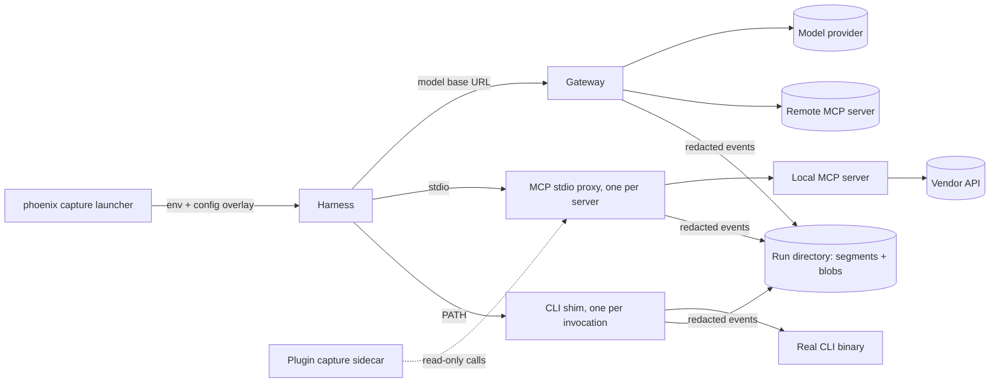
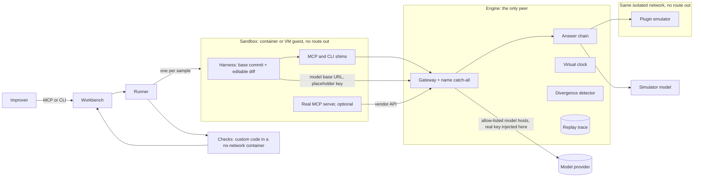

# Phoenix: Architecture

Status: November 15, 2026. Built from SPEC.md.

## 0. The shape

Phoenix is a TypeScript monorepo, run with npx, built around one idea: every tool surface (MCP over stdio, MCP over Streamable HTTP, CLI commands, direct HTTP calls, and the model API) is handled by a **tap** that relays wire traffic unchanged, turns a copy of it into a normalized `Call`, and hands it to a **backend**. During Capture the backend is the real upstream plus a recorder that writes redacted events to an append-only trace and never holds up a call. During a Replay the backend is the **answer chain**, which answers from the recording, the overlay, an emulator, pre-run read-only results, or the simulator model, and otherwise stops with a divergence. The harness is pointed at the same kinds of endpoints in both modes, so nothing about the harness changes between live and replay except where its config points. A Moment is a directory of plain files (manifest, success check, lock, data) that sits in git. A Replay runs a frozen copy of the harness (the base commit plus only the editable changes) inside a sandbox whose only network peer is the Phoenix engine, so every outbound byte takes one path, no real system is reachable, and no real credential is inside. The Workbench is a thin API over the runner, exposed as an MCP server and a matching CLI, and it contains no code that can write a success check. Everything language-neutral (trace, manifest, check, harness contract, plugin and recipe descriptors) is defined by JSON Schemas in `spec/`, and plugins and recipes are separate processes or data files, so the core works with none installed.

## 1. Runtime picture

**Capture (live, alongside the harness, no container):**



**Replay (inside the Workbench):**



In Capture every recorder is its own process writing its own file, so there is no shared daemon to lose. In a Replay the engine is the single controlled path the spec asks for.

## 2. Units

| Unit | Language | Owns | May depend on | Must never depend on |
|---|---|---|---|---|
| `spec` | JSON Schema, Markdown | The versioned definitions of trace, moment manifest, success check, lock, harness contract, plugin descriptor, recipe descriptor, replay result | nothing | any code |
| `formats` | TypeScript | Types generated from `spec`, validators, version checks | `spec` | every other unit |
| `store` | TypeScript | Run directories: segment writer, blob store, merged reader, crash recovery; moment bundle reader and writer | `formats` | taps, replay, Workbench |
| `redact` | TypeScript | Pure redaction of events before they are written | `formats` | I/O of any kind |
| `wire` | TypeScript | Pure codecs: MCP framing and era detection, CLI invocation records, HTTP exchange normalization, model-API dialects, call keys | `formats` | I/O of any kind |
| `taps` | TypeScript | The listeners for each surface, each taking a `Backend` | `wire`, `formats` | `capture`, `answer`, knowledge of live vs replay |
| `capture` | TypeScript | Launcher, passthrough backends with recorder tee, recipe application, flag and correction commands, plugin capture host | `taps`, `store`, `redact`, `plugin-host`, `formats` | `answer`, `engine`, `runner`, `workbench` |
| `model` | TypeScript | `ModelProvider` port and its adapters | `formats` | everything else |
| `answer` | TypeScript | Answer chain, matcher, entity overlay, prefetch and simulator resolvers, divergence | `wire`, `store`, `plugin-host`, `model`, `formats` | `taps`, `sandbox`, `workbench` |
| `engine` | TypeScript | Replay-side server: taps wired to the answer chain, MCP responder, virtual clock, replay trace | `taps`, `answer`, `store`, `redact`, `formats` | `workbench`, `setup` |
| `sandbox` | TypeScript | `Sandbox` port, the container driver, the VM driver | `formats` | everything else |
| `checks` | TypeScript | Deterministic expectation evaluators, custom-check host, sample and moment verdicts | `store`, `wire`, `sandbox`, `formats` | `engine`, `workbench`, `setup` |
| `runner` | TypeScript | Builds a Replay from a manifest, runs samples, records results | `engine`, `sandbox`, `checks`, `store`, `formats` | `workbench`, `setup` |
| `setup` | TypeScript | Turns a marked point or a Scenario into a moment bundle, drafts and locks the success check | `store`, `wire`, `plugin-host`, `model`, `formats` | `workbench`, `runner` |
| `workbench` | TypeScript | `WorkbenchApi`, its MCP server, workspaces, patch and pull-request output | `runner`, `store`, `checks`, `formats` | `setup`, any check-writing code |
| `plugin-host` | TypeScript | Finds plugin descriptors, starts plugin processes, speaks the plugin protocol | `sandbox`, `formats` | any specific plugin |
| `plugin-kit` | TypeScript | The test kit: runs recorded exchanges through a plugin and diffs | `plugin-host`, `store`, `wire`, `formats` | `workbench` |
| `cli` | TypeScript | The `phoenix` binary; the only place units are wired together | all units | — |
| `recipes/*` | YAML, shell | Capture recipes for Claude Code, Codex, pi, fx, Ozi and a generic one | `spec` | core internals |
| `plugins/*` | any | Connector plugins, separately installed | `spec` | core internals |
| `reference-harness` | TypeScript | The small from-scratch harness | the harness contract in `spec`, the MCP client SDK | every Phoenix package |

## 3. Core pieces

### 3.1 Taps and backends

A tap owns one surface's wire format and nothing else. It decodes a request into a `Call`, asks its backend for an answer, and streams the answer back in the surface's own wire format.

```ts
interface Call {
  surface: "mcp" | "cli" | "http" | "model";
  layer: "agent" | "under";   // "under" = made by a tool server beneath an agent-level call
  parent?: CallId;            // set when the enclosing agent-level call is known
  connector: string;          // logical name, e.g. "calendar"
  op: string;                 // "tools/call:move_event", "gh", "GET api.notion.com/v1/pages/{id}"
  args: unknown;              // normalized arguments
  raw: WireRequest;           // exact bytes and headers as received
}
interface Answer {
  raw: WireResponse;          // exact bytes to send back, streamable
  provenance: "real" | "recorded" | "derived" | "synthesized";
  resolver: string;           // which step produced it
}
interface Backend { handle(call: Call, signal: AbortSignal): Promise<Answer>; }
```

There are four taps:

- **MCP stdio.** A process that sits where the server command used to be. It relays newline-delimited JSON-RPC lines in both directions.
- **MCP Streamable HTTP.** A reverse route in the gateway (`/mcp/<name>`), relaying POST bodies, the request-scoped SSE stream, and, for older revisions, the session header and GET stream.
- **CLI.** A shim placed first on `PATH` for each declared command. It carries argv as an array, working directory, an allow-listed slice of the environment, stdin, stdout, stderr and the exit code or signal. If the shim's own stdout is a terminal it gives the child a pseudoterminal; otherwise it uses pipes, so a command never sees a different kind of stream than it would without Phoenix.
- **HTTP gateway.** One listener with three entry modes: reverse (the harness's base URL points at it), forward proxy (`HTTPS_PROXY` with a local CA), and transparent (used only inside the sandbox). It serves the model API, direct API calls, and vendor API traffic from a real MCP server.

Rules every tap keeps:

1. A tap forwards before it interprets. In Capture, bytes go to the upstream as they arrive and a copy goes to the recorder; decoding happens on the copy, off the forwarding path. A decode error never stops forwarding.
2. A tap never rewrites a message and never answers a protocol message itself in Capture. The MCP taps carry both protocol eras unchanged: the handshake-based revisions up to 2025-11-25 (with `initialize`, sessions and server-initiated requests) and the stateless 2026-07-28 revision, where each request carries its version in `_meta`, `server/discover` replaces `initialize`, servers no longer initiate requests, and a server asks for more input by returning `resultType: "input_required"` ([changelog](https://modelcontextprotocol.io/specification/2026-07-28/changelog), [transports](https://modelcontextprotocol.io/specification/2026-07-28/basic/transports), [versioning](https://modelcontextprotocol.io/specification/2026-07-28/basic/versioning)). A client that probes a stdio server by launching it a second time simply gets a second proxy process relaying to a second server process.
3. A tap knows nothing about live versus replay. That choice is the backend it was given.
4. Agent-level calls and calls underneath them are kept apart. An HTTP request made by a local MCP server while one of its `tools/call` requests is in flight is recorded with `layer: "under"` and, when exactly one call is in flight on that server, that call as `parent`. When the parent cannot be known it is left empty.

### 3.2 Capture

`phoenix capture -- <harness command>` is the launcher. It creates the run directory, applies a capture recipe as an overlay (environment variables, command-line config overrides, or a generated copy of a config file; the person's own files are not edited), starts the gateway on a loopback port as a supervised child, runs the harness, and closes the run when it exits. `PHOENIX_RUN_ID` and `PHOENIX_HOME` reach every proxy and shim through the inherited environment.

- **MCP proxy.** The recipe rewrites each stdio server entry to `node <phoenix>/mcp-proxy.js -- <original command>` and each remote entry to the gateway's `/mcp/<name>` route. The server itself is untouched. The proxy records every message in both directions, every tool list it sees (including later changes), and the protocol version actually used: from the `initialize` result on older servers, and from per-request `_meta` and `server/discover` on current ones.
- **CLI proxy.** The recipe puts a shim directory first on `PATH`. A shim records the invocation and its streams, then runs the real binary found on the rest of `PATH`.
- **Model-API recording.** The gateway in reverse mode forwards to the real provider and records the full request and the full streamed response in the provider's own format. Because each request contains every tool result the model was shown, this is the record of what the model saw from tools nobody proxied, and a second witness for tools that were.
- **Direct API calls.** The forward-proxy mode records them. It needs the local CA trusted by the calling process, so recipes turn it on only where that is known to work.
- **Plugin capture.** A connector plugin may declare a `capture` command. The capture host runs it as a sidecar, streams it that connector's recorded events, and executes the read-only calls it asks for on the same upstream connection. The host refuses any tool the plugin did not declare read-only. Results are written as `prefetch` events with their own timestamps and are never sent to the harness. This is how a stateful connector's state, and the pre-run read-only answers of step 4, exist before anything goes wrong. It is off unless the person turns it on for that connector.
- **Flagging.** `phoenix flag "<reason>"` writes a mark to the current run. An opt-in one-tool MCP server does the same for harnesses that prefer a tool. Neither is added unless the person adds it, so default Capture never changes what the agent sees.
- **Corrections.** `phoenix correct <run> --at <event> "<text>" [--one-off]` appends a Correction to the run's notes, during the run or afterward.
- **Coverage record.** At close the launcher writes which surfaces were tapped for this run (each MCP server, each shimmed command, the model API, forward proxy on or off) and which were configured but saw no traffic. A surface that was not tapped is named as such.

**Recording path.** In the gateway and the stdio proxy, forwarding runs on the main thread and the recorder runs on a worker thread fed through a bounded queue. The worker assembles each exchange, redacts it, and appends it. Each event is written with one `write()` to a file opened for append, with no buffering in the process, so a recorder crash loses nothing that was handed to the operating system. Segments are synced to disk on a short timer and when a recorder closes.

**Redaction** runs in the recorder before the write call, so unredacted bytes never reach disk:

```ts
redact(event: TraceEvent, policy: RedactPolicy): { event: TraceEvent; count: number }
```

The default policy strips auth headers (`Authorization`, `Proxy-Authorization`, `Cookie`, `Set-Cookie`, `x-api-key` and similar) from the recorded copy, replaces values under secret-named keys and values matching secret patterns, and replaces detected personal data. A replaced value becomes a typed placeholder derived from an HMAC of the original under a key that stays in `PHOENIX_HOME`, so the same value always maps to the same placeholder and replay matching still works. Redaction runs over the whole assembled body, so a secret split across network chunks is still caught. The count of redactions is kept on each event.

Rules Capture keeps:

1. Recording never blocks, delays or fails a call. If the queue is full or the disk fails, the recorder drops the event, writes a `gap` marker when it can, and keeps forwarding. A gap in a tool recorder is visible in the trace and the affected tool results can still be read from the model-API record.
2. A recorder writes only its own segment file. There are no locks between recorders.
3. A `call` event is written when the request is seen and a `result` event when the response ends, so a call that never returned is visible as such. A dropped connection gives an `aborted` result with the bytes received. Phoenix never retries a live call.

### 3.3 Trace store

A run is a directory:

```
runs/<run-id>/
  run.json            written once: harness name and commit, recipe and version, start time
  coverage.json       written at close: surfaces tapped
  seg/<recorder>.jsonl  one append-only file per recorder process
  blobs/sha256/..     bodies above a size threshold, named by content hash of the redacted bytes
  notes.jsonl         marks and corrections, append-only
```

```ts
interface TraceWriter { append(e: TraceEvent): void; close(): Promise<void>; }
interface TraceReader { events(run: RunId, from?: EventId): AsyncIterable<TraceEvent>; }
```

A blob is written to a temporary name, synced, and renamed before the event that refers to it is appended, so an event never points at a partial blob. The reader merges segments by timestamp, then recorder id, then sequence number, and drops a torn final line. Reading needs no index and no database; a run can be read while it is still being written. Run directories are private and are never published; only moment bundles are shared.

### 3.4 Moments and the setup step

A Moment is a bundle directory: `moment.yaml`, `check.yaml`, `moment.lock.json`, and `data/`. It holds data only, never harness or tool code, which is what lets it be shared on its own.

A **mark** is an event id in a run. "Before the mark" means every event earlier in the merged order. A call that started before the mark and finished after it belongs before the mark, and its recorded result is part of the frozen prefix.

`setup` builds a bundle in fixed steps, each a function from files to files:

1. **Locate.** Take a mark (flagged or picked) in a run, or a Scenario description.
2. **Find connectors.** Group the run's agent-level events by connector and surface.
3. **Collect the Snapshot.** Copy the connector's exchanges, plugin state and prefetch results into `data/`, each object keeping the time it was observed and the call it came from; copy the model exchanges before the mark as the frozen prefix; record prompt, model identifier as the provider reported it, clock time and timezone, harness commit, recipe version, tool lists and MCP protocol version and era. Setup only uses what Capture already recorded. It never queries a vendor's present state.
4. **Pick tiers.** A connector with a plugin gets at most the plugin's declared tier; one without gets `recorded`.
5. **Infer formats.** Build a JSON Schema per tool from its recorded responses and note where a declared `outputSchema` disagrees with what was recorded.
6. **Draft the check.** The draft is a file, `check.draft.yaml`. `phoenix check draft` writes it by reading the trace, the harness files and any docs the person names, through the `ModelProvider` port, starting from the Correction if there is one that is not marked one-off. The person, or an agent of theirs working outside the Workbench, may write or edit the same file.
7. **Lock.** `phoenix check approve <moment>` shows the draft to the person and, on approval, writes `check.yaml` and `moment.lock.json` (hashes of the check, any custom check file and every data file, who approved, when). For a seeded Scenario the manifest may set `lock: auto`, which locks without approval. Changing a locked check means a new moment revision with a new lock; results stay attached to the hash they were run against.

For a Scenario, steps 2 and 3 are replaced by the author's seed files: emulator state in the plugin's state format, or hand-written exchanges. The manifest says `source: scenario` and its data is marked `origin: seeded`, never `captured`. From step 4 on, both kinds are the same bundle and replay the same way.

### 3.5 Answer chain

The replay layer is an ordered list of resolvers. Each returns an answer or a reasoned miss; the chain returns the first answer.

```ts
interface Resolver { name: string; resolve(call: Call, ctx: ReplayCtx): Promise<Answer | Miss>; }
type Miss = { miss: true; why: string };
```

In the order the spec fixes:

1. **Recorded.** The call key is the SHA-256 of the canonical JSON ([RFC 8785](https://www.rfc-editor.org/rfc/rfc8785)) of surface, connector, op and normalized args, with volatile argument paths (declared by a plugin) removed. Only object key order is normalized: array order, null versus absent, and argv boundaries are kept. When several recorded exchanges share a key, the k-th call gets the k-th response; a call beyond the recorded count gets the last one and the answer is noted as reused. A hit is served byte for byte, unless the connector's state holder has a write touching an entity in it, in which case step 2 or 3 answers.
2. **Overlay.** Driven by a declarative **entity map** in the connector's plugin descriptor: for each tool, its kind (list, get, create, update, delete), the entity type, the paths to ids and items in arguments and results, and how a list result shows that it is complete. From this the core materializes the entities seen in recordings, applies writes made during the Replay on top, and derives answers, such as a single-event lookup from an earlier list. An entity that was never seen is a miss, not "not found", unless a complete list covering it was recorded. A connector with no entity map has no overlay.
3. **Emulator.** For connectors whose plugin has a `serve` command, the plugin host starts it seeded from the Snapshot. It answers at the vendor-API level (the gateway routes the vendor's hosts to it) or at the tool level.
4. **Prefetch.** Results of read-only tools that the plugin capture sidecar ran at capture time, matched by the same call key.
5. **Simulator.** Only for connectors whose manifest entry allows `synthesized`. The simulator model writes a response in the tool's format; it is validated against the inferred schema (and the declared one, if any), stored under the call key in the moment's workspace before it is served so every repeat and every sample gets the same answer, and tagged `synthesized`. Calls to tools not declared read-only return a synthesized acknowledgement and change nothing.
6. **Divergence.** The chain stops the sample and records the call and every resolver's reason for missing.

Each connector has exactly one state holder in a Replay: the overlay or the emulator, never both. Each sample has its own. A write that no state holder tracked (a no-op write, or a recorded write on a connector with neither) sets an `untracked write` flag on that connector for the rest of the sample. Later answers on that connector are still served and are tagged with the flag, which feeds the taint rule in 3.8.

The divergence detector is the last step plus four other triggers, all recorded the same way: an outbound connection the gateway cannot map to a connector, a TLS handshake the client refused, a call in the frozen prefix that does not match the recording, and a model request that declares provider-run tools.

Rules: the chain order is fixed in code and not configurable per moment; a manifest can only remove steps for a connector, never reorder them. Every answer carries its provenance and resolver. `real` means real code produced it (the live system during Capture, or the real MCP server running over replayed vendor data); `recorded` means bytes from the log or prefetch; `derived` means computed from recorded data by the overlay or an emulator; `synthesized` means the simulator. No resolver may return data without one of the four.

### 3.6 Engine, sandbox and virtual clock

**Engine.** One process per sample. It hosts the taps with the answer chain as their backend, the clock, and a trace writer, so a Replay produces a full trace in the same format as a live run. The matcher's index is built in memory from the bundle when the engine starts.

For MCP the engine is the server side of the wire, driven by the recording. It answers in the recorded era: a connector recorded on an older revision gets the recorded `initialize` result and rejects `server/discover` the way the recording shows; one recorded on 2026-07-28 answers `server/discover` and stamps each result as recorded. Tool lists are served as recorded. For a `tools/call`, the recorded messages the server sent during that call (progress, and on older revisions server-initiated requests) are replayed in order before the result; an `input_required` result and the retry that follows are two ordinary calls matched by key.

For the model API the backend has two phases:

- **Frozen prefix.** When a Replay starts from the mark, the harness is still launched from the start, and until the mark the engine answers model requests with the recorded model responses and tool calls with their recorded results only. Model requests are matched by a key that ignores the system prompt and tool descriptions, then by order. Recorded writes in the prefix are also applied to the connector's state holder, so at the mark it equals the captured world at the mark. This freezes everything before the mark exactly as it was, for any harness, with no harness-specific state restore. If the candidate's edits make the prefix issue a different call, the sample stops with a prefix-drift divergence, and the change needs a Replay from the beginning.
- **Live.** From the mark onward (or from the first request, when starting from the beginning) model requests go to the real provider through the allow-list and tool calls go through the answer chain.

The engine's allow-list holds the model provider hosts for the harness's model and for the simulator model, and nothing else. The sandbox holds only a placeholder key; the engine adds the real credential on the allow-listed request. A model request that declares provider-run tools which reach outside systems, such as Anthropic's web search tool or MCP connector ([docs](https://platform.claude.com/docs/en/agents-and-tools/mcp-connector)), is refused and reported as a divergence with tier `blocked`, because the provider would execute them against the live world.

**Sandbox.**

```ts
interface Sandbox {
  readonly clock: "preload" | "guest";
  start(spec: { image: ImageRef; argv: string[]; env: Record<string,string>;
                mounts: Mount[]; peer: EngineAddr; epoch: Instant }): Promise<SandboxProcess>;
}
```

Two drivers implement the port and keep the same contract.

- **Container driver.** It creates an internal network ([`docker network create --internal`](https://docs.docker.com/reference/cli/docker/network/create/)) whose members are the sandbox container, any emulator containers, and the engine container. Only the engine is also attached to a network with egress. The sandbox's name server is the engine, which resolves every name to itself and accepts those connections in transparent mode, so traffic from clients that ignore proxy settings still lands on the gateway and is either answered or reported; a connection to a raw address has no route.
- **VM driver.** The same image runs inside a hardware-accelerated guest whose single network device reaches only the engine (for QEMU, user networking with `restrict=on` and a forward to the engine, [QEMU manual](https://www.qemu.org/docs/master/system/qemu-manpage.html)). The guest has no time synchronization, and its init sets the guest's real-time clock to the captured time before the workload starts.

In both, the harness tree is the base commit plus only the Improver's changes to editable paths, materialized fresh for each Replay; the moment bundle and the check are not mounted at all; the host's home directory, credentials, agent sockets and container socket are absent. Stdio MCP entries point at a shim that relays to the engine, CLI shims do the same, and the model and remote-MCP base URLs point at the engine over plain HTTP, so the main paths need no CA. If the harness contract marks a connector `serve: real`, the real MCP server runs in the sandbox and only its vendor API traffic is redirected, which is the spec's most faithful setup. A vendor-hosted MCP server cannot be redirected and is answered at the tool level from the recording.

Rules: the sandbox has no route except to the engine; the engine forwards only to allow-listed model hosts; no real credential enters the sandbox; there is no flag that turns any of these off.

**Virtual clock.** A small state (virtual anchor, real anchor) owned by the engine and anchored to the captured time at Replay start and again at the mark. Plugin emulators get it from a `now` endpoint, and the engine uses it for the `Date` headers it writes. The harness gets it one of two ways. Under the container driver, [libfaketime](https://github.com/wolfcw/libfaketime) is preloaded into sandbox processes and reads a timestamp file the engine updates. libfaketime cannot affect statically linked binaries and is bypassed by some runtimes, and Linux time namespaces do not cover the real-time clock ([time_namespaces(7)](https://man7.org/linux/man-pages/man7/time_namespaces.7.html)), so before the first sample the runner probes the harness image's clock. If the probe sees host time, the runner uses the VM driver, where the whole guest is on virtual time. If no driver can give the harness the captured time, the Replay is refused with that reason. Host time is never reported as virtual time.

### 3.7 Runner

```ts
interface Runner {
  replay(req: { moment: MomentRef; candidate: TreeDigest; start: "beginning" | "mark";
                samples: number }): Promise<ReplayId>;
  status(id: ReplayId): ReplayStatus;       // durable; safe to poll after a crash
}
```

The runner validates the bundle against its lock, writes the harness's endpoint overlay from the harness contract, starts one engine and one sandbox per sample, and runs samples in parallel up to a configured limit. Samples share only immutable inputs. Each sample writes into its own directory, and the Replay keeps a journal of sample states, so an interrupted Replay resumes by re-running exactly the scheduled samples that have no recorded outcome. A re-run replaces an interrupted attempt, never a finished one. Baseline results (the base tree on the same moment and model) are stored under the hash of bundle, base tree, model, start point and sample count, and reused.

### 3.8 Success checks

`check.yaml` holds deterministic expectations, an optional custom check, an optional intent statement, and the sample count:

```yaml
phoenix_check: 1
samples: 5
expect:
  - called:     { tool: calendar.move_event, args: { event_id: evt_3pm }, times: 1 }
  - not_called: { tool: calendar.move_event, args: { event_id: { not: evt_3pm } } }
  - order:      [calendar.list_events, calendar.move_event, slack.post_message]
  - max_calls:  { tool: "*", count: 12 }
  - end_state:  { connector: calendar, equals: data/expected-calendar.json }
  - final_text: { contains: "moved" }      # or matches: <regex>
  - custom:     checks/only-3pm.ts
intent: "Move only the 3pm, notify attendees, leave recurring events alone."
```

Evaluators are pure functions over a sample's trace. They see agent-level calls only: tap events with `layer: "agent"` and, for tools nobody proxied, the tool-use blocks in the model exchanges. `order` compares calls by the order in which they were issued. `end_state` compares the connector's state holder at the end of the sample. A custom check is a TypeScript module exporting one function; it runs with Node's built-in type stripping in a container with no network, the sample's evidence mounted read-only, and nothing from the candidate tree, because Node's own permission model is not a boundary against untrusted code ([Node permissions](https://nodejs.org/docs/latest-v24.x/api/permissions.html)) and a shared moment's check is someone else's code.

Verdict rules:

- A sample **fails** if any deterministic expectation fails, **passes** if all pass and the intent, if present, was judged met, and is **unassessed** if it diverged, was interrupted, its check errored, or its intent has no judgment yet.
- Plain-language intent is judged by the Improver, who records a judgment and a reason per sample through the Workbench. A deterministic failure is binding and cannot be overridden by a judgment.
- An expectation whose evidence lies after the first synthesized answer or after an untracked write on the connector it reads is marked `tainted`. When a check has untainted expectations, only those decide; when all are tainted, the verdict is computed and marked `discounted`.
- A moment's result is **incomplete** while any scheduled sample is unassessed. Unassessed samples are never dropped to shrink the count.
- A complete moment **fails** when half or more of its samples fail. Otherwise it **meets the check**. It is **improved** when its count of passing samples is higher than the baseline's on the same model. Both facts are reported. A moment **passes** when it meets the check and either is improved or the baseline already met the check.
- A change **passes** a moment set when its target moments pass and no moment that passed at baseline now fails or is incomplete.

The lock is enforced in four places: the Workbench has no operation that writes a check and may not import the unit that does; the bundle is not mounted in the sandbox; the runner refuses a bundle whose hashes differ from `moment.lock.json`; and every result embeds the check's hash so the person reviewing the patch can see it is the one they approved.

### 3.9 Fidelity

Every answer carries a provenance. A connector's tier in a run is set by the weakest source that actually answered for it, and never higher than its plugin declared: emulator gives **stateful**, recording, overlay or prefetch gives **recorded**, simulator gives **synthesized**, a divergence or a refused call gives **blocked**. The run's grade is the weakest tier among connectors that were called. The fidelity report lists the moment's source (snapshot or scenario) and each connector's data origin (captured or seeded); per connector, the tier and the count of real, recorded, derived and synthesized responses; every synthesized, derived and reused answer with its call; untracked writes; every divergence; format mismatches between declared or inferred schemas and what came over the wire; the sandbox driver and clock mode; and redaction counts. It is a file in the sample directory, produced from the trace alone.

### 3.10 Workbench

```ts
interface WorkbenchApi {
  listMoments(): MomentSummary[];
  readTrace(ref: RunOrReplayRef, range?: Range): TraceEvent[];
  listEditable(): string[];
  readFile(path: string): string;
  editFile(path: string, content: string): void;   // editable paths only
  startReplay(req: ReplayRequest): ReplayId;        // one moment or the whole set
  getReplay(id: ReplayId): ReplayStatus;
  runChecks(id: ReplayId): CheckResults;
  judgeIntent(id: ReplayId, sample: number, met: boolean, reason: string): void;
  fidelityReport(id: ReplayId): FidelityReport;
  makePatch(opts?: { pullRequest?: boolean }): PatchRef;
}
```

The MCP server and the CLI are generated from this one interface, so they cannot drift. Replays are started and polled rather than awaited, so they survive tool-call timeouts and reconnects. A **workspace** is a git worktree of the harness repository at a base commit. The Improver may edit through `editFile` or directly in the tree. At `startReplay` the Workbench takes the diff of the worktree against the base, refuses if any changed tracked path falls outside the contract's editable globs (naming the paths), and builds the candidate from the base commit plus that diff alone. Ignored and untracked files in the workspace, such as build output, are never used, so they cannot carry a change past the editable list. The candidate's digest is stored with the Replay; later edits make the next candidate and cannot change a running one.

`makePatch` writes the diff of editable paths as a patch file, plus a result file (per-moment verdicts against baseline, sample counts, check hashes, fidelity grade). With `pullRequest`, it pushes a branch with that patch and opens a pull request against the harness's own repository, with the results and grade in the description, using the person's own git credentials on the host. Captured data never goes into the patch. Phoenix has no deploy command.

### 3.11 Harness contract, plugins, recipes, reference harness

**Harness contract** (`phoenix.harness.yaml` in the harness repository):

```yaml
phoenix_harness: 1
name: my-harness
run:      { command: [node, dist/main.js, --task-file, "{task_file}"], output: stdout,
            build: [npm, run, build], image: { dockerfile: Dockerfile } }
endpoints:
  model:  { env: ANTHROPIC_BASE_URL, dialect: anthropic-messages }
  mcp:    { file: .mcp.json, format: mcpServers }
  cli:    [gh, gcalcli]
connectors: { calendar: { mcp_server: google-calendar, serve: recorded } }
editable: ["prompts/**", "tools/*.json", "config/model.yaml"]
```

It declares the three things the spec names: how to run, where endpoints are configured, and what may be edited. The image is built from the base commit; `build` runs inside the sandbox on the candidate, with no network. The `connectors` map binds a moment's logical connector names to this harness's own config entries, which is what lets a shared moment run under someone else's harness.

**Connector plugin** (a separately installed package with a `phoenix-plugin.json`): connector name, how to recognize it (MCP server names, hosts, CLI commands), declared tier and the operations that tier covers, read-only tools, volatile argument paths, the optional entity map, and up to two commands. `capture` is the sidecar of 3.2. `serve` starts an emulator from a Snapshot directory, at `http` or `tool` level, answers "unsupported" for operations it does not cover (which is a miss, never an empty success), and exposes its state for `end_state`. Both commands speak newline-delimited JSON on stdio or plain HTTP, so a plugin can be written in any language. In a Replay an emulator runs in its own container on the sample's isolated network. Existing emulators are wrapped this way rather than linked into the core.

**Capture recipe** (a `recipe.yaml`, optionally with a script): how to point one harness at Phoenix. It names the model base-URL setting and dialect, where MCP servers are configured and in which format, which CLI commands to shim, and a sandbox image. A recipe states which surfaces it captures for which login mode, and never switches the harness to a different provider route than the person chose. Recipes are data read by the launcher and the runner.

**ModelProvider port:** `complete(req): Promise<ModelResult>`, with adapters for an Anthropic-style and an OpenAI-compatible endpoint chosen in config. It serves the simulator and the check draft. The Improver never goes through it.

**Reference harness:** a small TypeScript harness with one model, a few MCP tools and a few CLI tools, its own `phoenix.harness.yaml`, and no import of any Phoenix package.

## 4. Data flows

**1. Fix a live failure.**
1. The person runs the harness through `phoenix capture`. The calendar MCP proxy, the gateway and any CLI shims write redacted events to the run directory. If the calendar plugin's capture is on, its sidecar reads the calendar state through the same connection.
2. The harness calls `phoenix flag`, or the person later picks an event from the trace. Either way a mark exists.
3. The person runs `phoenix correct` with "it should only have moved the 3pm".
4. `phoenix moment create` runs the setup step: bundle written, check drafted from the Correction. The person runs `phoenix check approve`; the lock is written.
5. The person connects their coding agent to `phoenix workbench --mcp`. It calls `listMoments`, `readTrace`, `listEditable`.
6. It calls `startReplay`. The runner computes or reuses the baseline, then for each sample starts an engine and a sandbox with the frozen candidate. The prefix is frozen up to the mark; from there the model is live and calendar calls go through the answer chain (recorded, overlay, emulator).
7. Checks run on each sample trace. The Improver reads the results and the fidelity report, records intent judgments, edits the prompt and tool description, and replays.
8. When the moment passes, it calls `startReplay` on the whole set, which confirms no moment that passed at baseline now fails.
9. `makePatch` writes the patch and results, or opens the pull request. The person reviews and deploys.

**2. Staging that was never live.** The person writes a Scenario: `moment.yaml` with `source: scenario`, a prompt, a clock time, and seed files per connector. Setup runs from step 4. The check is approved, or locked automatically if the manifest opts in. From there the flow is steps 5 to 9 above, always starting from the beginning.

**3. Regression sets.** The moment set is the directory of bundles in the harness repository. `startReplay` with the set runs every moment against the candidate and against the cached baseline, and returns per-moment verdicts plus the set rule of 3.8.

**4. Model or tool migration.** The person changes the model or a tool description in the workspace (both are harness edits) and replays the set from the beginning. The baseline for each moment is the base tree run on the candidate's model, so the comparison is same-model as the spec requires. The result file shows which moments held, with their fidelity grades. No patch is needed unless they want one.

**5. Sharing.** `phoenix moment pack` re-runs the redactor over the bundle as a gate and writes an archive of the bundle directory, with no absolute paths and no code. The recipient unpacks it next to their own harness, maps connector names in their harness contract, installs any plugin the manifest names themselves, and replays. Phoenix validates the bundle's versions, paths and hashes before running anything, and never downloads or runs code a manifest points to. Raw run directories are never part of a pack.

**6. A brand-new harness.** The person writes `phoenix.harness.yaml`, runs `phoenix capture` with the generic recipe, and continues as in flow 1. The reference harness is this flow, kept in the repository.

## 5. Failure

| What fails | What happens |
|---|---|
| A recorder cannot write (disk full, permission, queue full) | The call is still forwarded. Events are dropped, a `gap` marker is written when possible, and the trace reader reports the gap. Tool results in the gap remain readable from the model-API record. |
| MCP stdio proxy or CLI shim crashes | That one server or invocation fails, as it would if the server crashed. Its segment is intact up to the last full line; other recorders are unaffected. |
| Gateway crashes during Capture | The launcher restarts it on the same port. An in-flight model request fails and the harness's own retry applies. Events already written are kept. |
| Host loses power during Capture | Events written since the last sync may be lost. Every earlier line is intact; a torn last line is dropped on read. |
| Upstream connection drops mid-response | The partial response is recorded with an `aborted` result, and the harness sees the same drop it would have seen without Phoenix. Phoenix does not retry it. |
| Plugin capture sidecar crashes or misbehaves | The live path is untouched. A request for a non-read-only tool is refused. The Snapshot is marked incomplete, which lowers the connector to `recorded`. |
| Malformed or unknown wire data | Forwarded unchanged and stored raw with a `decode_error` note. |
| Bundle does not match its lock, is a newer format version, or has paths outside itself | The runner refuses to start and names the mismatch. |
| A changed path outside the editable set | The Replay is refused with the list of paths. Nothing is reset silently. |
| No resolver can answer a call | Divergence: the sample stops, the call and all miss reasons are recorded, the sample is unassessed. |
| Outbound traffic to an unknown host in a Replay | It lands on the engine through the name catch-all and is reported as a divergence. A raw-address connection has no route and fails in the sandbox. |
| Simulator output fails schema validation | It is retried within the resolver; if still invalid, divergence. An invalid answer is never served. |
| Plugin emulator crashes mid-sample | The sample is marked interrupted with the emulator's exit reason and re-run from its immutable inputs. An empty world is never substituted. |
| No sandbox driver can give the harness the captured time | The Replay is refused and names the process that saw host time. |
| Engine or sandbox dies | That sample is marked interrupted and re-run on resume. No real system was reachable, so nothing needs undoing. |
| Runner or Workbench process dies | Workspaces, journals and finished samples are on disk. `getReplay` on restart returns the recorded state and the Replay resumes the unfinished samples. |
| Improver disconnects | Nothing is lost; all state is addressed by ids on disk, and it reconnects to the same workspace. |
| Model provider errors or rate limits during a Replay | The error is passed to the harness as the provider sent it and recorded. If the sample cannot finish, it is marked interrupted, not failed. |
| Custom check throws or exceeds its limit | That expectation is recorded as an error and the sample is unassessed; the error is shown to the person, since the check is theirs to fix. |
| Pull-request step fails or is interrupted | The patch and result files are already written. Before pushing again, Phoenix checks whether the branch and pull request already exist. |

## 6. Data and versions

- **Trace.** JSON Lines, one event per line: `v`, `run`, `rec` (recorder id), `seq`, `ts`, `kind` (`call`, `result`, `meta`, `prefetch`, `mark`, `gap`, `divergence`), `surface`, `layer`, `parent`, `connector`, `id`, `op`, `body` or a blob reference, `provenance` on replay results, `redactions`. Bodies are stored as received (after redaction), so a new provider API or MCP revision never breaks recording; decoding into tool calls and model turns happens at read time in `wire`. Large integers and durations that do not fit a JSON number are strings.
- **Moment bundle.** `moment.yaml` (YAML restricted to the JSON-compatible subset) with `phoenix_moment`, `id`, `source` (`snapshot` or `scenario`), run and mark, default start point, clock time and timezone, prompt, model identifier and parameters (an alias is recorded as an alias), harness name and commit, recipe version, and per connector: surface, tier, origin, plugin name and version range, recorded tool list, MCP protocol version and era, and paths to its data files (JSON and JSON Lines). `check.yaml` and `moment.lock.json` sit beside it.
- **Replay result.** JSON: moment and check hashes, base and candidate digests, model, start point, sandbox driver, per-sample status with per-expectation results and taint, intent judgments with reasons, baseline counts, the two facts (meets the check, improved), verdict, fidelity grade.
- **Harness contract, plugin descriptor, recipe descriptor.** YAML or JSON as shown in 3.11.

Versioning rules, the same for every format:

1. Each file carries an integer major version in a named field (`phoenix_moment: 1`).
2. Within a major version, changes only add optional fields. Readers ignore fields they do not know and preserve them when rewriting.
3. A breaking change is a new major version with a new schema file. `phoenix migrate` writes new files beside the old ones and never edits recorded evidence in place. Phoenix reads every older major version and refuses newer ones with a message naming both versions.
4. The JSON Schemas in `spec/` are the source of truth and are published with stable `$id`s. TypeScript types are generated from them, never the reverse.
5. A plugin states which plugin-interface major version it implements; the host refuses others at load time.

## 7. Repo layout

```
spec/                 JSON Schemas and prose for every format
packages/
  formats/  store/  redact/  wire/  taps/
  capture/  model/  answer/  engine/  sandbox/
  checks/   runner/ setup/   workbench/
  plugin-host/  plugin-kit/  cli/
recipes/              claude-code/ codex/ pi/ fx/ ozi/ generic/
plugins/              first-party connector plugins, each its own package
reference-harness/
```

Import rules, enforced by the package manifests and a lint on import paths:

- Dependencies point only in the direction given in the unit table. `formats` is the root; `cli` is the only leaf that sees everything.
- `redact` and `wire` do no I/O.
- `capture` and its dependencies never import `answer`, `engine`, `runner` or `workbench`, so what runs in production stays small.
- `workbench` never imports `setup`. Check-writing functions exist only in `setup`.
- Nothing under `packages/` imports from `recipes/`, `plugins/` or `reference-harness/`, and nothing in `reference-harness/` imports from `packages/`.
- No package names a specific harness, vendor or connector in code. Those names appear only in recipes and plugins.

## 8. Build order

1. `spec` schemas for the trace, moment manifest, check, lock, harness contract and plugin descriptor, with `formats`.
2. `store` and `redact`.
3. `wire` and `taps`, then `capture` with the launcher, MCP proxy, CLI shim and model-API recording. `reference-harness` and the generic recipe alongside, since Capture needs a harness to record.
4. `answer` with the recorded resolver and divergence only.
5. `sandbox` (container driver), `engine` with the MCP responder, and `runner`. From here a recorded run can be replayed safely, including the frozen prefix.
6. Moment bundles and the lock (the manual parts of `setup`), then `checks`.
7. `workbench` with workspaces, frozen candidates, the MCP server, the CLI, and patch and pull-request output. The full loop of scenario 1 now works on a recorded-tier moment.
8. Fidelity report, and the replay-and-diff of an original run in `plugin-kit`.
9. `plugin-host`, the entity overlay, and plugin capture with prefetch.
10. Emulator serving, the virtual clock with the clock probe and the VM driver, `model`, and the simulator resolver. These are independent of each other.
11. The automated parts of `setup`: connector discovery, tier choice, format inference, check drafting.
12. Recipes for Claude Code, Codex, pi, fx and Ozi, and first-party plugins. Each is independent and needs only steps 3 and 9.

## 9. Libraries

| Choice | Why | Source |
|---|---|---|
| Node.js 24 LTS | Runs TypeScript directly for custom checks; worker threads for the recorder | [nodejs.org/docs/latest-v24.x/api/cli.html](https://nodejs.org/docs/latest-v24.x/api/cli.html), [nodejs.org/learn/typescript/run-natively](https://nodejs.org/learn/typescript/run-natively) |
| `@modelcontextprotocol/server`, `/client`, `/core` v2 | The Workbench MCP server (serving both protocol eras), the reference harness's client, and the wire schemas for classifying recorded messages. Not used inside the MCP proxy, which relays messages untouched | [ts.sdk.modelcontextprotocol.io/v2](https://ts.sdk.modelcontextprotocol.io/v2/), [2026-07-28 support](https://ts.sdk.modelcontextprotocol.io/v2/migration/support-2026-07-28.html), [repository](https://github.com/modelcontextprotocol/typescript-sdk) |
| mockttp | The gateway's data plane: HTTPS interception with generated CA, forward and transparent proxying, streaming passthrough with request and response events | [github.com/httptoolkit/mockttp](https://github.com/httptoolkit/mockttp), [events](https://httptoolkit.github.io/mockttp/interfaces/Mockttp.html) |
| Docker-compatible CLI (Docker, Podman) | The container driver shells out to it; internal networks give the no-route-out property without privileges inside the container | [docker network create](https://docs.docker.com/reference/cli/docker/network/create/) |
| QEMU with hardware acceleration | The VM driver: a guest with its own clock and one restricted network device. Instruction counting is not used, since it is a feature of the software emulator | [QEMU manual](https://www.qemu.org/docs/master/system/qemu-manpage.html), [TCG instruction counting](https://www.qemu.org/docs/master/devel/tcg-icount.html) |
| libfaketime | Shifts the clock for dynamically linked processes, with a timestamp file the engine can update | [github.com/wolfcw/libfaketime](https://github.com/wolfcw/libfaketime) |
| node-pty | Gives a shimmed command a pseudoterminal only when the shim itself was run on one | [github.com/microsoft/node-pty](https://github.com/microsoft/node-pty) |
| Ajv (2020-12 build) | Validates every format in `spec` and every simulator and emulator answer; MCP schemas are JSON Schema 2020-12. External references are not fetched | [ajv.js.org/json-schema.html](https://ajv.js.org/json-schema.html), [MCP tools](https://modelcontextprotocol.io/specification/2026-07-28/server/tools) |
| json-schema-to-typescript | Generates `formats` types from `spec` so the schemas stay the source of truth | [github.com/bcherny/json-schema-to-typescript](https://github.com/bcherny/json-schema-to-typescript) |
| RFC 8785 canonical JSON (`json-canonicalize`) | Stable call keys that any language can reproduce | [rfc-editor.org/rfc/rfc8785](https://www.rfc-editor.org/rfc/rfc8785), [npm](https://www.npmjs.com/package/json-canonicalize) |
| `yaml` | Reads and writes manifests, checks and contracts | [eemeli.org/yaml](https://eemeli.org/yaml/) |
| eventsource-parser | Decodes SSE in model-API streams and Streamable HTTP when reading traces | [github.com/rexxars/eventsource-parser](https://github.com/rexxars/eventsource-parser) |
| picomatch | Matches editable-path globs | [github.com/micromatch/picomatch](https://github.com/micromatch/picomatch) |
| secretlint rules | Secret patterns for the redactor | [github.com/secretlint/secretlint](https://github.com/secretlint/secretlint) |
| git CLI | Worktrees for workspaces, diffs for patches, branches for pull requests | [git-scm.com/docs/git-worktree](https://git-scm.com/docs/git-worktree) |
| emulate (Apache-2.0) | Stateful Google, Slack and other API emulators with seeding; wrapped by plugins, never a core dependency | [github.com/vercel-labs/emulate](https://github.com/vercel-labs/emulate), [licence](https://github.com/vercel-labs/emulate/blob/main/LICENSE) |
| Backlot | Python emulator for Slack, Gmail, Notion and others over a supplied corpus; wrapped by plugins | [github.com/brekkylab/backlot](https://github.com/brekkylab/backlot), [pypi.org/project/backlot](https://pypi.org/project/backlot/) |

No database is used: the trace files are the store, and the Replay matcher's index is built in memory. Format inference and the expectation matchers are small enough to write in `wire` and `checks` without a dependency.

Harness settings the first recipes rely on: Claude Code reads `ANTHROPIC_BASE_URL` and MCP entries from `.mcp.json` ([gateway docs](https://code.claude.com/docs/en/llm-gateway-connect), [MCP docs](https://code.claude.com/docs/en/mcp)); Codex takes a custom `model_providers` entry with a base URL and `mcp_servers` in `config.toml` ([config docs](https://learn.chatgpt.com/docs/config-file/config-advanced)); pi takes a provider `baseUrl` in `models.json` ([docs](https://pi.dev/docs/latest/models-configuration)); fx takes named custom connections for Chat Completions, Responses or Anthropic Messages in `~/.fx/settings.json` ([docs](https://fx.sh/docs/configure-fx/custom-model-connections)).

## 10. Risks and open questions

- **Losing events instead of blocking.** Capture drops events when it cannot write, and a power loss can lose the events since the last sync. The gap is always marked and the model-API record is a second witness, but a gap at the model API itself is a real hole in that run. Find out how often it happens from the `gap` counts of real runs.
- **Two MCP eras on the wire.** The proxy avoids the problem by relaying, but the Replay responder must answer each era from what was recorded, including the probe behavior of current clients against older servers. Find out by replaying one recorded run of each era and diffing every response.
- **Remote MCP servers with OAuth.** Swapping the URL for the gateway's route can break authorization discovery, which is bound to the server's own URL. The fallback is the gateway's forward-proxy mode, which keeps the URL and needs the CA trusted. Find out with one OAuth-protected server per harness recipe.
- **TLS interception limits.** A native binary with its own trust roots will refuse the gateway's certificate. The base-URL paths avoid this for the model API and MCP; direct API calls from such a binary become a reported divergence in a Replay and an uncaptured surface live, named in the coverage record and visible only through model-API recording.
- **Model-API recording for fx and subscription logins.** pi is covered by `models.json`. fx is covered through a custom connection, but its default `gateway` provider and its `codex` and `grok` logins are a different route, and a recipe must not swap the route silently. Those depend on forward-proxy interception working against the binary. Codex with ChatGPT sign-in and a Claude Code install whose managed settings pin the endpoint have the same question. This is the spec's fourth open question and is answered only by trying each.
- **The VM driver.** Setting the guest's clock before the workload is simple in principle, but each hypervisor and guest kernel has its own time-sync paths to turn off, and macOS-only tools cannot run in a Linux guest at all. Find out by running the clock probe inside the guest for each official harness.
- **Frozen-prefix matching.** Harnesses that issue concurrent or background model calls may not repeat them in the same order. Matching by key first and order second should hold; a mismatch stops with a prefix-drift divergence rather than guessing. Hidden state the harness keeps outside its model and tool calls (a local database, a cache) is not restored by this method.
- **Local file effects of CLI commands.** A shimmed command answered from the recording does not recreate the files it wrote live, and an unshimmed command runs for real against the sandbox's copy of the tree, which starts from the base commit, not from the live working directory. Moments whose failure depends on local file state are at `recorded` tier at best.
- **Snapshots are not one instant.** Objects in a Snapshot were observed at different times. The observed-at times are kept, and derivation only trusts lists marked complete, but a Snapshot is still a set of observations, not a vendor-wide image.
- **Provider-run tools.** Harnesses that rely on a provider's own web search or MCP connector are `blocked` under this design. That is safe, and it limits what can be replayed for them.
- **Streaming through mockttp.** Its transform callbacks buffer whole bodies ([issue 192](https://github.com/httptoolkit/mockttp/issues/192)), so Capture must use plain passthrough and record from events. If the events prove insufficient for streamed model responses, the reverse-proxy path for the model API is small enough to write on Node's own HTTP modules behind the same tap.
- **Redaction changes the bytes.** Placeholders keep matching consistent, but the model in a Replay reads placeholders where the live model read real values, and names in free text cannot be found reliably by patterns. The fidelity report counts redactions so a pass can be discounted, and a mistake caused by a redacted value may not reproduce.
- **Emulators holding real data.** emulate and Backlot are built for seeded synthetic data and cover part of each API (the spec's second open question). `plugin-kit` answers it per connector: seed from a Snapshot, run the recorded exchanges through the emulator, diff. Recurrence rules and their exceptions, attendee data, ids and timestamps are the first things to diff.
- **Emulator licences.** emulate is Apache-2.0. Backlot's repository is Apache-2.0 today and earlier PyPI releases showed MIT; both are compatible with an open-source release, and they are wrapped by separately installed plugins rather than shipped in the core. The licence is checked against the exact version a plugin pins.
- **Entity maps are simple.** They fit list/get/create/update/delete connectors such as calendar. Notion's block trees likely need an emulator or stay recorded.
- **How far recorded replay gets.** The spec's first open question. The divergence log of the first real moments answers it and shows which of overlay, emulator and simulator is worth building next.
- **Simulator answers cleaner than real ones.** Taint marking keeps them out of the verdict where possible, but a moment whose fix depends on synthesized data stays discounted.
- **The Improver judges its own intent result.** The lock stops it changing the target, not misjudging it. Judgments carry a reason, deterministic failures stay binding, and the result file shows which verdicts rest on intent.
- **Overfitting to one moment.** Addressed only by the set rule; a set of one gives no protection.
- **CLI shim start-up.** Each shimmed invocation starts a Node process. If that proves noticeable, the shim can become a small launcher that hands off to the run's gateway process, at the cost of one more thing that can be down.

## 11. Questions for the user

1. **Never block versus never lose.** The design keeps the spec's "without changing what the agent does" and accepts a marked gap when recording fails. The alternative is to hold each call until its record is safely on disk and to stop the agent when the disk fails. Which do you want when the two conflict?
2. **Container or VM for replays.** A Replay needs a Docker-compatible runtime, and a hypervisor as well for harnesses that ignore the preloaded clock. Is that acceptable? The design chose it because it also blocks local side channels (iMessage is in the spec's connector list).
3. **What is one Run for a long-lived harness?** The design treats one launch through `phoenix capture` as one Run. A server-style harness that handles many tasks in one process would need a way to mark task boundaries. Do you have such harnesses in scope?
4. **"Better than the baseline."** The design reads a pass as: meets the check, and either has more passing samples than the baseline or the baseline already met the check. Is that the rule, or must a pass always be strictly better?
5. **Default sample count.** The spec says "several" and settable per moment. The design makes `samples` a required field in the check so there is no hidden default. What number should the setup step propose?
6. **Personal data.** Should detected personal data be replaced with consistent placeholders (the design) or removed outright? Placeholders keep replays matching; removal is safer for sharing.
7. **Pre-run read-only calls.** Plugin capture sends extra read-only requests to real services during live runs. That costs rate limit and money on the person's accounts. Is opt-in per connector the right default?
8. **Live corrections.** The design takes a Correction from a CLI command during or after the run. Is there a live surface (a harness's own approve/reject prompt) you expect Phoenix to read corrections from?
9. **Working directory.** Should Capture also record the harness's working directory at the start of a run, so file-based tools replay against the files as they were? The spec's manifest list does not include it.
10. **Auto-lock scope.** Is the opt-in to lock a Scenario's check without approval set per moment (the design) or per repository?
11. **Capture overhead.** The spec has no performance goal, so the design carries none. Capture is the one part of Phoenix that sits in a production call path, and "without changing what the agent does" may deserve a stated limit on added latency per call. If you want one, it belongs in the spec.
