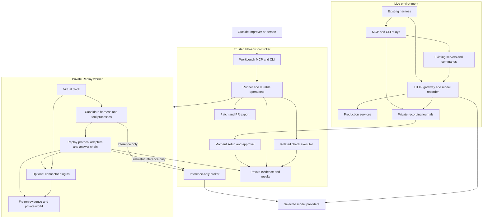

# Phoenix: Architecture

Status: November 15, 2026. Built from SPEC.md.

## 0. The shape

Phoenix is an open-source TypeScript application launched with `npx`. Live MCP, CLI, HTTP, and model-API adapters relay existing protocols while recording redacted evidence into durable, documented plain files. A Moment manifest identifies a captured Snapshot or seeded Scenario, its execution inputs, mark, frozen prefix, and approved success check. A supervised runner gives each Replay an immutable candidate harness, private connector state, and an isolated Workbench with no production access. Calls resolve through recorded responses, overlays and derivation, emulators, capture-time read expansion, synthesis, then divergence. The outside Improver edits only declared files and judges plain-language intent; Phoenix owns deterministic checks, sample accounting, same-model comparisons, regression preservation, and patch or pull-request export. Missing evidence remains missing, and Phoenix never deploys.

## 1. Runtime picture



These are ownership boundaries, not separate deployed services for every box. The controller runs on the person’s machine. Replay workloads run in a supported isolated Linux runtime; a hardware-accelerated guest supplies guest-wide time when process-level clock adapters cannot cover the workload.

The controller holds approval authority, authoritative results, and provider credentials. Candidate code, real tool processes, custom checks, and plugin serving execute outside that trust boundary. The Improver’s own model connection stays outside Phoenix.

## 2. Units

| Unit | Language | Owns | May depend on | Must never depend on |
|---|---|---|---|---|
| Formats | JSON Schema, Markdown, generated TypeScript | Public files and message contracts | Standards | Runtime implementations |
| Domain | TypeScript | Matching, resolution order, state transitions, verdict rules | Formats | Filesystem, networking, SDKs |
| Store and privacy | TypeScript, platform flush adapter | Journals, artifacts, redaction, recovery | Formats, filesystem ports | Harness or connector behavior |
| Wire and Capture | TypeScript | Protocol relays, launch overlays, live evidence | Formats, store, transport libraries, plugin capture port | Replay or grading |
| Replay | TypeScript | Answer chain, occurrence cursors, provenance, divergence | Domain, store, plugin and simulator ports | Live vendor clients or production credentials |
| Plugin host and connector kit | TypeScript | Language-neutral process interface and fidelity inspection | Formats, store, sandbox port | Specific connector implementations |
| Sandbox and inference broker | TypeScript orchestration, standard runtimes | Filesystem, process, network and clock boundaries | Formats, runtime and provider adapters | Verdict decisions or approval authority |
| Runner and checks | TypeScript | Candidates, reconstruction, samples, recovery, deterministic checks | Domain, store, Replay, sandbox, isolated check executor | Named-harness branches or check approval |
| Setup | TypeScript | Corrections, state assembly, check drafting and approval | Formats, store, selected research model port | Candidate edits or check changes during improvement |
| Workbench, export and CLI | TypeScript | User operations, allowed edits, results, patches and PRs | Runner and store APIs; CLI composes units | Workbench and export must not import Setup or deployment code |
| Recipes and plugins | Plain files; optional helpers in any language | Harness configuration and connector semantics | Public contracts | Core implementation packages |
| Reference harness | TypeScript | Independent example harness | Public harness contract and SDKs | Phoenix internals |

Domain operations take explicit inputs and return decisions and effects. Storage, clock, transport, model, and plugin ports make those decisions inspectable without running production services. Protocol evidence remains available alongside its normalized view.

## 3. Core pieces

### 3.1 Capture and protocol boundaries

A live adapter relays the existing application payload and protocol lifecycle. It does not become a replacement MCP client/server pair, upgrade a protocol, or insert a discovery request. Privacy processing and durable admission are on the recording boundary; semantic indexing is not.

```ts
interface TraceEvent {
  version: string;
  runId: string;
  sourceId: string;
  sequence: string;
  eventId: string;
  callId?: string;
  parents: string[];
  kind: string;
  wallTime: string;
  elapsedNs: string;
  payload: ArtifactRef;
}

interface CaptureSink {
  append(events: TraceEvent[]): Promise<DurableReceipt>;
}
```

A redacted request intent is committed before dispatch. A safely represented response frame or withholding record is committed before that frame is delivered. Dispatch, response receipt, delivery attempt, completion, cancellation, and unknown outcome are distinct. Writing to a socket does not prove the harness consumed the bytes.

Independent records may share a flush. Bounded queues apply backpressure rather than dropping evidence. If storage cannot commit, affected forwarding pauses or fails; it does not continue unrecorded. This is a deliberate default favoring the requested no-loss property, not a claim of unchanged timing or uninterrupted production availability. The unresolved conflict with SPEC §3 is explicit in Questions for the user.

**MCP.** Stdio carries the original bidirectional stream. Streamable HTTP preserves application bodies, status, relevant headers, SSE events, cancellations, and revision-specific lifecycle. Capture records initialization and negotiated versions where applicable, per-request version metadata, discovery, tool-list changes, schemas, errors, progress, and server-initiated exchanges where the recorded revision supports them. A discovery probe is recorded as a probe; merely seeing modern metadata does not establish successful modern negotiation. The [2026-07-28 transport specification](https://modelcontextprotocol.io/specification/2026-07-28/basic/transports) and [SDK guide](https://ts.sdk.modelcontextprotocol.io/v2/migration/support-2026-07-28.html) distinguish the protocol eras.

The official SDK implements Phoenix’s own Workbench endpoint and supports revision-aware Replay endpoints. It does not terminate the live relay. Remote OAuth keeps the server’s resource identity and discovery semantics; endpoint substitution is used only where authorization remains valid. Explicit forward proxying can preserve the original URL where the client supports the required trust configuration. Phoenix never weakens token validation to make interception work ([MCP authorization](https://modelcontextprotocol.io/specification/2026-07-28/basic/authorization)).

**CLI.** Record executable identity, argument boundaries, working directory, relevant redacted environment, stdin, stdout, stderr, termination, signals, and timing. Preserve the actual terminal configuration, including individual descriptor behavior, terminal size, and signal forwarding; stdout being a terminal alone does not establish the whole invocation’s terminal topology. Use pipes or a PTY accordingly. Never assemble a shell command by concatenating arguments.

PATH shims cover PATH lookup, not absolute paths, shell built-ins, or every descendant. Recipes describe additional supported interception and the local files or state needed by the harness. Recorded stdout does not recreate filesystem effects. Local effects needed for reconstruction must be captured, supplied by a supported continuation mechanism, or reported missing.

**HTTP and model APIs.** Prefer configured reverse endpoints. Use explicit forward proxying and a local CA where the caller supports them. The model recorder retains provider-native requests, responses, stream framing, parameters, tool definitions, tool-result messages, and available attachments. It does not translate every provider into one chat format.

Model recording captures what crosses the model boundary, including results of unproxied tools. It cannot recover hidden side effects or prove the content of unresolved remote references. Stateful provider conversations require their available history or an explicit coverage limitation; a later request need not contain the entire prior conversation.

Raw sockets, pinned TLS, unsupported protocols, inaccessible attachments, and bypassed endpoints appear in the coverage record. They never acquire live access during Replay.

Parent links associate underlying HTTP exchanges with agent-level tool calls only when supported by actual correlation. A single in-flight tool call is not sufficient evidence that unrelated background HTTP traffic belongs to it. Checks deduplicate known observations of the same action rather than counting each protocol layer.

### 3.2 Plain-file durability and privacy

Each capture adapter owns a journal segment and its writer worker. Worker messages carry sequence numbers; acknowledgments identify durable committed sequences. There is no shared database writer in the live path. The launcher records participating adapters as they start, rather than waiting until clean shutdown to describe coverage.

The same store implementation maintains a separate operation journal for the controller and a transaction journal for each Replay world.

```text
run/
  run.json
  segments/<source>.jsonl
  artifacts/sha256/<digest>
  notes.jsonl
  coverage.json
```

Journal transactions are documented JSON Lines records containing identity, sequence, events, referenced artifacts, and an integrity checksum. A writer completes partial writes, serializes appends, synchronizes the transaction, and only then returns a receipt. Readers accept complete validated transactions; an incomplete tail remains interrupted evidence, never a successful operation. Process restart discovers and validates existing segments before opening new ones.

Artifacts are redacted before hashing. Write and synchronize the artifact, atomically publish its final name, durably publish the directory entry, then commit a referring transaction. Recovery can leave unreferenced artifacts, but must not acknowledge a reference to incomplete bytes. [`fsync(2)`](https://man7.org/linux/man-pages/man2/fsync.2.html) documents the directory requirement.

The flush port uses the platform’s actual persistence operation. On macOS, strict power-loss ordering requires the equivalent of `F_FULLFSYNC`, not merely a Node `fsync` call; [Apple documents the distinction](https://developer.apple.com/library/archive/documentation/System/Conceptual/ManPages_iPhoneOS/man2/fsync.2.html). A small platform helper supplies that operation where needed. Unsupported filesystems or storage cannot be advertised as durable. No guarantee covers hardware that lies about persistence or destruction of the only storage device.

Public journals are the authoritative representation. In-memory matching indexes and optional disposable read indexes derive from them; no conversion from a private database is required to read a Run.

Only redacted evidence is persisted. Defaults strip authentication headers, cookies, credential fields, and secret-bearing URL components. Structured policies cover personal fields; text and attachment policies handle supported content. Stable scoped placeholders preserve relationships without exporting their private mapping key.

Redaction maintains state across stream frames so splitting a secret does not bypass a pattern. Formats requiring whole-body processing are buffered within declared resource bounds or represented as withheld content. Malformed, opaque, or unsafe content is never stored raw as a fallback. Raw data must not leak through debug logs or crash files.

Each affected artifact identifies transformed or withheld fields and its coverage limits. Pattern matching cannot guarantee recognition of every kind of personal information. Removing task-relevant data can prevent exact reproduction; the Moment reports that fact rather than claiming that redacted prompts are byte-identical to production prompts.

### 3.3 Harness declarations, recipes, and the reference harness

The mandatory harness declaration contains the three items in the spec:

```json
{
  "version": "1.0",
  "run": { "command": ["node", "dist/main.js"], "cwd": "." },
  "configuration": {
    "mcp": { "file": "harness.json", "pointer": "/mcpServers" },
    "model": { "environmentVariable": "MODEL_BASE_URL" }
  },
  "editable": ["prompts/**", "src/tools/**", "config/model.json"]
}
```

Recipes add configuration syntax, version and authentication applicability, CLI capture, runtime preparation, local-state requirements, and any native continuation or clock adapter. These are recipe capabilities, not additional mandatory harness methods. Launch overlays never modify the person’s production configuration.

Logical connector bindings belong to Moment and recipe configuration. A shared Moment can be mapped to another harness’s endpoint names without changing captured data. Git commits are useful identities, not a prerequisite: a content manifest can identify a harness outside git. A repository is needed when exporting a repository patch or PR.

The shipped recipe collection covers the generic contract, reference harness, Claude Code, Codex, pi, fx, and Ozi. Each recipe names the versions and authentication paths it supports. Available configuration includes [Claude Code gateway settings](https://code.claude.com/docs/en/llm-gateway-connect), [Codex provider settings](https://learn.chatgpt.com/docs/config-file/config-advanced), [pi `baseUrl`](https://pi.dev/docs/latest/models-configuration), and [fx custom connections](https://fx.sh/docs/configure-fx/custom-model-connections). These documents do not establish capture of every subscription-login path. A recipe never silently changes the selected provider or billing route.

The reference harness is written from scratch in TypeScript, uses one model and a few MCP and CLI tools, and imports no Phoenix internals. It exercises the same declaration, capture, and continuation capabilities available to user harnesses.

### 3.4 Moments, Corrections, and approval

`phoenix flag <reason>` writes a mark through the launcher’s local control endpoint. An optional MCP tool exposes the same operation when explicitly added to the harness. It is not inserted into the live tool list by default. A person can also select any recorded event afterward. `phoenix correct <run> --at <event> <text>` records a Correction, with a one-off flag when it must not become a check.

A mark identifies an event boundary and a causal frontier: completed observations, delivered stream position, and pending operations. Wall time is descriptive, not a substitute for causal order. A response received after the mark stays after it, even when its request began earlier.

A Snapshot is captured evidence and state with observation times and coverage. It is not a globally atomic vendor snapshot. A Scenario is deliberately seeded state or staged exchanges. A Scenario can produce a marked Run and use either supported start mode, just like a Snapshot.

Setup reads the trace, harness, Correction, and relevant documentation; identifies connector boundaries; assembles state; drafts the success check; and obtains approval. Drafting may use the person’s selected model or outside agent. Phoenix supplies neither an Improver nor a separate judge. The person’s Correction is the default source, except when marked one-off.

A compact manifest shape is:

```ts
interface MomentManifest {
  version: string;
  id: string;
  source: "snapshot" | "scenario";
  run?: ArtifactRef;
  mark?: { eventId: string; frontier: ArtifactRef };
  initialState: ArtifactRef[];
  prefix?: ArtifactRef;
  clock: { epoch: string; timezone: string; policy: string };
  prompt: ArtifactRef;
  model: { provider: string; name: string; parameters: ArtifactRef };
  harness: { identity: ArtifactRef; recipe: ArtifactRef };
  connectors: ConnectorBinding[];
  check: ArtifactRef;
  lock: ArtifactRef;
}
```

Connector bindings contain snapshots or logs, recorded tool lists, MCP revisions, origin, coverage, concrete plugin identities, and declared fidelity. Later historical responses may be retained as evidence, but do not automatically become initial state before their causal prerequisites.

Approval locks the check, its custom code and dependencies, expected data, sample count, and relevant Moment identity. The trusted controller stores the approved digest outside the Improver’s writable area. The adjacent lock file is a portable record of that approval, not its sole authority. Imported Moments require explicit acceptance of their lock; hashes establish integrity, not the identity of an arbitrary approver.

Unattended locking is an explicit Scenario opt-in. Changing a check or relevant evidence creates a new revision and lock. Existing results retain their original identity.

Capture-time read expansion runs only over encountered objects through authorized read-only operations. It is opt-in per connector and uses restricted credentials where available. Plugin declarations are not proof of harmlessness; MCP likewise treats tool annotations as untrusted unless their source is trusted ([tools specification](https://modelcontextprotocol.io/specification/2026-07-28/server/tools)). Expanded observations retain their actual timestamps and completeness limits.

### 3.5 Reconstruction and frozen candidates

At Replay creation, the runner freezes the candidate’s complete permitted source changes, including additions and deletions, against its base content identity. It rejects disallowed paths, traversal, and link escapes. Build outputs occupy separate runtime directories and do not become source changes. Dependencies and execution images resolve to concrete identities before execution.

**From the beginning:** materialize the initial prompt, configuration, local state, connector state, and clock, then launch the candidate. Recordings become eligible only in the state and causal context where they apply.

**From the mark:** restore through a recipe’s supported native continuation or documented transcript/state import. If restoration requires executing the prefix, run the original harness against recorded model/tool exchanges and captured local effects until the designated boundary, export its supported continuation state, and launch the candidate with that state. This is an explicit process restart through a continuation interface, not arbitrary hot-swapping of code inside a running process.

```ts
interface ContinuationArtifact {
  version: string;
  harnessFormat: string;
  frontier: ArtifactRef;
  conversation: ArtifactRef;
  localState: ArtifactRef[];
  connectorState: ArtifactRef[];
  pendingOperations: ArtifactRef;
  clockState: ArtifactRef;
}
```

The recipe defines which original state the native format preserves and how the candidate imports it. Previously consumed messages, tool lists, side effects, and state remain frozen. Changes to initialization that cannot take effect at that boundary require replay from the beginning.

A candidate launched from the beginning with prompt differences ignored is not accepted as exact mark restoration. Hidden memory, uncaptured local state, or unsupported pending-operation restoration can make a mark unavailable. Phoenix names the missing capability instead of claiming universal reconstruction from network recordings. This is an unresolved limit of the spec’s minimal harness contract.

### 3.6 Ordered answers and connector state

```ts
interface ResolveRequest {
  replayId: string;
  callId: string;
  connectorId: string;
  surface: "mcp" | "cli" | "http";
  operation: string;
  arguments: unknown;
  wire: ArtifactRef;
  stateDigest: string;
  causalContext: ArtifactRef;
}

type Resolution =
  | { kind: "answer"; response: ArtifactRef; provenance: Provenance }
  | { kind: "miss"; reason: string };
```

The order is fixed:

1. **Recorded response.** Match connector, operation, arguments, relevant protocol information, occurrence, causal history, and state applicability.
2. **Overlay or derivation.** Apply known replay-local writes and connector-defined transformations over captured evidence.
3. **Stateful emulator.** Ask a plugin seeded from the applicable Snapshot or Scenario.
4. **Capture-time read expansion.** Use compatible observations collected during Capture.
5. **Simulator.** Generate, validate, persist, and label a synthesized response. Writes change no connector state.
6. **Divergence.** Stop and report the call and why every applicable resolver declined it.

Canonical JSON normalizes representation, not meaning. Preserve array order, argument boundaries, absent versus null fields, and meaningful HTTP distinctions. Plugin normalization is explicit and versioned. Removing a timestamp or token is allowed only when its semantic irrelevance is established. [RFC 8785](https://www.rfc-editor.org/rfc/rfc8785.html) provides the representation rules within its numeric limits.

Recorded occurrences are consumed. An exhausted sequence falls through unless a connector rule establishes safe reuse. After a state-changing call, argument equality alone cannot make an earlier read applicable.

Each connector has one state authority. It may implement overlay and emulator behavior behind that authority; the core does not maintain competing worlds. An answering write publishes its response, mutation or explicit no-op, occurrence cursor, and next state identity in one durable world transaction before delivery. Repeating a committed call identity returns that result without applying the mutation again.

A plugin serving mutable state must export a recoverable next-state artifact or provide reconstruction from committed operations. If it mutates an external in-memory emulator before the transaction commits, that instance is disposable; recovery restores the last committed state. Unsupported recovery is a declared capability limit, not permission to resume an uncertain world.

Unknown write effects do not force every connector into immediate divergence. A recorded suffix can establish subsequent reads when the same recorded write history applies. A declared banking no-op leaves local state unchanged and can be followed by recorded reads, while the report makes clear that money movement was not validated. A new write with unknown effects cannot make arbitrary stale reads truthful: the chain must derive, emulate, synthesize, or diverge. An invented acknowledgment never establishes a successful external state transition.

Derivation records source references and its transformation. An event lookup from a complete applicable list can be derived; an unseen entity in a partial list cannot be declared absent. Recurrence, permissions, ranking, and side effects belong to connector semantics, not a universal CRUD map.

For a real MCP server running over redirected vendor APIs, the resolver substitutes at the HTTP boundary and observes the MCP boundary. It does not answer both layers independently. Vendor-hosted servers that cannot be redirected use tool-level recorded replay.

Replay adapters reconstruct the protocol lifecycle, remapping transport identifiers where necessary while preserving recorded application content after redaction. Older server-initiated exchanges include their expected client responses, not merely a replayed list of notifications. Unexpected lifecycle behavior produces divergence rather than an invented protocol success.

### 3.7 Plugins, synthesis, and fidelity

Plugins are separately installed packages with language-neutral descriptors and messages:

```json
{
  "pluginApiVersion": "1.0",
  "id": "example.calendar",
  "capture": ["calendar-plugin", "capture"],
  "serve": ["calendar-plugin", "serve"],
  "declaredTier": "stateful",
  "readOnlyTools": ["list_events", "get_event"],
  "snapshotSchema": "snapshot.schema.json"
}
```

`capture` consumes documented observation files or messages and emits state, coverage, and requested read expansion. `serve` consumes a world descriptor and answers versioned messages over stdio or local HTTP. Replies distinguish an answer, unsupported operation, invalid input, and execution failure. Optional capabilities cover derivation and recoverable state publication. The core works with no plugin installed.

Plugin serving has no production credentials or network access. A declared tier is a ceiling, not proof that every operation or imported Snapshot meets it. Existing [emulate](https://github.com/vercel-labs/emulate) and [Backlot](https://pypi.org/project/backlot/) implementations are optional plugin dependencies. Their current publications identify Apache-2.0; the selected release, dependencies, and imported datasets determine the actual license obligations.

The connector kit consumes the public interface, supplied observations, and state. It reports wire differences, available end-state differences, unsupported operations, and coverage limits. It gives connector authors a way to inspect fidelity without linking to core internals.

The simulator is replaceable and sees the call, applicable redacted evidence, actual schemas, and format examples. MCP `outputSchema` is optional; absent schemas require validation of the real protocol envelope and an explicitly inferred format contract, not an assertion that text is structured JSON ([MCP tools](https://modelcontextprotocol.io/specification/2026-07-28/server/tools)). Invalid output is not delivered as a success.

An accepted synthesized response is committed before delivery. Its cache identity includes the Moment, connector, semantic call, world state, and simulator configuration. Equivalent repeated calls reuse it; different state does not. Samples share immutable synthesized evidence only when those identities agree.

Every response uses one of the spec’s provenance labels: **real**, **recorded**, **derived**, or **synthesized**. Origin—captured or seeded—and method—overlay, emulator, or read expansion—are separate fields. Running real MCP server code over invented inputs does not make its response real; the resulting provenance retains those dependencies.

Connector tiers remain **stateful**, **recorded**, **synthesized**, and **blocked**. Effective coverage and the weakest evidence used determine the attained tier, bounded by the plugin’s declaration. The Run grade is the weakest participating or required connector. Optional unused connectors are listed as unused; required unavailable connectors cannot disappear from the grade.

### 3.8 Isolation, inference, and the clock

A Replay worker receives an immutable base, explicitly writable source paths, private runtime directories, frozen data, and fake connector credentials. It receives no host home, production credentials, agent socket, device, container socket, or unrelated host IPC. Check code and approval authority are outside the candidate workspace.

Host-enforced network policy permits only the sample’s Replay endpoints and inference broker. It denies host services, bridge gateway services, metadata addresses, unrelated workers, raw external addresses, and alternate outbound protocols. DNS routing assists interception but is not the enforcement boundary. Docker’s [`--internal`](https://docs.docker.com/reference/cli/docker/network/create/#internal) needs explicit host-service restrictions; its documented gateway access is not acceptable by itself.

The inference broker holds provider credentials outside the worker and accepts configured inference operations only. It fixes the upstream destination, validates method and path, rejects arbitrary forwarding and redirects, and disallows provider-run tools or remote fetch features that escape the frozen world. Provider-hosted MCP can execute remotely, as the [Anthropic connector documentation](https://platform.claude.com/docs/en/agents-and-tools/mcp-connector) explains. Such features are replayed through captured local behavior where supported or blocked—not forwarded live.

Custom TypeScript checks run separately with immutable code and sealed evidence, no network, and no candidate filesystem access. Node permissions are defense in depth, not an isolation boundary; [Node explicitly says they do not protect against malicious code](https://nodejs.org/docs/latest-v24.x/api/permissions.html).

The clock contract separates wall time from elapsed time:

```ts
interface ReplayClock {
  wallTime(): string;
  elapsedNs(): string;
}
```

The Moment fixes epoch, timezone, and advancement policy. Prefix reconstruction uses captured temporal boundaries. Candidate continuation begins at the mark’s captured time. Connector fakes use the same clock authority for timestamps, expiry, and recurrence. Controller supervision and provider networking use host monotonic time outside that virtual clock.

A container can use runtime adapters or libfaketime only when the recipe covers the complete relevant process tree. A diagnostic probe can detect a failure but cannot prove arbitrary subprocess coverage. [libfaketime](https://github.com/wolfcw/libfaketime) documents bypasses; [Linux time namespaces](https://man7.org/linux/man-pages/man7/time_namespaces.7.html) do not virtualize `CLOCK_REALTIME`.

Otherwise use a hardware-accelerated guest. Its trusted initialization establishes guest wall time before launching workloads and disables external time synchronization. A guest clock service supplies the same clock to connector fakes; the controller does not run an independently drifting clock and call it equivalent. A mark transition pauses relevant workloads while applying the boundary state. No TCG instruction-count mode or deterministic arbitrary-execution claim is required. [QEMU](https://www.qemu.org/docs/master/system/qemu-manpage.html) supplies guest and accelerator machinery; restricted networking still permits only explicitly configured forwarding to Phoenix.

A workload requiring unavailable operating-system behavior, continuation, or clock coverage is blocked in that mode. Recorded tool behavior may avoid executing an unavailable native binary only when its required local effects are also represented.

### 3.9 Success checks and comparisons

A locked check fixes sample count, evidence scope, expectations, optional custom TypeScript, and optional intent. The public shape includes every deterministic form in the spec:

```ts
interface SuccessCheck {
  version: string;
  samples: number;
  scope: "whole-run" | "continuation";
  expectations: Array<
    | { kind: "called"; tool: string; arguments: Matcher; times?: number }
    | { kind: "not-called"; tool: string; arguments?: Matcher }
    | { kind: "order"; calls: CallMatcher[] }
    | { kind: "call-cap"; tool: string; maximum: number }
    | { kind: "end-state"; connector: string; equals: ArtifactRef }
    | { kind: "final-text"; contains?: string; matches?: string }
    | { kind: "custom"; module: ArtifactRef; dependencies: ArtifactRef }
  >;
  intent?: string;
}
```

Built-in checks consume sealed agent-action, final-text, and end-state evidence. Known duplicate observations from MCP and the model API represent one action. Order assertions use available invocation or causal order; ingestion timestamps do not invent an order between concurrent calls. A custom check receives the same sealed evidence and provenance.

The Improver submits a judgment, reason, and supporting evidence for each sample requiring intent assessment. It cannot change the intent statement or override deterministic failure. Missing judgment is incomplete assessment, not success.

For the locked sample count `n`, a complete Moment fails when `2 × failedSamples >= n`. The count does not shrink when a sample crashes, diverges, or lacks evidence. A binding deterministic failure remains a failure; otherwise unavailable required evidence leaves the sample unassessed.

Reports distinguish:

- **Meets the check:** the complete samples satisfy the specified threshold.
- **Improved:** the candidate meets the check and has more successful samples than the baseline on the same model and Moment.
- **Regression preserved:** every previously passing Moment still meets its check.
- **Incomplete:** required samples or evidence cannot establish the conclusion.

A target fix passes only with improvement and regression preservation. An already-passing baseline does not waive strict improvement for that target. Previously passing regression Moments need to remain passing; they need not improve again.

For model migration, the report shows whether the saved checks hold under the proposed model. If improvement is claimed, run the original and candidate harness with that same proposed model. This uses the ordinary comparison fields; it does not require a separate execution subsystem.

Synthesis dependencies follow responses into model turns and subsequent actions, including cross-connector effects. A required condition resting on invented facts cannot certify success. Independently established deterministic failure remains binding. Independently established success on another condition does not erase the unresolved condition. When independence cannot be established, the assessment is incomplete rather than a discounted pass.

Baseline identity includes the Moment and check digests, original harness content, model and exposed revision, generation parameters, sample count, start mode, state artifacts, tool/plugin/recipe identities, matching semantics, and clock policy. Candidate results additionally bind candidate content. Floating provider aliases are labeled as such.

### 3.10 Runner, Workbench, and export

The runner journals accepted operations and immutable inputs before starting them. Client request identifiers make reconnects idempotent. Each scheduled sample has private connector state and occurrence cursors, while immutable artifacts and eligible baseline results can be shared.

After restart, supervision reconciles workers with the journal and resumes unfinished orchestration automatically. Committed model responses, tool responses, and world transitions are reused during reconstruction of the same attempt. An incomplete external inference response cannot be reconstructed from bytes Phoenix never received; retain that interrupted attempt and repeat only the incomplete work where the protocol allows it. Attempts are not erased or selectively replaced based on their outcomes.

The Workbench MCP server and CLI call the same operations:

```text
list_moments       read_moment       read_trace
read_fidelity      list_editable     read_file
apply_edit         replay            read_replay
run_checks         submit_intent_judgment
export_patch
```

Neither Workbench imports Setup nor possesses approval/check-write capabilities. Filesystem access enforces that separation in addition to the import rule. The outside Improver receives the workspace and public operations, not unrestricted access to the controller’s private home. A person can edit declared files by hand under the same candidate and export rules.

Edits are acknowledged after persistence. Accepted operations and results survive an Improver disconnect. Starting a Replay freezes the candidate, so later edits cannot alter running work.

Export revalidates the allowlist against the frozen candidate, including new files, removals, and file types. The patch contains only permitted harness changes. Replay results, check identities, comparison settings, and fidelity accompany it separately or in the PR description. Private captures are not automatically committed. Optional PR publication uses host-side credentials outside the worker and reconciles interrupted publication before retrying. Phoenix exposes no deployment operation.

## 4. Data flows

### Fix a live failure

1. A recipe launches the existing harness with MCP, CLI, HTTP, and model Capture configured, preserving its provider and authentication route.
2. Capture records redacted requests, responses, timing, tool lists, and available local-state evidence. The agent flags a Moment or someone selects its mark later.
3. Setup reads the Correction and evidence, drafts the check, and locks it after approval.
4. The runner materializes the original harness and frozen world for the baseline using the locked sample configuration.
5. The Improver reads evidence, edits allowed files, and requests a Replay from the beginning or a supported mark.
6. The answer chain supplies frozen-world responses; Phoenix runs deterministic checks and the Improver supplies required intent judgments.
7. The runner compares the candidate with the same-model baseline and verifies preservation of the saved previously passing Moments.
8. Phoenix exports the permitted patch or PR and the report. The person reviews and deploys outside Phoenix.

### Staging that was never live

1. Supply Scenario seeds or staged exchanges and a harness declaration.
2. Setup records seeded origin, coverage, prompt, tools, clock, and the proposed check.
3. Approve and lock, or use the explicit unattended Scenario opt-in.
4. Run the ordinary baseline and improvement loop. A Scenario-derived Run can also be marked and resumed through supported continuation mechanisms.

### Regression sets

1. Freeze the Moment revisions, candidate contents, comparison settings, and references identifying previously passing Moments.
2. Run samples against independent worlds, reusing only equivalent baseline results.
3. Report every Moment. A regression or incomplete required result prevents the change from passing the set.

### Model or tool migration

1. Edit an allowed model setting, tool description, or implementation.
2. Replay the saved Moments, starting from the beginning when initialization changes matter.
3. Prefer running changed real tool code over frozen vendor APIs. New calls use the normal answer chain rather than being forced into old responses.
4. Report check preservation and fidelity. Any improvement claim compares both harness versions under the proposed model.

### Sharing

1. Select a manifest and redacted evidence bundle, keeping connector and harness implementations separate.
2. Include locked custom-check code or exact independently supplied references when the check requires them; executable content is identified explicitly.
3. If privacy processing changes evidence, create new references and a new Moment revision rather than preserving an invalid lock.
4. The recipient validates versions, hashes, paths, and approval expectations, then explicitly supplies required tools/plugins and maps their harness bindings.
5. Imported launch instructions never execute on the host merely because a manifest names them. Replay records harness substitution and any missing evidence.

### A brand-new harness

1. Declare launch, endpoint configuration, and editable files.
2. Apply the generic recipe and default proxies to the available surfaces.
3. Create a Snapshot-derived or seeded Moment and approve its check.
4. Use the same Workbench operations as official harnesses; the reference harness follows this public path.

## 5. Failure

| Failure | Behavior and recovery |
|---|---|
| Recorder or launcher crashes | Recover committed segments, retain interrupted exchanges, restart supervised components, and record the interruption. Never infer a missing response. |
| Queue or storage cannot admit evidence | Backpressure or fail the affected forwarding path; never silently drop into unrecorded operation. Resume when persistence is available. |
| Live connection fails after a possible write | Preserve the intent and unknown outcome. Do not automatically repeat the production action; use vendor idempotency or status semantics only when actually available. |
| Power fails | Recover acknowledged transactions on supported persistent storage. Validate tails and artifact references. Unobserved external outcomes remain unknown. |
| Wire data is malformed or unsafe to redact | Relay only under the recording policy, persist a safe withholding/coverage record, and never persist a raw-secret fallback. Replay cannot treat missing content as captured truth. |
| Improver disconnects | Persisted edits, accepted operations, and results remain addressable; repeated requests do not duplicate them. |
| Worker or engine crashes | Retain the attempt and reconstruct from immutable inputs and committed exchanges. Resume the same scheduled work without choosing favorable outcomes. |
| Emulator crashes | Restore committed state or rebuild it from committed operations. Never substitute an empty world. |
| Model provider fails mid-response | Preserve received evidence and uncertainty. Resume only where the provider protocol supports it; otherwise retain the interrupted attempt before repeating incomplete work. |
| Simulator response is invalid | Reject it before delivery; report failure or divergence. |
| No answer applies | Stop with divergence and resolver reasons. There is no live connector fallback. |
| Clock, local state, or continuation cannot be restored | Block the affected mode and name the missing capability. Never silently substitute host time or a fresh transcript-only run. |
| Required check evidence is missing or check code fails | Assessment is incomplete unless available evidence already establishes a binding failure. Fixing the locked check requires a new approved revision. |
| Bundle, plugin, or edit is invalid | Reject unsupported capabilities, broken references, invalid paths, and unsafe executable placement before execution. |
| Export or PR publication is interrupted | Rebuild from frozen identities and reconcile previous publication before retrying. |

No local recorder can atomically commit a vendor’s side effect with its own journal. Automatic recovery applies to durable local work, not blind repetition of uncertain production writes.

## 6. Data and versions

| Public format | Contents |
|---|---|
| Trace JSON Lines | Source sequences, event/call identities, causal links, wire references, timestamps, committed operation state, provenance and coverage |
| Moment manifest | Snapshot or Scenario origin, mark/frontier, prefix, initial state, prompt, clock, model, harness, tool lists, MCP revisions, connector bindings, check and lock |
| Harness declaration | Launch command, endpoint configuration locations, editable paths |
| Recipe descriptor | Version/authentication applicability, capture configuration, local state, continuation and clock capabilities |
| Plugin descriptor and messages | Capture/serve interface, tiers, read-only declarations, supported semantics and recovery capabilities |
| Success check and lock | Expectations, custom code, intent, scope, samples, approved evidence identity and authority |
| Replay result | Candidate and baseline identities, attempts, sample outcomes, evidence, intent judgments, fidelity, divergence and set result |
| Artifacts | Redacted bodies, streams, local state, connector state, seeds, expected data and explicitly identified check code |

JSON Schema is authoritative and generates TypeScript bindings. Public files remain usable in any language. Binary content is referenced. Large counters and nanosecond values use strings where JSON numbers are insufficient.

Each format carries its own version. Additive fields can be ignored only when doing so cannot change safety or meaning; otherwise a required capability or new major is necessary. Readers reject unsupported majors and required capabilities. Migration writes new identities rather than mutating historical evidence. Supporting the file format does not promise that every old tool binary can still execute.

Plugin, recipe, runtime, tool, and dependency ranges resolve to concrete identities before execution. Model identifiers retain any exposed revision and identify aliases honestly. Derived artifacts name their source references and transformation version.

Data stays separate from harness and connector implementations. Private captures live outside source repositories. Selected manifests and intentionally shareable redacted data may sit beside the harness in git; export does not publish the private Run store.

## 7. Repo layout

```text
formats/
  trace/ moment/ harness/ recipe/ plugin/ check/ result/
packages/
  contracts/
  domain/
  store/
  privacy/
  wire/
  capture/
  replay/
  plugin-host/
  connector-kit/
  sandbox/
  model-broker/
  runner/
  checks/
  setup/
  workbench/
  export/
  cli/
recipes/
  generic/ claude-code/ codex/ pi/ fx/ ozi/
reference-harness/
docs/
```

`contracts` consumes public schemas; `domain` consumes contracts only. Runtime adapters implement ports. Capture never imports Replay or checks. Replay never imports production access. Workbench and export never import Setup. The CLI composes these units without duplicating domain rules.

Recipes, independently installed plugins, and the reference harness use public contracts only. Core packages contain no named-harness branches. Packages express replaceable responsibilities, not a requirement to launch a service per folder.

## 8. Build order

1. Define the trace, Moment, harness, plugin, check, result, and provenance contracts, including commit and recovery semantics.
2. Build privacy-aware plain-file storage and wire relays, then MCP, CLI, HTTP, and model Capture. Add the reference harness and generic recipe as public-contract consumers.
3. Build isolation, the inference broker, required clock support, strict recorded matching, and divergence. These are prerequisites for honest recorded Replay, not later enhancements to it.
4. Build Moment and Scenario assembly, approval locks, immutable candidates, deterministic checks, sample accounting, baseline comparisons, and durable orchestration.
5. Compose the Workbench and patch/PR export around that loop; add supported native mark reconstruction and required local-state restoration.
6. Implement connector-owned overlays, derivation, capture-time read expansion, emulator adapters, and connector-kit reporting against the established plugin interface.
7. Add schema-checked synthesis and dependency-aware assessment, then automate setup research and drafting through the existing approval path.
8. Complete the named harness recipes as their capture, authentication, continuation, and clock capabilities become available. No recipe’s presence implies unsupported modes work.

## 9. Libraries

| Choice | Why and boundary | Source |
|---|---|---|
| TypeScript and Node.js | `npx` core, streams, processes, HTTP and file operations; custom TypeScript checks execute in isolation | [TypeScript](https://www.typescriptlang.org/docs/), [Node](https://nodejs.org/api/) |
| Official MCP TypeScript SDK v2 | Phoenix endpoints and revision-aware Replay behavior; not a terminating live proxy | [SDK](https://github.com/modelcontextprotocol/typescript-sdk), [revision support](https://ts.sdk.modelcontextprotocol.io/v2/migration/support-2026-07-28.html) |
| Node HTTP/HTTPS and streams | Provider-native streaming relays with explicit recording and backpressure control | [HTTP](https://nodejs.org/api/http.html), [streams](https://nodejs.org/api/stream.html) |
| Mockttp | Configured proxy/TLS machinery and replay endpoints; observer callbacks alone are not durable acknowledgments | [Repository](https://github.com/httptoolkit/mockttp) |
| `node:child_process` and `node-pty` | Argument-safe launches and terminal-preserving CLI capture | [Child processes](https://nodejs.org/api/child_process.html), [node-pty](https://github.com/microsoft/node-pty) |
| Node filesystem APIs plus a platform flush adapter | Plain-file journals and artifacts with platform-correct durability | [Node filesystem](https://nodejs.org/api/fs.html), [Linux synchronization](https://man7.org/linux/man-pages/man2/fsync.2.html), [Apple synchronization](https://developer.apple.com/library/archive/documentation/System/Conceptual/ManPages_iPhoneOS/man2/fsync.2.html) |
| Ajv and JSON Schema tooling | Versioned public validation and generated bindings; no automatic external schema fetches | [Ajv](https://ajv.js.org/json-schema.html), [json-schema-to-typescript](https://github.com/bcherny/json-schema-to-typescript) |
| RFC 8785 canonicalization | Reproducible structured identities without inventing semantic equivalence | [RFC 8785](https://www.rfc-editor.org/rfc/rfc8785.html) |
| OCI-compatible container runtime | Supported workload and check isolation with explicit host/network restrictions | [OCI runtime specification](https://github.com/opencontainers/runtime-spec), [Docker internal networks](https://docs.docker.com/reference/cli/docker/network/create/#internal) |
| QEMU with hardware acceleration | Guest-wide clock and compatible native-process execution where process adapters are insufficient | [Manual](https://www.qemu.org/docs/master/system/qemu-manpage.html) |
| libfaketime, where recipe coverage is established | Process-level wall-clock adaptation without claiming universal coverage | [Repository](https://github.com/wolfcw/libfaketime) |
| Git CLI | Optional worktree editing and repository patches/PRs, not the portable data store | [Worktrees](https://git-scm.com/docs/git-worktree), [diff](https://git-scm.com/docs/git-diff) |
| emulate and Backlot, optional plugins | Existing stateful behavior reused behind the public connector boundary | [emulate](https://github.com/vercel-labs/emulate), [Backlot](https://pypi.org/project/backlot/) |

There is no mandatory database, second HTTP interception stack, hosted Phoenix service, separate judge, or built-in Improver. Speed comes from grouped durable writes, independent recording journals, indexed matching, compiled validators, immutable artifact reuse, private copy-on-write worlds, and concurrent independent samples. No latency or throughput target is invented.

## 10. Risks and open questions

**Capture coverage can be narrower than configuration suggests.** Model-visible evidence does not establish hidden CLI or API effects. Protocol traces, recipe capability declarations, and captured local-state references reveal what is and is not reconstructible.

**Exact continuation exceeds the minimum harness contract.** A supported native continuation format or a reconstructible boundary is the deciding evidence. Without one, a generic network recorder cannot recover hidden execution state. This remains a limitation requiring a product decision.

**Privacy can remove the failure’s cause.** Artifact-level redaction provenance shows which facts changed. Recognition of personal text remains imperfect; a useful Moment and a maximally redacted Moment may not be the same artifact.

**Snapshots are observations across time.** Object versions, completeness, causal prerequisites, and observation timestamps determine which recordings can be used together. More capture-time reads do not create a vendor-wide atomic snapshot.

**Emulator labels can overstate fidelity.** Required recurrence, attendee, permission, pagination, search, identifier, and timestamp behavior must be represented by the selected plugin. The connector kit exposes differences against supplied evidence rather than certifying a tier from a package name.

**Provider and harness authentication paths change.** Configuration documentation establishes available routing mechanisms, not every login path. Preserve the actual route and report unsupported recording instead of switching providers silently.

**The Improver judges its own intent result.** Locking prevents rewriting the target, not biased interpretation. Reasons and evidence remain visible, and deterministic failures remain binding; that is the spec’s chosen tradeoff.

**Storage and external services are not one transaction.** Local durability preserves acknowledged evidence, but cannot recover an unseen vendor response or prove whether a disconnected write happened. Unknown outcomes remain explicit.

**Native workload and clock compatibility has limits.** Linux workers cannot necessarily execute macOS-only tools. Clock adapters must cover actual process behavior; a successful probe is not universal proof.

## 11. Questions for the user

1. When recording cannot persist, should production pause as designed, or continue with an explicitly incomplete Run? The latter relaxes the no-loss requirement; neither choice preserves every stated property under failure.
2. Is it acceptable to block mark replay when the harness has no usable continuation boundary, while retaining replay from the beginning where possible? Otherwise the three-item harness contract must be expanded to require restorable execution state.
3. What default privacy policy should apply to task-relevant personal text, attachments, and local working files when redaction would remove the failure’s cause?
4. What sample count should setup propose? The architecture requires a locked per-Moment count and does not invent a default.
5. Which exact Ozi and fx distributions and authentication modes are intended? Public custom-endpoint settings do not settle every subscription or private route.
6. For model migration, should preserving saved checks be reported separately from a same-model improvement claim, as designed?
7. Does a long-lived harness need task-level Run boundaries within one process, rather than one Run per captured launch? That changes how recipes identify initial state and marks.
8. Is a capture-overhead goal needed? Durable admission is on the production path; if latency needs a bound, that bound belongs in the spec rather than being invented here.
