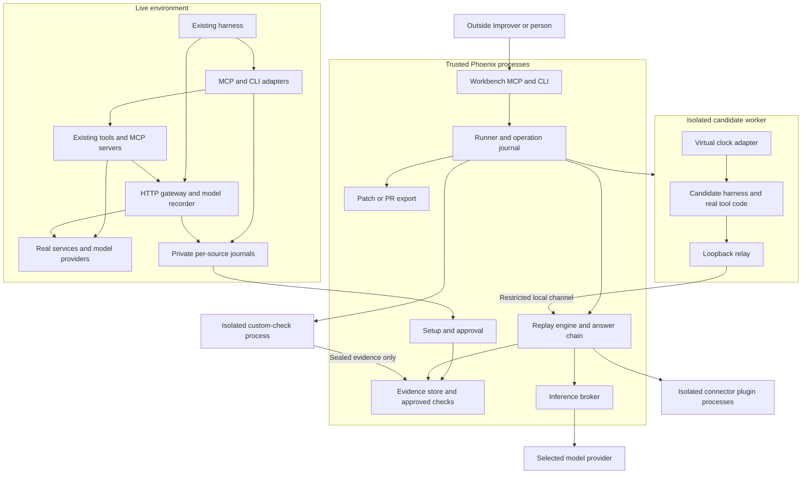

# Phoenix: Architecture

Status: November 15, 2026. Built from SPEC.md.

## 0. The shape

Phoenix is an open-source TypeScript application run with `npx`. Protocol adapters capture MCP, CLI, direct HTTP, and model-API traffic into private, redacted, durable plain files. A Moment binds a captured Snapshot or seeded Scenario to a prompt, harness identity, tool configuration, clock, marked boundary, and approved success check. A supervised runner executes frozen harness candidates in an isolated Workbench whose only external capability is controlled model inference. Connector calls follow the specified recorded, overlay, emulator, capture-time read, simulator, and divergence order. The outside Improver edits only declared harness files and judges plain-language intent; Phoenix evaluates deterministic expectations, compares several samples against the same-model baseline, preserves previously passing Moments, and exports an allowed patch or pull request. Fidelity and missing evidence remain explicit. Phoenix neither supplies an Improver nor deploys a harness.

## 1. Runtime picture



The live adapters do not depend on the Workbench controller. Unintercepted live paths are recorded as coverage limits, not mistaken for captured traffic.

The Replay engine, authoritative evidence, approval records, and provider credentials are outside the candidate’s filesystem and process boundary. Connector plugins and custom checks run in separate restricted processes. Boxes identify responsibilities, not independently deployed services. A local supervisor runs accepted work and restarts failed child processes; there is no hosted Phoenix service.

## 2. Units

| Unit | Language | Owns | May depend on | Must never depend on |
|---|---|---|---|---|
| `contracts` | JSON Schema, Markdown, generated TypeScript | Public formats, validators, version rules | Standards and schema tooling | Runtime packages |
| `store` | TypeScript and platform persistence helper | Journals, artifacts, operation claims, recovery | `contracts` | Capture or connector semantics |
| `privacy` | TypeScript | Redaction decisions and provenance | `contracts` | Networking or persistence |
| `wire` | TypeScript | Protocol codecs, transport adapters, typed exchange views | `contracts`, transport libraries | Checks or approval |
| `capture` | TypeScript | Live relays, launch overlays, capture-time reads, marks and Corrections | `wire`, `store`, `privacy`, `plugin-host` | Replay or grading |
| `models` | TypeScript | Provider adapters and inference-only broker | `contracts`, `wire`, `store`, `privacy` | Connector production clients or verdicts |
| `replay` | TypeScript | Matching, answer chain, world transitions, divergence and provenance | `contracts`, `store`, `wire`, plugin and model ports | Live vendor access, Setup or Workbench |
| `plugin-host` | TypeScript | Language-neutral plugin process protocol | `contracts`, `sandbox` | Particular connector implementations |
| `sandbox` | TypeScript and runtime helpers | Process, filesystem, channel and clock isolation | `contracts`, supported runtimes | Matching, checks or approval |
| `checks` | TypeScript | Deterministic expectations, sample and comparison rules | `contracts`, `store`, `sandbox` | Connector calls or check approval |
| `runner` | TypeScript | Immutable plans, candidates, reconstruction, samples and recovery | `store`, `replay`, `models`, `sandbox`, `checks`, `plugin-host` | Named-harness behavior or check approval |
| `setup` | TypeScript | Snapshot/Scenario assembly, research, check drafting and approval | `contracts`, `store`, `wire`, `plugin-host`, model port | Candidate editing or Workbench operations |
| `workbench` | TypeScript | MCP/CLI operations, allowed edits and patch/PR export | `contracts`, `store`, `runner`, `checks` | Setup or approval-writing capabilities |
| `connector-kit` | TypeScript | Public plugin execution and fidelity comparison | `contracts`, `store`, `wire`, `plugin-host` | Workbench internals |
| `cli` | TypeScript | `npx` entry point and composition | Public package APIs | Duplicated domain rules |
| Recipes and installed plugins | Plain files; helpers in any language | Harness configuration and connector-specific semantics | Public contracts | Core implementation imports |
| Reference harness | TypeScript | Independent example harness | Public harness contract and external SDKs | Phoenix packages |

Matching and verdict rules live separately. Both consume explicit immutable evidence, so their decisions can be inspected without running a vendor service. Filesystem, transport, clock, model, and plugin boundaries have replaceable implementations.

## 3. Core pieces

### 3.1 Capture and transport adapters

Adapters expose the same protocols the harness already uses. Their backend is either an existing upstream during Capture or a Replay responder. Transport events distinguish data, headers, stream identity, end-of-stream, cancellation, and errors; application decoding does not erase the original captured representation.

```ts
type WireEvent =
  | { kind: "open"; stream: string; metadata: unknown }
  | { kind: "data"; stream: string; bytes: Uint8Array }
  | { kind: "end"; stream: string; metadata?: unknown }
  | { kind: "cancel"; stream: string; reason: string }
  | { kind: "error"; stream: string; error: unknown };

interface Link {
  send(event: WireEvent): Promise<void>;
  receive(): AsyncIterable<WireEvent>;
  close(): Promise<void>;
}

interface Backend {
  open(binding: ConnectorBinding): Promise<Link>;
}
```

**MCP.** Stdio preserves bidirectional newline-delimited messages and subprocess lifecycle. Streamable HTTP preserves application bodies, status, meaningful headers, SSE events, cancellation, discovery, and revision-specific behavior. Capture records the negotiated version for revisions with initialization and the actual per-request version for revisions without it. It does not upgrade the connection, inject discovery, or modify the tool list.

The [2026-07-28 transport specification](https://modelcontextprotocol.io/specification/2026-07-28/basic/transports) puts version metadata in requests; earlier revisions have different lifecycle requirements. Replay supports the captured revision, remaps transport identifiers where required, and reconstructs both sides of older server-initiated exchanges. It does not invent an error response for an unrecorded discovery request merely because the recording is older.

Remote authorization remains bound to the correct server resource. Reverse endpoint substitution is used only when its authorization behavior is valid. Explicit forward proxying can retain the original URL where supported. Phoenix does not weaken OAuth token validation to accommodate interception; see [MCP authorization](https://modelcontextprotocol.io/specification/2026-07-28/basic/authorization).

**CLI.** Record executable identity, argv boundaries, working directory, relevant redacted environment, stdin, stdout, stderr, terminal descriptors, resize events, signals, exit status, and timing. Launch with an argument array, not shell concatenation. Preserve the invocation’s descriptor topology; a PTY is used where it matches that topology, not merely because stdout happens to be a terminal. Unsupported terminal arrangements are identified rather than silently changed.

The generic recipe supplies PATH shims for selected commands. Absolute paths, shell built-ins, descendants that bypass interception, and local filesystem effects are separate coverage concerns. A recorded command response does not recreate a file it wrote. Recipes capture or reconstruct the local state needed for Replay, or report that state missing.

**HTTP and model APIs.** Use configured reverse endpoints first and explicit forward proxying with a trusted local CA where supported. The gateway records provider-native requests, responses, streaming events, tool definitions, parameters, tool-result messages, and available attachments. It is not a universal conversion into one chat format.

Model recording captures tool evidence that reached the provider even when the tool itself was not proxied. It does not reveal hidden side effects. Provider-maintained conversation references are resolved from captured history or reported incomplete; no assumption says each request contains all earlier messages. OpenAI’s [conversation-state mechanisms](https://developers.openai.com/api/docs/guides/conversation-state) make this distinction material.

Underlying HTTP exchanges receive a tool-call parent only when explicit correlation establishes one. Having exactly one in-flight tool call is insufficient. Checks deduplicate observations only when their common identity is known.

### 3.2 Durable recording and privacy

Each adapter owns its journal segment and writer worker. There is no shared SQLite database, authoritative private index, or central writer required for live forwarding. The launcher registers each adapter durably when it starts, so interrupted Runs still describe their intended coverage.

```ts
interface CaptureSink {
  commit(transaction: TraceTransaction): Promise<{
    source: string;
    committedThrough: string;
  }>;
}
```

The recording boundary commits request intent before forwarding it and commits a finalized redacted observation—or an explicit privacy-withholding record—before releasing the corresponding bytes. Response receipt, delivery attempt, completion, cancellation, and unknown outcome remain different events. A socket write does not prove the harness consumed the response.

The release unit is a span whose privacy representation is final, not the arbitrary final byte of a whole HTTP body. An incremental redactor retains unresolved bytes until its policy can decide them. When a format requires whole-message inspection, it buffers within its declared resource bounds; content it cannot safely represent is withheld and identified before release. It never persists a provisional plaintext prefix and later tries to redact it. Chunk boundaries are not assumed to be privacy boundaries.

This mechanism adds buffering and persistence latency. It preserves forwarded application content, not exact timing. Bounded queues apply backpressure; storage failure pauses or fails the affected path rather than silently continuing unrecorded. That is the default chosen for the requested no-loss goal. It cannot simultaneously promise uninterrupted production availability, unchanged timing, and complete durable capture under storage failure. That conflict remains an explicit user question.

Independent records may share a durable flush. Writers handle short writes, serialize append transactions, and acknowledge only after synchronization. Large artifacts are redacted before hashing, written and synchronized, published atomically, and made durable before a journal references them. Directory publication is included, as required by [fsync(2)](https://man7.org/linux/man-pages/man2/fsync.2.html). macOS strict ordering uses a platform helper for the appropriate persistence operation; [Apple documents why `F_FULLFSYNC` differs from `fsync`](https://developer.apple.com/library/archive/documentation/System/Conceptual/ManPages_iPhoneOS/man2/fsync.2.html).

Recovery reads complete checksum-valid transactions and retains interrupted tails as incomplete evidence. Derived indexes are disposable. Acknowledged data survives process or host restart on supported storage; destruction of the only storage device and storage that falsely acknowledges persistence are outside that guarantee.

Defaults remove authentication headers, cookies, credential fields, secret-bearing URL components, and recognized personal data. Structured-field policies, streaming text policies, and supported attachment handlers provide different redaction mechanisms. Stable scoped placeholders preserve relationships without publishing their private mapping key. Unsupported or unsafe content is withheld, not stored as unscanned raw media by default. Debug output and crash handling must not bypass this boundary.

Every transformation or omission records its location and reason. Pattern recognition cannot prove that arbitrary personal text contains no sensitive information. Redaction may remove the cause of a failure, so a redacted Moment cannot automatically claim byte-identical model context.

### 3.3 Harness declarations, recipes, and the reference harness

The mandatory declaration remains the spec’s three items:

```ts
interface HarnessDeclaration {
  version: string;
  run: { command: string[]; cwd: string };
  configuration: {
    mcp: ConfigurationLocation[];
    model: ConfigurationLocation[];
  };
  editable: string[];
}
```

A configuration location describes an environment variable, command argument, or a file field interpreted by a recipe. A recipe is a versioned plain-file description of how to apply those settings without modifying production configuration:

```ts
interface CaptureRecipe {
  version: string;
  harnessVersions: string;
  authenticationModes: string[];
  endpointMappings: ConfigurationMapping[];
  cliCommands: string[];
  runtime: RuntimeDescription;
  localState: LocalStateDescription[];
  reconstruction: ReconstructionCapabilities;
  clock: ClockCapabilities;
}
```

Reconstruction and clock capabilities belong to the recipe, not a mandatory fourth harness method. A generic recipe covers the declared endpoints, selected CLI commands, launch environment, and supplied local inputs. Named recipes cover Claude Code, Codex, pi, fx, and Ozi using the same public boundaries.

Public routing mechanisms include [Claude Code gateway configuration](https://code.claude.com/docs/en/llm-gateway-connect), [Codex provider configuration](https://learn.chatgpt.com/docs/config-file/config-advanced), [pi provider `baseUrl`](https://pi.dev/docs/latest/models-configuration), and [fx custom connections](https://fx.sh/docs/configure-fx/custom-model-connections). Those settings do not prove every subscription-login path is interceptable. Recipes state their version and authentication applicability and never silently switch provider or billing route. A harness log importer may supply model exchanges only when its log actually contains the required evidence.

A harness need not already be in git: a content manifest identifies its source and runtime inputs. Git is used when available for workspace materialization and repository patch/PR export. The runner includes explicitly selected additions, modifications, and deletions under editable paths; it never treats all untracked or ignored files as automatically approved inputs.

The reference harness is written from scratch in TypeScript with one model and a few MCP and CLI tools. Its model-boundary state is explicit and serializable, so its recipe can reconstruct marked boundaries. It imports public standards and SDKs, not Phoenix internals.

### 3.4 Moments, setup, Corrections, and approval

`phoenix flag <reason>` sends a mark to the capture launcher’s local control endpoint. An opt-in MCP tool exposes the same operation. Neither changes the live tool list unless the person configures it. `phoenix correct <run> --at <event> <text> [--one-off]` records a Correction during or after the Run.

A mark identifies an event plus a causal frontier: completed observations, released stream positions, and pending operations. Events are ordered within each source and by established causal links. A timestamp-sorted view is for reading, not for inventing causal order. A response arriving after the mark remains after it even if its request started earlier.

A Snapshot contains observations and captured state with their times, completeness, and frontiers. It is not a globally atomic snapshot of unrelated vendors. A Scenario contains deliberately seeded state or staged exchanges. Both use the same manifest and Replay path; a Scenario-derived Run can also be marked.

```ts
interface MomentManifest {
  version: string;
  id: string;
  source: "snapshot" | "scenario";
  run?: ArtifactRef;
  mark?: { event: string; frontier: ArtifactRef };
  initialState: ArtifactRef[];
  prefix?: ArtifactRef;
  clock: { epoch: string; timezone: string; policy: string };
  prompt: ArtifactRef;
  model: ModelIdentity;
  harness: { content: ArtifactRef; recipe: ArtifactRef };
  connectors: ConnectorBinding[];
  check: ArtifactRef;
  lock: ArtifactRef;
}
```

Bindings include logs or snapshots, tool lists, MCP revisions, plugin identities, fidelity declarations, and captured versus seeded origin. Post-mark recordings remain available to answer compatible later calls; they do not automatically become initial state.

Setup reads the trace, harness, Correction, and relevant documentation; identifies connector coverage; assembles the world; infers missing format information; and drafts the success check. The person’s Correction is the default source unless marked one-off. A chosen model or the outside agent can help draft it; Phoenix supplies no Improver or separate judge.

Approval fixes the check, custom code and dependency identities, expected data, sample count, evidence scope, and relevant Moment identity. The authoritative approved digest is stored outside the Improver’s writable boundary. A portable lock records those identities and approval facts, but importing it requires explicit acceptance. Changing a locked input creates a new approved revision. Unattended Scenario locking is an explicit opt-in.

Capture-time read expansion is opt-in per connector, limited to encountered objects and authorized read-only operations. The capture host validates requested operations and uses restricted credentials where available. Plugin declarations are trust inputs, not proofs; [MCP tool annotations are untrusted unless their source is trusted](https://modelcontextprotocol.io/specification/2026-07-28/server/tools). Expansion records its actual timing and coverage and never sends its results to the live harness.

### 3.5 Reconstruction and immutable candidates

Starting a Replay freezes the candidate source, dependencies, image, bindings, selected model, and allowed changes. Path checks reject traversal, escaping links, and disallowed file types. Build steps run in isolation with supplied dependency artifacts; build outputs and runtime scratch space are separate from editable source. Missing runtime dependencies are reported rather than fetched through unrestricted Replay networking.

**From the beginning**, materialize the initial prompt, configuration, captured local inputs, connector state, and clock, then launch the candidate. Later recordings are eligible only when their prerequisites hold.

**From the mark**, preserve the observed prefix while applying the candidate’s intended continuation changes. There are two supported mechanisms:

- A native continuation or transcript/state import restores the conversation and the recipe’s declared local state at the boundary.
- Imposed-prefix reconstruction launches the harness against recorded model and tool exchanges, restores represented local effects, and stops at the frontier before continuing with live inference.

Imposed-prefix reconstruction is supported when the recipe can account for the relevant state. It is not restricted to an opaque process snapshot, and prompt fixes do not require transferring a running process into a different executable. A recipe may apply the candidate’s system prompt, tool descriptions, or model selection to the continuation while retaining prior messages and observations. When it bootstraps the candidate through the prefix, it records permitted configuration differences and does not claim that ignored model requests were newly evaluated.

Other prefix differences—changed tool actions, unavailable local effects, or unsupported pending operations—produce a reconstruction failure. A changed initialization path that cannot preserve the required boundary needs replay from the beginning. History can be imposed; uncaptured hidden state cannot be inferred merely from matching model requests.

```ts
interface ContinuationState {
  version: string;
  format: string;
  frontier: ArtifactRef;
  conversation: ArtifactRef;
  localState: ArtifactRef[];
  connectorState: ArtifactRef[];
  pendingOperations: ArtifactRef;
  clockState: ArtifactRef;
}
```

A transcript is sufficient for a harness whose relevant state is the transcript plus supplied files. It is not universally sufficient. An unsupported mark remains addressable but unavailable for exact continuation; Phoenix does not silently move it to another boundary. This is a real gap between the spec’s universal wording and its minimal harness contract.

### 3.6 Ordered answers and connector state

```ts
interface ReplayCall {
  id: string;
  connector: string;
  surface: "mcp" | "cli" | "http";
  operation: string;
  arguments: unknown;
  wire: ArtifactRef;
  causalContext: ArtifactRef;
  worldIdentity: string;
}

type Resolution =
  | { kind: "answer"; response: ArtifactRef; provenance: Provenance;
      effect: StateEffect }
  | { kind: "miss"; reason: string };
```

A world identity always exists. With a plugin it binds the seed, committed state or transition history, and clock context. Without one it binds the initial evidence, consumed occurrences, and accepted operation history. It is a reproducibility identity, not a claim that Phoenix knows all vendor state.

The order is fixed:

1. **Recorded response.** Match connector, operation, arguments, relevant protocol metadata, occurrence, causal prerequisites, and state applicability.
2. **Overlay or derivation.** Apply known replay-local writes or derive an answer from applicable captured evidence.
3. **Stateful emulator.** Ask the selected plugin’s world implementation.
4. **Capture-time read expansion.** Use compatible read-only observations captured in advance.
5. **Simulator.** Generate, validate, persist, and label a response; simulated writes are explicit no-ops.
6. **Divergence.** Stop and report the call and resolver reasons. Never fall back to a live connector.

Canonicalization preserves meaning: array order, absent versus null fields, argument boundaries, and meaningful HTTP distinctions remain. [RFC 8785](https://www.rfc-editor.org/rfc/rfc8785.html) supplies representation rules, not permission to strip inconvenient fields. Connector-specific normalization is explicit and versioned.

Recorded occurrences are consumed. An extra identical read may reuse an earlier observation only when a declared stability rule covers the relevant state and clock. Otherwise the call proceeds down the chain. Write-history equality is one prerequisite, not the whole rule. Unknown operation effects conservatively constrain reuse; an error response is not automatically proof that no side effect occurred.

Each connector has one state authority. Overlay and emulator behavior can share that authority; they never maintain independent competing worlds. Every accepted write, including a recorded response that wins before the emulator, updates that authority through a known transition, an explicit no-op, or an unknown-state marker before a later call is answered. State artifacts identify the frontier they already represent, so prefix writes are applied exactly once.

Connector plugins own entity semantics, recurrence, permissions, filtering, completeness, ranking approximations, and effect application. The core does not define a generic entity-map language. A lookup may be derived from a complete applicable list; absence from a partial list is not “not found.” Recorded suffixes may remain valid after the same recorded write history even when the core cannot model the write. A banking write can remain a declared no-op, without claiming that money movement was validated.

For recoverability, Phoenix journals the accepted response, effect identity, occurrence change, and state-recovery information before delivery. A plugin need not implement a distributed transaction. Its adapter may provide an immutable next-state artifact or rebuild from the seed and committed operation log. An emulator mutated before a failed commit is discarded and reconstructed. Nondeterministic identifiers, timestamps, and state effects must be preserved or explicitly declared unrecoverable; replaying an operation list alone is not assumed sufficient.

When the real MCP server runs over redirected vendor APIs, the resolver substitutes at the API boundary and only observes the tool boundary. It does not independently answer both. Result provenance retains the dependencies of the API responses it consumed. Vendor-hosted servers that cannot be redirected remain at tool-level recorded fidelity.

### 3.7 Plugins, synthesis, and fidelity

Plugins are separately installed packages with documented language-neutral descriptors:

```ts
interface PluginDescriptor {
  pluginApiVersion: string;
  id: string;
  capture?: string[];
  serve?: string[];
  declaredTier: "stateful" | "recorded" | "synthesized" | "blocked";
  readOnlyTools: string[];
  snapshotSchema: string;
  capabilities: string[];
}
```

`capture` consumes documented observations and emits state, coverage, or requests for authorized read expansion. `serve` receives a world description and versioned requests over stdio or local HTTP. Replies distinguish an answer, unsupported operation, invalid input, and execution failure. Optional capabilities cover derivation, effect application, end-state export, and recovery. The core works with no plugin installed.

Plugin serving has no production credentials or general network access. Its tier is capped by actual imported coverage and supported semantics. [emulate](https://github.com/vercel-labs/emulate) and [Backlot](https://pypi.org/project/backlot/) are optional dependencies behind this boundary, not substitutes for coverage evidence. Their current published licenses are Apache-2.0; exact selected releases and dependencies determine redistribution obligations.

The connector kit drives the public interface with supplied observations and compares response content, protocol behavior, and available end state. It reports unsupported behavior and explained differences without declaring full fidelity from a package label. The runner can similarly reconstruct an original recorded Run with recorded model responses and produce the response-by-response comparison requested in SPEC §10. This is a diagnostic capability, not a new benchmark or execution gate.

The replaceable simulator receives the call, relevant redacted evidence, actual declared schemas, and inferred format information. MCP [`outputSchema` is optional](https://modelcontextprotocol.io/specification/2026-07-28/server/tools). Where it is absent, validation covers the actual protocol envelope and an explicitly inferred content contract; plain text is not silently treated as JSON. Declared-schema violations in original recordings remain evidence and fidelity findings, not rewritten history.

Accepted synthesized responses are stored before delivery. Their immutable cache key includes Moment identity, connector, semantic call, world identity, clock context where relevant, and simulator configuration. Equivalent calls share the stored answer across samples and baseline/candidate comparisons. Writes change no connector state. Invalid simulated output is never delivered as a valid answer.

Each response carries **real**, **recorded**, **derived**, or **synthesized** provenance, with captured/seeded origin and resolution method as separate fields. Running real server code over derived or invented inputs does not erase those dependencies.

Connector tiers remain **stateful**, **recorded**, **synthesized**, and **blocked**. The attained tier is bounded by declared capability, captured coverage, and evidence used. The Run grade is its weakest participating or required connector; unused optional connectors are listed separately. Reports show redactions, omissions, derived sources, synthesis, format differences, reconstruction limitations, and divergence.

### 3.8 Isolation, model inference, and virtual time

```ts
interface Sandbox {
  start(spec: {
    runtime: RuntimeIdentity;
    command: string[];
    mounts: MountDescription[];
    environment: Record<string, string>;
    clock: ClockDescription;
  }): Promise<{
    worker: WorkerIdentity;
    channel: RestrictedChannel;
  }>;
}
```

Candidate code receives only its materialized harness, permitted source paths, captured local inputs needed to execute, private runtime directories, and fake connector credentials. The trace store, answer indexes, checks, approval authority, provider credentials, host home, agent sockets, container socket, and unrelated devices are absent. Necessary task files are inputs, not access to the evidence archive.

**Container mechanism.** A relay container owns a [`--network none`](https://docs.docker.com/engine/network/drivers/none/) namespace; the candidate joins that namespace, which contains loopback only. The relay’s Unix channel is mounted only into the relay and the trusted engine, not the candidate. The candidate has no capability to create routes, join host namespaces, or access host IPC. Known endpoints point to loopback. Optional interception improves reporting, but safety does not depend on redirecting raw-address attempts: without a route they cannot reach production or host services.

**Guest mechanism.** A hardware-accelerated QEMU guest runs without network devices using `-nic none`. A single virtio-serial channel connects its restricted relay to the engine. QEMU documents [network suppression and character-device backends](https://www.qemu.org/docs/master/system/invocation.html), with [socket-backed virtio-serial examples](https://www.qemu.org/docs/master/devel/migration/CPR.html). Guest initialization and the relay are trusted; the candidate cannot access the host socket or management channel. This supplies the same external capability boundary without pretending that a restricted NIC is no NIC.

Plugins and custom checks run separately with no network and only their required state or sealed evidence. Node permissions are defense in depth, not the boundary: [Node explicitly disclaims protection against malicious code](https://nodejs.org/docs/latest-v24.x/api/permissions.html).

The inference broker fixes the provider destination, adds credentials outside the worker, and validates allowed methods, paths, and request features. It rejects arbitrary forwarding, redirects, provider-side web access, remotely executed MCP, and uncaptured URL fetches. [Anthropic’s MCP connector executes remote tools through the provider](https://platform.claude.com/docs/en/agents-and-tools/mcp-connector), so allowing its host is not enough to make Replay safe. Unsupported provider-run behavior is replayed locally where represented or blocked. Historical provider conversation identifiers are expanded from captured content or mapped to Replay-owned inference state, never used to fetch a moving production conversation.

**Clock.** A Moment fixes epoch, timezone, and advancement policy. Wall time and monotonic elapsed time are distinct:

```ts
interface ReplayClock {
  read(): Promise<{ wallTime: string; elapsedNs: string }>;
  restoreBoundary(state: ArtifactRef): Promise<void>;
}
```

One authority supplies the harness clock and connector timestamps. In guest mode, trusted initialization establishes guest time before launching workloads and disables external synchronization; connector fakes read the same guest clock through the control channel. The engine does not maintain a separately drifting approximation. Boundary restoration pauses relevant workloads, restores the clock state and connector frontier, then resumes them. Controller supervision and provider transport use real host monotonic time outside the simulated world.

Container clock adapters are used only where the recipe covers the relevant runtime and subprocesses. A probe can refute coverage, not prove arbitrary code cannot bypass it. [libfaketime documents interception limits](https://github.com/wolfcw/libfaketime), and [Linux time namespaces do not virtualize `CLOCK_REALTIME`](https://man7.org/linux/man-pages/man7/time_namespaces.7.html). A guest supplies the broader wall-clock mechanism when required. Unsupported native operating-system behavior or clock coverage blocks that mode rather than silently using host time. This is wall-clock fidelity, not deterministic scheduling of arbitrary execution.

### 3.9 Success checks and comparison rules

```ts
interface SuccessCheck {
  version: string;
  samples: number;
  scope: "whole-run" | "continuation";
  expectations: Array<
    | { kind: "called"; tool: string; arguments: Matcher; times?: number }
    | { kind: "not-called"; tool: string; arguments?: Matcher }
    | { kind: "order"; calls: CallMatcher[] }
    | { kind: "call-cap"; tool: string; maximum: number }
    | { kind: "end-state"; connector: string; equals: ArtifactRef }
    | { kind: "final-text"; contains?: string; matches?: string }
    | { kind: "custom"; module: ArtifactRef; dependencies: ArtifactRef }
  >;
  intent?: string;
}
```

Sample count is explicit and locked; the architecture invents no default. Checks consume sealed logical tool actions, final text, and available end state. Multiple observations of one known action count once. Ordering uses available invocation and causal order, not a timestamp tie-break or an assumption that every action originated in one model turn. Unknown order cannot establish an order expectation.

Custom TypeScript checks are compiled with their locked dependencies and run separately without network or candidate filesystem access. Their inputs include provenance. No check code, expectation, or sample count is writable through the Workbench.

The Improver supplies an intent judgment, reason, and evidence for each relevant sample. Missing judgment leaves assessment incomplete. A deterministic failure is binding and cannot be overridden by intent or a fidelity label.

Synthesis has an explicit, conservative effect on confidence. Evidence causally downstream of a synthesized answer is marked synthesis-dependent; subsequent actions in a model context that has consumed it are included. If dependency is unknown, treat it as dependent. This is trace bookkeeping, not an attempted proof of what influenced the model’s reasoning.

Expectations that can be decided from sufficient non-synthesized evidence use that evidence. No expectation is dropped. A positive result that necessarily relies on synthesized evidence may still count, but it is a **discounted pass**, and that qualification propagates to Moment, set, and export results. A deterministic violation remains a failure, even if its context was synthesized. Missing facts are not fabricated to complete an assessment.

For a locked count `n`:

- A sample fails when an evaluable deterministic expectation fails or required intent is judged unmet.
- A sample passes when all required expectations and intent are satisfied, carrying any synthesis qualification.
- A sample is unassessed when required evidence, execution, or judgment is unavailable. After divergence, an already established irreversible violation still fails.
- A Moment remains incomplete while scheduled samples are unassessed; the denominator never shrinks.
- A complete Moment fails when `2 × failedSamples >= n`; otherwise it meets its check.
- A target passes when it meets its check and has more successful samples than the baseline on the same model and Moment.
- A change passes a set only if its target passes and no previously passing Moment now fails or remains incomplete.

A baseline already meeting the threshold does not prohibit a strict improvement; it simply constrains what can improve. Regression Moments need to keep meeting their checks, not improve again. Discounted results are never presented as unqualified passes.

For model migration, report whether saved checks hold under the proposed model. An improvement claim compares original and candidate harnesses under that same proposed model. Baseline identity includes Moment/check content, harness content, provider/model revision when exposed, generation parameters, sample count, start mode, state, tool/plugin/recipe identities, clock policy, and matching semantics. Floating provider aliases remain identified as aliases.

### 3.10 Runner, Workbench, and export

The runner persists an accepted operation and immutable execution plan before starting work. Operation identity is distinct from the plan digest: retrying a client request returns the existing operation, while an intentional new request can run the same plan again.

A local supervisor exclusively owns each active operation through an operating-system lock and a persisted ownership generation. Reconciliation checks existing workers before restarting work; stale workers cannot publish as the new owner. Durable child supervision resumes accepted unfinished work after controller restart. Per-sample worlds, cursors, and runtime directories are private; immutable artifacts and equivalent baseline results can be reused.

After interruption, retained exchanges and state-recovery artifacts reconstruct the same attempt where supported. Already committed model responses and connector effects are reused, not resampled. An unseen provider response or unsupported local-state continuation remains uncertain. Recovery never silently replaces prefix drift with a fresh successful attempt. If reconstruction is impossible, the attempt and its evidence remain recorded and the sample is incomplete. Nothing real is retried to repair a Replay.

```ts
interface WorkbenchApi {
  listMoments(): Promise<MomentSummary[]>;
  readTrace(ref: string, range?: EventRange): Promise<TraceEvent[]>;
  listEditable(): Promise<string[]>;
  readFile(path: string): Promise<string>;
  applyEdit(edit: AllowedEdit): Promise<CandidateIdentity>;
  replay(request: ReplayRequest): Promise<OperationIdentity>;
  readReplay(id: string): Promise<ReplayStatus>;
  runChecks(id: string): Promise<CheckResults>;
  submitIntentJudgment(input: IntentJudgment): Promise<void>;
  readFidelity(id: string): Promise<FidelityReport>;
  exportPatch(input: ExportRequest): Promise<ExportResult>;
}
```

The MCP server and CLI call the same operations. Acknowledged edits and accepted Replays survive an Improver disconnect. Starting a Replay freezes its candidate; later edits affect only later Replays.

The Improver can edit through these operations or through a restricted filesystem workspace. Direct editing is not permission to access the trusted controller’s home or approval store. The person can make allowed edits by hand. The security guarantee requires that capability boundary; unrestricted host-shell access by the Improver cannot enforce an immutable check.

Export revalidates additions, modifications, removals, and links against the allowed paths and frozen candidate. Only permitted harness changes enter the patch. Results, sample counts, check identities, comparison settings, discounted conclusions, and fidelity accompany it separately or in the PR description. Captures are not automatically committed. Optional PR publication uses host-side credentials and reconciles interrupted publication before retrying. There is no deployment operation.

## 4. Data flows

### Fix a live failure

1. A recipe launches the existing harness with capture endpoints and CLI interception, retaining its provider and authentication route.
2. Adapters durably record redacted exchanges, timing, tool lists, coverage, and represented local state. The agent flags a Moment or someone selects a recorded boundary afterward.
3. Setup reads the Correction and evidence, assembles the Snapshot, drafts the check, and obtains approval before locking it.
4. The runner materializes the original harness and frozen world for the baseline with the locked sample settings.
5. The outside Improver reads the evidence, edits declared files, and replays from the beginning or a reconstructible mark.
6. The answer chain serves the frozen world. Phoenix runs deterministic checks; the Improver judges required intent.
7. The runner compares against the same-model baseline and preserves all previously passing saved Moments.
8. Phoenix exports the allowed patch or PR and results. The person reviews and deploys outside Phoenix.

### Staging that was never live

1. Supply Scenario seeds or staged exchanges, a prompt, tools, clock, and harness declaration.
2. Setup records seeded origin and coverage and drafts the check.
3. Approve it or explicitly opt into unattended Scenario locking.
4. Use the ordinary baseline and improvement loop. A resulting Run can be marked and replayed through the same reconstruction mechanisms.

### Regression sets

1. Freeze the Moment revisions, candidate, comparison settings, and identities of previously passing results.
2. Run each Moment’s samples in independent worlds, reusing only equivalent baseline results.
3. Report every result and its fidelity. A regression or incomplete required Moment prevents a set pass; synthesis qualifications propagate.

### Model or tool migration

1. Edit an allowed model setting, prompt, tool description, or tool implementation.
2. Replay saved Moments, using the beginning when initialization changes cannot apply at a mark.
3. Prefer running changed real tool code over frozen vendor APIs, so tool formatting and defaults are exercised.
4. Report check preservation; any improvement claim uses an original-harness baseline on the proposed model.

### Sharing

1. Select a Moment manifest and intentionally shareable redacted evidence, separate from harness and connector implementations.
2. Include explicitly identified custom-check code or exact independently supplied references where required.
3. Validate privacy and locked identities. Privacy changes create a new Moment revision rather than silently rewriting locked evidence.
4. The recipient validates versions, paths, references, and approval expectations, then supplies required implementations and maps logical connector bindings to their harness.
5. Imported launch instructions never execute on the host merely because a manifest names them. Missing inputs and harness substitutions remain visible.

### A brand-new harness

1. Declare launch, endpoint configuration, and editable paths.
2. Apply the generic recipe and capture adapters to the available surfaces.
3. Create a Snapshot-derived or seeded Moment and lock its approved check.
4. Drive the same Workbench as for official harnesses. The reference harness follows this path without privileged internal APIs.

## 5. Failure

| Failure | Behavior and recovery |
|---|---|
| Recorder or launcher crashes | Recover committed source segments and startup coverage, retain interrupted exchanges, and restart supervised components. Missing external outcomes remain unknown. |
| Queue or storage cannot admit evidence | Backpressure or fail the affected path. Do not release unrecorded content as if Capture succeeded. Resume when persistence is available. |
| Host loses power | Validate journal transactions and artifact references, recover acknowledged data on supported storage, and preserve incomplete tails. |
| Live connection fails after a possible write | Retain intent and uncertainty. Never blindly repeat a production write; use vendor idempotency/status semantics only when actually available. |
| Malformed or unsafe-to-redact payload | Preserve a safe withholding record and coverage limitation; never persist raw content as a fallback. |
| Plugin capture fails | Retain observations already obtained, mark missing coverage, and do not infer complete state. |
| Improver disconnects | Persisted edits, operations, results, and judgments remain addressable; reconnect retries are idempotent. |
| Runner or worker crashes | Reconcile exclusive ownership and reconstruct from committed inputs, exchanges, and recoverable state. Preserve attempts that cannot be reconstructed. |
| Emulator crashes | Restore its committed state or rebuild through its declared recovery adapter; never substitute an empty world. |
| Model provider fails mid-response | Retain partial evidence. Resume only where the protocol supports it; do not claim an unseen response was recovered. |
| Simulator output is invalid | Reject it before delivery and report failure or divergence; no invalid success response is synthesized silently. |
| No resolver applies | Stop with divergence and its reasons. There is no live fallback. |
| Clock, local state, or pending operations cannot be restored | Block the affected start mode, retaining the requested mark and naming the missing capability. |
| Check code errors or evidence is missing | Leave assessment incomplete unless existing evidence establishes a binding failure. A changed check requires a new approved revision. |
| Lock, plugin, bundle, or edit is invalid | Reject incompatible versions, unsafe paths, broken references, and unauthorized capabilities before execution. |
| Export or PR publication is interrupted | Reconstruct from frozen identities and reconcile any existing publication before retrying. |

A local recorder cannot atomically commit a remote vendor’s side effect with its journal. “Nothing lost” means acknowledged local evidence and work survive the supported crash model; it cannot mean recovering bytes never received or reversing an unknown production effect.

## 6. Data and versions

```text
private-store/
  runs/<run-id>/
    run.json
    segments/<source-id>.jsonl
    coverage.jsonl
    notes.jsonl
  artifacts/sha256/<digest>
  operations/<operation-id>/
    plan.json
    journal.jsonl
    samples/<sample-id>/attempts/<attempt-id>/
  approvals/
```

The store is plain documented files, not a database plus exports. Artifact content is redacted before hashing. Indexes are rebuildable from the journals. A Moment manifest can sit beside the harness in git and refer to selected bundled data without moving the private Run store into the repository.

| Format | Contents |
|---|---|
| Trace transactions | Version, source sequence, event/call identity, typed event kind, causal links, wall/monotonic times, wire references, delivery state, provenance and coverage |
| Moment manifest | Snapshot/Scenario origin, mark/frontier, initial state and prefix, clock, prompt, model, harness, tool lists, MCP revisions, bindings, check and lock |
| Harness and recipe files | Launch, endpoint locations, allowed paths, supported capture/authentication/runtime/reconstruction capabilities |
| Plugin files and messages | Capture/serve commands, tier, read-only declarations, snapshot schema, supported effects and recovery behavior |
| Success check and lock | Expectations, custom code and dependencies, intent, scope, samples, approved evidence identity |
| Replay plan and result | Operation and plan identities, candidate/baseline settings, attempts, samples, verdicts, intent judgments, synthesis qualification and fidelity |
| Artifacts | Redacted messages, streams, local state, connector state, seeds, expected data and explicitly identified check code |

Trace kinds include request intent, observed data, delivery attempt, completion, cancellation, unknown outcome, mark, Correction, coverage, state transition, and divergence. Binary data is referenced. Counters and nanosecond values use strings where JSON numbers are insufficient.

JSON Schema defines public formats and generates TypeScript bindings. JSON and the JSON-compatible YAML subset keep files accessible to any language. Each format has its own version. Optional fields may be ignored only when doing so cannot change safety or meaning; otherwise a required capability or new major is necessary. Readers reject unsupported majors and required capabilities.

Migration writes new identities without mutating historical evidence. Recipes, plugins, runtimes, tools, and dependencies resolve to concrete identities before execution. Model identities retain exposed revisions and label aliases. Derived artifacts name their sources and transformation versions. Format compatibility does not promise that every historical native binary remains executable.

## 7. Repo layout

```text
formats/
  trace/ moment/ harness/ recipe/ plugin/ check/ result/
packages/
  contracts/
  store/
  privacy/
  wire/
  capture/
  models/
  replay/
  plugin-host/
  sandbox/
  checks/
  runner/
  setup/
  workbench/
  connector-kit/
  cli/
recipes/
  generic/ claude-code/ codex/ pi/ fx/ ozi/
reference-harness/
docs/
```

Public schemas live in `formats`; generated bindings and validators live in `contracts`. Package imports follow the unit table. Capture does not import Replay or grading. Replay has no production-vendor client. Workbench cannot import Setup or write approval authority. Connector and harness names appear in recipes or separately installed plugins, not branches throughout the runner. Provider dialects belong in replaceable model/transport adapters. The reference harness and plugins use public contracts only.

## 8. Build order

1. Define versioned trace, Moment, harness, recipe, plugin, check, result, provenance, and persistence contracts.
2. Build privacy-aware durable files and transport adapters, then MCP, CLI, HTTP, and model Capture. Add the generic recipe and independent reference harness.
3. Build worker isolation, inference restrictions, applicable clock support, recorded matching, and divergence. These precede safe Replay.
4. Build Snapshot/Scenario assembly, approval authority, immutable candidates, reconstruction, durable orchestration, checks, samples, and baseline comparisons.
5. Compose the Workbench and patch/PR export. Provide recorded-original response comparison and explain its differences in the fidelity report.
6. Add connector-owned overlays, derivation, capture-time expansion, emulator adapters, recovery support, and the connector kit against the already published interface.
7. Add validated synthesis with persistent answer reuse and qualified assessment; automate setup research and drafting through the existing approval path.
8. Complete named harness recipes as their authentication, capture, local-state, reconstruction, and clock capabilities are established. Listing a recipe never implies unsupported modes work.

## 9. Libraries

| Choice | Why and boundary | Source |
|---|---|---|
| TypeScript and Node.js | `npx` core, workers, processes, streams and file operations; compile custom checks rather than assume every TypeScript feature is erasable | [TypeScript](https://www.typescriptlang.org/docs/), [Node](https://nodejs.org/api/), [native TypeScript limits](https://nodejs.org/api/typescript.html) |
| Official MCP TypeScript SDK v2 | Workbench endpoints, reference client, and revision-aware Replay behavior; live MCP relaying does not terminate and renegotiate the protocol | [SDK documentation](https://ts.sdk.modelcontextprotocol.io/v2/) |
| Node HTTP/HTTP2, TLS, net and streams | One streaming gateway with explicit admission and protocol control | [HTTP](https://nodejs.org/api/http.html), [HTTP2](https://nodejs.org/api/http2.html), [streams](https://nodejs.org/api/stream.html) |
| `@peculiar/x509` | Local interception certificates where explicit proxy trust is supported | [Repository](https://github.com/PeculiarVentures/x509) |
| `node:child_process` and `node-pty` | Argument-safe launching and supported terminal-preserving capture | [Child processes](https://nodejs.org/api/child_process.html), [node-pty](https://github.com/microsoft/node-pty) |
| Node filesystem APIs and platform persistence helper | Authoritative plain-file transactions and correct durable publication | [Filesystem](https://nodejs.org/api/fs.html), [Linux synchronization](https://man7.org/linux/man-pages/man2/fsync.2.html), [Apple synchronization](https://developer.apple.com/library/archive/documentation/System/Conceptual/ManPages_iPhoneOS/man2/fsync.2.html) |
| Ajv and `json-schema-to-typescript` | Public schema validation and generated bindings; no automatic external reference fetching | [Ajv](https://ajv.js.org/json-schema.html), [generator](https://github.com/bcherny/json-schema-to-typescript) |
| RFC 8785 canonicalization | Stable structured identities without inventing semantic equivalence | [RFC 8785](https://www.rfc-editor.org/rfc/rfc8785.html) |
| `yaml` and `eventsource-parser` | JSON-compatible human-readable files and SSE parsing | [YAML](https://eemeli.org/yaml/), [SSE parser](https://github.com/rexxars/eventsource-parser) |
| Docker-compatible runtime | Concrete loopback-only container isolation with separate mounts and processes | [None network driver](https://docs.docker.com/engine/network/drivers/none/) |
| QEMU with hardware acceleration | Guest-wide wall time and restricted channel transport where process adapters are insufficient | [Invocation](https://www.qemu.org/docs/master/system/invocation.html) |
| libfaketime where supported | Process-level clock adaptation with declared limitations | [Repository](https://github.com/wolfcw/libfaketime) |
| Git CLI | Optional worktrees and repository patches/PRs, not a requirement for capture or data portability | [Worktrees](https://git-scm.com/docs/git-worktree), [diff](https://git-scm.com/docs/git-diff) |
| emulate and Backlot as optional plugin dependencies | Reuse implemented vendor semantics without linking them into core | [emulate](https://github.com/vercel-labs/emulate), [Backlot](https://pypi.org/project/backlot/) |

There is one HTTP interception stack, no mandatory database, and no hosted controller. Mockttp is not the critical-path gateway: its documented [stream-transform limitation](https://github.com/httptoolkit/mockttp/issues/192) does not establish the recording-before-release contract Phoenix needs. Speed comes from grouped durable writes, independent source writers, compiled validators, indexed matching, immutable artifact reuse, copy-on-write world materialization, and parallel independent samples. No latency, throughput, benchmark, or soak target is invented.

## 10. Risks and open questions

**Capture durability competes with transparent production behavior.** Persistence and redaction can delay a stream or stop forwarding when storage fails. No queue design removes that tradeoff. The release contract and privacy coverage identify what was actually protected.

**Exact mark replay exceeds what generic network capture can establish.** Native continuation, captured local state, or a reconstructible prefix can supply it. A successful conversation replay alone cannot establish that hidden state was restored. Recipe capabilities and recorded-original differences expose the boundary.

**Capture coverage is not the same as configuration coverage.** Model recording can see reported tool results without seeing side effects, and a configured proxy may be bypassed. Registered surfaces, observed traffic, and explicit limitations must remain separate.

**Snapshots are observations across time.** Observation versions, completeness, and causal frontiers determine applicability. Read expansion cannot make unrelated vendors atomically consistent.

**Privacy can remove the failure’s cause.** Redaction provenance reveals what changed; unsupported media and free text remain difficult. No architecture can promise perfect personal-data recognition and exact unmodified replay simultaneously.

**Emulator state and recovery may be incomplete.** Recurrence, attendees, identifiers, permissions, timestamps, and search semantics need concrete support. The connector kit exposes differences and recovery capabilities rather than certifying a package by name.

**Provider routes and native runtimes vary.** Endpoint configuration does not establish every subscription login, TLS trust path, operating-system dependency, or stored-conversation representation. A route can remain safely blocked even when another route for the same harness works.

**The Improver judges its own intent.** The approved text cannot change, but its interpretation can still be biased. Reasons, evidence, deterministic failures, and fidelity remain visible; there is no separate judge.

**Replay execution is not arbitrarily deterministic.** Native scheduling, hidden randomness, and incomplete state can prevent resumption. Phoenix retains accepted inputs and evidence, but does not call a fresh stochastic execution the recovery of an interrupted one.

## 11. Questions for the user

1. When recording cannot persist, should production pause as designed, or continue with an explicitly incomplete Run? Continuing relaxes the no-loss goal; pausing relaxes uninterrupted transparent operation.
2. May Phoenix report mark continuation as unsupported when the harness exposes neither restorable state nor a reconstructible prefix, while retaining beginning replay where possible? Universal support would require a stronger harness/runtime contract.
3. What privacy policy should apply to task-relevant personal text, attachments, and local files when redaction removes the failure’s cause? The design withholds unsupported content rather than retaining raw media by default.
4. What sample count should setup propose? The count remains explicit and approved per Moment; no default is invented here.
5. Which exact Ozi distribution and fx authentication modes are intended? Public endpoint configuration does not establish capture of every login route.
6. Should a long-lived harness identify task-level Runs within one process, rather than treating one captured launch as one Run?
7. Is a capture-overhead goal needed? Durable recording is on the production path; any numerical bound belongs in the spec.
