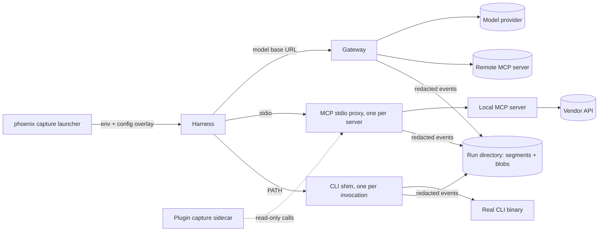
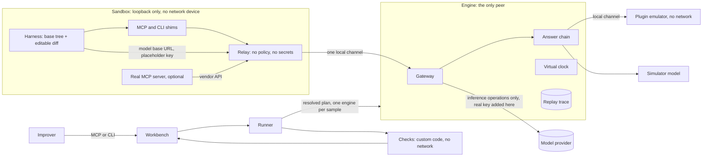

# Phoenix: Architecture

Status: November 15, 2026. Built from SPEC.md.

## 0. The shape

Phoenix is a TypeScript monorepo, run with npx, built around one idea: every tool surface (MCP over stdio, MCP over Streamable HTTP, CLI commands, direct HTTP calls, and the model API) is handled by a **tap** that carries wire traffic unchanged over a two-way **link** to a **backend**. During Capture the backend is the real upstream wrapped in a tee: every byte passes straight through except the last bytes of each message, which wait until that message's redacted record has been written out to the operating system. Nothing the harness received whole is missing from the trace, no call waits on a disk flush, and a recorder that falls behind slows the call instead of dropping the record. During a Replay the backend is a responder driven by the **answer chain**, which answers from the recording, the overlay, an emulator, pre-run read-only results, or the simulator model, and otherwise stops with a divergence. A recorded answer is used only while the Replay's writes match the writes the original run had made at that point. The harness is pointed at the same kinds of endpoints in both modes. A Moment is a directory of plain files (manifest, success check, lock, data) that sits in git; its approval is also kept in a ledger outside the workspace. A Replay runs a frozen copy of the harness (the base tree plus only the editable changes) in a sandbox that has no network device, only a loopback relay to the Phoenix engine, so every outbound byte takes one path, no real system is reachable, and no real credential, recording or check is inside. Replay from the mark works on any harness by running it from the start against recorded answers until the mark. The Workbench is a thin API over the runner, exposed as an MCP server and a matching CLI, and contains no code that can write a success check. Everything language-neutral is defined by JSON Schemas in `spec/`; plugins and recipes are separate processes or data files, so the core works with none installed.

## 1. Runtime picture

**Capture (live, alongside the harness, no container):**



**Replay (inside the Workbench):**



In Capture every recorder is its own process writing its own file, so there is no shared daemon to lose. In a Replay the engine is the single controlled path the spec asks for, and it sits outside the sandbox: the candidate can reach the engine's listeners and nothing else, not the recording, not the trace, not the check. Phoenix has no long-running service. All state is files, and any `phoenix` process can pick up where another stopped.

## 2. Units

| Unit | Language | Owns | May depend on | Must never depend on |
|---|---|---|---|---|
| `spec` | JSON Schema, Markdown | The versioned definitions of trace, moment manifest, success check, lock, approvals ledger, harness contract, bindings, plugin descriptor, recipe descriptor, replay plan, replay result | nothing | any code |
| `formats` | TypeScript | Types generated from `spec`, validators, version checks | `spec` | every other unit |
| `store` | TypeScript | Run directories: segment writer, blob store and spool, merged reader, crash recovery; moment bundle reader and writer; reading the approvals ledger | `formats` | taps, replay, Workbench |
| `redact` | TypeScript | Pure redaction of messages before they are written | `formats` | I/O of any kind |
| `wire` | TypeScript | Pure codecs: MCP framing for both eras, CLI invocation records, HTTP exchanges, model-API dialects (inference-operation lists, the split of a request into history and configuration), call keys, write histories | `formats` | I/O of any kind |
| `taps` | TypeScript | The listener for each surface, each given a `Backend` | `wire`, `formats` | `capture`, `answer`, knowledge of live vs replay |
| `capture` | TypeScript | Launcher, upstream backends, the tee and its release rule, recipe application, flag and correction commands, plugin capture host | `taps`, `store`, `redact`, `plugin-host`, `formats` | `answer`, `engine`, `runner`, `workbench` |
| `model` | TypeScript | `ModelProvider` port and its adapters | `formats` | everything else |
| `answer` | TypeScript | Answer chain, matcher, entity overlay, prefetch and simulator resolvers, divergence | `wire`, `store`, `plugin-host`, `model`, `formats` | `taps`, `sandbox`, `workbench` |
| `engine` | TypeScript | Replay-side server: taps wired to responders over the answer chain, virtual clock, replay trace | `taps`, `answer`, `store`, `redact`, `formats` | `workbench`, `setup` |
| `sandbox` | TypeScript | `Sandbox` port, container driver, VM driver, the relay | `formats` | everything else |
| `checks` | TypeScript | Deterministic expectation evaluators, custom-check host, sample and moment verdicts | `store`, `wire`, `sandbox`, `formats` | `engine`, `workbench`, `setup` |
| `fidelity` | TypeScript | Tier and grade rules, the fidelity report, all computed from a trace | `store`, `wire`, `formats` | `engine`, `workbench` |
| `runner` | TypeScript | Resolves a replay plan, runs and resumes samples, records results | `engine`, `sandbox`, `checks`, `fidelity`, `store`, `formats` | `workbench`, `setup` |
| `setup` | TypeScript | Turns a marked point or a Scenario into a moment bundle, drafts and locks the success check, appends to the approvals ledger | `store`, `wire`, `plugin-host`, `model`, `formats` | `workbench`, `runner` |
| `workbench` | TypeScript | `WorkbenchApi`, its MCP server, workspaces, patch and pull-request output | `runner`, `store`, `checks`, `fidelity`, `formats` | `setup`, any check-writing or ledger-writing code |
| `plugin-host` | TypeScript | Finds plugin descriptors, starts plugin processes, speaks the plugin protocol | `sandbox`, `formats` | any specific plugin |
| `plugin-kit` | TypeScript | The test kit: runs recorded exchanges through a plugin and diffs | `plugin-host`, `store`, `wire`, `formats` | `workbench` |
| `cli` | TypeScript | The `phoenix` binary; the only place units are wired together | all units | (nothing barred) |
| `recipes/*` | YAML, shell | Capture recipes for Claude Code, Codex, pi, fx, Ozi and a generic one | `spec` | core internals |
| `plugins/*` | any | Connector plugins, separately installed | `spec` | core internals |
| `reference-harness` | TypeScript | The small from-scratch harness | the harness contract in `spec`, the MCP client SDK | every Phoenix package |

## 3. Core pieces

### 3.1 Taps, links and backends

A tap owns one surface's transport and nothing else. It knows where a message starts and ends, not what it means. It carries frames between the harness and a backend over a link.

```ts
interface Frame {
  dir: "out" | "back";     // out: harness toward tool; back: tool toward harness
  stream: number;          // one message or body within the connection
  bytes: Uint8Array;
  last: boolean;           // this frame completes a message
  at: bigint;              // the host's monotonic clock when it was seen
}
interface Link { write(f: Frame): Promise<void>; frames(): AsyncIterable<Frame>; abort(why: string): void; }
interface Backend { open(conn: { surface: Surface; connector: string; meta: unknown }): Link; }
```

A link is two-way and long-lived, so everything a protocol does fits in it without a special case: a JSON-RPC line in either direction on stdio; a POST and its request-scoped SSE stream; and, for MCP revisions up to 2025-11-25, the session header, the standalone GET stream, server-initiated requests, cancellation notifications and `Last-Event-ID` resumption ([2025-11-25 transports](https://modelcontextprotocol.io/specification/2025-11-25/basic/transports)). The stateless 2026-07-28 revision removes the handshake, sessions, the GET stream and resumability, carries the version in each request's `_meta`, adds `server/discover`, delivers change notifications on the response stream of a `subscriptions/listen` request, and has servers ask for input by returning `resultType: "input_required"` ([changelog](https://modelcontextprotocol.io/specification/2026-07-28/changelog)). Both eras are frames on streams.

There are four taps:

- **MCP stdio.** A process that sits where the server command used to be and carries newline-delimited JSON-RPC lines both ways. A client that probes a stdio server by launching it a second time (the official SDK's probe "rides a disposable sibling process", [SDK guide](https://ts.sdk.modelcontextprotocol.io/v2/migration/support-2026-07-28.html)) gets a second proxy relaying to a second server process.
- **MCP Streamable HTTP.** A reverse route in the gateway (`/mcp/<name>`).
- **CLI.** A shim placed first on `PATH` for each command the recipe names. It carries argv as an array (never a joined shell string), working directory, an allow-listed slice of the environment, stdin, stdout, stderr and the exit code or signal. Each of the three descriptors is given a pseudoterminal only if the shim's own descriptor is a terminal, with the terminal's size and resize and signal forwarding; otherwise it is a pipe.
- **HTTP gateway.** One listener with three entry modes: reverse (the harness's base URL points at it), forward proxy (`HTTPS_PROXY` with a local CA), and transparent (inside the sandbox only). It serves the model API, direct API calls, and vendor API traffic from a real MCP server.

Rules every tap keeps:

1. A tap never rewrites a message, never answers one itself, never decodes a body, and never adds a request of its own (no discovery probe, no protocol upgrade). Meaning is decoded later, from the recorded copy, by `wire`.
2. A tap knows nothing about live versus replay. That is the backend it was given.
3. Agent-level traffic and traffic underneath it are kept apart. An HTTP request made by a local MCP server is recorded with `layer: "under"`. When exactly one `tools/call` is in flight on that server, that call is recorded as `parent` with `parent_basis: "sole-in-flight"`, which says it is an inference and not proof. When the parent cannot be narrowed to one call it is left empty.

A `Call` is a view that `wire` derives from frames (pairing a request with its response); it is what the answer chain works on (3.5), not what taps exchange.

### 3.2 Capture

`phoenix capture -- <harness command>` is the launcher. It creates the run directory, applies a capture recipe as an overlay (environment variables, command-line config overrides, or a generated copy of a config file; the person's own files are not edited), starts the gateway on a loopback port as a supervised child, runs the harness, and closes the run when it exits. `PHOENIX_RUN_ID` and `PHOENIX_HOME` reach every proxy and shim through the inherited environment.

- **MCP proxy.** The recipe rewrites each stdio server entry to `node <phoenix>/mcp-proxy.js -- <original command>` and each remote entry to the gateway's `/mcp/<name>` route. The server is untouched. The trace holds every message in both directions, every tool list seen (including later changes), and the protocol version actually used: from the `initialize` result on older servers, and from per-request `_meta` and `server/discover` on current ones. A `server/discover` that the harness sent as a probe is recorded as a probe; seeing it does not mean the modern era was negotiated.
- **CLI proxy.** The recipe puts a shim directory first on `PATH`. A shim records the invocation, then runs the real binary found on the rest of `PATH`. A command invoked by absolute path or as a shell built-in does not pass through a shim; the coverage record says so.
- **Model-API recording.** The gateway in reverse mode forwards to the real provider and records the full request and the full streamed response in the provider's own format. Every tool result the model was shown crosses this boundary in some request, so this is the record of what the model saw from tools nobody proxied, and a second witness for tools that were. It is evidence of what reached the model, not of actions the harness never reported. Where a dialect lets the provider hold the conversation, so that later requests carry only new items ([OpenAI conversation state](https://developers.openai.com/api/docs/guides/conversation-state)), the trace still holds every item that was sent, and the coverage record notes that the provider held the history.
- **Direct API calls.** The forward-proxy mode records them. It needs the local CA trusted by the calling process, so recipes turn it on only where that is known to work. The same mode, set in a local MCP server's environment, records the vendor traffic underneath it.
- **A harness whose model base URL cannot be pointed elsewhere.** Its recipe supplies its own way: the forward proxy where the binary accepts the CA, or a script that turns the harness's own log of model exchanges into trace events through `phoenix record` (events on stdin, validated against the trace schema). The coverage record names which was used.
- **Plugin capture.** A connector plugin may declare a `capture` command. The capture host runs it as a sidecar, streams it that connector's recorded events, and executes the read-only calls it asks for on the same upstream connection. The host refuses any tool the plugin did not declare read-only; tool annotations from a server are never enough, since MCP says clients must treat them as untrusted ([tools](https://modelcontextprotocol.io/specification/2026-07-28/server/tools)). Results are written as `prefetch` events with their own timestamps and are never sent to the harness. The sidecar ends by writing a coverage statement: which collections it read completely, and over what span of time. Off unless the person turns it on for that connector.
- **Flagging.** `phoenix flag "<reason>"` writes a mark to the current run. An opt-in one-tool MCP server does the same for harnesses that prefer a tool. Neither is added unless the person adds it, so default Capture never changes what the agent sees.
- **Corrections.** `phoenix correct <run> --at <event> "<text>" [--one-off]` appends a Correction to the run's notes, during the run or afterward.
- **Coverage record.** Each recorder appends a line to `coverage.jsonl` when it starts (which surface, which server or command, which entry mode), so coverage survives a run that never closes cleanly. At close the launcher adds which surfaces were configured but saw no traffic and what the taps cannot see.

**The tee and its release rule.** In Capture a backend is the real upstream wrapped in a tee. The tee passes every frame through the moment it arrives, except a frame marked `last`. It holds that frame until the recorder reports that the message's redacted record has been written out in full to the operating system, then releases it. So a tool never holds a complete request, and the harness never holds a complete response, that is not in the trace. For a streamed response every chunk but the final one flows at full speed.

Two things can go wrong with the recorder, and they are handled differently:

- **It is behind.** The queue between the tap and the recorder is bounded. When it is full the tap stops reading from its sockets, which is ordinary stream backpressure. The call is slower; no record is dropped.
- **It has failed.** A write returned an error (disk full, permission, I/O error) or the recorder thread died. Held frames are released at once and the run continues unrecorded on that tap. This is visible without relying on any marker being written: every event carries a sequence number the tap assigned before queueing, so a hole in the sequence is a gap, and a segment that does not end with a `close` event has an unknown tail. A `gap` event is also written when writing is still possible.

No storage flush happens on the call path.

**Recording path.** Forwarding runs on the main thread; the recorder runs on a worker thread fed through the bounded queue. The worker assembles each message, redacts it whole, and appends it to a file opened for append with no buffering in the process, calling `write` again until every byte is accepted, since one call may take fewer bytes than asked ([write(2)](https://man7.org/linux/man-pages/man2/write.2.html)). After each batch it has written, the worker syncs the file, continuously and off the call path, so what a power loss can take is the batch in flight and no more. Node's `fs.fsync` is enough on every platform: libuv issues `F_FULLFSYNC` on macOS itself ([libuv `fs.c`](https://github.com/libuv/libuv/blob/v1.x/src/unix/fs.c)). Streamed bodies are spooled as they pass: redacted bytes are appended to a temporary blob once they are behind the redactor's look-behind window, with the arrival time of each chunk. When the body ends the blob is synced, renamed to its content hash, and its directory synced, before the event that refers to it is appended ([fsync(2)](https://man7.org/linux/man-pages/man2/fsync.2.html) on why the directory needs its own sync).

**Redaction** runs in the recorder before any write, so unredacted bytes never reach disk:

```ts
redact(msg: WireMessage, policy: RedactPolicy): { msg: WireMessage; changes: { at: string; rule: string }[] }
```

The default policy strips auth headers (`Authorization`, `Proxy-Authorization`, `Cookie`, `Set-Cookie`, `x-api-key` and similar) and credentials in URLs from the recorded copy, replaces values under secret-named keys and values matching secret patterns, and replaces detected personal data. A replaced value becomes a typed placeholder derived from an HMAC of the original under a key that stays in `PHOENIX_HOME`, so the same value always maps to the same placeholder and replay matching still works. Redaction runs over the whole assembled message, and over a streamed body with a look-behind window, so a secret split across network chunks is caught. Each change is recorded with its location and rule. A payload the redactor cannot decode is **withheld**: the event keeps its size and an HMAC digest and says why, and the bytes are not stored. A decode failure never permits raw storage. Binary media the redactor has no rule for is stored only for content types the policy lists, and is marked `unscanned`. Phoenix writes no raw payload to its own logs or crash output.

What Capture guarantees, exactly:

1. Recording never fails a call and never waits on a disk flush. What it adds to a call is one redaction pass and one write per message. A recorder that is behind slows the call.
2. If a tap process crashes, every message that was delivered whole is in its segment. The exchange in flight shows as a `call` with no `result`, with whatever part of its body had been spooled attached as partial.
3. If the machine loses power or the kernel crashes, the batch each recorder had written but not yet synced can be lost. Everything synced earlier is intact.
4. If storage fails outright, the agent keeps running and the trace shows exactly where recording stopped.
5. A recorder writes only its own segment file. There are no locks between recorders.
6. A dropped upstream connection gives an `aborted` result with the bytes received. Phoenix never retries a live call.

### 3.3 Trace store

A run is a directory, whether it came from Capture or from a Replay sample:

```
runs/<run-id>/
  run.json              written once: harness name and tree digest, recipe and version, start time, host boot id
  coverage.jsonl        one line per recorder as it starts, plus the launcher's summary at close
  seg/<recorder>.jsonl  one append-only file per recorder process, ending with a close event
  blobs/sha256/..       bodies above a size threshold, named by content hash of the redacted bytes
  blobs/tmp/..          spools of bodies still streaming
  notes.jsonl           marks and corrections, append-only
```

```ts
interface TraceWriter { append(e: TraceEvent): Promise<"written" | "failed">; close(): Promise<void>; }
interface TraceReader { events(run: RunId, from?: EventId): AsyncIterable<TraceEvent>; }
```

The reader merges segments by monotonic timestamp, then recorder id, then sequence number. All recorders of a run are processes on one host reading one monotonic clock, so the merged order is the order in which the taps saw the traffic. The reader drops a final line that does not parse and reports it as torn, reports a line that fails validation anywhere else as corruption (never skipping it silently), reports sequence holes and segments with no `close`, and attaches an orphaned spool to its call as a partial body. Reading needs no index and no database, and a run can be read while it is being written. Run directories are private and are never published; only moment bundles are shared.

### 3.4 Moments and the setup step

A Moment is a bundle directory: `moment.yaml`, `check.yaml`, `moment.lock.json`, `data/`, and `checks/` when the check has custom code. It never holds harness, tool or plugin code. The one executable thing it may hold is the custom check, which is named in the manifest as executable and runs only in the check container (3.8).

A **mark** is a cut in a run's merged order, named by an event id. The **frozen prefix** is every exchange whose result was complete before the cut. A call that was open at the cut (its request before, its result after) is not frozen: its recorded result belongs to the after-mark recordings, because the harness had not yet received it. A run can be a live Capture, a Replay sample's trace, or a staged run written by hand, so all three can be marked.

`setup` builds a bundle in fixed steps, each a function from files to files:

1. **Locate.** Take a mark (flagged or picked) in a run, or a Scenario description.
2. **Find connectors.** Group the run's agent-level events by connector and surface.
3. **Collect the Snapshot.** Copy the whole run's evidence for each connector and for the model, in three parts kept apart: the **frozen prefix**, the **after-mark recordings** (what the original run went on to do and see), and **capture-time observations** (plugin state and prefetch results). Each recorded exchange keeps its observed-at time, the call it came from, and its **write history**: the ordered keys of the non-read-only calls that had completed on that connector before it. Record prompt, model identifier as the provider reported it, clock time and timezone, harness tree digest (and git commit when there is one), recipe version, tool lists, and MCP protocol version and era. Setup uses only what Capture recorded. It never queries a vendor's present state.
4. **Classify operations.** For each connector, write which operations are read-only and where that came from: the plugin's declaration; otherwise the server's own annotations and HTTP safe methods ([RFC 9110 §9.2.1](https://www.rfc-editor.org/rfc/rfc9110#section-9.2.1)), marked `unverified`; otherwise nothing, which means every operation counts as a write. This list is part of what the person approves.
5. **Pick tiers.** A connector's tier is at most what its plugin declares and at most what its coverage statement supports: `stateful` only when the collections its tools read were captured completely; otherwise `recorded`. A connector with no plugin is `recorded`.
6. **Infer formats.** Build a JSON Schema per tool from its recorded responses and note where a declared `outputSchema` disagrees with what was recorded.
7. **Draft the check.** The draft is a file, `check.draft.yaml`. `phoenix check draft` writes it by reading the trace, the harness files and any docs the person names, through the `ModelProvider` port, starting from the Correction if there is one that is not marked one-off. The person, or an agent of theirs working outside the Workbench, may write or edit the same file.
8. **Lock.** `phoenix check approve <moment>` shows the draft to the person and, on approval, writes `check.yaml` and `moment.lock.json` (hashes of the manifest, the check, any custom check file and every data file; who approved; when), and appends the lock's hash to the **approvals ledger**, an append-only file in `PHOENIX_HOME`, outside any workspace. For a seeded Scenario the manifest may set `lock: auto`, which locks without approval and is recorded in the ledger as such. Changing anything locked means a new moment revision with a new lock; results stay attached to the hash they were run against.

The lock file in the bundle is the portable record of an approval. The ledger is the authority on this machine: the runner runs only bundles whose lock hash is in it. A moment that arrived from someone else carries their lock, which proves the files are intact, not that this person agrees; `phoenix moment accept <moment>` shows the check and records the acceptance in the ledger.

For a Scenario, steps 2 and 3 are replaced by the author's seed files: emulator state in the plugin's state format, hand-written exchanges, and optionally a **staged run** (hand-written model and tool exchanges as trace events) with a mark in it. The manifest says `source: scenario` and its data is marked `origin: seeded`, never `captured`. From step 4 on, both kinds are the same bundle and replay the same way: from the beginning, or from the mark when the bundle has a run with one.

### 3.5 Answer chain

The replay layer is an ordered list of resolvers over calls. Each returns an answer or a reasoned miss; the chain returns the first answer.

```ts
interface Call {
  surface: "mcp" | "cli" | "http" | "model";
  layer: "agent" | "under";
  parent?: CallId;
  connector: string;          // logical name, e.g. "calendar"
  op: string;                 // "tools/call:move_event", "gh", "GET api.notion.com/v1/pages/{id}"
  args: unknown;              // normalized arguments
  readOnly: boolean;          // from the manifest's classification
  raw: WireMessage;
}
interface Answer {
  raw: WireMessage;           // exact bytes to send back, streamable
  provenance: "real" | "recorded" | "derived" | "synthesized";
  resolver: string;
  note?: string;              // e.g. "repeat of last observation"
}
interface Resolver { name: string; resolve(call: Call, ctx: ReplayCtx): Promise<Answer | Miss>; }
type Miss = { miss: true; why: string };
```

**Keys.** A call key is the SHA-256 of the canonical JSON ([RFC 8785](https://www.rfc-editor.org/rfc/rfc8785)) of surface, connector, op and normalized args. Canonical JSON fixes representation, not meaning, so only object key order is normalized: array order, null versus absent, and argv boundaries are kept. Argument paths are removed from the key only by a versioned rule in the connector's plugin; the core removes nothing.

**Write history.** For each connector the engine keeps the ordered keys of the non-read-only calls served so far in this sample. A recorded exchange is **current** when its stored write history equals the sample's. With a plugin entity map the comparison is narrowed: a differing write makes stale only the recorded answers that contain an entity it touched and, for a create, lists of that entity type. This is the one rule that keeps the recording from answering for a world the candidate has changed, or for one where the candidate skipped a write the original made.

In the order the spec fixes:

1. **Recorded.** A current exchange with the same key answers, byte for byte. When several share a key, the k-th call gets the k-th. A call beyond the recorded count is a miss here, with one exception: a call whose read-only classification is in the locked manifest is answered with the last current observation, labeled `derived` with the note "repeat of last observation". The frozen world has not been written to since that observation, so the frozen world's answer is unchanged. The exception does not apply to an operation a plugin marks `volatile` (cursors, polls, anything whose answer moves without a write), and a manifest can turn it off for a connector.
2. **Overlay.** Driven by a declarative **entity map** in the connector's plugin descriptor: for each tool, its kind (list, get, create, update, delete), the entity type, the paths to ids and items, how a list result shows it is complete, and optionally which arguments filter a list by equality or range on a named field. The core builds the entities observed at or before the mark (plus capture-time observations), applies recorded prefix writes using the entity each write's recorded response returned, and applies the Replay's own writes on top. It answers a get by id for a known entity, and a list only when the list is complete and either unfiltered or filtered by declared arguments. An entity whose state after a write is not known is **unknown**, and a read of it is a miss; an entity never seen is a miss, not "not found," unless a complete list covers it. A connector with no entity map has no overlay. The entity map covers lookups only. Recurrence, permissions, ranking and side effects are connector semantics and belong to an emulator.
3. **Emulator.** For connectors whose plugin has a `serve` command, started from the Snapshot. It answers at the vendor-API level or at the tool level. Recorded prefix writes are executed against it so its state at the mark matches the captured world; where its answer differs from the recorded one, the recorded one is served and the difference goes in the fidelity report.
4. **Prefetch.** Results of read-only tools the plugin capture sidecar ran at capture time, matched by key and current by the same write-history rule.
5. **Simulator.** Only for connectors whose manifest entry allows `synthesized`. The simulator model writes a response in the tool's format; it is validated against the tool's real protocol envelope, the inferred schema and the declared one if any, and stored before it is served, under the moment, connector, call key, write history and simulator configuration. The store is write-once and shared by every sample and by the baseline, so the same question in the same world gets the same invented answer on both sides of a comparison. Non-read-only calls get a synthesized acknowledgement and change nothing; that acknowledgement never counts as evidence that a state change happened.
6. **Divergence.** The chain stops the sample and records the call and every resolver's reason for missing.

Each connector has exactly one state holder in a Replay, the overlay or the emulator, never both, and each sample has its own.

When the bindings mark a connector `serve: real`, the real MCP server runs in the sandbox, tool calls go to it, and the chain answers only its vendor traffic; the two layers are never both answered. The tool result's provenance is the weakest provenance among the vendor answers served to that server since its previous tool result, with `resolver: real-server`. Real code over invented inputs is not `real`.

The divergence detector is the last step plus six other triggers, all recorded the same way: an outbound connection the gateway cannot map to a connector, a TLS handshake the client refused, a call in the frozen prefix that does not match the recording, a model-route request that is not an inference operation, a model request that would make the provider act on the live world, and a model request that refers to conversation state the provider holds from outside this sample.

Rules: the order is fixed in code; a manifest can only remove steps for a connector. Every answer carries its provenance and resolver. `real` means the live system during Capture, the real model provider during a Replay, or real server code that consumed no replayed data; `recorded` means bytes from the log or prefetch; `derived` means computed from recorded data by the overlay, an emulator, or a repeat; `synthesized` means the simulator. No resolver may return data without one of the four.

### 3.6 Engine, sandbox and virtual clock

**Engine.** One process per sample, outside the sandbox. It hosts the taps with responders as their backends, the clock, and a trace writer, so a Replay produces a full trace in the same format as a live run. The matcher's index is built in memory from the bundle when the engine starts. The engine appends each answer to the sample's trace before it sends that answer; in a Replay nothing is in production, so the write is simply waited for. Every answer the harness received is therefore in the trace, which is what makes a sample resumable (3.7).

For MCP the responder is the server side of the link, driven by the recording. It answers in the recorded era: a connector recorded on an older revision gets the recorded `initialize` result and rejects `server/discover` the way the recording shows; one recorded on 2026-07-28 answers `server/discover` and stamps each result as recorded. Tool lists are served as recorded. Within a `tools/call`, the messages the server sent during that call are replayed in order before the result: progress, and on older revisions server-initiated requests, each of which waits for the harness's response and compares it with the recorded one. Change notifications are sent at the same position in the call order as recorded, on the GET stream or the `subscriptions/listen` stream according to era. An `input_required` result and the retry that follows are two ordinary calls. Lifecycle behavior the recording does not have is a divergence, not an invented success.

For the model API the responder has two phases:

- **Frozen prefix.** When a Replay starts from the mark, the harness is still launched from the start, and until the mark the engine answers every model request with the recorded model response and every tool call with its recorded result. This imposes the history exactly as it was, for any harness, with nothing asked of the harness beyond its three-item contract. `wire` splits each prefix model request into its **history** (the user, assistant and tool-result turns) and its **configuration** (system prompt, tool definitions, model identifier and parameters). The history must equal the recorded one. The configuration may differ, because that is what an Improver edits; each difference is listed in the result as `prefix_edits`. One condition ties the two together: every tool call in the recorded history must still name a tool the candidate defines, with arguments its input schema accepts. A history difference, a broken condition, or a tool call the recording does not have at that point stops the sample with a **prefix-drift** divergence that names the first differing field; that change needs a Replay from the beginning. Concurrent requests are matched by content first and order second.
- **Live.** From the mark onward (or from the first request, when starting from the beginning) model requests go to the real provider and tool calls go through the answer chain. A call that was open at the cut is the first live step.

Every result says what "frozen" covered: the history shown to the model and every answer the harness received before the mark are the recorded ones; the code that carried them is the candidate's; state a harness keeps outside its model and tool calls is whatever the candidate built from that history.

The same mechanism serves two more jobs. An **echo** Replay puts the mark at the end of the run, so nothing is live: every difference between what the harness does and the recording is a fidelity finding about Phoenix, the recipe or the harness's own nondeterminism. And an interrupted sample is resumed with its own partial trace as the prefix (3.7).

The model route is an allow-list of operations, not hosts. Each dialect in `wire` lists its inference operations (method and path); the engine forwards only those, to the configured provider, and adds the real credential there. It does not follow redirects on the harness's behalf. Two kinds of request are refused as a divergence with tier `blocked`: one that declares provider-run tools that reach outside systems, such as Anthropic's web search or MCP connector ([docs](https://platform.claude.com/docs/en/agents-and-tools/mcp-connector)), or names content for the provider to fetch by URL, because the provider would act on the live world; and one that points at a stored response or conversation the provider holds from the live run, because that is vendor state outside the frozen copy.

**Sandbox.**

```ts
interface Sandbox {
  readonly clock: "guest" | "preload";
  start(spec: { image: ImageRef; argv: string[]; env: Record<string,string>;
                mounts: Mount[]; epoch: Instant }): Promise<{ process: SandboxProcess; channel: EngineChannel }>;
}
```

The contract both drivers keep: the workload's network namespace has a loopback interface and nothing else, and one byte channel leaves it, ending at the engine. Inside the namespace a **relay** listens on loopback, answers every name lookup with loopback, accepts the connections that follow, and pipes each to the engine with its original destination. The relay has no policy and no secrets; the engine decides everything. Where the runtime permits a redirect rule inside the namespace, every other outbound TCP connection (raw addresses, unusual ports) is also turned to the relay and so reported; where it does not, those connections fail locally and the fidelity report says raw-address reporting is off. Either way they reach nothing. Safety rests on the absence of a route, not on name resolution and not on firewall rules.

- **Container driver.** The workload runs with [`--network none`](https://docs.docker.com/engine/network/drivers/none/), sharing the network namespace of a small Phoenix container that runs the relay. The channel is a Unix socket in a volume mounted into the relay container and the engine container only. Only the engine container has a network with egress. Emulators run with no network and their own socket to the engine. An internal bridge network is not used: Docker documents that containers on one can still reach the gateway address and host services listening there ([`--internal`](https://docs.docker.com/reference/cli/docker/network/create/#internal)).
- **VM driver.** The same image runs in a hardware-accelerated guest whose one network device is QEMU user networking with `restrict=on`, under which the guest "will not be able to contact the host and no guest IP packets will be routed over the host to the outside", plus a single explicit forward to the engine ([QEMU manual](https://www.qemu.org/docs/master/system/qemu-manpage.html)). The guest's init runs the same relay, has no time synchronization, and sets the guest clock to the captured time before the workload starts.

In both, the harness tree is the base tree plus only the Improver's changes to editable paths, materialized fresh for each sample; the moment bundle, the recording and the check are not mounted; the host's home directory, credentials, agent sockets and container socket are absent. Stdio MCP entries point at a shim that relays to the engine, CLI shims do the same, and model and remote-MCP base URLs point at the relay over plain HTTP, so the main paths need no CA.

Rules: the sandbox reaches only the engine; the engine forwards only inference operations; no real credential enters the sandbox; there is no flag that turns any of these off.

**Virtual clock.** A small state (virtual anchor, real anchor) owned by the engine, anchored to the captured time at Replay start and again at the mark. Plugin emulators read it from a `now` endpoint, and the engine uses it for the `Date` headers it writes. The harness gets it from the sandbox. The default is the VM driver, where the whole guest is on the captured time, because nothing lighter covers every process: [libfaketime](https://github.com/wolfcw/libfaketime/blob/master/README) cannot affect statically linked binaries and is bypassed by runtimes that do not call libc for time, and Linux time namespaces "do not virtualize the CLOCK_REALTIME clock" ([time_namespaces(7)](https://man7.org/linux/man-pages/man7/time_namespaces.7.html)). The container driver with libfaketime preloaded is used only when the harness contract or its recipe declares `clock: preload`, and a probe at start confirms the harness's runtime sees the captured time. The probe can refute the declaration, not prove it, so the fidelity report shows `clock: preload (declared)`. If neither driver can give the harness the captured time, the Replay is refused with the reason. Host time is never used as virtual time.

### 3.7 Runner

```ts
interface Runner {
  replay(req: { moment: MomentRef; candidate: TreeDigest; start: "beginning" | "mark" | "echo";
                samples: number }): Promise<ReplayId>;
  status(id: ReplayId): ReplayStatus;       // durable; safe to poll after a crash
}
```

The runner first writes a **resolved plan**, `plan.json`: bundle digest, check hash, base and candidate tree digests, harness image digest, model identifier and parameters (an alias is kept and labeled as an alias), start mode, sample count, resolved plugin versions, simulator model and configuration, sandbox driver and clock mode, and the version of the engine's matching rules. Everything after is a function of the plan. The plan's hash is the Replay's identity, so asking for the same Replay twice returns the same one, and it is the key under which baseline results (the base tree, same moment, same model) are stored and reused.

The runner checks the bundle against its lock and the lock against the approvals ledger, writes the harness's endpoint overlay from the harness contract and bindings, starts one engine and one sandbox per sample, and runs samples in parallel up to a configured limit. Samples share only immutable inputs and the write-once simulator store. Each attempt at a sample writes into its own directory and no attempt is ever deleted. A Replay keeps a journal of sample states. A sample that was interrupted (engine, sandbox, emulator or host died; provider outage) is resumed with a new attempt that uses the interrupted attempt's own trace as a frozen prefix: the model responses and answers it had received are imposed again, and its writes are run against a fresh state holder, so the resumed sample continues the same history instead of drawing a new one. If that prefix drifts, the attempt starts fresh and the result says so. A sample's outcome is that of the first attempt to reach one. A finished sample is never re-run.

### 3.8 Success checks

`check.yaml` holds deterministic expectations, an optional custom check, an optional intent statement, the evidence scope, and the sample count:

```yaml
phoenix_check: 1
samples: 5
scope: continuation            # or: run
expect:
  - called:     { tool: calendar.move_event, args: { event_id: evt_3pm }, times: 1 }
  - not_called: { tool: calendar.move_event, args: { event_id: { not: evt_3pm } } }
  - order:      [calendar.list_events, calendar.move_event, slack.post_message]
  - max_calls:  { tool: "*", count: 12 }
  - end_state:  { connector: calendar, equals: data/expected-calendar.json }
  - final_text: { contains: "moved" }      # or matches: <regex>
  - custom:     checks/only-3pm.ts
intent: "Move only the 3pm, notify attendees, leave recurring events alone."
```

Evaluators are pure functions over a sample's trace. They see agent-level calls only: tap events with `layer: "agent"` and, for tools nobody proxied, the tool-use blocks in the model exchanges. An action seen at both places is one action. With `scope: continuation` they see only what happened after the mark, so frozen history is not mistaken for the candidate's behavior. `order` compares calls by the model turn that issued them and their position in that turn, not by arrival time. `end_state` compares the connector's state holder at the end of the sample. A custom check is a TypeScript module exporting one function; it runs with Node's built-in type stripping in a container with no network, the sample's evidence mounted read-only, and nothing from the candidate tree, because Node's permission model "does not protect against malicious code" ([Node permissions](https://nodejs.org/docs/latest-v24.x/api/permissions.html)) and a shared moment's check is someone else's code.

Verdict rules:

- Every expectation is evaluated; none is ever dropped. An expectation is **clean** when all the evidence it reads comes before the first synthesized answer in the sample, and **tainted** otherwise. Taint runs forward in time because everything the model does after a synthesized answer may have been shaped by it; no finer dependency can be established through a model.
- A sample **fails** if any clean expectation fails; that result is binding and no intent judgment overrides it. It **passes** if every expectation passes and the intent, if present, was judged met. When the deciding results include a tainted expectation, the sample's result stands but is marked **discounted**.
- A sample that diverged **fails** if its trace up to the divergence already breaks an expectation that later events cannot repair (`not_called`, `max_calls`, a broken `order`). Otherwise it is **unassessed**, as is a sample whose check errored or whose intent has no judgment yet.
- Plain-language intent is judged by the Improver, who records a judgment and a reason per sample through the Workbench.
- A moment's result is **incomplete** while any scheduled sample is unassessed. Unassessed samples are never dropped to shrink the count.
- A complete moment **fails** when half or more of its samples fail. Otherwise it **meets the check**. A verdict that rests on any discounted sample is itself marked discounted, and is never shown as a plain pass.
- A target moment **passes** when it meets the check and has more passing samples than the baseline on the same model. If the baseline itself meets the check, the result says so: the failure did not reproduce, and there is nothing to pass.
- A change **passes** a moment set when its target moments pass and every other moment that met its check at baseline still does. An incomplete moment cannot establish either.

The lock is enforced in five places. The Workbench has no operation that writes a check or the ledger and may not import the unit that does. The bundle is not mounted in the sandbox. The runner refuses a bundle whose hashes differ from `moment.lock.json`, and a lock whose hash is not in the approvals ledger. A harness contract whose editable globs match any path inside a moment bundle is refused. And every result embeds the check's hash and its ledger entry, so the person reviewing the patch can see it is the one they approved.

### 3.9 Fidelity

Every answer carries a provenance. A connector's tier in a run is the lowest of three things: what its plugin declared, what its captured coverage supports, and the weakest source that actually answered (emulator gives **stateful**; recording, overlay or prefetch gives **recorded**; simulator gives **synthesized**; a divergence or a refused call gives **blocked**). The run's grade is the weakest tier among connectors that were called. The fidelity report lists the moment's source (snapshot or scenario) and each connector's data origin (captured or seeded); per connector, the tier and the count of real, recorded, derived and synthesized responses; every synthesized, derived and repeated answer with its call; read-only classifications that are unverified; recorded answers refused as stale; every divergence; emulator answers that differed from the recording; format mismatches between declared or inferred schemas and what came over the wire; the start mode and `prefix_edits`; the sandbox driver and clock mode; gaps and unknown tails in the source run; and what was redacted or withheld, by location. `fidelity` produces it from the trace alone, as a file in the sample directory.

### 3.10 Workbench

```ts
interface WorkbenchApi {
  listMoments(): MomentSummary[];
  readTrace(ref: RunOrReplayRef, range?: Range): TraceEvent[];
  listEditable(): string[];
  readFile(path: string): string;
  editFile(path: string, content: string): void;   // editable paths only
  startReplay(req: ReplayRequest): ReplayId;        // target moments, optionally the whole set
  getReplay(id: ReplayId): ReplayStatus;
  runChecks(id: ReplayId): CheckResults;
  judgeIntent(id: ReplayId, sample: number, met: boolean, reason: string): void;
  fidelityReport(id: ReplayId): FidelityReport;
  makePatch(opts?: { pullRequest?: boolean }): PatchRef;
}
```

The MCP server and the CLI are generated from this one interface, so they cannot drift. Replays are started and polled rather than awaited, so they survive tool-call timeouts and reconnects; `editFile` returns after the file is on disk.

A **workspace** is a working copy of the harness at a base tree. When the harness is a git repository it is a git worktree at a base commit. When it is not, Phoenix copies the directory into a private git repository of its own under `PHOENIX_HOME` and uses that; such a harness gets a patch file, and a pull request needs a repository of its own. The Improver may edit through `editFile` or directly in the tree. At `startReplay` the Workbench takes the changes against the base: modified and deleted tracked files, plus new files. A changed or new path outside the contract's editable globs refuses the Replay and names the paths; a symlink or path that escapes the tree is refused the same way. Files the repository ignores (dependencies, build output) are never part of a candidate. The candidate is the base tree plus exactly those editable changes, and its digest is stored in the plan; later edits make the next candidate and cannot change a running one.

`makePatch` writes the diff of editable paths as a patch file, plus a result file (per-moment verdicts against baseline, sample counts, check hashes and ledger entries, discounts, fidelity grade). With `pullRequest`, it pushes a branch with that patch and opens a pull request against the harness's own repository, with the results and grade in the description, using the person's own git credentials on the host. Captured data never goes into the patch. Phoenix has no deploy command.

### 3.11 Harness contract, bindings, plugins, recipes, reference harness

**Harness contract** (`phoenix.harness.yaml` in the harness repository) declares the three things the spec names and nothing else:

```yaml
phoenix_harness: 1
name: my-harness
run:      { command: [node, dist/main.js, --task-file, "{task_file}"], output: stdout,
            build: [npm, run, build], image: { dockerfile: Dockerfile }, clock: preload }
endpoints:
  model:  { env: ANTHROPIC_BASE_URL, dialect: anthropic-messages }
  mcp:    { file: .mcp.json, format: mcpServers }
editable: ["prompts/**", "tools/*.json", "config/model.yaml"]
```

The image is built from the base tree; `build` runs inside the sandbox on the candidate.

**Bindings** (`bindings.yaml` beside a moment set, optional) join a moment's logical connector names to this harness's own config entries, and say how each is served: `calendar: { mcp_server: google-calendar, serve: recorded }`, or `serve: real` to run the real server over replayed vendor traffic. With no bindings file a connector binds to the MCP server or command of the same name. This is what lets a shared moment run under someone else's harness without touching the locked bundle.

**Connector plugin** (a separately installed package with a `phoenix-plugin.json`): connector name, how to recognize it (MCP server names, hosts, CLI commands), declared tier and the operations it covers, read-only tools, volatile operations, key rules for arguments, the optional entity map, and up to two commands. `capture` is the sidecar of 3.2. `serve` starts an emulator from a Snapshot directory, at `http` or `tool` level, answers "unsupported" for operations it does not cover (a miss, never an empty success), reads `now` from the engine, and exposes its state for `end_state`. Both speak newline-delimited JSON on stdio or plain HTTP, so a plugin can be written in any language. Existing emulators are wrapped this way rather than linked into the core. A declared tier is a ceiling, never proof.

**Capture recipe** (a `recipe.yaml`, optionally with a script): how to point one harness at Phoenix. It names the model base-URL setting and dialect, where MCP servers are configured and in which format, which CLI commands to shim, a sandbox image, and any clock declaration. A recipe states which harness versions and login modes it covers and which surfaces it captures for each, and never switches the harness to a different provider route than the person chose.

**ModelProvider port:** `complete(req): Promise<ModelResult>`, with adapters for an Anthropic-style and an OpenAI-compatible endpoint chosen in config. It serves the simulator and the check draft. The Improver never goes through it.

**Reference harness:** a small TypeScript harness with one model, a few MCP tools and a few CLI tools, its own `phoenix.harness.yaml`, and no import of any Phoenix package. It has no session or resume feature, and replays from the mark like any other harness.

## 4. Data flows

**1. Fix a live failure.**
1. The person runs the harness through `phoenix capture`. The calendar MCP proxy, the gateway and any CLI shims write redacted events to the run directory. If the calendar plugin's capture is on, its sidecar reads calendar state through the same connection and states what it covered.
2. The harness calls `phoenix flag`, or the person later picks an event from the trace. Either way a mark exists.
3. The person runs `phoenix correct` with "it should only have moved the 3pm".
4. `phoenix moment create` runs the setup step: the bundle is written with the whole run's evidence split at the cut, and the check is drafted from the Correction. The person runs `phoenix check approve`; the lock is written and its hash goes in the ledger.
5. The person connects their coding agent to `phoenix workbench --mcp`. It calls `listMoments`, `readTrace`, `listEditable`.
6. It calls `startReplay`. The runner writes the plan, computes or reuses the baseline, then for each sample starts an engine and a sandbox with the frozen candidate. The prefix is imposed up to the mark; from there the model is live and calendar calls go through the answer chain. A read the original also made, before any differing write, is answered from the recording; after the candidate moves a different event, reads come from the overlay or emulator.
7. Checks run on each sample trace. The Improver reads the results and the fidelity report, records intent judgments, edits the prompt and tool description, and replays.
8. When the moment passes, it calls `startReplay` on the whole set, which confirms every moment that met its check at baseline still does.
9. `makePatch` writes the patch and results, or opens the pull request. The person reviews and deploys.

**2. Staging that was never live.** The person writes a Scenario: `moment.yaml` with `source: scenario`, a prompt, a clock time, seed files per connector, and optionally a staged run with a mark. Setup runs from step 4 of 3.4. The check is approved, or locked automatically if the manifest opts in. A Scenario with only world state starts from the beginning; one with a staged run starts from its mark. Any sample's trace is also a run, so the person can mark a point in it and create a moment from that.

**3. Regression sets.** The moment set is a directory of bundles kept with the harness. `startReplay` with the set runs every moment against the candidate and against the cached baseline, and returns per-moment verdicts plus the set rule of 3.8.

**4. Model or tool migration.** The person changes the model or a tool description in the workspace (both are harness edits) and replays the set from the beginning. Each moment reports whether it still meets its check under the change. Where an improvement is claimed, the baseline is the base tree run on the candidate's model, so the comparison is same-model as the spec requires. No patch is needed unless they want one.

**5. Sharing.** `phoenix moment pack` verifies the bundle against its lock, runs the current redaction policy over it, and writes an archive of the bundle directory with no absolute paths, listing any custom check file as executable content. If the policy would change anything, or the bundle holds `unscanned` media the person has not explicitly included, packing refuses; the person builds a new moment revision with a new lock instead. The recipient unpacks it next to their own harness, runs `phoenix moment accept` after reading the check, writes bindings, installs any plugin the manifest names themselves, and replays. Phoenix validates the bundle's versions, paths and hashes before running anything, never downloads or runs code a manifest points to, and runs the bundle's custom check only in the check container. Raw run directories are never part of a pack.

**6. A brand-new harness.** The person writes `phoenix.harness.yaml`, runs `phoenix capture` with the generic recipe (naming the CLI commands to shim), and continues as in flow 1, including replay from the mark. The reference harness is this flow, kept in the repository.

## 5. Failure

| What fails | What happens |
|---|---|
| A recorder is slower than the traffic | The tap stops reading until the queue drains. Calls are slower; no record is lost. |
| A recorder cannot write (disk full, permission, I/O error) or its thread died | Held frames are released at once and the call completes. The run continues unrecorded on that tap. The hole shows as missing sequence numbers or a segment with no `close`; a `gap` event is written when possible. Tool results in the gap remain readable from the model-API record if that recorder is healthy. |
| MCP stdio proxy or CLI shim crashes | That one server or invocation fails, as it would if the server crashed. Every message it delivered whole is in its segment; the one in flight is a `call` with a partial body. Other recorders are unaffected. |
| Gateway crashes during Capture | The launcher restarts it on the same port. An in-flight model request fails and the harness's own retry applies. Completed exchanges are in the trace. |
| Host loses power during Capture | Each recorder can lose the batch it had written but not synced. Every earlier line is intact; a torn last line is dropped on read and reported. A call whose request was dispatched in that window may be missing; its outcome at the vendor is unknown and Phoenix does not guess it. |
| Upstream connection drops mid-response | The partial response is recorded with an `aborted` result, and the harness sees the same drop it would have seen without Phoenix. Phoenix does not retry it. |
| Plugin capture sidecar crashes or misbehaves | The live path is untouched. A request for a tool not declared read-only is refused. With no coverage statement the connector is `recorded`. |
| Malformed or undecodable wire data | Forwarded unchanged. The recorded copy is withheld: size, digest and reason, no bytes. |
| Bundle does not match its lock, its lock is not in the ledger, it is an unsupported format version, or it has paths outside itself | The runner refuses to start and names the mismatch. |
| A changed or new path outside the editable set | The Replay is refused with the list of paths. Nothing is reset silently. |
| A recorded answer is stale (write histories differ) | The recorded resolver misses with that reason and the chain continues to the overlay, emulator, simulator or divergence. |
| No resolver can answer a call | Divergence: the sample stops, the call and all miss reasons are recorded. |
| Candidate departs from the recording before the mark | Prefix-drift divergence naming the first differing field; the change needs a Replay from the beginning. |
| Outbound traffic to an unknown destination in a Replay | It lands on the engine through the relay and is reported as a divergence, or fails locally where redirect is unavailable. It reaches nothing in either case. |
| Simulator output fails validation | It is retried within the resolver; if still invalid, divergence. An invalid answer is never served. |
| Plugin emulator crashes mid-sample | The sample is interrupted with the emulator's exit reason and resumed: a fresh emulator is started from the Snapshot and the sample's recorded writes are run against it. An empty world is never substituted. |
| No sandbox driver can give the harness the captured time | The Replay is refused and names why. |
| Engine or sandbox dies | The sample is interrupted and resumed from its own trace. No real system was reachable, so nothing needs undoing. |
| Runner or Workbench process dies | Workspaces, plans, journals and attempts are on disk. `getReplay` on restart returns the recorded state and the Replay resumes its unfinished samples. |
| Improver disconnects | Nothing is lost; all state is addressed by ids on disk, and it reconnects to the same workspace. Repeating `startReplay` returns the same Replay. |
| Model provider errors or rate limits during a Replay | The error is passed to the harness as the provider sent it and recorded. If the sample cannot finish, it is interrupted, not failed. |
| Custom check throws or exceeds its limit | That expectation is recorded as an error and the sample is unassessed; the error is shown to the person, since the check is theirs to fix with a new revision. |
| Pull-request step fails or is interrupted | The patch and result files are already written. Before pushing again, Phoenix checks whether the branch and pull request already exist. |

## 6. Data and versions

- **Trace.** JSON Lines, one event per line: `v`, `run`, `rec` (recorder id), `seq` (assigned by the tap), `ts` (wall time and monotonic time), `kind` (`call`, `result`, `meta`, `prefetch`, `mark`, `gap`, `divergence`, `close`), `surface`, `layer`, `parent`, `parent_basis`, `connector`, `id`, `op`, `body` inline or a blob reference above the size threshold, `chunks` (offset and arrival time, for streamed bodies), `partial`, `withheld` with its reason, `provenance` and `resolver` on replay results, and `redactions` (location and rule for each). Bodies are stored as received (after redaction), so a new provider API or MCP revision never breaks recording; decoding into tool calls and model turns happens at read time in `wire`. Large integers and durations that do not fit a JSON number are strings.
- **Moment bundle.** `moment.yaml` (YAML restricted to the JSON-compatible subset) with `phoenix_moment`, `id`, `source` (`snapshot` or `scenario`), run and mark, default start point, clock time and timezone, prompt (inline), model identifier and parameters (an alias is recorded as an alias), harness name, tree digest and commit, recipe version, and per connector: surface, tier, origin, coverage, read-only operations and their source, plugin name and version range, recorded tool list, MCP protocol version and era, and paths to its data files, each marked prefix, after-mark or capture-time (JSON and JSON Lines). `check.yaml`, any `checks/*.ts` and `moment.lock.json` sit beside it.
- **Approvals ledger.** JSON Lines in `PHOENIX_HOME`, append-only: moment id and revision, lock hash, how it was locked (`approved`, `auto`, `accepted`), who, when.
- **Replay plan and result.** JSON. The plan is described in 3.7. The result holds the plan hash, per-sample attempts and status with per-expectation results and taint, intent judgments with reasons, baseline counts, whether the moment meets the check, whether it improved, the verdict and any discount, the start mode and `prefix_edits`, and the fidelity grade.
- **Harness contract, bindings, plugin descriptor, recipe descriptor.** YAML or JSON as shown in 3.11.

Versioning rules, the same for every format:

1. Each file carries an integer major version in a named field (`phoenix_moment: 1`).
2. Within a major version, changes only add optional fields that are safe to ignore. Readers ignore fields they do not know and preserve them when rewriting. A field that is not safe to ignore means a new major version.
3. A breaking change is a new major version with a new schema file. `phoenix migrate` writes new files beside the old ones and never edits recorded evidence in place. A reader refuses a major version it does not support with a message naming both versions.
4. The JSON Schemas in `spec/` are the source of truth and are published with stable `$id`s. TypeScript types are generated from them, never the reverse.
5. A plugin states which plugin-interface major version it implements; the host refuses others at load time.

## 7. Repo layout

```
spec/                 JSON Schemas and prose for every format
packages/
  formats/  store/  redact/  wire/  taps/
  capture/  model/  answer/  engine/  sandbox/
  checks/   fidelity/  runner/  setup/  workbench/
  plugin-host/  plugin-kit/  cli/
recipes/              claude-code/ codex/ pi/ fx/ ozi/ generic/
plugins/              first-party connector plugins, each its own package
reference-harness/
```

One package per unit in section 2, with the same names. Import rules, enforced by the package manifests and a lint on import paths:

- Dependencies point only in the direction given in the unit table. `formats` is the root; `cli` is the only leaf that sees everything.
- `redact` and `wire` do no I/O.
- `capture` and its dependencies never import `answer`, `engine`, `runner` or `workbench`, so what runs in production stays small.
- `workbench` never imports `setup`. Functions that write a check or append to the approvals ledger exist only in `setup`.
- Nothing under `packages/` imports from `recipes/`, `plugins/` or `reference-harness/`, and nothing in `reference-harness/` imports from `packages/`.
- No package names a specific harness, vendor or connector in code. Those names appear only in recipes and plugins.

## 8. Build order

1. `spec` schemas for the trace, moment manifest, check, lock, ledger, plan, harness contract, bindings and plugin descriptor, with `formats`.
2. `store` and `redact`.
3. `wire` and `taps`, then `capture` with the launcher, the tee, MCP proxy, CLI shim and model-API recording. `reference-harness` and the generic recipe alongside, since Capture needs a harness to record.
4. `answer` with the recorded resolver, write histories and divergence only.
5. `sandbox` with the relay and both drivers, the virtual clock, `engine` with the responders and the frozen prefix, `runner` with plans and resume, and `fidelity`. A recorded run can now be replayed safely on the captured time with a report of what answered. The echo Replay comes with this step and is the first thing run on any new recipe.
6. Moment bundles, the lock and the ledger (the manual parts of `setup`), then `checks`.
7. `workbench` with workspaces, frozen candidates, the MCP server, the CLI, and patch and pull-request output. The full loop of scenario 1 now works on a recorded-tier moment.
8. `plugin-host`, then the entity overlay and plugin capture with prefetch and coverage.
9. Emulator serving (needs the clock and the plugin host), then `plugin-kit`.
10. `model` and the simulator resolver (needs write histories and format inference).
11. The automated parts of `setup`: connector discovery, operation classification, tier choice, format inference, check drafting.
12. Recipes for Claude Code, Codex, pi, fx and Ozi, and first-party plugins. Each is independent and needs only steps 3, 5 and 8.

## 9. Libraries

| Choice | Why | Source |
|---|---|---|
| Node.js 24 LTS | Runs TypeScript directly for custom checks; worker threads for the recorder; `http`, `http2`, `tls` and `net` for the gateway; `fs.fsync` already does the full flush on macOS through libuv | [nodejs.org/learn/typescript/run-natively](https://nodejs.org/learn/typescript/run-natively), [libuv `fs.c`](https://github.com/libuv/libuv/blob/v1.x/src/unix/fs.c) |
| Node core HTTP modules for the gateway, not a mocking proxy | The release rule needs frame-level control of a passing stream. mockttp's callbacks wait for whole bodies and a non-blocking stream hook is still an open request, so the gateway is written on Node's own modules | [mockttp issue 192](https://github.com/httptoolkit/mockttp/issues/192), [http](https://nodejs.org/api/http.html), [http2](https://nodejs.org/api/http2.html) |
| `@peculiar/x509` | Mints the local CA and per-host certificates for forward and transparent modes with WebCrypto | [github.com/PeculiarVentures/x509](https://github.com/PeculiarVentures/x509/) |
| `@modelcontextprotocol/server` and `/client`, v2 | The Workbench MCP server (serving both eras by explicit opt-in), the reference harness's client, and the per-era wire codecs for classifying recorded messages. Not used inside the MCP proxy, which relays untouched | [ts.sdk.modelcontextprotocol.io/v2](https://ts.sdk.modelcontextprotocol.io/v2/), [2026-07-28 support](https://ts.sdk.modelcontextprotocol.io/v2/migration/support-2026-07-28.html) |
| Docker-compatible CLI (Docker, Podman) | The container driver shells out to it; `--network none` leaves only loopback | [none driver](https://docs.docker.com/engine/network/drivers/none/) |
| QEMU with hardware acceleration | The VM driver: a guest with its own clock and one restricted network device | [QEMU manual](https://www.qemu.org/docs/master/system/qemu-manpage.html) |
| libfaketime | Shifts the clock for dynamically linked processes that call libc, where declared | [README](https://github.com/wolfcw/libfaketime/blob/master/README) |
| node-pty | Gives a shimmed command a pseudoterminal on the descriptors that were terminals | [github.com/microsoft/node-pty](https://github.com/microsoft/node-pty) |
| Ajv (2020-12 build) | Validates every format in `spec` and every simulator and emulator answer; MCP schemas are JSON Schema 2020-12. External references are not fetched | [ajv.js.org/json-schema.html](https://ajv.js.org/json-schema.html), [MCP tools](https://modelcontextprotocol.io/specification/2026-07-28/server/tools) |
| json-schema-to-typescript | Generates `formats` types from `spec` so the schemas stay the source of truth | [github.com/bcherny/json-schema-to-typescript](https://github.com/bcherny/json-schema-to-typescript) |
| RFC 8785 canonical JSON (`json-canonicalize`) | Stable call keys that any language can reproduce | [rfc-editor.org/rfc/rfc8785](https://www.rfc-editor.org/rfc/rfc8785), [npm](https://www.npmjs.com/package/json-canonicalize) |
| `yaml` | Reads and writes manifests, checks and contracts | [eemeli.org/yaml](https://eemeli.org/yaml/) |
| eventsource-parser | Decodes SSE in model-API streams and Streamable HTTP when reading traces | [github.com/rexxars/eventsource-parser](https://github.com/rexxars/eventsource-parser) |
| picomatch | Matches editable-path globs | [github.com/micromatch/picomatch](https://github.com/micromatch/picomatch) |
| secretlint rules | Secret patterns for the redactor | [github.com/secretlint/secretlint](https://github.com/secretlint/secretlint) |
| git CLI | Worktrees for workspaces, the private repository for a harness outside git, diffs for patches, branches for pull requests | [git-scm.com/docs/git-worktree](https://git-scm.com/docs/git-worktree) |
| emulate (Apache-2.0) | Stateful Google, Slack and other API emulators with seeding; wrapped by plugins, never a core dependency | [github.com/vercel-labs/emulate](https://github.com/vercel-labs/emulate), [licence](https://github.com/vercel-labs/emulate/blob/main/LICENSE) |
| Backlot (Apache-2.0) | Python emulator for Slack, Gmail, Notion and others over a supplied corpus; wrapped by plugins | [github.com/brekkylab/backlot](https://github.com/brekkylab/backlot), [pypi.org/project/backlot](https://pypi.org/project/backlot/) |

No database and no native add-on of Phoenix's own is used: the trace files are the store, and the Replay matcher's index is built in memory. Format inference and the expectation matchers are small enough to write in `wire` and `checks` without a dependency.

Harness settings the first recipes rely on: Claude Code reads `ANTHROPIC_BASE_URL` and MCP entries from `.mcp.json` ([gateway docs](https://code.claude.com/docs/en/llm-gateway-connect), [MCP docs](https://code.claude.com/docs/en/mcp)); Codex takes a custom `model_providers` entry with a base URL and `mcp_servers` in `config.toml` ([config docs](https://learn.chatgpt.com/docs/config-file/config-advanced)); pi takes a provider `baseUrl` in `models.json` ([docs](https://pi.dev/docs/latest/models-configuration)); fx takes named custom connections in `~/.fx/settings.json` ([docs](https://fx.sh/docs/configure-fx/custom-model-connections)). The Ozi recipe is written against Ozi's own configuration files.

## 10. Risks and open questions

- **A gap instead of a halt.** When storage fails outright, Capture keeps the agent running and loses the record from that point; a power loss can take the batch in flight, which may include a write the vendor already applied. Both are always visible in the trace, and the model-API record is a second witness, but a hole at the model API itself is a real hole in that run. Sequence holes and unclosed segments in real runs show how often it happens.
- **A wedged disk slows the agent.** Backpressure means a write that never returns holds that tap's traffic. This is the same exposure the harness's own logging has, but it is exposure Phoenix adds.
- **Frozen-prefix matching.** Harnesses that issue concurrent or background model calls may not repeat them in the same order; content-first matching should hold, and a mismatch stops with prefix drift rather than guessing. State a harness keeps outside its model and tool calls (a local database, a cache) is rebuilt by the candidate, not restored. A harness that drifts on an echo Replay with no edits cannot replay from the mark and is limited to the beginning. The echo Replay on each recipe is how to find out, before any improvement is trusted.
- **Provider-held conversations.** A harness that relies on the provider storing the conversation sends requests the engine refuses once they point at state from the live run. Recipes set such harnesses to send full history where they have that setting; where they do not, replay from the mark is `blocked` for them.
- **The namespace redirect.** Turning every outbound connection to the relay needs a rule inside the sandbox's own network namespace, which not every container runtime permits. Without it raw-address attempts fail locally and go unreported. Try it on Docker Desktop and Podman.
- **The VM driver is the default clock path.** Each hypervisor and guest kernel has its own time-sync paths to turn off, an OCI image has to become a bootable guest, and macOS-only tools cannot run in a Linux guest at all. Run the clock probe inside the guest for each official harness.
- **Write histories and repeats on connectors with no plugin.** With no read-only list, every operation counts as a write and a recorded answer is current only while the candidate repeats the original's calls in order. With an unverified list from annotations, a tool wrongly marked read-only would leave a stale or repeated answer labeled recorded or derived. The classification is shown to the person at lock time and in every fidelity report.
- **Two MCP eras on the wire.** The proxy relays, but the Replay responder must answer each era from what was recorded, including the probe behavior of current clients against older servers. Replay one recorded run of each era with echo.
- **Remote MCP servers with OAuth.** Swapping the URL for the gateway's route can break authorization discovery, which is bound to the server's own URL. The fallback is the forward-proxy mode, which keeps the URL and needs the CA trusted. Phoenix never weakens token validation to make interception work. Try one OAuth-protected server per recipe.
- **TLS interception limits.** A native binary with its own trust roots will refuse the gateway's certificate. Direct API calls from such a binary are a reported divergence in a Replay and an uncaptured surface live, named in the coverage record.
- **Model-API recording for fx and subscription logins.** pi is covered by `models.json`. fx is covered through a custom connection, but its default provider and its other logins are a different route, and a recipe must not swap the route silently. Codex with ChatGPT sign-in and a Claude Code install whose managed settings pin the endpoint have the same question. This is the spec's fourth open question and is answered only by trying each.
- **Local file effects of CLI commands.** A shimmed command answered from the recording does not recreate the files it wrote live, and an unshimmed command runs for real against the sandbox's copy of the tree, which starts from the base tree, not from the live working directory. Moments whose failure depends on local file state are `recorded` at best.
- **Snapshots are not one instant.** Objects were observed at different times. Observed-at times and coverage are kept, and the world at the mark is built only from observations valid there, but a Snapshot is still a set of observations, not a vendor-wide image.
- **Provider-run tools.** Harnesses that rely on a provider's own web search or MCP connector are `blocked`. That is safe, and it limits what can be replayed for them.
- **Redaction changes the bytes.** The model in a Replay reads placeholders where the live model read real values, and names in free text cannot be found reliably by patterns. A mistake caused by a redacted or withheld value may not reproduce; the fidelity report shows where redaction touched the evidence.
- **Emulators holding real data.** emulate and Backlot are built for seeded data and cover part of each API (the spec's second open question). `plugin-kit` answers it per connector: seed from a Snapshot, run the recorded exchanges through the emulator, diff. Recurrence rules and their exceptions, attendee data, ids and timestamps are the first things to diff. Licences are checked against the exact version a plugin pins.
- **Entity maps are small on purpose.** They answer lookups by id and complete lists with simple filters. Recurrence expansion, search and permissions are misses by construction and need an emulator or stay recorded.
- **How far recorded replay gets.** The spec's first open question. The stale-answer and divergence counts of the first real moments answer it and show which of overlay, emulator and simulator is worth building next.
- **Simulator answers cleaner than real ones.** Taint keeps them out of the decision where possible, but a moment whose fix depends on synthesized data stays discounted.
- **The Improver judges its own intent result.** The lock stops it changing the target, not misjudging it. Judgments carry a reason, clean deterministic failures stay binding, and the result file shows which verdicts rest on intent.
- **An Improver with a shell on the same account.** The Workbench gives no path to the ledger or the check. A coding agent that also has unrestricted file access under the person's own account could write to `PHOENIX_HOME`; nothing local can stop a process with the person's full rights. The check hash and ledger entry in every result, and a patch that can only contain editable paths, are what the reviewer has.
- **Overfitting to one moment.** Addressed only by the set rule; a set of one gives no protection.
- **CLI shim start-up.** Each shimmed invocation starts a Node process. If that proves noticeable, the shim can become a small launcher that hands off to the run's gateway process, at the cost of one more thing that can be down.

## 11. Questions for the user

1. **Never stop the agent versus never lose a record.** The design never puts a disk flush on the call path and keeps the agent running if storage fails, showing the hole. There are two stricter levels: flush each request before it is dispatched (so no real-world write can go unrecorded after a power loss, at one flush per call), or flush everything before delivery and stop the agent when the disk fails. Which do you want when the two conflict?
2. **A hypervisor for replays.** Guest-wide time is the default, so most replays need a hypervisor as well as a container runtime; only harnesses declared safe for a preloaded clock run on containers alone. Is that acceptable?
3. **What is one Run for a long-lived harness?** The design treats one launch through `phoenix capture` as one Run. A server-style harness that handles many tasks in one process would need a way to mark task boundaries. Are such harnesses in scope?
4. **Discounted passes in a set.** A pass that rests on synthesized answers is reported as discounted. Should a discounted pass on a target moment count toward the set rule, or must it be confirmed some other way first?
5. **Default sample count.** The spec says "several" and settable per moment. The design makes `samples` a required field in the check so there is no hidden default. What number should the setup step propose?
6. **Personal data and media.** Should detected personal data be replaced with consistent placeholders (the design) or removed outright? And should images and other media the redactor cannot scan be kept in private runs by default (the design, marked `unscanned` and refused at packing) or withheld?
7. **Pre-run read-only calls.** Plugin capture sends extra read-only requests to real services during live runs, which costs rate limit and money on the person's accounts. Is opt-in per connector the right default?
8. **Live corrections.** The design takes a Correction from a CLI command during or after the run. Is there a live surface (a harness's own approve or reject prompt) you expect Phoenix to read corrections from?
9. **Working directory.** Should Capture also record the harness's working directory at the start of a run, so file-based tools replay against the files as they were? The spec's manifest list does not include it.
10. **Auto-lock scope.** Is the opt-in to lock a Scenario's check without approval set per moment (the design) or per repository?
11. **Capture overhead.** The spec has no performance goal, so the design carries none. Capture is the one part of Phoenix in a production call path, and "without changing what the agent does" may deserve a stated limit on added latency per call. If you want one, it belongs in the spec.
